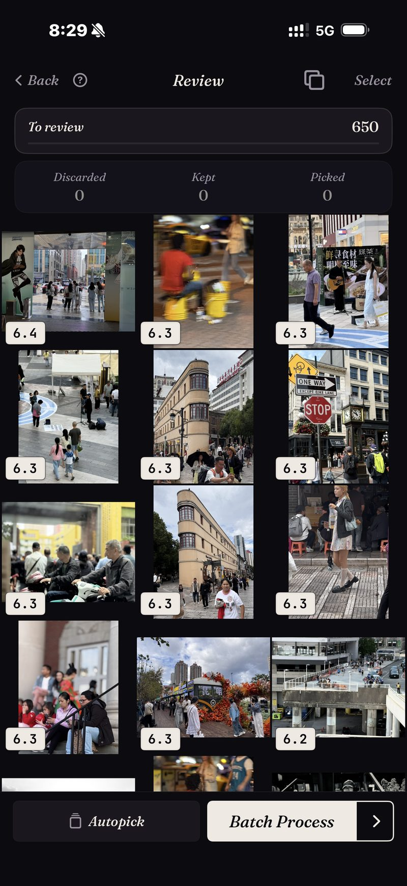

<section class="page-hero">
  

    
<a href="/de/">SpectraSort</a>›KI-Fotoauswahl für iPhone

    <h1>Die KI-Fotoauswahl für iPhone.</h1>
    
Die Suche findet jedes Strandfoto, das du je gemacht hast. Sie sagt dir nicht, welche drei es wert sind, behalten zu werden. Genau dafür ist SpectraSort da: Es bewertet deine Fotos nach Qualität, lernt deinen Geschmack aus denen, die du behältst, und stellt die Gewinner nach oben.

    

      <a class="cta" href="https://apps.apple.com/us/app/spectrasort-ai-photo-picker/id6757512134?ppid=5fd01708-3a73-4412-9bea-b411522af1f3">
        <svg viewBox="0 0 24 24" aria-hidden="true"><path d="M17.05 12.04c-.02-2.16 1.77-3.2 1.85-3.25-1.01-1.48-2.59-1.68-3.14-1.7-1.33-.13-2.61.78-3.29.78-.69 0-1.73-.76-2.85-.74-1.46.02-2.83.85-3.59 2.17-1.54 2.66-.39 6.59 1.1 8.75.73 1.06 1.6 2.24 2.73 2.2 1.1-.04 1.51-.71 2.84-.71 1.32 0 1.7.71 2.85.69 1.18-.02 1.92-1.07 2.64-2.13.84-1.22 1.18-2.42 1.2-2.48-.03-.01-2.3-.88-2.34-3.58zM14.95 5.6c.61-.74 1.02-1.77.9-2.8-.88.04-1.94.58-2.57 1.31-.56.65-1.06 1.7-.93 2.71.98.07 1.99-.5 2.6-1.22z"/></svg>
        Im App Store laden
      </a>
      Kostenlos · iPhone · iOS 18.5 oder neuer · Aktualisiert am 31. Oktober 2026
    

    

      <b>100 % auf dem Gerät</b> — nichts wird hochgeladen
      <b>Kostenlos</b> 5 Aktionen pro Woche
      <b>Einmal zahlen</b> — unbegrenzte Aktionen
    

  

</section>

<section class="slab">
  

    <h2>Was eine Fotoauswahl ist</h2>
    
Der Begriff wird locker verwendet. Es hilft, drei Arten von App zu unterscheiden:

    <ul>
      <li><b>Fotosuche</b> findet Treffer. Frag nach „Strand“ und du bekommst alle 87 Strandfotos, die du je gemacht hast — in einem langen Raster, nach Datum.</li>
      <li><b>Foto-Reiniger</b> suchen Müll: Duplikate, Screenshots, verwackelte Aufnahmen. Nützlich, aber sie sagen dir nur, was schlecht ist.</li>
      <li><b>Eine Fotoauswahl</b> trifft die Entscheidung. Sie bewertet jedes Foto nach Schärfe, Belichtung, Bildaufbau und danach, wie gut es zu deiner Anfrage passt, und gibt dir die Auswahl <em>sortiert zurück, das beste zuerst</em> — mit einer Möglichkeit, direkt zu handeln.</li>
    </ul>
    
Die meisten haben keine Mühe, ihre Fotos zu finden. Sie haben Mühe, sich zwischen ihnen zu entscheiden. Für diese Entscheidung ist SpectraSort gebaut.

  

</section>

<section id="ranked-not-just-matched" class="slab rise">
  

    

      

        Sortiert, nicht nur gefunden
        <h2>Jedes Ergebnis kommt sortiert zurück, das beste zuerst.</h2>
        
Es gibt sechs Werkzeuge, jedes mit einem Tippen: <b>Dein Geschmack</b>, <b>Beste Aufnahmen</b>, <b>Motiv finden</b>, <b>Wie dieses Foto</b>, <b>Duplikate</b> und <b>Fotos von einem Ort</b>.

        
Egal welches du nimmst — die Ergebnisse kommen bewertet und geordnet zurück. Der Screenshot hier ist eine echte Sortierung: ein Straßen-Ausschnitt mit 650 Fotos, jede Aufnahme bewertet, das beste zuerst.

        
Sortierungen kommen fast sofort zurück, weil sie gegen einen Index auf dem Gerät laufen. Er wird einmal aufgebaut — bis zu 100 Fotos pro Sekunde auf aktuellen iPhones — und danach automatisch aktuell gehalten, wenn neue Fotos dazukommen.

      

      

        

          

        

      

    

  

</section>

<section id="your-taste" class="slab">
  

    

      

        Was keine andere App macht
        <h2>Sie lernt, welche Fotos du behalten würdest.</h2>
        
Die meisten Foto-KIs bewerten nach einer allgemeinen Idee von einem guten Foto: scharf, gut belichtet, mittig. Deine Favoriten passen nicht immer in diese Form. Vielleicht magst du das Gegenlichtfoto, den Hund mitten im Schütteln oder eine leicht unscharfe Aufnahme, die du trotzdem drucken würdest.

        
SpectraSort beobachtet deshalb während der Überprüfung, was du behältst und was du gehen lässt, und baut daraus ein <b>Geschmacksprofil</b>. Nach genug Überprüfungen sieht eine Sortierung mit Dein Geschmack aus wie ein Album, das du von Hand ausgewählt hast. Du kannst das Lernen pausieren, zurücksetzen oder mehrere Profile führen — und alles bleibt auf deinem Telefon.

      

      

        

          

        

      

    

  

</section>

<section id="how-a-sort-works" class="slab rise">
  

    
So funktioniert eine Sortierung

    

      

Finden

Wähle ein Werkzeug: einen Begriff, ein Beispielfoto, einen Ort oder deinen Geschmack.

      

Bewerten

Alles wird auf dem Gerät bewertet — Schärfe, Belichtung, Bildaufbau, Ähnlichkeit.

      

Abschließen

Die Gewinner nach rechts wischen, dann den Rest auf einem Bildschirm sichern, teilen oder löschen.

    

  

</section>

<section class="slab">
  

    <h2>Nichts verlässt das Telefon</h2>
    
Die gesamte Bewertung läuft auf der Neural Engine deines iPhone. Deine Fotos werden nirgendwohin hochgeladen, es gibt kein Konto, und die Modelle kommen vortrainiert mit — nichts über deine Mediathek erreicht je jemand anderen. <a href="/de/private-ai-photo-app/">Mehr dazu, wie das auf dem Gerät funktioniert →</a>

    

      
Wo sie nicht hilft

      <ul>
        <li>Nur iPhone, iOS 18.5 oder neuer. Keine Version für iPad, Android oder Desktop.</li>
        <li>Der allererste Index einer großen Mediathek dauert etwas. Danach läuft es automatisch — neue Fotos werden indexiert, sobald sie erscheinen, du wartest kein zweites Mal.</li>
        <li>Das Geschmacksprofil ist nur so gut wie die Überprüfungen, die du ihm gegeben hast. Es fängt allgemein an.</li>
        <li>Gelöschte Fotos landen im Papierkorb von iOS: in „Zuletzt gelöscht“. Der Speicher kommt zurück, sobald du diesen Ordner dort leerst — oder automatisch nach 30 Tagen. Jedes Löschen in SpectraSort zeigt vorher den Speicher, der frei wird.</li>
      </ul>
    

  

</section>

<section id="pricing" class="slab rise">
  

    

      Preise
      <h2>Fünf kostenlose Aktionen pro Woche. Einmal zahlen, dann unbegrenzt.</h2>
      
Fünf kostenlose Aktionen pro Woche, dauerhaft — kein Konto, keine Kreditkarte. Einmal zahlen für unbegrenzte Aktionen. Kein Abo. Nie.

      <a class="cta" href="https://apps.apple.com/us/app/spectrasort-ai-photo-picker/id6757512134?ppid=5fd01708-3a73-4412-9bea-b411522af1f3">
        <svg viewBox="0 0 24 24" aria-hidden="true"><path d="M17.05 12.04c-.02-2.16 1.77-3.2 1.85-3.25-1.01-1.48-2.59-1.68-3.14-1.7-1.33-.13-2.61.78-3.29.78-.69 0-1.73-.76-2.85-.74-1.46.02-2.83.85-3.59 2.17-1.54 2.66-.39 6.59 1.1 8.75.73 1.06 1.6 2.24 2.73 2.2 1.1-.04 1.51-.71 2.84-.71 1.32 0 1.7.71 2.85.69 1.18-.02 1.92-1.07 2.64-2.13.84-1.22 1.18-2.42 1.2-2.48-.03-.01-2.3-.88-2.34-3.58zM14.95 5.6c.61-.74 1.02-1.77.9-2.8-.88.04-1.94.58-2.57 1.31-.56.65-1.06 1.7-.93 2.71.98.07 1.99-.5 2.6-1.22z"/></svg>
        Im App Store laden
      </a>
    

  

</section>

<section id="faq" class="slab">
  

    

      FAQ
      <h2>Fragen zur KI-Fotoauswahl.</h2>
    

    

      

Was ist eine KI-Fotoauswahl?

Eine App, die entscheidet, welche deiner Fotos es wert sind, behalten zu werden — nicht nur, welche zu einer Suche passen. Sie bewertet jedes Foto nach Schärfe, Belichtung, Bildaufbau oder Ähnlichkeit zu den Fotos, die du meistens behältst, und gibt sie sortiert zurück, das beste zuerst — mit einem Ablauf, um den Rest zu behalten, zu teilen oder zu löschen.

      

Wie unterscheidet sich das von einer Fotosuche?

Die Suche sagt dir, welche Fotos passen — eine Strand-Anfrage liefert alle 87 Strandfotos. Eine Fotoauswahl sortiert diese 87 und stellt die besten nach oben. SpectraSort macht beides; jede Suche kommt sortiert zurück. Den ganzen Unterschied zeigt <a href="/de/ai-photo-picker-vs-photo-culling/">Fotoauswahl vs. Aussortieren</a>.

      

Lädt SpectraSort meine Fotos hoch, um sie auszuwählen?

Nein. Suche, Bewertung und Geschmacksprofil laufen alle auf der Neural Engine deines iPhone. Keine Uploads, kein Konto, kein SpectraSort-Server im Weg.

      

Löscht sie Fotos von allein?

Nein. Nichts wird angewendet, bis du tippst, und Löschungen laufen immer über den Bestätigungsdialog der Fotos-App in den Ordner „Zuletzt gelöscht“ von iOS — 30 Tage wiederherstellbar, oder sofort weg, wenn du ihn leerst.

      

Was kostet sie?

Fünf Aktionen pro Woche sind dauerhaft kostenlos — keine Testversion. Einmal zahlen für unbegrenzte Aktionen plus die vollen Regler von Studio. Kein Abo.

    

  

</section>

<section class="slab">
  

    

      Weiterlesen
      

        <a href="/de/photo-culling-iphone/">Fotos aussortieren auf dem iPhoneDer Workflow der Fotografen, auf dem Telefon</a>
        <a href="/de/best-photo-picker/">Eine Fotoauswahl-App wählenWas diese Apps unterscheidet</a>
        <a href="/de/how-to-pick-best-photos-from-camera-roll/">Die besten Fotos aus der Mediathek wählenSchritt für Schritt, mit oder ohne App</a>
      

    

  

</section>
