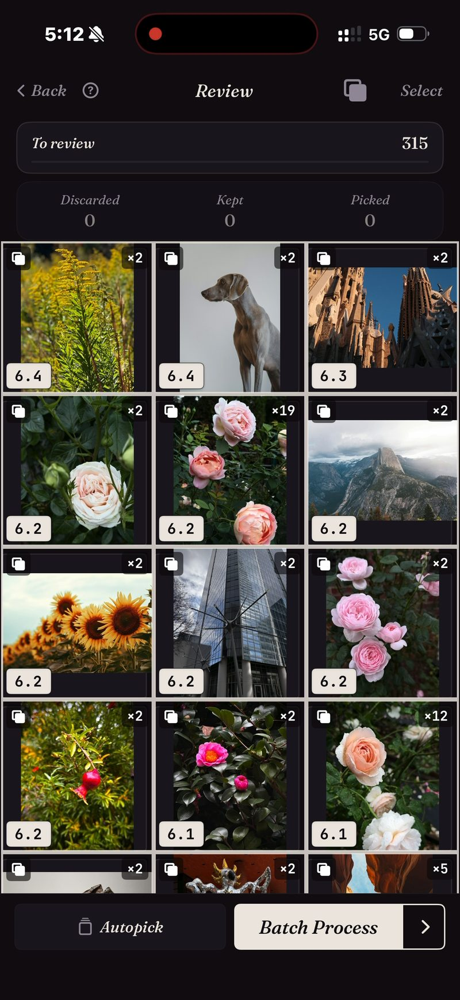

<section class="page-hero">
  

    
<a href="/de/">SpectraSort</a>&#8250;Duplikatfinder

    <h1>Duplikate, gestapelt und erledigt.</h1>
    
Eine Rose, 19 Mal fotografiert. Dieselbe Skyline, neun Reisen lang. Jede Serie, die du nie aussortiert hast. SpectraSort stapelt alle drei, markiert das schärfste und räumt den Rest in einer Stapelaktion weg.

    

      <a class="cta" href="https://apps.apple.com/us/app/spectrasort-ai-photo-picker/id6757512134?ppid=5fd01708-3a73-4412-9bea-b411522af1f3"><svg viewBox="0 0 24 24" aria-hidden="true"><path d="M17.05 12.04c-.02-2.16 1.77-3.2 1.85-3.25-1.01-1.48-2.59-1.68-3.14-1.7-1.33-.13-2.61.78-3.29.78-.69 0-1.73-.76-2.85-.74-1.46.02-2.83.85-3.59 2.17-1.54 2.66-.39 6.59 1.1 8.75.73 1.06 1.6 2.24 2.73 2.2 1.1-.04 1.51-.71 2.84-.71 1.32 0 1.7.71 2.85.69 1.18-.02 1.92-1.07 2.64-2.13.84-1.22 1.18-2.42 1.2-2.48-.03-.01-2.3-.88-2.34-3.58zM14.95 5.6c.61-.74 1.02-1.77.9-2.8-.88.04-1.94.58-2.57 1.31-.56.65-1.06 1.7-.93 2.71.98.07 1.99-.5 2.6-1.22z"/></svg>
        Im App Store laden
      </a>
      Kostenlos &middot; iPhone &middot; iOS 18.5 oder neuer &middot; Aktualisiert am 31. Oktober 2026
    

    

      <b>100 % auf dem Gerät</b> — nichts wird hochgeladen
      <b>Kostenlos</b> 5 Aktionen pro Woche
      <b>Einmal zahlen</b> — unbegrenzte Aktionen
    

  

</section>

<section class="slab">
  

    <h2>iOS findet eine Art von Duplikat. Es gibt drei.</h2>
    
<b>Duplikate</b> — exakte Kopien derselben Datei. <b>Serien</b> — Aufnahmen im Sekundenabstand, keine davon byte-identisch. <b>Ähnliche</b> — dieselbe Szene, Monate später erneut aufgenommen.

    
Apple Fotos führt die erste Art zusammen. Die anderen beiden sind der größte Teil des Durcheinanders. SpectraSort vergleicht, was auf dem Bild ist — deshalb landen alle drei in Stapeln.

  

</section>

<section id="stacked-before-you-look" class="slab rise">
  

    

      

        Gestapelt, bevor du hinsiehst
        <h2>315 Fotos → die Stapel, die zählen.</h2>
        
Lass Duplikate über eine Reise, einen Monat oder die ganze Mediathek laufen, und das Raster kommt gruppiert zurück. Jeder Stapel zeigt, wie viele Aufnahmen er enthält, und die Punktzahl seiner besten. Einzelbilder bleiben außen vor.

      

      

        

          

          
Ein echter Durchlauf: 315 Fotos, die meisten Stapel sind Paare, einige ein Dutzend tief, eine Rose ×19.

        

      

    

  

</section>

<section id="one-stack-one-decision" class="slab">
  

    

      

        Ein Stapel, eine Entscheidung
        <h2>19 Aufnahmen → eine bleibt.</h2>
        
In einem Stapel liegen die Aufnahmen auf einem Rad. Roll durch sie, ohne das Foto zu verlassen, behalte die, die du willst — und der Stapel ist erledigt.

        
Oder lass Auto-Auswahl das machen: Die Kopien landen in Verworfen, und die beste jedes Stapels bleibt für deine Entscheidung. Dann räumt eine Stapelaktion die verworfenen Fotos weg — hinter dem Bestätigungsdialog des Systems, in „Zuletzt gelöscht“.

      

      

        

          

        

      

    

  

</section>

<section id="how-it-works" class="slab rise">
  

    
So funktioniert es

    

      

Scannen

Für Duplikate liest die App den Index auf dem Gerät — einmal aufgebaut, dann aktuell gehalten, wenn neue Fotos kommen. Bis zu 100 Fotos pro Sekunde beim ersten Durchlauf.

      

Behalten

Das schärfste Foto in jedem Stapel wird markiert. Bestätige es, oder dreh das Rad und wähle ein anderes.

      

Aufräumen

Eine Stapelaktion. Löschungen laufen über den Systemdialog in „Zuletzt gelöscht“.

    

    

      
Mit dem Aufräumen von Duplikaten geht der größte Teil des Speichers einer Mediathek weg. Gelöschte Fotos landen im Ordner „Zuletzt gelöscht“ von iOS; leerst du ihn dort, ist der Platz sofort zurück — oder du lässt ihn und iOS gibt ihn nach 30 Tagen frei. Jedes Löschen in SpectraSort zeigt vor der Bestätigung, wie viel Speicher es freigibt.

    

  

</section>

<section class="slab">
  

    <h2>Das Kleingedruckte</h2>
    
Der Vergleich läuft auf der Neural Engine des iPhone. Nichts wird hochgeladen, und es gibt kein Konto. <a href="/de/private-ai-photo-app/">Mehr dazu, wie das funktioniert →</a>

    

      
Wo es nicht hilft

      <ul>
        <li>Es schaut nur in deine Fotomediathek — nicht in Dateien, Downloads oder anderes auf dem Telefon.</li>
        <li>Nur iPhone, iOS 18.5 oder neuer. Keine Version für iPad, Android oder Desktop.</li>
        <li>Der allererste Index einer großen Mediathek dauert etwas. Danach läuft es automatisch — neue Fotos werden indexiert, sobald sie erscheinen, du wartest kein zweites Mal.</li>
        <li>Gelöschte Fotos landen im Papierkorb von iOS: in „Zuletzt gelöscht“. Der Speicher kommt zurück, sobald du diesen Ordner dort leerst — oder automatisch nach 30 Tagen.</li>
      </ul>
    

  

</section>

<section id="pricing" class="slab rise">
  

    

      Preise
      <h2>Fünf kostenlose Aktionen pro Woche. Einmal zahlen, dann unbegrenzt.</h2>
      
Fünf kostenlose Aktionen pro Woche, ohne Konto und ohne Kreditkarte. Einmal zahlen für unbegrenzte Aktionen. Kein Abo, nie. Gebaut von einem unabhängigen Entwickler, der sie täglich benutzt.

      <a class="cta" href="https://apps.apple.com/us/app/spectrasort-ai-photo-picker/id6757512134?ppid=5fd01708-3a73-4412-9bea-b411522af1f3"><svg viewBox="0 0 24 24" aria-hidden="true"><path d="M17.05 12.04c-.02-2.16 1.77-3.2 1.85-3.25-1.01-1.48-2.59-1.68-3.14-1.7-1.33-.13-2.61.78-3.29.78-.69 0-1.73-.76-2.85-.74-1.46.02-2.83.85-3.59 2.17-1.54 2.66-.39 6.59 1.1 8.75.73 1.06 1.6 2.24 2.73 2.2 1.1-.04 1.51-.71 2.84-.71 1.32 0 1.7.71 2.85.69 1.18-.02 1.92-1.07 2.64-2.13.84-1.22 1.18-2.42 1.2-2.48-.03-.01-2.3-.88-2.34-3.58zM14.95 5.6c.61-.74 1.02-1.77.9-2.8-.88.04-1.94.58-2.57 1.31-.56.65-1.06 1.7-.93 2.71.98.07 1.99-.5 2.6-1.22z"/></svg>
        Im App Store laden
      </a>
    

  

</section>

<section id="faq" class="slab">
  

    

      FAQ
      <h2>Fragen zu Duplikaten.</h2>
    

    

      

Wie unterscheidet sich das vom eingebauten Duplikatfinder von Apple?

Der Duplikate-Ordner von Apple Fotos führt exakte und fast exakte Kopien derselben Aufnahme zusammen. SpectraSort stapelt auch Serien, Wiederholungen und Ähnliche — verschiedene Dateien desselben Moments — und markiert das schärfste Foto in jedem Stapel. Das ist der größte Teil des Durcheinanders.

      

Kann es Fotos ohne Nachfrage löschen?

Nein. Nichts ändert sich, bis du tippst, und jede Löschung läuft über den Bestätigungsdialog der Fotos-App in „Zuletzt gelöscht“, wo das Foto 30 Tage bleibt.

      

Gibt das Löschen von Duplikaten sofort Speicher frei?

Gelöschte Fotos landen im Ordner „Zuletzt gelöscht“ von iOS. Leere diesen Ordner, und der Platz ist sofort zurück; lässt du ihn, räumt iOS nach 30 Tagen auf. SpectraSort zeigt vor der Bestätigung, wie viel Speicher jedes Löschen freigibt.

      

Kann ich wählen, was als Duplikat gilt?

Ja. Drei Stapel-Schalter in Überprüfen: Duplikate (exakte Kopien), Serien (Aufnahmen im Sekundenabstand) und Ähnliche (dieselbe Szene). Schaltest du einen aus, erscheinen diese Fotos als Einzelbilder.

      

Kann es ähnliche Fotos finden, nicht nur Duplikate?

Dieselbe Engine. Wie dieses Foto sortiert die ganze Mediathek nach Ähnlichkeit zu einem Bild, das du wählst; der Schalter Ähnliche gruppiert ähnliche Aufnahmen in Stapeln innerhalb jeder Sortierung. <a href="/de/find-best-photos-iphone/">Drei Wege zu deinen besten Fotos →</a>

      

Ist der Duplikatfinder kostenlos?

Duplikate kannst du kostenlos laufen lassen, so oft du willst. Die Kopien zu löschen ist eine Aktion, egal wie viele es sind, und fünf Aktionen pro Woche sind kostenlos. Premium (einmal zahlen, kein Abo) macht sie unbegrenzt.

    

  

</section>

<section class="slab">
  

    

      Weiterlesen
      

        <a href="/de/photo-culling-iphone/">Fotos aussortieren auf dem iPhoneDer ganze Behalten-oder-Aufräumen-Ablauf</a>
        <a href="/de/vacation-photos-iphone/">Urlaubsfotos → ein Album1.200 Aufnahmen, eine Sitzung</a>
        <a href="/de/ai-photo-organizer-vs-apple-photos/">vs. Apple FotosWo eingebaute Werkzeuge aufhören</a>
      

    

  

</section>
