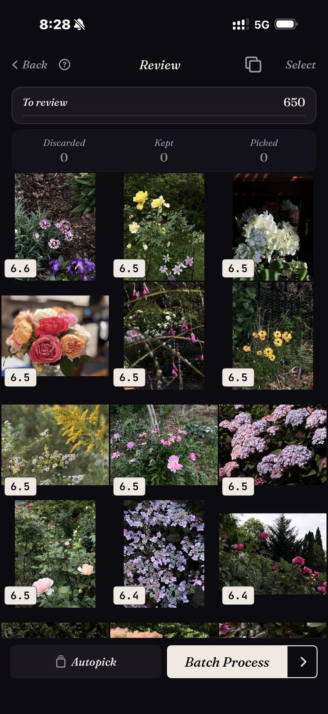

<section class="page-hero">
  

    
<a href="/de/">SpectraSort</a>&#8250;Deine besten Fotos finden

    <h1>Finde deine besten Fotos auf dem iPhone.</h1>
    
Irgendwo in deiner Mediathek sind die Fotos, die du wirklich rahmen würdest. Sie liegen unter allem begraben, was du an dem Tag sonst noch aufgenommen hast. SpectraSort gibt dir drei Wege, sie herauszuholen: beschreiben, auf eines zeigen, oder ein gelerntes Geschmacksprofil sie von selbst hochholen lassen.

    

      <a class="cta" href="https://apps.apple.com/us/app/spectrasort-ai-photo-picker/id6757512134?ppid=5fd01708-3a73-4412-9bea-b411522af1f3"><svg viewBox="0 0 24 24" aria-hidden="true"><path d="M17.05 12.04c-.02-2.16 1.77-3.2 1.85-3.25-1.01-1.48-2.59-1.68-3.14-1.7-1.33-.13-2.61.78-3.29.78-.69 0-1.73-.76-2.85-.74-1.46.02-2.83.85-3.59 2.17-1.54 2.66-.39 6.59 1.1 8.75.73 1.06 1.6 2.24 2.73 2.2 1.1-.04 1.51-.71 2.84-.71 1.32 0 1.7.71 2.85.69 1.18-.02 1.92-1.07 2.64-2.13.84-1.22 1.18-2.42 1.2-2.48-.03-.01-2.3-.88-2.34-3.58zM14.95 5.6c.61-.74 1.02-1.77.9-2.8-.88.04-1.94.58-2.57 1.31-.56.65-1.06 1.7-.93 2.71.98.07 1.99-.5 2.6-1.22z"/></svg>
        Im App Store laden
      </a>
      Kostenlos &middot; iPhone &middot; iOS 18.5 oder neuer &middot; Aktualisiert am 31. Oktober 2026
    

    

      <b>100 % auf dem Gerät</b> — nichts wird hochgeladen
      <b>Kostenlos</b> 5 Aktionen pro Woche
      <b>Einmal zahlen</b> — unbegrenzte Aktionen
    

  

</section>

<section id="way-1" class="slab">
  

    

      

        Weg 1 — beschreiben
        <h2>Tippe ein, woran du dich erinnerst. Zurück kommt es, das beste zuerst.</h2>
        
Tippe eine Vorlage an wie „Porträt“ oder „Nacht“, oder gib ein Wort ein — die Texteingabe funktioniert vorerst auf Englisch. <b>Motiv finden</b> nimmt alles, was du in Worte fassen kannst — konkret, zusammengesetzt oder abstrakt. Apple Intelligence ist dafür nicht nötig.

        
Anders als bei der eingebauten Suche ist die Reihenfolge. Jeder Treffer wird bewertet, deshalb steht die beste Aufnahme des gesuchten Motivs oben statt irgendwo in der neunten Reihe. Das Raster hier ist ein echtes Ergebnis: eine Blumensuche über die Mediathek, bewertet und geordnet.

      

      

        

          

        

      

    

  

</section>

<section id="way-2" class="slab rise">
  

    

      

        Weg 2 — auf eines zeigen
        <h2>Ein gutes Foto findet die übrigen.</h2>
        
Manchmal ist die Anfrage ein Foto, kein Satz. Du hast eine gute Aufnahme vom Haus am See und weißt, dass es mehr gibt. <b>Wie dieses Foto</b> nimmt dieses eine Beispiel und sortiert die ganze Mediathek danach. Der Screenshot zeigt eine echte Sortierung: 1.708 Fotos gegen eine einzige Referenz sortiert.

        
Es ist die schnellste Antwort auf „Ich weiß, dass es dieses Foto gibt, aber ich finde es nicht“ — auch bei Fotos, die drei Jahre zurückliegen.

      

      

        

          

        

      

    

  

</section>

<section id="way-3" class="slab">
  

    

      

        Weg 3 — ganz ohne Anfrage
        <h2>Oder frag einfach nach den besten.</h2>
        
<b>Beste Aufnahmen</b> holt die schärfsten, am besten belichteten und am besten aufgebauten Fotos aus jedem Ausschnitt der Mediathek hervor — und du kannst sie technisch oder künstlerisch neigen.

        
<b>Dein Geschmack</b> geht einen Schritt weiter: Dahinter steckt ein Profil, gelernt aus deinen eigenen Behalten- und Verwerfen-Entscheidungen. Nach oben steigt also, was <em>du</em> ausgewählt hättest, nicht was einem allgemeinen Modell gefällt. Keine andere App macht das.

      

      

        

          

        

      

    

  

</section>

<section id="how-it-works" class="slab rise">
  

    
So funktioniert es

    

      

Finden

Ein Begriff, ein Beispielfoto, ein Ort oder dein Geschmack — sechs Werkzeuge, jedes mit einem Tippen.

      

Bewerten

Auf dem Gerät bewertet nach Schärfe, Belichtung, Bildaufbau und Ähnlichkeit.

      

Abschließen

Favoriten markiert, Album gefüllt oder geteilt — auf einem Sammel-Bildschirm.

    

  

</section>

<section class="slab">
  

    <h2>Alles auf deinem Telefon</h2>
    
Index, Suche und Bewertungen werden alle auf der Neural Engine des iPhone berechnet. Deine Fotos werden also nie hochgeladen, und es gibt kein Konto anzulegen. Eine Suche über Tausende Fotos dauert einen Augenblick, weil sie auf einem Index läuft, den die App einmal aufbaut — bis zu 100 Fotos pro Sekunde auf aktuellen iPhones — und aktuell hält, wenn neue Fotos dazukommen.

    

      
Wo es nicht hilft

      <ul>
        <li>Es kann nur das Beste von dem finden, was du aufgenommen hast. Einen Moment, den du nicht eingefangen hast, kann es nicht retten.</li>
        <li>Nur iPhone, iOS 18.5 oder neuer. Keine Version für iPad, Android oder Desktop.</li>
        <li>Der allererste Index einer großen Mediathek dauert etwas. Danach läuft es automatisch — neue Fotos werden indexiert, sobald sie erscheinen, du wartest kein zweites Mal.</li>
        <li>Gelöschte Fotos landen im Papierkorb von iOS: in „Zuletzt gelöscht“. Der Speicher kommt zurück, sobald du diesen Ordner dort leerst — oder automatisch nach 30 Tagen. Jedes Löschen in SpectraSort zeigt vorher den Speicher, der frei wird.</li>
      </ul>
    

  

</section>

<section id="pricing" class="slab rise">
  

    

      Preise
      <h2>Fünf kostenlose Aktionen pro Woche. Einmal zahlen, dann unbegrenzt.</h2>
      
Fünf kostenlose Aktionen pro Woche, ohne Konto und ohne Kreditkarte. Einmal zahlen für unbegrenzte Aktionen. Kein Abo, nie. Gebaut von einem unabhängigen Entwickler, der sie täglich benutzt.

      <a class="cta" href="https://apps.apple.com/us/app/spectrasort-ai-photo-picker/id6757512134?ppid=5fd01708-3a73-4412-9bea-b411522af1f3"><svg viewBox="0 0 24 24" aria-hidden="true"><path d="M17.05 12.04c-.02-2.16 1.77-3.2 1.85-3.25-1.01-1.48-2.59-1.68-3.14-1.7-1.33-.13-2.61.78-3.29.78-.69 0-1.73-.76-2.85-.74-1.46.02-2.83.85-3.59 2.17-1.54 2.66-.39 6.59 1.1 8.75.73 1.06 1.6 2.24 2.73 2.2 1.1-.04 1.51-.71 2.84-.71 1.32 0 1.7.71 2.85.69 1.18-.02 1.92-1.07 2.64-2.13.84-1.22 1.18-2.42 1.2-2.48-.03-.01-2.3-.88-2.34-3.58zM14.95 5.6c.61-.74 1.02-1.77.9-2.8-.88.04-1.94.58-2.57 1.31-.56.65-1.06 1.7-.93 2.71.98.07 1.99-.5 2.6-1.22z"/></svg>
        Im App Store laden
      </a>
    

  

</section>

<section id="faq" class="slab">
  

    

      FAQ
      <h2>Deine besten finden.</h2>
    

    

      

Wie finde ich meine besten Fotos, ohne alles durchzuscrollen?

Gib SpectraSort einen Ausgangspunkt: einen Begriff, ein Beispielfoto, einen Ort oder einfach Beste Aufnahmen über einen Zeitraum. Überprüfe dann das sortierte Ergebnis statt die rohe Mediathek. Die wahrscheinlichen Gewinner stehen oben, bevor du anfängst.

      

Kann es Fotos von vor Jahren finden?

Ja. Der Index deckt deine ganze Mediathek ab, und die Zeitleiste in Entdecken geht von Jahr zu Monat zu Tag, wenn du einen Zeitraum lieber durchstöberst als durchsuchst.

      

Braucht es eine Internetverbindung?

Nein. Suche, Bewertung und Geschmacksprofil laufen auf dem Gerät, das Finden von Fotos hängt also nicht von einer Verbindung ab.

      

Was heißt „beste“ eigentlich?

Standardmäßig Schärfe, Belichtung und Bildaufbau, pro Foto bewertet. Mit Dein Geschmack wird es persönlich und nach Ähnlichkeit zu den Fotos sortiert, die du behältst. In Studio kannst du sieben Qualitätsachsen selbst gewichten.

    

  

</section>

<section class="slab">
  

    

      Weiterlesen
      

        <a href="/de/how-to-pick-best-photos-from-camera-roll/">Die besten Fotos aus der Mediathek wählenDie Methode Schritt für Schritt</a>
        <a href="/de/ai-photo-picker-iphone/">KI-Fotoauswahl für iPhoneWas eine Fotoauswahl wirklich macht</a>
        <a href="/de/photo-organizer-iphone/">KI-Foto-OrganizerSzenen, Zeitleiste und Alben</a>
      

    

  

</section>
