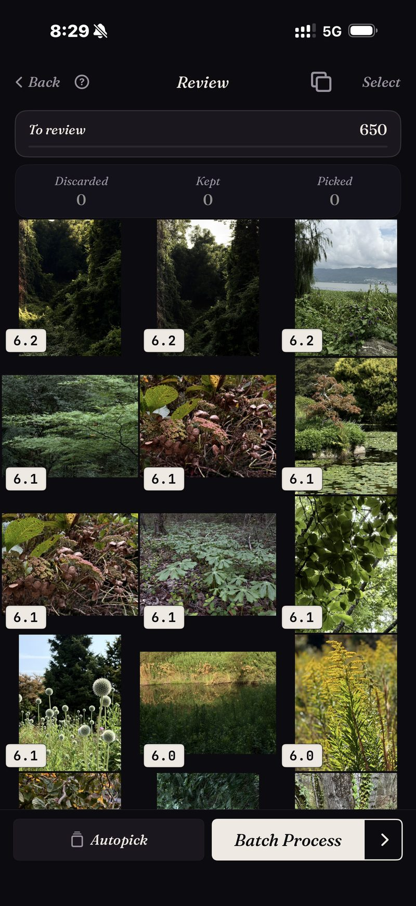

<section class="page-hero">
  

    
<a href="/de/">SpectraSort</a>&#8250;Beste Fotos aus der Mediathek

    <h1>So wählst du die besten Fotos aus deiner Mediathek.</h1>
    
Eine Methode, die von Tausenden Fotos zu den wenigen Hundert führt, die dir wichtig sind. Erst die Version von Hand, dann die unterstützte. Beide funktionieren; eine davon skaliert.

    

      <a class="cta" href="https://apps.apple.com/us/app/spectrasort-ai-photo-picker/id6757512134?ppid=5fd01708-3a73-4412-9bea-b411522af1f3"><svg viewBox="0 0 24 24" aria-hidden="true"><path d="M17.05 12.04c-.02-2.16 1.77-3.2 1.85-3.25-1.01-1.48-2.59-1.68-3.14-1.7-1.33-.13-2.61.78-3.29.78-.69 0-1.73-.76-2.85-.74-1.46.02-2.83.85-3.59 2.17-1.54 2.66-.39 6.59 1.1 8.75.73 1.06 1.6 2.24 2.73 2.2 1.1-.04 1.51-.71 2.84-.71 1.32 0 1.7.71 2.85.69 1.18-.02 1.92-1.07 2.64-2.13.84-1.22 1.18-2.42 1.2-2.48-.03-.01-2.3-.88-2.34-3.58zM14.95 5.6c.61-.74 1.02-1.77.9-2.8-.88.04-1.94.58-2.57 1.31-.56.65-1.06 1.7-.93 2.71.98.07 1.99-.5 2.6-1.22z"/></svg>
        Im App Store laden
      </a>
      Kostenlos &middot; iPhone &middot; iOS 18.5 oder neuer &middot; Aktualisiert am 31. Oktober 2026
    

    

      <b>100 % auf dem Gerät</b> — nichts wird hochgeladen
      <b>Kostenlos</b> 5 Aktionen pro Woche
      <b>Einmal zahlen</b> — unbegrenzte Aktionen
    

  

</section>

<section class="slab">
  

    <h2>Die Methode von Hand (ohne App)</h2>
    <ol>
      <li><b>Arbeite in Ausschnitten, nie in der ganzen Mediathek.</b> Eine Reise, ein Monat, ein Ereignis. Ein fertiger Ausschnitt ist Fortschritt; eine halb durchgescrollte Mediathek nicht.</li>
      <li><b>Zwei Durchgänge.</b> Im ersten die offensichtlichen Fehlschläge schnell wegschneiden: Verwackler, versehentliche Aufnahmen, Ausschuss. Im zweiten zwischen den Ähnlichen entscheiden, die übrig sind.</li>
      <li><b>Fast Gleiche direkt nebeneinander klären.</b> Öffne die Serie, vergleiche, behalte genau eine. Schieb es nicht auf; aufgeschobene Stapel sind der Grund, warum die Mediathek so aussieht.</li>
      <li><b>Markiere die Behaltenen als Favoriten</b> (oder verschiebe sie in ein Album), damit die Entscheidung irgendwo festgehalten ist.</li>
      <li><b>Schließe den Ausschnitt ab</b> — Album gefüllt, Verworfene erledigt —, bevor du den nächsten öffnest.</li>
    </ol>
    
Das funktioniert. Es kostet etwa einen Abend pro tausend Fotos — und das ist der eigentliche Grund, warum die meisten Mediatheken nie fertig werden.

    <h3>Warum es in großem Maßstab scheitert</h3>
    
Drei Probleme summieren sich. Nichts ist sortiert, jedes Foto kostet also eine Entscheidung zum vollen Preis. Fast Gleiche liegen verstreut, Vergleichen heißt suchen. Und die Entscheidungsmüdigkeit kommt lange vor dem Ende des Ausschnitts. Die Methode ist gut; die Rechnung nicht.

  

</section>

<section id="the-assisted-version" class="slab rise">
  

    

      

        Die unterstützte Version
        <h2>Dieselbe Methode, vorsortiert.</h2>
        
SpectraSort macht dieselben fünf Schritte, nur sind die teuren Teile erledigt, bevor du hinsiehst. Wähle einen Ausschnitt — eine Szene, einen Zeitraum oder eine Motivsuche —, und er kommt <b>sortiert</b> zurück, mit den fast Gleichen schon gestapelt.

        
Dann überprüfen: nach rechts zum Behalten, nach unten zum Belassen, nach links zum Verwerfen — oder lass die Auto-Auswahl alles nach Bewertung ablegen und sieh nur kurz drüber. Gestapelte Ähnliche sitzen auf einem Rad, eine Serie ist also eine Entscheidung.

        
Die Stapelaktionen schließen den Ausschnitt auf einem Bildschirm ab: Behaltene in ein Album oder ins Teilen-Menü, der Rest über den Systemdialog gelöscht.

      

      

        

          

        

      

    

  

</section>

<section id="the-method" class="slab rise">
  

    
Dieselbe Methode, komprimiert

    

      

Aufteilen

Szenen und die Zeitleiste schneiden die Mediathek in Stücke, die man abschließen kann.

      

Überprüfen

Sortiert und gestapelt, du entscheidest also über die guten — statt alles durchzuarbeiten.

      

Abschließen

Eine Stapelaktion: Album, Favoriten, Teilen oder Löschen.

    

  

</section>

<section class="slab">
  

    <h2>Details, die es sicher halten</h2>
    
Ein Wisch nach unten behält das Foto nur; ein Foto nicht auszuwählen löscht es nie. Gelöscht wird nur in den Stapelaktionen, über den Bestätigungsdialog des Systems, und es landet im Album Zuletzt gelöscht von iOS — 30 Tage wiederherstellbar, oder weg, sobald du es leerst. Die Sortierung selbst läuft auf der Neural Engine deines iPhone, es wird also <a href="/de/private-ai-photo-app/">nichts hochgeladen</a>.

    

      
Wo es nicht hilft

      <ul>
        <li>Das letzte Wort hast weiterhin du. Die Sortierung beurteilt jede Aufnahme und die Auto-Auswahl kann alle nach Bewertung ablegen; was dann wirklich passiert, wartet auf deinen Tipp.</li>
        <li>Nur iPhone, iOS 18.5 oder neuer. Keine iPad-, Android- oder Desktop-Version.</li>
        <li>Der allererste Index einer großen Mediathek dauert eine Weile. Danach läuft es automatisch — neue Fotos werden indexiert, sobald sie da sind, du wartest nie wieder.</li>
        <li>Gelöschte Fotos gehen durch den Papierkorb von iOS: Sie landen in Zuletzt gelöscht, und der Speicher kommt zurück, sobald du das Album dort leerst — oder automatisch nach 30 Tagen. Jedes Löschen in SpectraSort zeigt vorher, wie viel Speicher frei wird.</li>
      </ul>
    

  

</section>

<section id="pricing" class="slab rise">
  

    

      Preise
      <h2>Fünf kostenlose Aktionen pro Woche. Einmal zahlen, dann unbegrenzt.</h2>
      
Fünf kostenlose Aktionen pro Woche, ohne Konto und ohne Kreditkarte. Einmal zahlen für unbegrenzte Aktionen. Kein Abo, nie. Gebaut von einem unabhängigen Entwickler, der es täglich benutzt.

      <a class="cta" href="https://apps.apple.com/us/app/spectrasort-ai-photo-picker/id6757512134?ppid=5fd01708-3a73-4412-9bea-b411522af1f3"><svg viewBox="0 0 24 24" aria-hidden="true"><path d="M17.05 12.04c-.02-2.16 1.77-3.2 1.85-3.25-1.01-1.48-2.59-1.68-3.14-1.7-1.33-.13-2.61.78-3.29.78-.69 0-1.73-.76-2.85-.74-1.46.02-2.83.85-3.59 2.17-1.54 2.66-.39 6.59 1.1 8.75.73 1.06 1.6 2.24 2.73 2.2 1.1-.04 1.51-.71 2.84-.71 1.32 0 1.7.71 2.85.69 1.18-.02 1.92-1.07 2.64-2.13.84-1.22 1.18-2.42 1.2-2.48-.03-.01-2.3-.88-2.34-3.58zM14.95 5.6c.61-.74 1.02-1.77.9-2.8-.88.04-1.94.58-2.57 1.31-.56.65-1.06 1.7-.93 2.71.98.07 1.99-.5 2.6-1.22z"/></svg>
        Im App Store laden
      </a>
    

  

</section>

<section id="faq" class="slab">
  

    

      FAQ
      <h2>Fragen zur Methode.</h2>
    

    

      

Wie oft sollte ich meine Mediathek durchgehen?

Klein und oft schlägt heroisches Großreinemachen. Ein Ausschnitt pro Woche — vielleicht die Fotos der letzten Woche oder eine alte Reise — hält die Mediathek entschieden. Sortieren ist kostenlos und unbegrenzt, der Rhythmus kostet also nichts.

      

Was mache ich mit den Behaltenen?

Halte die Entscheidung fest: ein Album, Favoriten oder irgendwo teilen. Die Stapelaktionen von SpectraSort erledigen jedes davon in einem Schritt, und seine Alben erscheinen in Apple Fotos. Der <a href="/de/photo-organizer-iphone/">Organizer-Ratgeber</a> geht auf Alben und Szenen genauer ein.

      

Wie vermeide ich, etwas zu löschen, das ich bereuen werde?

Es gibt drei Sicherheitsnetze. Ein Foto nicht auszuwählen löscht es nie. Löschen verlangt den Bestätigungsdialog des Systems. Und gelöschte Fotos bleiben 30 Tage in Zuletzt gelöscht wiederherstellbar.

      

Geht das ohne jede App?

Ja. Die Methode von Hand oben auf dieser Seite braucht nichts außer der Fotos-App und Geduld. Die App-Version gibt es, weil meistens die Geduld fehlt.

    

  

</section>

<section class="slab">
  

    

      Weiterlesen
      

        <a href="/de/find-best-photos-iphone/">Deine besten Fotos findenDrei Wege zu den Behaltenen</a>
        <a href="/de/photo-culling-iphone/">Fotos aussortieren auf dem iPhoneDer ganze Ablauf</a>
        <a href="/de/duplicate-photo-finder-iphone/">DuplikatfinderErst die Wiederholungen klären</a>
      

    

  

</section>
