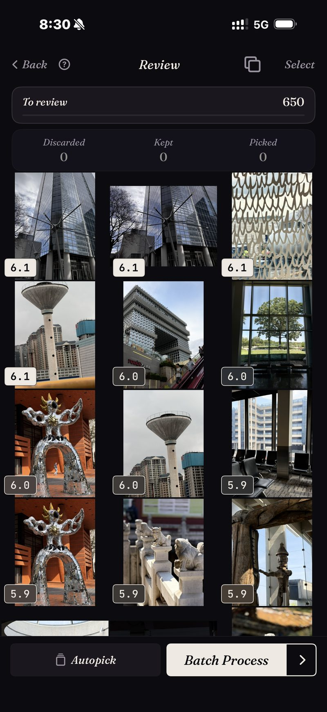

<section class="page-hero">
  

    
<a href="/de/">SpectraSort</a>&#8250;Fotos aussortieren auf dem iPhone

    <h1>Fotos aussortieren, auf deinem iPhone.</h1>
    
Aussortieren heißt: die besten behalten und den Rest gehen lassen. Früher brauchte das einen Rechner, einen Import und einen freien Abend. SpectraSort führt den ganzen Ablauf auf dem Telefon aus, auf dem deine Fotos ohnehin sind — und bewertet jede Aufnahme, bevor du ein einziges Mal wischst.

    

      <a class="cta" href="https://apps.apple.com/us/app/spectrasort-ai-photo-picker/id6757512134?ppid=5fd01708-3a73-4412-9bea-b411522af1f3"><svg viewBox="0 0 24 24" aria-hidden="true"><path d="M17.05 12.04c-.02-2.16 1.77-3.2 1.85-3.25-1.01-1.48-2.59-1.68-3.14-1.7-1.33-.13-2.61.78-3.29.78-.69 0-1.73-.76-2.85-.74-1.46.02-2.83.85-3.59 2.17-1.54 2.66-.39 6.59 1.1 8.75.73 1.06 1.6 2.24 2.73 2.2 1.1-.04 1.51-.71 2.84-.71 1.32 0 1.7.71 2.85.69 1.18-.02 1.92-1.07 2.64-2.13.84-1.22 1.18-2.42 1.2-2.48-.03-.01-2.3-.88-2.34-3.58zM14.95 5.6c.61-.74 1.02-1.77.9-2.8-.88.04-1.94.58-2.57 1.31-.56.65-1.06 1.7-.93 2.71.98.07 1.99-.5 2.6-1.22z"/></svg>
        Im App Store laden
      </a>
      Kostenlos &middot; iPhone &middot; iOS 18.5 oder neuer &middot; Aktualisiert am 31. Oktober 2026
    

    

      <b>100 % auf dem Gerät</b> — nichts wird hochgeladen
      <b>Kostenlos</b> 5 Aktionen pro Woche
      <b>Einmal zahlen</b> — unbegrenzte Aktionen
    

  

</section>

<section class="slab">
  

    <h2>Warum es Aussortieren gibt</h2>
    
Fotografen sortieren aus, weil ein Shooting immer mehr Aufnahmen produziert, als es abgeben soll. Du machst 500 und gibst 40 ab. Eine Mediathek hat dieselbe Rechnung und kein Werkzeug dafür: Eine zwei Wochen lange Reise kommt als 1.200 Fotos nach Hause, und die eingebaute Methode dafür ist Scrollen.

    
Desktop-Werkzeuge haben das für Berufsfotografen gelöst — mit Bewertungen, Vergleichen nebeneinander und Überprüfung im Tastaturtempo. Deine Mediathek lebt woanders. SpectraSort baut diesen Ablauf fürs Telefon nach und fügt etwas hinzu, das die Desktop-Werkzeuge nie hatten: Die Aufnahmen kommen <b>schon sortiert</b> an.

  

</section>

<section id="ranked-before-you-review" class="slab rise">
  

    

      

        Sortiert, bevor du überprüfst
        <h2>Die Überprüfung beginnt oben im Stapel.</h2>
        
Richte eine Sortierung auf eine Reise, eine Szene oder eine Suche, und jede Aufnahme kommt nach Schärfe, Belichtung und Bildaufbau bewertet zurück. Auf Wunsch wiegt sie auch mit, wie sehr jedes Foto denen ähnelt, die du sonst behältst. Die stärksten Aufnahmen stehen oben, bevor du eine einzige Entscheidung getroffen hast.

        
Der Screenshot hier ist ein echter Durchlauf: ein Architektur-Ausschnitt mit 650 Fotos, jede Aufnahme bewertet, die stärkste zuerst — und er kam in einem Augenblick zurück, weil die Mediathek aus früheren Sortierungen schon indexiert war. Die Indexierung passiert einmal und hält sich dann selbst aktuell: Die App nimmt neue Fotos auf, sobald sie erscheinen, mit bis zu 100 Fotos pro Sekunde auf aktuellen iPhones.

        
Wenn du andere Kriterien willst: <b>Studio</b> hat sieben Qualitätsachsen, ein Rad, das Motivtreffer gegen Qualität abwägt, und Profile, die du speichern kannst.

      

      

        

          

        

      

    

  

</section>

<section id="bursts-and-retakes" class="slab">
  

    

      

        Serien und Wiederholungen
        <h2>Neunzehn Aufnahmen eines Moments kosten eine Entscheidung.</h2>
        
Fast identische Aufnahmen machen manuelles Aussortieren langsam, weil jede zusätzliche Aufnahme ein weiterer Vergleich ist. SpectraSort gruppiert Duplikate, Serien und Ähnliche in Stapel, bevor die Überprüfung beginnt.

        
Ein Stapel sitzt auf einem einzigen Rad. Du rollst durch die Aufnahmen, ohne das Foto zu verlassen, behältst die, die du willst, und der Stapel ist erledigt. Der Screenshot stammt aus einem echten Duplikate-Durchlauf: dieselbe Rose, 19 Aufnahmen, ein Rad.

        
Dann die Wischgesten: nach rechts zum Behalten, nach unten zum Belassen, nach links zum Verwerfen. Oder lass Auto-Auswahl den ganzen Ausschnitt mit einem Tippen nach Punktzahl einsortieren und überflieg nur das Ergebnis.

      

      

        

          

        

      

    

  

</section>

<section id="the-culling-loop" class="slab rise">
  

    
Der Aussortier-Ablauf

    

      

Eingrenzen

Fang nicht mit der ganzen Mediathek an. Szenen sammelt Reisen und Themen von selbst, und die Zeitleiste geht von Jahr zu Monat zu Tag.

      

Wischen

Sortierte Ergebnisse, gestapelte Ähnliche, drei Gesten. Auto-Auswahl, wenn du lieber überfliegst als wischst.

      

Abschließen

Stapelaktionen legen deine Auswahl in ein Album oder ins Teilen-Menü und löschen den Rest — hinter dem Bestätigungsdialog des Systems.

    

  

</section>

<section class="slab">
  

    <h2>Das Kleingedruckte</h2>
    
Indexierung, Bewertung und das Geschmacksprofil laufen alle auf der Neural Engine des iPhone. Nichts wird hochgeladen, und es gibt kein Konto. <a href="/de/private-ai-photo-app/">Mehr dazu, wie das funktioniert →</a>

    

      
Wo es nicht hilft

      <ul>
        <li>Deine Aufmerksamkeit bleibt der langsame Teil. Die Sortierung übernimmt das Urteilen — die Gewinner oben, und Auto-Auswahl kann die ganze Warteschlange mit einem Tippen nach Punktzahl einsortieren —, aber das Überfliegen des Ergebnisses bleibt bei dir, und nichts berührt deine Mediathek, bis du handelst.</li>
        <li>Nur iPhone, iOS 18.5 oder neuer. Keine Version für iPad, Android oder Desktop.</li>
        <li>Der allererste Index einer großen Mediathek dauert etwas. Danach läuft es automatisch — neue Fotos werden indexiert, sobald sie erscheinen, du wartest kein zweites Mal.</li>
        <li>Gelöschte Fotos landen im Papierkorb von iOS: in „Zuletzt gelöscht“. Der Speicher kommt zurück, sobald du diesen Ordner dort leerst — oder automatisch nach 30 Tagen. Jedes Löschen in SpectraSort zeigt vorher den Speicher, der frei wird.</li>
      </ul>
    

  

</section>

<section id="pricing" class="slab rise">
  

    

      Preise
      <h2>Fünf kostenlose Aktionen pro Woche. Einmal zahlen, dann unbegrenzt.</h2>
      
Fünf kostenlose Aktionen pro Woche, ohne Konto und ohne Kreditkarte. Einmal zahlen für unbegrenzte Aktionen. Kein Abo, nie. Gebaut von einem unabhängigen Entwickler, der sie täglich benutzt.

      <a class="cta" href="https://apps.apple.com/us/app/spectrasort-ai-photo-picker/id6757512134?ppid=5fd01708-3a73-4412-9bea-b411522af1f3"><svg viewBox="0 0 24 24" aria-hidden="true"><path d="M17.05 12.04c-.02-2.16 1.77-3.2 1.85-3.25-1.01-1.48-2.59-1.68-3.14-1.7-1.33-.13-2.61.78-3.29.78-.69 0-1.73-.76-2.85-.74-1.46.02-2.83.85-3.59 2.17-1.54 2.66-.39 6.59 1.1 8.75.73 1.06 1.6 2.24 2.73 2.2 1.1-.04 1.51-.71 2.84-.71 1.32 0 1.7.71 2.85.69 1.18-.02 1.92-1.07 2.64-2.13.84-1.22 1.18-2.42 1.2-2.48-.03-.01-2.3-.88-2.34-3.58zM14.95 5.6c.61-.74 1.02-1.77.9-2.8-.88.04-1.94.58-2.57 1.31-.56.65-1.06 1.7-.93 2.71.98.07 1.99-.5 2.6-1.22z"/></svg>
        Im App Store laden
      </a>
    

  

</section>

<section id="faq" class="slab">
  

    

      FAQ
      <h2>Fragen zum Aussortieren.</h2>
    

    

      

Wie lange dauert es, Tausende Fotos auszusortieren?

Sortierungen kommen im Nu zurück, weil sie auf einem Index laufen, den die App einmal aufbaut und dann automatisch aktuell hält — neue Fotos werden aufgenommen, sobald sie erscheinen. Selbst der erste Index schafft bis zu 100 Fotos pro Sekunde auf aktuellen iPhones. Der echte Aufwand ist deine eigene Überprüfungszeit, und Sortierung und Stapel sind es, die sie verkürzen: Du steckst deine Aufmerksamkeit in die wahrscheinlichen Favoriten, und jeder Stapel kostet eine Geste.

      

Kann sie automatisch aussortieren?

Ja, weitgehend. Die Sortierung beurteilt ohnehin jede Aufnahme, und Auto-Auswahl verteilt die ganze Warteschlange mit einem Tippen nach diesen Punkten: die besten in Behalten, die mittleren in Belassen, die schwächsten in Verworfen. Du überfliegst das Ergebnis, und nichts wird auf deine Mediathek angewendet, bis du eine Aktion tippst.

      

Ist Aussortieren einfach Fotos löschen?

Nein. Aussortieren ist entscheiden; Löschen ist ein optionaler letzter Schritt. Stapelaktionen können deine Auswahl genauso gut in einem Album oder im Teilen-Menü sichern und alles andere in Ruhe lassen. Mehr zum Unterschied unter <a href="/de/ai-photo-picker-vs-photo-culling/">Fotoauswahl vs. Aussortieren</a>.

      

Gibt das Löschen aussortierter Fotos sofort Speicher frei?

So schnell, wie du willst. Gelöschte Fotos landen im Ordner „Zuletzt gelöscht“ von iOS; leerst du ihn dort, ist der Speicher sofort zurück — oder du lässt ihn und iOS räumt nach 30 Tagen auf. SpectraSort zeigt vor der Bestätigung, wie viel Speicher jedes Löschen freigibt.

      

Was kostet es?

Fünf Aktionen pro Woche sind dauerhaft kostenlos. Premium bedeutet: einmal zahlen für unbegrenzte Aktionen plus die vollen Regler von Studio. Kein Abo.

    

  

</section>

<section class="slab">
  

    

      Weiterlesen
      

        <a href="/de/ai-photo-picker-vs-photo-culling/">Fotoauswahl vs. AussortierenWas du wirklich brauchst</a>
        <a href="/de/duplicate-photo-finder-iphone/">DuplikatfinderSerien und Ähnliche, gestapelt</a>
        <a href="/de/ai-photo-picker-iphone/">KI-Fotoauswahl für iPhoneWas eine Fotoauswahl wirklich macht</a>
      

    

  

</section>
