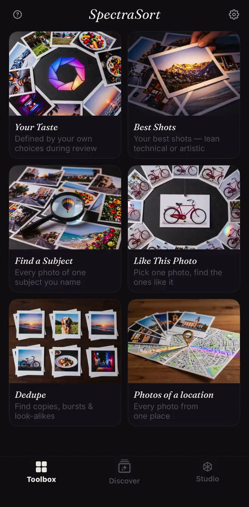
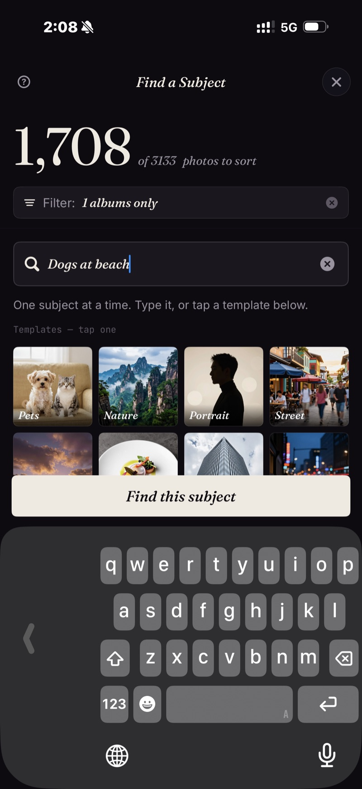
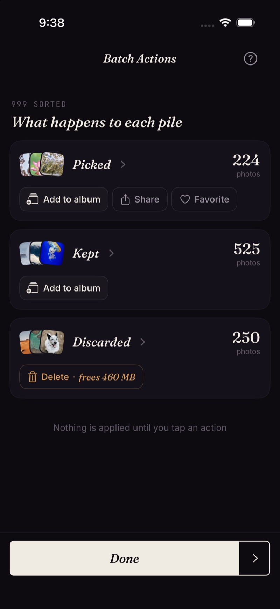

<section class="page-hero">
  

    
<a href="/de/">SpectraSort</a>&#8250;Presse

    <h1>Die Pressemappe.</h1>
    
Alles, was du zum Prüfen von SpectraSort brauchst: die Fakten, die Screenshots und einen Kontakt. Aktualisiert am 31. Oktober 2026, mit Version 3.2.

    

      <a class="cta" href="/press/spectrasort-press-kit.zip">Pressemappe herunterladen</a>
      ZIP &middot; Icon, Screenshots, Faktenblatt
    

  

</section>

<section class="slab">
  

    

      Die Fakten
      <h2>Was SpectraSort ist, in einer Tabelle.</h2>
      
SpectraSort ist eine KI-Fotoauswahl für iPhone, die deine Mediathek nach Qualität und deinem eigenen Geschmack sortiert. Sie sortiert auch aus, entfernt Duplikate und räumt auf. Einmal zahlen, kein Abo.

    

    

      <table class="cmp">
        <tbody>
          <tr><th>Name</th><td>SpectraSort</td></tr>
          <tr><th>Was es ist</th><td>Eine KI-Fotoauswahl für iPhone. Sie sortiert eine Mediathek nach Qualität und nach einem Geschmacksprofil, das aus dem gelernt wird, was man behält und verwirft. Sie sortiert auch aus, entfernt Duplikate und räumt auf.</td></tr>
          <tr><th>Plattform</th><td>iPhone, iOS 18.5 oder neuer. Keine Version für iPad, Mac, Android oder Web.</td></tr>
          <tr><th>Sprachen</th><td>Englisch, Französisch, Deutsch, Italienisch, Spanisch und Portugiesisch (Brasilien). Die Ausgabe für das chinesische Festland ist 光谱挑片.</td></tr>
          <tr><th>Preis</th><td>Kostenloser Download. Fünf Aktionen pro Woche sind dauerhaft kostenlos; einmal zahlen für unbegrenzte Aktionen und Studio. Kein Abo, kein Konto, keine Kreditkarte zum Start.</td></tr>
          <tr><th>Datenschutz</th><td>100 % auf dem Gerät. Suche, Bewertung und Geschmacksprofil laufen auf der Neural Engine des iPhone. Keine Foto-Uploads, kein Konto, kein SpectraSort-Server.</td></tr>
          <tr><th>Tempo</th><td>Bis zu 100 Fotos pro Sekunde auf aktuellen iPhones. Der Index wird bei der ersten Sortierung aufgebaut und danach automatisch aktuell gehalten.</td></tr>
          <tr><th>Werkzeuge</th><td>Sechs Werkzeuge mit je einem Tippen: Dein Geschmack, Beste Aufnahmen, Motiv finden, Wie dieses Foto, Duplikate, Fotos von einem Ort. Studio ergänzt sieben Qualitätsachsen, bis zu drei Motive und gespeicherte Profile. Die Texteingabe in Motiv finden funktioniert vorerst auf Englisch; die Vorlagen funktionieren in jeder Sprache.</td></tr>
          <tr><th>Erste Veröffentlichung</th><td>Januar 2026. Version 3.2 erschien im November 2026.</td></tr>
          <tr><th>Entwickler</th><td>Mike Lu, unabhängiger Entwickler.</td></tr>
          <tr><th>Kontakt</th><td><a href="mailto:spectrasortapp@gmail.com">spectrasortapp@gmail.com</a></td></tr>
        </tbody>
      </table>
    

  

</section>

<section class="slab rise">
  

    

      Neu in 3.2
      <h2>Fünf Sprachen. Weniger Papier.</h2>
      
Version 3.2 bringt Französisch, Deutsch, Italienisch, Spanisch und Portugiesisch (Brasilien) in die gesamte Oberfläche und in die App-Store-Seite. Sie ergänzt außerdem einen Schalter <b>Dokumente &amp; Belege</b> unter Filter → Ausschließen: Screenshots, Formulare und Fotos von Papier werden vor einer Sortierung zurückgehalten, damit die Überprüfung die Fotos zeigt, die man behalten will.

      
Das Teilen wurde in derselben Version repariert: Instagram, WeChat und Xiaohongshu nehmen das Foto jetzt aufrecht an, bei einzelnen und bei mehreren Fotos. <a href="/de/changelog/">Die vollständigen 3.2-Notizen →</a>

    

  

</section>

<section class="slab">
  

    

      Der Entwickler
      <h2>Gemacht von Mike Lu.</h2>
      
Mike Lu ist der unabhängige Entwickler hinter SpectraSort. Er hat die App um eine Frage herumgebaut, die die meisten Foto-Werkzeuge überspringen: nicht „Ist das ein gutes Foto?“, sondern „Würdest du es behalten?“ Die App lernt aus den Behalten- und Verwerfen-Entscheidungen, die man ohnehin trifft, und sortiert die Mediathek genauso.

      
SpectraSort erschien erstmals im Januar 2026. Die App kommt ohne Server, ohne Konto und ohne Abo aus — die App und das Geschäftsmodell sind beide bewusst klein.

    

  

</section>

<section class="slab rise">
  

    

      Screenshots
      <h2>Drei echte Aufnahmen.</h2>
      
Die Dateien in voller Größe liegen in der Pressemappe. Die App läuft auf dem Gerät; die Screenshots stammen aus einer echten Mediathek.

      

        <figure><figcaption>Die Toolbox: sechs Werkzeuge mit je einem Tippen, Dein Geschmack ganz oben.</figcaption></figure>
        <figure><figcaption>Motiv finden: einen Begriff eintippen, Treffer sortiert, das beste zuerst.</figcaption></figure>
        <figure><figcaption>Stapelaktionen: Auswahl ins Album, Favoriten markiert, der Rest gelöscht.</figcaption></figure>
      

      

        <a class="cta" href="/press/spectrasort-press-kit.zip">Pressemappe herunterladen</a>
        ZIP &middot; Icon, 3 Screenshots, Faktenblatt
      

    

  

</section>

<section class="slab">
  

    Themen, die sich lohnen
    <h2>Drei Geschichten in der App.</h2>
    <ul>
      <li><b>Das Anti-Abo-Werkzeug.</b> Ein einmaliger Kauf, kein Abo, kein Konto, kein Server. Eine Foto-App, die keine Cloud braucht.</li>
      <li><b>KI auf dem Gerät, ohne Apple Intelligence.</b> Bewertung, Suche und Geschmacksprofil laufen auf der Neural Engine, offline, unter iOS 18.5 und neuer.</li>
      <li><b>Fünf Sprachen auf einmal.</b> Version 3.2 übersetzt die gesamte Oberfläche und die App-Store-Seite in fünf Sprachen: Französisch, Deutsch, Italienisch, Spanisch und Portugiesisch (Brasilien).</li>
    </ul>
    

      
Was wir nicht behaupten

      <ul>
        <li>Keine Behauptung, besser als Apple Fotos zu sein. Beide sind für unterschiedliche Aufgaben gebaut: Apple Fotos durchsucht und verwahrt; SpectraSort wählt aus und sortiert.</li>
        <li>Keine Trefferquote für den Dokumenten-Klassifikator. Er ist ein Filter, kein Versprechen.</li>
        <li>Keine Cloud, kein Konto, kein Training mit Nutzerfotos — das sind Fakten zur Architektur, keine Werbesätze.</li>
      </ul>
    

  

</section>
