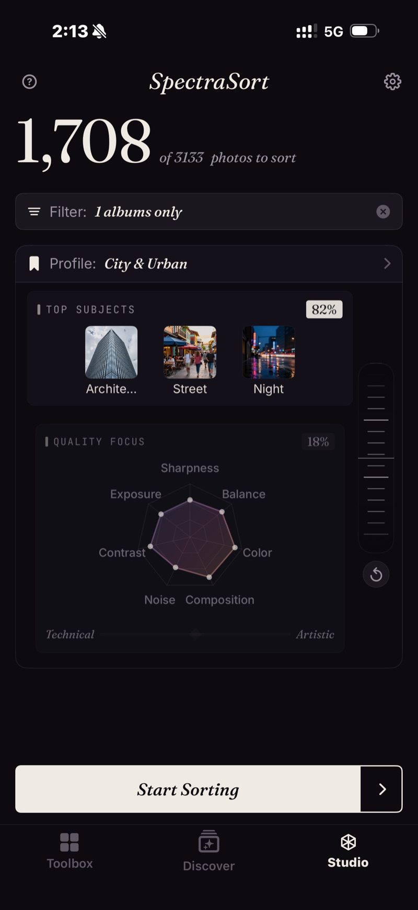

<section class="page-hero">
  

    
<a href="/de/">SpectraSort</a>&#8250;Studio

    <h1>Studio. Wenn du die Kontrolle willst.</h1>
    
Die Werkzeuge mit einem Tippen entscheiden, was „beste“ heißt. Studio gibt diese Entscheidung dir: welche der sieben Qualitätsachsen zählen, welche Motive wichtig sind und wie stark ein Motivtreffer ein scharfes Bild überwiegen soll. Speichere es als Profil, und jede weitere Sortierung ist deine.

    

      <a class="cta" href="https://apps.apple.com/us/app/spectrasort-ai-photo-picker/id6757512134?ppid=5fd01708-3a73-4412-9bea-b411522af1f3"><svg viewBox="0 0 24 24" aria-hidden="true"><path d="M17.05 12.04c-.02-2.16 1.77-3.2 1.85-3.25-1.01-1.48-2.59-1.68-3.14-1.7-1.33-.13-2.61.78-3.29.78-.69 0-1.73-.76-2.85-.74-1.46.02-2.83.85-3.59 2.17-1.54 2.66-.39 6.59 1.1 8.75.73 1.06 1.6 2.24 2.73 2.2 1.1-.04 1.51-.71 2.84-.71 1.32 0 1.7.71 2.85.69 1.18-.02 1.92-1.07 2.64-2.13.84-1.22 1.18-2.42 1.2-2.48-.03-.01-2.3-.88-2.34-3.58zM14.95 5.6c.61-.74 1.02-1.77.9-2.8-.88.04-1.94.58-2.57 1.31-.56.65-1.06 1.7-.93 2.71.98.07 1.99-.5 2.6-1.22z"/></svg>
        Im App Store laden
      </a>
      Kostenlos &middot; iPhone &middot; iOS 18.5+
    

    

      <b>Sieben</b> Qualitätsachsen
      <b>Bis zu drei</b> Motive pro Sortierung
      <b>Inklusive</b> in Premium — einmal zahlen
    

  

</section>

<section id="quality-focus" class="slab">
  

    

      

        Qualitätsfokus — sieben Achsen
        <h2>Schärfe für Tiere. Bildaufbau für Street.</h2>
        
Schärfe, Belichtung, Kontrast und Rauschen auf der technischen Seite. Bildaufbau, Farbharmonie und visuelle Balance auf der künstlerischen Seite. Ziehe einen Punkt im Radar, um ihn zu gewichten, oder verschiebe den Regler Technisch / Künstlerisch, um alle sieben gemeinsam zu bewegen.

      

      

        

          

          
Ein gespeichertes Profil, City &amp; Urban: drei Motive bei 82 %, Qualität bei 18 %, Kontrast und Farbe nach vorn gezogen.

        

      

    

  

</section>

<section id="balance-wheel" class="slab rise">
  

    

      

        Motive und das Balance-Rad
        <h2>Motivtreffer gegen Qualität.</h2>
        
Bis zu drei Motive in einer Sortierung — Vorlagen oder alles, was du tippen kannst. Das Rad entscheidet, wie stark ein Treffer zählt. Dreh es Richtung Motive, und ein gutes Foto vom richtigen Ding gewinnt. Dreh es Richtung Qualität, und das schärfste, bestkomponierte Bild gewinnt, egal was es zeigt.

      

      

        

          

            <video class="screen-loop" src="/video/web-studio-wheel.mp4"
                   poster="/images/shots/studio-wheel-poster.jpg"
                   loop muted playsinline preload="none"
                   width="920" height="852"
                   aria-label="Studios Balance-Rad wird hin und her gedreht: die Gewichtung der Top-Motive fällt von 75 % auf 25 %, während der Radar Qualitätsfokus von 25 % auf 75 % wächst und wieder zurückgeht"></video>
          

        

      

    

  

</section>

<section id="profiles" class="slab">
  

    Profile
    <h2>Einmal einstellen. Jedes Mal wiederverwenden.</h2>
    
Speichere jede Konfiguration unter einem eigenen Namen und wechsle sie vom Startbildschirm aus. Starte bei Dein Geschmack und passe es an — die App legt eine eigene Kopie an, das gelernte Profil bleibt unberührt und lernt weiter.

    
Das gewählte Profil steuert jede Sortierung, Duplikate und Fotos von einem Ort inklusive. Der Treffer eines Stapels oder die beste Aufnahme einer Stadt wird also nach deinen Kriterien beurteilt. Das Überprüfungsraster nennt das Profil, das sortiert hat.

  

</section>

<section id="pricing" class="slab rise">
  

    

      Preise
      <h2>In Premium enthalten — einmal zahlen.</h2>
      
Die sechs Werkzeuge mit einem Tippen sind kostenlos, mit fünf kostenlosen Aktionen pro Woche. Studio gehört zu Premium: eigene Sortierungen und gespeicherte Profile, plus unbegrenzte Aktionen — ein Kauf, kein Abo.

      <a class="cta" href="https://apps.apple.com/us/app/spectrasort-ai-photo-picker/id6757512134?ppid=5fd01708-3a73-4412-9bea-b411522af1f3"><svg viewBox="0 0 24 24" aria-hidden="true"><path d="M17.05 12.04c-.02-2.16 1.77-3.2 1.85-3.25-1.01-1.48-2.59-1.68-3.14-1.7-1.33-.13-2.61.78-3.29.78-.69 0-1.73-.76-2.85-.74-1.46.02-2.83.85-3.59 2.17-1.54 2.66-.39 6.59 1.1 8.75.73 1.06 1.6 2.24 2.73 2.2 1.1-.04 1.51-.71 2.84-.71 1.32 0 1.7.71 2.85.69 1.18-.02 1.92-1.07 2.64-2.13.84-1.22 1.18-2.42 1.2-2.48-.03-.01-2.3-.88-2.34-3.58zM14.95 5.6c.61-.74 1.02-1.77.9-2.8-.88.04-1.94.58-2.57 1.31-.56.65-1.06 1.7-.93 2.71.98.07 1.99-.5 2.6-1.22z"/></svg>
        Im App Store laden
      </a>
    

  

</section>

<section id="faq" class="slab">
  

    

      FAQ
      <h2>Fragen zu Studio.</h2>
    

    

      

Für wen ist Studio?

Für Leute, die viel fotografieren und auf dem Telefon aussortieren — Events und Reisen, bei denen Schärfe und Belichtung zuerst zählen und Rauschen bei Nachtaufnahmen egal ist. Für Leute mit einem eigenen Stil, den die Voreinstellungen nicht treffen: Farbe und Bildaufbau vorn, ein, zwei Motive festgelegt. Und für alle, die mit Beste Aufnahmen einfach nicht einverstanden sind und den Regler einmal nach ihrem Geschmack einstellen wollen.

      

Was ist der Unterschied zwischen Studio und Beste Aufnahmen?

Beste Aufnahmen ist ein Regler: technisch am einen Ende, künstlerisch am anderen. Studio teilt das in sieben Achsen, die du einzeln gewichtest, ergänzt bis zu drei Motive und das Balance-Rad und lässt dich das Ergebnis als Profil speichern.

      

Verändert das Anpassen mein Profil Dein Geschmack?

Nein. Beim Anpassen entsteht eine eigene Kopie; das gelernte Profil bleibt unberührt und lernt weiter. Du kannst es jederzeit in den Einstellungen zurücksetzen oder neu aufbauen.

      

Kann ich in einer Sortierung nach Motiv und Qualität zugleich sortieren?

Ja — dafür ist das Balance-Rad da. Dreh es Richtung Motive, gewinnt ein gutes Foto vom richtigen Ding; dreh es Richtung Qualität, gewinnt das schärfste, bestkomponierte Bild, egal was es zeigt.

      

Gilt ein Studio-Profil auch für Duplikate und Ortssortierungen?

Ja. Das gewählte Profil steuert jede Sortierung, also wird der Treffer in einem Stapel oder die beste Aufnahme einer Stadt nach deinen Kriterien beurteilt. Das Überprüfungsraster nennt das Profil, das sortiert hat.

      

Ist Studio kostenlos?

Studio gehört zu Premium — einmal zahlen, kein Abo. Du kannst es in der kostenlosen Version öffnen und ansehen; eigene Sortierungen und gespeicherte Profile brauchen Premium. Die sechs Werkzeuge mit einem Tippen bleiben kostenlos, mit fünf kostenlosen Aktionen pro Woche.

    

  

</section>

<section class="slab">
  

    

      Weiterlesen
      

        <a href="/de/photo-culling-iphone/">Fotos aussortieren auf dem iPhoneErst sortieren, dann wischen</a>
        <a href="/de/features/">Alle FunktionenWerkzeuge, Einstellungen und Limits auf einer Seite</a>
        <a href="/de/find-best-photos-iphone/">Deine besten Fotos findenNach Begriff, nach Beispiel, nach Geschmack</a>
      

    

  

</section>
