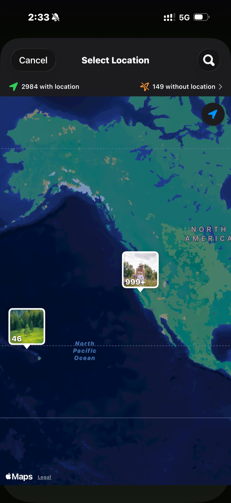

<section class="page-hero">
  

    
<a href="/de/">SpectraSort</a>&#8250;Urlaubsfotos

    <h1>1.200 Urlaubsfotos → das Album, das du zeigen willst.</h1>
    
Eine zwei Wochen lange Reise kommt als tausend Fotos nach Hause — und mit dem Versprechen, sie „durchzugehen“. SpectraSort geht sie durch: Die Reise ist schon zu einer Szene gesammelt, jede Aufnahme kommt sortiert zurück, die elf Sonnenuntergänge sitzen in einem Stapel, und deine Auswahl landet in einem Album — auf dem Rückflug.

    

      <a class="cta" href="https://apps.apple.com/us/app/spectrasort-ai-photo-picker/id6757512134?ppid=5fd01708-3a73-4412-9bea-b411522af1f3"><svg viewBox="0 0 24 24" aria-hidden="true"><path d="M17.05 12.04c-.02-2.16 1.77-3.2 1.85-3.25-1.01-1.48-2.59-1.68-3.14-1.7-1.33-.13-2.61.78-3.29.78-.69 0-1.73-.76-2.85-.74-1.46.02-2.83.85-3.59 2.17-1.54 2.66-.39 6.59 1.1 8.75.73 1.06 1.6 2.24 2.73 2.2 1.1-.04 1.51-.71 2.84-.71 1.32 0 1.7.71 2.85.69 1.18-.02 1.92-1.07 2.64-2.13.84-1.22 1.18-2.42 1.2-2.48-.03-.01-2.3-.88-2.34-3.58zM14.95 5.6c.61-.74 1.02-1.77.9-2.8-.88.04-1.94.58-2.57 1.31-.56.65-1.06 1.7-.93 2.71.98.07 1.99-.5 2.6-1.22z"/></svg>
        Im App Store laden
      </a>
      Kostenlos &middot; iPhone &middot; iOS 18.5 oder neuer &middot; Aktualisiert am 31. Oktober 2026
    

    

      <b>100 % auf dem Gerät</b> — nichts wird hochgeladen
      <b>Kostenlos</b> 5 Aktionen pro Woche
      <b>Einmal zahlen</b> — unbegrenzte Aktionen
    

  

</section>

<section id="find-the-trip" class="slab">
  

    

      

        Die Reise finden
        <h2>Sie ist schon eine Szene.</h2>
        
Öffne Entdecken, und die Reise ist da, nach Zeit und Ort gesammelt — kein Album nötig. Oder tippe auf Fotos von einem Ort und setze die Stadt als Marke: jede Aufnahme von dort, nichts anderes.

        
Fotos von vor Jahren zählen auch. Die Marke findet die frühere Reise, von der du vergessen hattest, dass du sie fotografiert hast.

      

      

        

          

        

      

    

  

</section>

<section id="rank" class="slab rise">
  

    

      

        Sortieren
        <h2>Die Behaltenen steigen nach oben, bevor du wischst.</h2>
        
Beste Aufnahmen stellt die schärfsten und am besten komponierten Bilder nach oben. Dein Geschmack stellt, sobald er dich kennt, die Fotos nach oben, die du selbst gewählt hättest. So oder so beginnt die Überprüfung mit den guten — nicht mit Foto 1 von 1.200.

        
Schieb den Regler für die Sonnenuntergänge Richtung künstlerisch und für die Gruppenfotos Richtung technisch.

      

      

        

          

        

      

    

  

</section>

<section id="retakes" class="slab">
  

    

      

        Wiederholungen
        <h2>11 Aufnahmen desselben Sonnenuntergangs → ein Wisch.</h2>
        
Sonnenuntergänge, Gruppenfotos, der Blick aus dem Hotel: Jeder Moment, den du sechsmal fotografiert hast, kommt als ein Stapel an, die schärfste markiert. Dreh am Rad, behalte eine, weiter.

      

      

        

          

        

      

    

  

</section>

<section id="finish" class="slab rise">
  

    

      

        Abschließen
        <h2>Album fertig. Rest gelöscht.</h2>
        
Die Stapelaktionen legen die Auswahl in ein Album, das in Apple Fotos auftaucht — und im Teilen-Menü, für den Gruppenchat. Behalte den Rest oder lösche ihn über den Systemdialog nach Zuletzt gelöscht.

      

      

        

          

        

      

    

  

</section>

<section id="the-trip-in-three-steps" class="slab">
  

    
Die Reise, in drei Schritten

    

      

Finden

Die Szene, die Marke auf der Karte oder die Monate in der Zeitleiste.

      

Wischen

Sortierte Ergebnisse, gestapelte Wiederholungen, drei Gesten. Auto-Auswahl, wenn du lieber überfliegst als wischst.

      

Ablegen

Ein Album, das Teilen-Menü und der Rest gelöscht — ein Bildschirm.

    

  

</section>

<section class="slab rise">
  

    <h2>Das Kleingedruckte</h2>
    
Szenen, die Bewertungen und das Geschmacksprofil laufen alle auf der Neural Engine des iPhone. Nichts wird hochgeladen und es gibt kein Konto. <a href="/de/private-ai-photo-app/">Mehr dazu, wie das funktioniert →</a>

    

      
Wo es nicht hilft

      <ul>
        <li>Nur iPhone, iOS 18.5 oder neuer. Keine iPad-, Android- oder Desktop-Version.</li>
        <li>Der allererste Index einer großen Mediathek dauert eine Weile. Danach läuft es automatisch — neue Fotos werden indexiert, sobald sie da sind, du wartest nie wieder.</li>
        <li>Die Ortssuche nach Namen nutzt Apple Maps und braucht eine Verbindung. Szenen, die Zeitleiste und die Sortierung selbst funktionieren offline.</li>
        <li>Gelöschte Fotos gehen durch den Papierkorb von iOS: Sie landen in Zuletzt gelöscht, und der Speicher kommt zurück, sobald du das Album dort leerst — oder automatisch nach 30 Tagen.</li>
      </ul>
    

  

</section>

<section id="pricing" class="slab">
  

    

      Preise
      <h2>Fünf kostenlose Aktionen pro Woche. Einmal zahlen, dann unbegrenzt.</h2>
      
Fünf kostenlose Aktionen pro Woche, ohne Konto und ohne Kreditkarte. Einmal zahlen für unbegrenzte Aktionen. Kein Abo, nie. Gebaut von einem unabhängigen Entwickler, der es täglich benutzt.

      <a class="cta" href="https://apps.apple.com/us/app/spectrasort-ai-photo-picker/id6757512134?ppid=5fd01708-3a73-4412-9bea-b411522af1f3"><svg viewBox="0 0 24 24" aria-hidden="true"><path d="M17.05 12.04c-.02-2.16 1.77-3.2 1.85-3.25-1.01-1.48-2.59-1.68-3.14-1.7-1.33-.13-2.61.78-3.29.78-.69 0-1.73-.76-2.85-.74-1.46.02-2.83.85-3.59 2.17-1.54 2.66-.39 6.59 1.1 8.75.73 1.06 1.6 2.24 2.73 2.2 1.1-.04 1.51-.71 2.84-.71 1.32 0 1.7.71 2.85.69 1.18-.02 1.92-1.07 2.64-2.13.84-1.22 1.18-2.42 1.2-2.48-.03-.01-2.3-.88-2.34-3.58zM14.95 5.6c.61-.74 1.02-1.77.9-2.8-.88.04-1.94.58-2.57 1.31-.56.65-1.06 1.7-.93 2.71.98.07 1.99-.5 2.6-1.22z"/></svg>
        Im App Store laden
      </a>
    

  

</section>

<section id="faq" class="slab rise">
  

    

      FAQ
      <h2>Fragen zur Reise.</h2>
    

    

      

Wie lange dauert es, die Fotos einer Reise durchzugehen?

Die Sortierung selbst dauert einen Moment, sobald die Mediathek indexiert ist — der erste Index läuft mit bis zu 100 Fotos pro Sekunde auf neueren iPhones und passiert einmal. Die echte Zeit sind deine Wische, und Sortierung plus Stapel kürzen sie: Die guten stehen oben, und jede Wiederholung kostet eine Geste.

      

Was passiert mit den Fotos, die ich nicht auswähle?

Nichts, solange du nichts sagst. Belassen ist ein Korb, kein Löschen. Was du wirklich löschst, geht über den Systemdialog nach Zuletzt gelöscht, wo es 30 Tage bleibt.

      

Geht das im Flugzeug, offline?

Sortieren, Bewerten und Überprüfen laufen komplett auf dem Telefon, also ja. Die Ortssuche nach Namen nutzt Apple Maps und braucht eine Verbindung; die Reise über Szenen oder die Zeitleiste zu öffnen nicht.

      

Kann ich mehrere Reisen auf einmal sortieren?

In der Zeitleiste hakt du so viele Monate an, wie du willst, und sortierst sie zusammen. Oder du filterst nach einem eigenen Zeitraum, der den ganzen Sommer umfasst.

      

Werden meine Urlaubsfotos hochgeladen?

Nein. Szenen, die Bewertungen und das Geschmacksprofil entstehen und bleiben auf deinem iPhone. Keine Uploads, kein Konto.

    

  

</section>

<section class="slab">
  

    

      Weiterlesen
      

        <a href="/de/photo-culling-iphone/">Fotos aussortieren auf dem iPhoneDer ganze Behalten-oder-Löschen-Ablauf</a>
        <a href="/de/photo-organizer-iphone/">KI-Foto-OrganizerGruppiert, sortiert, abgelegt</a>
        <a href="/de/duplicate-photo-finder-iphone/">DuplikatfinderSerien und Ähnliche, gestapelt</a>
      

    

  

</section>
