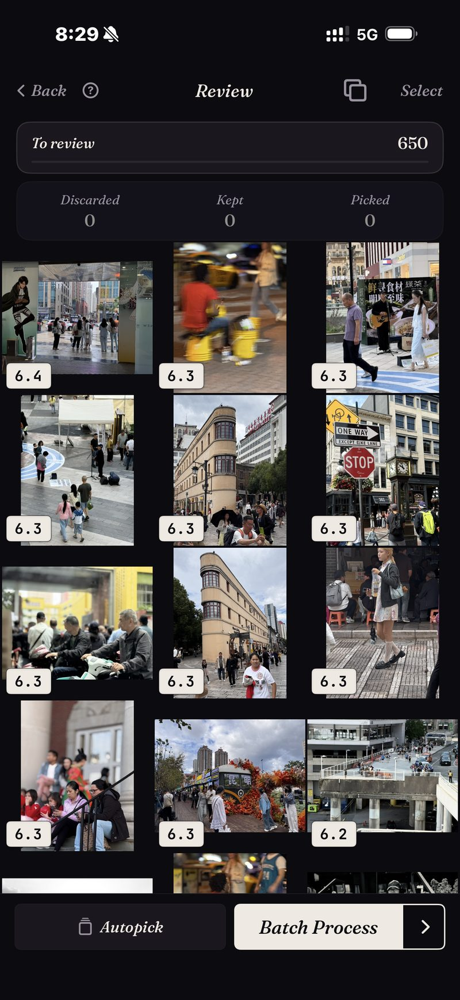
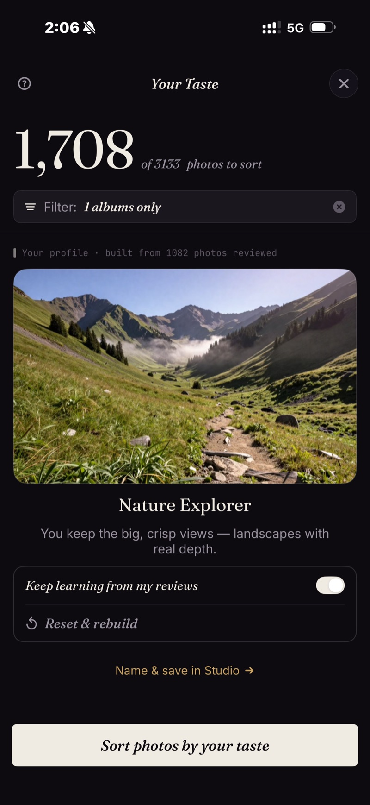

<section class="page-hero">
  

    
<a href="/es/">SpectraSort</a>›Selector de fotos con IA para iPhone

    <h1>El selector de fotos con IA para iPhone.</h1>
    
La búsqueda puede encontrar todas las fotos de playa que has hecho en tu vida. No puede decirte cuáles tres merecen quedarse. Esa segunda pregunta es para lo que existe SpectraSort: puntúa tus fotos por calidad, aprende tu gusto de las que conservas y pone las mejores arriba.

    

      <a class="cta" href="https://apps.apple.com/us/app/spectrasort-ai-photo-picker/id6757512134?ppid=5fd01708-3a73-4412-9bea-b411522af1f3">
        <svg viewBox="0 0 24 24" aria-hidden="true"><path d="M17.05 12.04c-.02-2.16 1.77-3.2 1.85-3.25-1.01-1.48-2.59-1.68-3.14-1.7-1.33-.13-2.61.78-3.29.78-.69 0-1.73-.76-2.85-.74-1.46.02-2.83.85-3.59 2.17-1.54 2.66-.39 6.59 1.1 8.75.73 1.06 1.6 2.24 2.73 2.2 1.1-.04 1.51-.71 2.84-.71 1.32 0 1.7.71 2.85.69 1.18-.02 1.92-1.07 2.64-2.13.84-1.22 1.18-2.42 1.2-2.48-.03-.01-2.3-.88-2.34-3.58zM14.95 5.6c.61-.74 1.02-1.77.9-2.8-.88.04-1.94.58-2.57 1.31-.56.65-1.06 1.7-.93 2.71.98.07 1.99-.5 2.6-1.22z"/></svg>
        Descargar en el App Store
      </a>
      Gratis · iPhone · iOS 18.5+ · Actualizado el 31 de octubre de 2026
    

    

      <b>100% en el dispositivo</b> — nada se sube
      <b>Gratis</b> 5 acciones por semana
      <b>Un solo pago</b> — acciones ilimitadas
    

  

</section>

<section class="slab">
  

    <h2>Qué es un selector de fotos</h2>
    
El término se usa a la ligera, así que conviene separar tres tipos de app:

    <ul>
      <li><b>Búsqueda de fotos</b> encuentra coincidencias. Pides «playa» y obtienes las 87 fotos de playa que has hecho, en una cuadrícula larga y por fecha.</li>
      <li><b>Limpiadores de fotos</b> buscan basura: duplicados, capturas de pantalla, fotos borrosas. Son útiles, pero solo saben decirte qué está mal.</li>
      <li><b>Un selector de fotos</b> toma la decisión. Puntúa cada foto por nitidez, exposición, composición y parecido con lo que pediste, y te entrega el conjunto <em>clasificado, de mejor a peor</em>, con una forma de actuar sobre él.</li>
    </ul>
    
A la mayoría de la gente no le cuesta encontrar sus fotos. Le cuesta elegir entre ellas. SpectraSort está hecha para elegir.

  

</section>

<section id="ranked-not-just-matched" class="slab rise">
  

    

      

        Clasificadas, no solo encontradas
        <h2>Cada resultado vuelve con lo mejor primero.</h2>
        
Hay seis herramientas, un toque cada una: <b>Tu gusto</b>, <b>Mejores fotos</b>, <b>Buscar un sujeto</b>, <b>Como esta foto</b>, <b>Duplicados</b> y <b>Fotos de un lugar</b>.

        
Sea cual sea la que uses, los resultados vuelven puntuados y ordenados. La captura es una ordenación real: un corte de 650 fotos de calle, cada imagen puntuada, la mejor primero.

        
Las ordenaciones vuelven casi al instante, porque se ejecutan contra un índice en el dispositivo. Se crea una vez —hasta 100 fotos por segundo en iPhones recientes— y luego se mantiene al día automáticamente a medida que aparecen fotos nuevas.

      

      

        

          

        

      

    

  

</section>

<section id="your-taste" class="slab">
  

    

      

        La parte que no hace ninguna otra app
        <h2>Aprende qué fotos conservarías tú.</h2>
        
Casi toda la IA de fotos puntúa contra una idea universal de buena foto: nítida, bien iluminada, centrada. Tus favoritas no siempre encajan en ese molde. Quizá te guste la que está a contraluz, el perro sacudiéndose o un encuadre algo blando que imprimirías igual.

        
Por eso SpectraSort observa lo que conservas y lo que dejas pasar durante la revisión, y construye con ello un <b>perfil de gustos</b>. Después de suficientes revisiones, ordenar por Tu gusto empieza a parecerse a un álbum que elegiste a mano. Puedes pausar el aprendizaje, reiniciarlo o mantener varios perfiles, y todo se queda en tu teléfono.

      

      

        

          

        

      

    

  

</section>

<section id="how-a-sort-works" class="slab rise">
  

    
Cómo funciona una ordenación

    

      

Buscar

Elige una herramienta: una frase, una foto de ejemplo, un lugar o tu gusto.

      

Clasificar

Todo puntuado en el dispositivo: nitidez, exposición, composición, parecido.

      

Terminar

Desliza las ganadoras hacia dentro y luego guarda, comparte o limpia el resto en lote en una pantalla.

    

  

</section>

<section class="slab">
  

    <h2>Nada sale del teléfono</h2>
    
Toda la puntuación ocurre en el Neural Engine de tu iPhone. Tus fotos no se suben a ningún sitio, no hay cuenta y los modelos vienen ya entrenados, así que nada de tu fototeca llega a nadie más. <a href="/es/private-ai-photo-app/">Más sobre cómo funciona el procesamiento en el dispositivo →</a>

    

      
Dónde no ayuda

      <ul>
        <li>Solo iPhone, iOS 18.5 o posterior. Sin versión para iPad, Android ni escritorio.</li>
        <li>El primer índice de una fototeca grande tarda un poco. Después es automático: las fotos nuevas se indexan a medida que aparecen, así que no vuelves a esperar.</li>
        <li>El perfil de gustos es tan bueno como las revisiones que le hayas dado. Empieza genérico.</li>
        <li>Las fotos eliminadas pasan por la papelera de iOS: van a Eliminados recientemente, y el almacenamiento vuelve en el momento en que vacías ese álbum allí, o automáticamente a los 30 días. Cada Eliminar en SpectraSort muestra el almacenamiento que libera antes de que confirmes.</li>
      </ul>
    

  

</section>

<section id="pricing" class="slab rise">
  

    

      Precios
      <h2>Cinco acciones gratis por semana. Un solo pago para tenerlas ilimitadas.</h2>
      
Cinco acciones gratis por semana, para siempre: sin cuenta y sin tarjeta. Paga una sola vez para tener acciones ilimitadas. Sin suscripción. Nunca.

      <a class="cta" href="https://apps.apple.com/us/app/spectrasort-ai-photo-picker/id6757512134?ppid=5fd01708-3a73-4412-9bea-b411522af1f3">
        <svg viewBox="0 0 24 24" aria-hidden="true"><path d="M17.05 12.04c-.02-2.16 1.77-3.2 1.85-3.25-1.01-1.48-2.59-1.68-3.14-1.7-1.33-.13-2.61.78-3.29.78-.69 0-1.73-.76-2.85-.74-1.46.02-2.83.85-3.59 2.17-1.54 2.66-.39 6.59 1.1 8.75.73 1.06 1.6 2.24 2.73 2.2 1.1-.04 1.51-.71 2.84-.71 1.32 0 1.7.71 2.85.69 1.18-.02 1.92-1.07 2.64-2.13.84-1.22 1.18-2.42 1.2-2.48-.03-.01-2.3-.88-2.34-3.58zM14.95 5.6c.61-.74 1.02-1.77.9-2.8-.88.04-1.94.58-2.57 1.31-.56.65-1.06 1.7-.93 2.71.98.07 1.99-.5 2.6-1.22z"/></svg>
        Descargar en el App Store
      </a>
    

  

</section>

<section id="faq" class="slab">
  

    

      FAQ
      <h2>Preguntas sobre el selector de fotos con IA.</h2>
    

    

      

¿Qué es un selector de fotos con IA?

Una app que decide cuáles de tus fotos merecen conservarse, no solo cuáles coinciden con una búsqueda. Puntúa cada foto por nitidez, exposición, composición o parecido con las fotos que sueles conservar, y las devuelve clasificadas de mejor a peor, con un flujo para conservar, compartir o limpiar el resto.

      

¿En qué se diferencia de la búsqueda de fotos?

La búsqueda te dice qué fotos coinciden, así que una consulta de playa devuelve las 87 fotos de playa. Un selector clasifica esas 87 y pone las mejores primero. SpectraSort hace las dos cosas; toda búsqueda vuelve clasificada. Consulta <a href="/es/ai-photo-picker-vs-photo-culling/">selector frente a selección</a> para el desglose completo.

      

¿SpectraSort sube mis fotos para elegirlas?

No. La búsqueda, la puntuación y el perfil de gustos se ejecutan en el Neural Engine de tu iPhone. Sin subidas, sin cuenta y sin servidor de SpectraSort en el camino.

      

¿Eliminará fotos por su cuenta?

No. No se aplica nada hasta que tocas, y las eliminaciones siempre pasan por el diálogo de confirmación de Fotos del sistema hacia el álbum Eliminados recientemente de iOS: recuperables 30 días, o borradas en el momento en que lo vacías.

      

¿Cuánto cuesta?

Cinco acciones por semana son gratis, para siempre: no es una prueba. Paga una sola vez para tener acciones ilimitadas y todos los controles de Studio. Sin suscripción.

    

  

</section>

<section class="slab">
  

    

      Sigue leyendo
      

        <a href="/es/photo-culling-iphone/">Selección de fotos en iPhoneEl flujo del fotógrafo, en el teléfono</a>
        <a href="/es/best-photo-picker/">Elegir un selector de fotosQué separa a estas apps</a>
        <a href="/es/how-to-pick-best-photos-from-camera-roll/">Elige lo mejor de tu carretePaso a paso, con o sin app</a>
      

    

  

</section>
