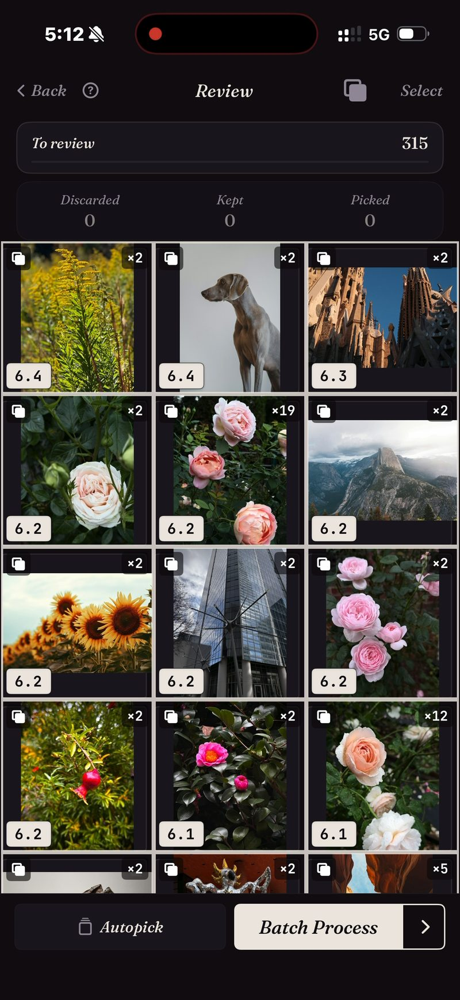

<section class="page-hero">
  

    
<a href="/es/">SpectraSort</a>&#8250;Buscador de fotos duplicadas

    <h1>Fotos duplicadas, apiladas y resueltas.</h1>
    
Una rosa fotografiada 19 veces. El mismo horizonte, nueve viajes seguidos. Cada ráfaga que nunca recortaste. SpectraSort apila las tres cosas, marca la más nítida y limpia el resto en un solo lote.

    

      <a class="cta" href="https://apps.apple.com/us/app/spectrasort-ai-photo-picker/id6757512134?ppid=5fd01708-3a73-4412-9bea-b411522af1f3"><svg viewBox="0 0 24 24" aria-hidden="true"><path d="M17.05 12.04c-.02-2.16 1.77-3.2 1.85-3.25-1.01-1.48-2.59-1.68-3.14-1.7-1.33-.13-2.61.78-3.29.78-.69 0-1.73-.76-2.85-.74-1.46.02-2.83.85-3.59 2.17-1.54 2.66-.39 6.59 1.1 8.75.73 1.06 1.6 2.24 2.73 2.2 1.1-.04 1.51-.71 2.84-.71 1.32 0 1.7.71 2.85.69 1.18-.02 1.92-1.07 2.64-2.13.84-1.22 1.18-2.42 1.2-2.48-.03-.01-2.3-.88-2.34-3.58zM14.95 5.6c.61-.74 1.02-1.77.9-2.8-.88.04-1.94.58-2.57 1.31-.56.65-1.06 1.7-.93 2.71.98.07 1.99-.5 2.6-1.22z"/></svg>
        Descargar en el App Store
      </a>
      Gratis &middot; iPhone &middot; iOS 18.5+ &middot; Actualizado el 31 de octubre de 2026
    

    

      <b>100% en el dispositivo</b> — nada se sube
      <b>Gratis</b> 5 acciones por semana
      <b>Un solo pago</b> — acciones ilimitadas
    

  

</section>

<section class="slab">
  

    <h2>iOS encuentra un tipo de duplicado. Hay tres.</h2>
    
<b>Duplicados</b>: copias exactas del mismo archivo. <b>Ráfagas</b>: tomas con segundos de diferencia, ninguna idéntica byte a byte. <b>Similares</b>: la misma escena, fotografiada de nuevo meses después.

    
Apple Photos fusiona el primer tipo. Los otros dos son la mayor parte del desorden. SpectraSort compara lo que hay en la imagen, así que los tres acaban en pilas.

  

</section>

<section id="stacked-before-you-look" class="slab rise">
  

    

      

        Apiladas antes de que mires
        <h2>315 fotos → las pilas que importan.</h2>
        
Ejecuta Duplicados en un viaje, un mes o toda la fototeca y la cuadrícula vuelve agrupada. Cada pila muestra cuántas tomas contiene y la puntuación de la mejor. Las sueltas no estorban.

      

      

        

          

          
Una pasada real: 315 fotos, la mayoría, pilas de dos, algunas de una docena, una rosa ×19.

        

      

    

  

</section>

<section id="one-stack-one-decision" class="slab">
  

    

      

        Una pila, una decisión
        <h2>19 tomas → una elegida.</h2>
        
Dentro de una pila, las tomas se revisan en una rueda. Pasa por ellas sin salir de la foto, conserva la que quieras y la pila está resuelta.

        
O deja que lo haga Autoselección: las copias van a Descartar y la mejor de cada pila se queda para que decidas. Luego un solo lote limpia los descartes, tras el diálogo de confirmación del sistema, hacia Eliminados recientemente.

      

      

        

          

        

      

    

  

</section>

<section id="how-it-works" class="slab rise">
  

    
Cómo funciona

    

      

Escanea

Duplicados lee el índice en el dispositivo, creado una vez y mantenido al día a medida que llegan fotos nuevas. Hasta 100 fotos por segundo en la primera pasada.

      

Elige

La más nítida marcada en cada pila. Confírmala o gira la rueda y elige otra.

      

Limpia

Un solo lote. Las eliminaciones pasan por el diálogo del sistema hacia Eliminados recientemente.

    

    

      
Limpiar duplicados es donde se va la mayor parte del almacenamiento de un carrete. Las fotos eliminadas van al álbum Eliminados recientemente de iOS; vacíalo allí y el espacio vuelve al instante, o déjalo y iOS lo libera a los 30 días. Cada Eliminar en SpectraSort muestra el almacenamiento que libera antes de que confirmes.

    

  

</section>

<section class="slab">
  

    <h2>La letra pequeña</h2>
    
La comparación se ejecuta en el Neural Engine del iPhone. Nada se sube y no hay cuenta. <a href="/es/private-ai-photo-app/">Más sobre cómo funciona →</a>

    

      
Dónde no ayuda

      <ul>
        <li>Solo mira tu fototeca: no archivos, descargas ni nada más del teléfono.</li>
        <li>Solo iPhone, iOS 18.5 o posterior. Sin versión para iPad, Android ni escritorio.</li>
        <li>El primer índice de una fototeca grande tarda un poco. Después es automático: las fotos nuevas se indexan a medida que aparecen, así que no vuelves a esperar.</li>
        <li>Las fotos eliminadas pasan por la papelera de iOS: van a Eliminados recientemente, y el almacenamiento vuelve en el momento en que vacías ese álbum allí, o automáticamente a los 30 días.</li>
      </ul>
    

  

</section>

<section id="pricing" class="slab rise">
  

    

      Precios
      <h2>Cinco acciones gratis por semana. Un solo pago para tenerlas ilimitadas.</h2>
      
Cinco acciones gratis por semana, sin cuenta y sin tarjeta. Paga una sola vez para tener acciones ilimitadas. Sin suscripción. Nunca. Hecha por un desarrollador independiente que la usa cada día.

      <a class="cta" href="https://apps.apple.com/us/app/spectrasort-ai-photo-picker/id6757512134?ppid=5fd01708-3a73-4412-9bea-b411522af1f3"><svg viewBox="0 0 24 24" aria-hidden="true"><path d="M17.05 12.04c-.02-2.16 1.77-3.2 1.85-3.25-1.01-1.48-2.59-1.68-3.14-1.7-1.33-.13-2.61.78-3.29.78-.69 0-1.73-.76-2.85-.74-1.46.02-2.83.85-3.59 2.17-1.54 2.66-.39 6.59 1.1 8.75.73 1.06 1.6 2.24 2.73 2.2 1.1-.04 1.51-.71 2.84-.71 1.32 0 1.7.71 2.85.69 1.18-.02 1.92-1.07 2.64-2.13.84-1.22 1.18-2.42 1.2-2.48-.03-.01-2.3-.88-2.34-3.58zM14.95 5.6c.61-.74 1.02-1.77.9-2.8-.88.04-1.94.58-2.57 1.31-.56.65-1.06 1.7-.93 2.71.98.07 1.99-.5 2.6-1.22z"/></svg>
        Descargar en el App Store
      </a>
    

  

</section>

<section id="faq" class="slab">
  

    

      FAQ
      <h2>Preguntas sobre duplicados.</h2>
    

    

      

¿En qué se diferencia del buscador de duplicados integrado de Apple?

El álbum Duplicados de Apple Photos fusiona copias exactas y casi exactas de la misma toma. SpectraSort también apila ráfagas, repeticiones y parecidas —archivos distintos del mismo momento— y marca la más nítida de cada pila. Eso es la mayor parte del desorden.

      

¿Puede eliminar fotos sin preguntar?

No. Nada cambia hasta que tocas, y cada eliminación pasa por el diálogo de confirmación de Fotos del sistema hacia Eliminados recientemente, donde se queda 30 días.

      

¿Eliminar duplicados libera espacio al momento?

Las fotos eliminadas van al álbum Eliminados recientemente de iOS. Vacía ese álbum y el espacio vuelve al instante; déjalo y iOS lo borra a los 30 días. SpectraSort muestra el almacenamiento que libera cada Eliminar antes de que confirmes.

      

¿Puedo elegir qué cuenta como duplicado?

Sí. Tres interruptores de apilado en Revisión: Duplicados (copias exactas), Ráfagas (tomas con segundos de diferencia) y Similares (la misma escena). Desactiva cualquiera y esas fotos aparecen sueltas.

      

¿Puede encontrar fotos parecidas, no solo duplicados?

El mismo motor. Como esta foto clasifica toda la fototeca por parecido con una imagen que elijas; el interruptor Similares agrupa las parecidas en pilas dentro de cualquier ordenación. <a href="/es/find-best-photos-iphone/">Tres formas de encontrar tus mejores fotos →</a>

      

¿El buscador de duplicados es gratis?

Duplicados se ejecuta gratis, tantas veces como quieras. Eliminar las copias es una acción, por muchas que haya, y cinco acciones por semana son gratis. Premium (un solo pago, sin suscripción) las hace ilimitadas.

    

  

</section>

<section class="slab">
  

    

      Sigue leyendo
      

        <a href="/es/photo-culling-iphone/">Selección de fotos en iPhoneEl flujo completo de conservar o limpiar</a>
        <a href="/es/vacation-photos-iphone/">Fotos de vacaciones → un álbum1.200 fotos, una sesión</a>
        <a href="/es/ai-photo-organizer-vs-apple-photos/">Frente a Apple PhotosDónde acaban las herramientas integradas</a>
      

    

  

</section>
