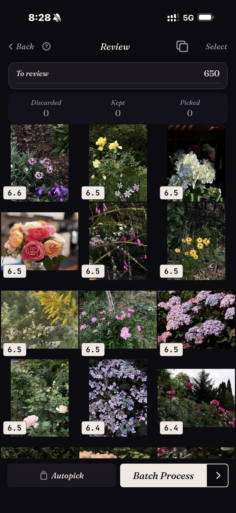

<section class="page-hero">
  

    
<a href="/es/">SpectraSort</a>&#8250;Encuentra tus mejores fotos

    <h1>Encuentra tus mejores fotos en iPhone.</h1>
    
En algún lugar de tu carrete están las fotos que enmarcarías de verdad. Están enterradas bajo todo lo demás que disparaste ese día. SpectraSort te da tres formas de sacarlas: descríbelas, señala una o deja que un perfil de gustos aprendido las saque por su cuenta.

    

      <a class="cta" href="https://apps.apple.com/us/app/spectrasort-ai-photo-picker/id6757512134?ppid=5fd01708-3a73-4412-9bea-b411522af1f3"><svg viewBox="0 0 24 24" aria-hidden="true"><path d="M17.05 12.04c-.02-2.16 1.77-3.2 1.85-3.25-1.01-1.48-2.59-1.68-3.14-1.7-1.33-.13-2.61.78-3.29.78-.69 0-1.73-.76-2.85-.74-1.46.02-2.83.85-3.59 2.17-1.54 2.66-.39 6.59 1.1 8.75.73 1.06 1.6 2.24 2.73 2.2 1.1-.04 1.51-.71 2.84-.71 1.32 0 1.7.71 2.85.69 1.18-.02 1.92-1.07 2.64-2.13.84-1.22 1.18-2.42 1.2-2.48-.03-.01-2.3-.88-2.34-3.58zM14.95 5.6c.61-.74 1.02-1.77.9-2.8-.88.04-1.94.58-2.57 1.31-.56.65-1.06 1.7-.93 2.71.98.07 1.99-.5 2.6-1.22z"/></svg>
        Descargar en el App Store
      </a>
      Gratis &middot; iPhone &middot; iOS 18.5+ &middot; Actualizado el 31 de octubre de 2026
    

    

      <b>100% en el dispositivo</b> — nada se sube
      <b>Gratis</b> 5 acciones por semana
      <b>Un solo pago</b> — acciones ilimitadas
    

  

</section>

<section id="way-1" class="slab">
  

    

      

        Forma 1 — descríbela
        <h2>Escribe lo que recuerdas. Recupéralo con lo mejor primero.</h2>
        
Toca una plantilla como «Retrato» o «Noche», o escribe una palabra: la búsqueda escrita funciona por ahora en inglés. <b>Buscar un sujeto</b> acepta cualquier cosa que puedas poner en palabras, sea concreta, compuesta o abstracta. No necesita Apple Intelligence.

        
Lo que cambia frente a la búsqueda integrada es el orden. Cada coincidencia está puntuada, así que la mejor toma de lo que recordabas está arriba en lugar de en algún punto de la novena fila. La cuadrícula es un resultado real: una búsqueda de flores en la fototeca, puntuada y ordenada.

      

      

        

          

        

      

    

  

</section>

<section id="way-2" class="slab rise">
  

    

      

        Forma 2 — señala una
        <h2>Una buena foto encuentra el resto.</h2>
        
A veces la consulta es una foto, no una frase. Tienes una buena toma de la casa del lago y sabes que hay más. <b>Como esta foto</b> toma ese ejemplo y clasifica toda la fototeca contra él. La captura muestra una ordenación real, con 1.708 fotos clasificadas contra una sola referencia.

        
Es la respuesta más rápida a «sé que esta foto existe pero no la encuentro», también para fotos de hace tres años.

      

      

        

          

        

      

    

  

</section>

<section id="way-3" class="slab">
  

    

      

        Forma 3 — sin consulta
        <h2>O simplemente pide las mejores.</h2>
        
<b>Mejores fotos</b> saca las imágenes más nítidas, mejor expuestas y mejor compuestas de cualquier corte de la fototeca, y puedes inclinarla hacia lo técnico o lo artístico.

        
<b>Tu gusto</b> va un paso más allá. Es un perfil aprendido de tus propias conservadas y descartadas, así que lo que sube arriba es lo que <em>tú</em> habrías elegido, no lo que le gusta a un modelo genérico. Ninguna otra app hace esto.

      

      

        

          

        

      

    

  

</section>

<section id="how-it-works" class="slab rise">
  

    
Cómo funciona

    

      

Buscar

Una frase, una foto de ejemplo, un lugar o tu gusto: seis herramientas, un toque cada una.

      

Clasificar

Puntuado en el dispositivo por nitidez, exposición, composición y parecido.

      

Terminar

Favoritas marcadas, álbum lleno o compartido, en una sola pantalla en lote.

    

  

</section>

<section class="slab">
  

    <h2>Todo en tu teléfono</h2>
    
El índice, la búsqueda y las puntuaciones se calculan en el Neural Engine del iPhone, así que tus fotos nunca se suben y no hay cuenta que crear. Una búsqueda entre miles de fotos tarda un momento, porque se ejecuta sobre un índice que la app crea una vez —hasta 100 fotos por segundo en iPhones recientes— y mantiene al día a medida que aparecen fotos nuevas.

    

      
Dónde no ayuda

      <ul>
        <li>Solo puede encontrar lo mejor de lo que disparaste. No puede rescatar un momento que no capturaste.</li>
        <li>Solo iPhone, iOS 18.5 o posterior. Sin versión para iPad, Android ni escritorio.</li>
        <li>El primer índice de una fototeca grande tarda un poco. Después es automático: las fotos nuevas se indexan a medida que aparecen, así que no vuelves a esperar.</li>
        <li>Las fotos eliminadas pasan por la papelera de iOS: van a Eliminados recientemente, y el almacenamiento vuelve en el momento en que vacías ese álbum allí, o automáticamente a los 30 días. Cada Eliminar en SpectraSort muestra el almacenamiento que libera antes de que confirmes.</li>
      </ul>
    

  

</section>

<section id="pricing" class="slab rise">
  

    

      Precios
      <h2>Cinco acciones gratis por semana. Un solo pago para tenerlas ilimitadas.</h2>
      
Cinco acciones gratis por semana, sin cuenta y sin tarjeta. Paga una sola vez para tener acciones ilimitadas. Sin suscripción. Nunca. Hecha por un desarrollador independiente que la usa cada día.

      <a class="cta" href="https://apps.apple.com/us/app/spectrasort-ai-photo-picker/id6757512134?ppid=5fd01708-3a73-4412-9bea-b411522af1f3"><svg viewBox="0 0 24 24" aria-hidden="true"><path d="M17.05 12.04c-.02-2.16 1.77-3.2 1.85-3.25-1.01-1.48-2.59-1.68-3.14-1.7-1.33-.13-2.61.78-3.29.78-.69 0-1.73-.76-2.85-.74-1.46.02-2.83.85-3.59 2.17-1.54 2.66-.39 6.59 1.1 8.75.73 1.06 1.6 2.24 2.73 2.2 1.1-.04 1.51-.71 2.84-.71 1.32 0 1.7.71 2.85.69 1.18-.02 1.92-1.07 2.64-2.13.84-1.22 1.18-2.42 1.2-2.48-.03-.01-2.3-.88-2.34-3.58zM14.95 5.6c.61-.74 1.02-1.77.9-2.8-.88.04-1.94.58-2.57 1.31-.56.65-1.06 1.7-.93 2.71.98.07 1.99-.5 2.6-1.22z"/></svg>
        Descargar en el App Store
      </a>
    

  

</section>

<section id="faq" class="slab">
  

    

      FAQ
      <h2>Encontrar lo mejor.</h2>
    

    

      

¿Cómo encuentro mis mejores fotos sin hacer scroll por todo?

Dale un punto de partida: una frase, una foto de ejemplo, un lugar o simplemente Mejores fotos sobre un rango de fechas. Luego revisa el resultado clasificado en lugar del carrete en bruto. Las probables ganadoras están arriba antes de que empieces.

      

¿Puede encontrar fotos de hace años?

Sí. El índice cubre toda tu fototeca, y la Cronología de Descubrir baja de año a mes y a día si prefieres navegar un periodo en lugar de buscarlo.

      

¿Necesita conexión a internet?

No. La búsqueda, la puntuación y el perfil de gustos se ejecutan en el dispositivo, así que encontrar fotos no depende de una conexión.

      

¿Qué significa «mejor» en realidad?

Por defecto significa nitidez, exposición y composición, puntuadas por foto. Con Tu gusto se vuelve personal, clasificado por parecido con las fotos que conservas. En Studio puedes ponderar tú mismo siete ejes de calidad.

    

  

</section>

<section class="slab">
  

    

      Sigue leyendo
      

        <a href="/es/how-to-pick-best-photos-from-camera-roll/">Elige lo mejor de tu carreteEl método paso a paso</a>
        <a href="/es/ai-photo-picker-iphone/">Selector de fotos con IA para iPhoneQué hace un selector en realidad</a>
        <a href="/es/photo-organizer-iphone/">Organizador de fotos con IAEscenas, Cronología y álbumes</a>
      

    

  

</section>
