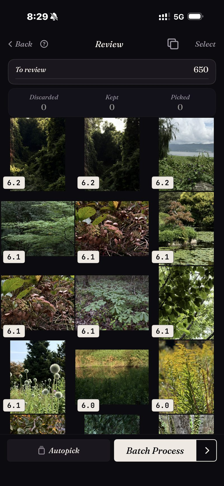

<section class="page-hero">
  

    
<a href="/es/">SpectraSort</a>&#8250;Elige lo mejor de tu carrete

    <h1>Cómo elegir las mejores fotos de tu carrete.</h1>
    
Un método que funciona para pasar de miles de fotos a los pocos cientos que te importan. Primero viene la versión a mano y después la asistida. Las dos funcionan; una escala.

    

      <a class="cta" href="https://apps.apple.com/us/app/spectrasort-ai-photo-picker/id6757512134?ppid=5fd01708-3a73-4412-9bea-b411522af1f3"><svg viewBox="0 0 24 24" aria-hidden="true"><path d="M17.05 12.04c-.02-2.16 1.77-3.2 1.85-3.25-1.01-1.48-2.59-1.68-3.14-1.7-1.33-.13-2.61.78-3.29.78-.69 0-1.73-.76-2.85-.74-1.46.02-2.83.85-3.59 2.17-1.54 2.66-.39 6.59 1.1 8.75.73 1.06 1.6 2.24 2.73 2.2 1.1-.04 1.51-.71 2.84-.71 1.32 0 1.7.71 2.85.69 1.18-.02 1.92-1.07 2.64-2.13.84-1.22 1.18-2.42 1.2-2.48-.03-.01-2.3-.88-2.34-3.58zM14.95 5.6c.61-.74 1.02-1.77.9-2.8-.88.04-1.94.58-2.57 1.31-.56.65-1.06 1.7-.93 2.71.98.07 1.99-.5 2.6-1.22z"/></svg>
        Descargar en el App Store
      </a>
      Gratis &middot; iPhone &middot; iOS 18.5+ &middot; Actualizado el 31 de octubre de 2026
    

    

      <b>100% en el dispositivo</b> — nada se sube
      <b>Gratis</b> — 5 acciones por semana
      <b>Un solo pago</b> — acciones ilimitadas
    

  

</section>

<section class="slab">
  

    <h2>El método manual (sin ninguna app)</h2>
    <ol>
      <li><b>Trabaja por bloques, nunca con toda la fototeca.</b> Un viaje, un mes, un evento. Un bloque terminado es progreso; una fototeca a medio recorrer, no.</li>
      <li><b>Dos pasadas.</b> En la primera, corta rápido los fallos evidentes: desenfoque, fotos accidentales, tomas inservibles. En la segunda, elige entre las parecidas que quedan.</li>
      <li><b>Resuelve los casi idénticos cara a cara.</b> Abre la ráfaga, compara y quédate con una exactamente. No lo aplaces; las pilas aplazadas son la razón de que la fototeca esté así.</li>
      <li><b>Marca las que se quedan como Favoritas</b> (o muévelas a un álbum) para que la decisión quede registrada en algún sitio.</li>
      <li><b>Termina el bloque</b>, con el álbum lleno y los descartes resueltos, antes de abrir el siguiente.</li>
    </ol>
    
Funciona. Cuesta aproximadamente una tarde por cada mil fotos, y esa es la verdadera razón por la que la mayoría de las fototecas nunca se terminan.

    <h3>Por qué se rompe a escala</h3>
    
Tres problemas se acumulan. Nada está clasificado, así que cada foto cuesta una decisión a precio completo. Los casi idénticos están dispersos, así que comparar significa cazar. Y la fatiga de decidir aparece mucho antes de que acabe el bloque. El método es sólido; la economía no.

  

</section>

<section id="the-assisted-version" class="slab rise">
  

    

      

        La versión asistida
        <h2>El mismo método, ya clasificado.</h2>
        
SpectraSort ejecuta los mismos cinco pasos con las partes caras hechas antes de que mires. Elige un bloque —una Escena, un rango de fechas o una búsqueda por sujeto— y vuelve <b>clasificado</b>, con los casi idénticos ya apilados.

        
Después revisa: desliza a la derecha para conservar, abajo para mantener, a la izquierda para descartar, o deja que Autoselección lo archive todo por puntuación y limítate a ojear el resultado. Las parecidas apiladas están en una sola rueda, así que una ráfaga cuesta una decisión.

        
Acciones en lote termina el bloque en una sola pantalla: las conservadas a un álbum o a la hoja de compartir, y el resto eliminado desde el diálogo del sistema.

      

      

        

          

        

      

    

  

</section>

<section id="the-method" class="slab rise">
  

    
El mismo método, comprimido

    

      

Divide

Las Escenas y la Cronología ya cortan la fototeca en piezas que se pueden terminar.

      

Revisa

Clasificado y apilado, así que decides ganadoras, no lo procesas todo.

      

Termina

Un solo lote: álbum, favoritas, compartir o eliminar.

    

  

</section>

<section class="slab">
  

    <h2>Detalles que lo mantienen a salvo</h2>
    
Un deslizamiento hacia abajo solo mantiene la foto; no elegir algo nunca lo elimina. Las eliminaciones ocurren solo en Acciones en lote, pasan por el diálogo de confirmación del sistema y acaban en el álbum Eliminados recientemente de iOS: recuperables 30 días o borradas en cuanto lo vacías. La clasificación se ejecuta en el Neural Engine de tu iPhone, así que <a href="/es/private-ai-photo-app/">nada se sube</a>.

    

      
Dónde no ayuda

      <ul>
        <li>La última palabra sigue siendo tuya. La clasificación juzga cada fotograma y Autoselección puede archivarlos todos por puntuación; lo que les pasa de verdad espera a que toques.</li>
        <li>Solo iPhone, iOS 18.5 o posterior. Sin versión para iPad, Android ni escritorio.</li>
        <li>El primer índice de una fototeca grande tarda un poco. Después es automático: las fotos nuevas se indexan según aparecen, así que no vuelves a esperar.</li>
        <li>Las fotos eliminadas pasan por la papelera de iOS: van a Eliminados recientemente y el espacio vuelve en cuanto vacías ese álbum allí, o automáticamente a los 30 días. Cada Eliminar en SpectraSort muestra el espacio que libera antes de que confirmes.</li>
      </ul>
    

  

</section>

<section id="pricing" class="slab rise">
  

    

      Precio
      <h2>Cinco acciones gratis por semana. Un solo pago para tenerlas ilimitadas.</h2>
      
Cinco acciones gratis por semana, sin cuenta y sin tarjeta. Un solo pago para tener acciones ilimitadas. Sin suscripción, nunca. Hecho por un desarrollador independiente que la usa cada día.

      <a class="cta" href="https://apps.apple.com/us/app/spectrasort-ai-photo-picker/id6757512134?ppid=5fd01708-3a73-4412-9bea-b411522af1f3"><svg viewBox="0 0 24 24" aria-hidden="true"><path d="M17.05 12.04c-.02-2.16 1.77-3.2 1.85-3.25-1.01-1.48-2.59-1.68-3.14-1.7-1.33-.13-2.61.78-3.29.78-.69 0-1.73-.76-2.85-.74-1.46.02-2.83.85-3.59 2.17-1.54 2.66-.39 6.59 1.1 8.75.73 1.06 1.6 2.24 2.73 2.2 1.1-.04 1.51-.71 2.84-.71 1.32 0 1.7.71 2.85.69 1.18-.02 1.92-1.07 2.64-2.13.84-1.22 1.18-2.42 1.2-2.48-.03-.01-2.3-.88-2.34-3.58zM14.95 5.6c.61-.74 1.02-1.77.9-2.8-.88.04-1.94.58-2.57 1.31-.56.65-1.06 1.7-.93 2.71.98.07 1.99-.5 2.6-1.22z"/></svg>
        Descargar en el App Store
      </a>
    

  

</section>

<section id="faq" class="slab">
  

    

      FAQ
      <h2>Preguntas sobre el método.</h2>
    

    

      

¿Con qué frecuencia debería repasar mi carrete?

Poco y a menudo gana a las purgas heroicas. Un bloque por semana, quizá las fotos de la semana pasada o un viaje antiguo, mantiene la fototeca decidida. Ordenar es gratis e ilimitado, así que el ritmo no cuesta nada.

      

¿Qué hago con las que se quedan?

Registra la decisión: un álbum, Favoritas o compartirlas en algún sitio. Acciones en lote de SpectraSort hace cualquiera de las tres en un paso, y sus álbumes aparecen en Apple Photos. La <a href="/es/photo-organizer-iphone/">guía de organización</a> cubre los álbumes y las Escenas con más detalle.

      

¿Cómo evito eliminar algo de lo que me arrepienta?

Hay tres redes de seguridad. No elegir una foto nunca la elimina. Las eliminaciones requieren el diálogo de confirmación del sistema. Y las fotos eliminadas siguen siendo recuperables en Eliminados recientemente durante 30 días.

      

¿Puedo hacerlo sin ninguna app?

Sí. El método manual del principio de esta página no necesita más que la app Fotos y paciencia. La versión con app existe porque la paciencia suele ser la pieza que falta.

    

  

</section>

<section class="slab">
  

    

      Sigue leyendo
      

        <a href="/es/find-best-photos-iphone/">Encuentra tus mejores fotosTres formas de sacar las que se quedan</a>
        <a href="/es/photo-culling-iphone/">Descarte de fotos en iPhoneEl flujo completo</a>
        <a href="/es/duplicate-photo-finder-iphone/">Buscador de fotos duplicadasResuelve primero las repeticiones</a>
      

    

  

</section>
