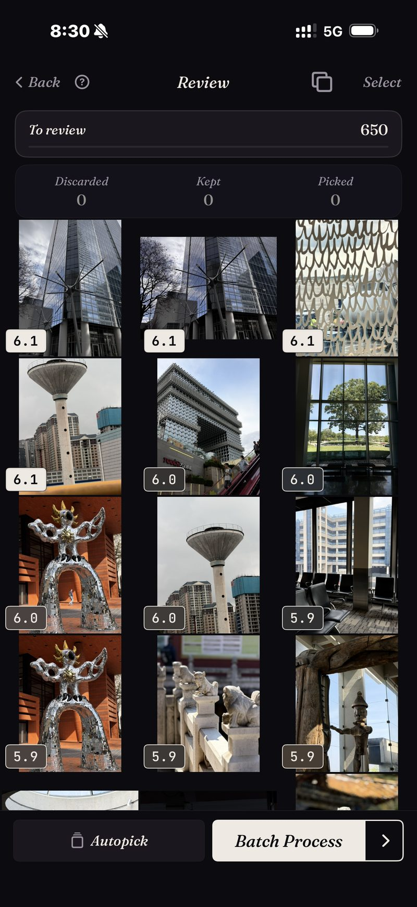

<section class="page-hero">
  

    
<a href="/es/">SpectraSort</a>&#8250;Selección de fotos en iPhone

    <h1>Selección de fotos, en tu iPhone.</h1>
    
Seleccionar significa quedarse con lo mejor y soltar el resto. Antes hacía falta un ordenador, una importación y una tarde libre. SpectraSort hace todo el flujo en el teléfono donde ya están tus fotos, y clasifica cada imagen antes de que deslices una sola.

    

      <a class="cta" href="https://apps.apple.com/us/app/spectrasort-ai-photo-picker/id6757512134?ppid=5fd01708-3a73-4412-9bea-b411522af1f3"><svg viewBox="0 0 24 24" aria-hidden="true"><path d="M17.05 12.04c-.02-2.16 1.77-3.2 1.85-3.25-1.01-1.48-2.59-1.68-3.14-1.7-1.33-.13-2.61.78-3.29.78-.69 0-1.73-.76-2.85-.74-1.46.02-2.83.85-3.59 2.17-1.54 2.66-.39 6.59 1.1 8.75.73 1.06 1.6 2.24 2.73 2.2 1.1-.04 1.51-.71 2.84-.71 1.32 0 1.7.71 2.85.69 1.18-.02 1.92-1.07 2.64-2.13.84-1.22 1.18-2.42 1.2-2.48-.03-.01-2.3-.88-2.34-3.58zM14.95 5.6c.61-.74 1.02-1.77.9-2.8-.88.04-1.94.58-2.57 1.31-.56.65-1.06 1.7-.93 2.71.98.07 1.99-.5 2.6-1.22z"/></svg>
        Descargar en el App Store
      </a>
      Gratis &middot; iPhone &middot; iOS 18.5+ &middot; Actualizado el 31 de octubre de 2026
    

    

      <b>100% en el dispositivo</b> — nada se sube
      <b>Gratis</b> 5 acciones por semana
      <b>Un solo pago</b> — acciones ilimitadas
    

  

</section>

<section class="slab">
  

    <h2>Por qué existe la selección</h2>
    
Los fotógrafos seleccionan porque un rodaje siempre produce más imágenes de las que debe entregar. Disparas 500 y entregas 40. Un carrete tiene las mismas cuentas y ninguna de las herramientas: un viaje de dos semanas vuelve como 1.200 fotos, y la forma nativa de gestionarlas es hacer scroll.

    
Las herramientas de escritorio resolvieron esto para fotógrafos profesionales, con estrellas, comparaciones lado a lado y revisión a velocidad de teclado. Tu carrete vive en otro sitio. SpectraSort reconstruye ese flujo para el teléfono y añade algo que las herramientas de escritorio nunca tuvieron: las imágenes aparecen <b>ya clasificadas</b>.

  

</section>

<section id="ranked-before-you-review" class="slab rise">
  

    

      

        Clasificadas antes de que revises
        <h2>La revisión empieza por lo alto de la pila.</h2>
        
Apunta una ordenación a un viaje, una escena o una búsqueda, y cada imagen vuelve puntuada por nitidez, exposición y composición. Si se lo pides, también pesa cuánto se parece cada foto a las que sueles conservar. Las imágenes más fuertes están arriba antes de que hayas tomado una sola decisión.

        
La captura es una pasada real: un corte de 650 fotos de arquitectura, cada imagen puntuada, la más fuerte primero. Y volvió en un momento, porque la fototeca ya estaba indexada de ordenaciones anteriores. La indexación ocurre una vez y luego se mantiene al día: la app recoge las fotos nuevas a medida que aparecen, hasta 100 por segundo en iPhones recientes.

        
Si quieres otros criterios, <b>Studio</b> tiene siete ejes de calidad, una rueda que equilibra el parecido con el sujeto y la calidad, y perfiles que puedes guardar.

      

      

        

          

        

      

    

  

</section>

<section id="bursts-and-retakes" class="slab">
  

    

      

        Ráfagas y repeticiones
        <h2>Diecinueve tomas de un momento cuestan una decisión.</h2>
        
Las tomas casi idénticas son lo que hace lenta la selección manual, porque cada toma extra es otra comparación. SpectraSort agrupa duplicados, ráfagas y parecidas en pilas antes de que empiece la revisión.

        
Cada pila se revisa en una sola rueda. Pasas por las tomas sin salir de la foto, conservas la que quieres y la pila está resuelta. La captura es de una pasada de Duplicados real: la misma rosa, 19 tomas, una rueda.

        
Luego los gestos: a la derecha para conservar, abajo para mantener, a la izquierda para descartar. O deja que Autoselección reparta todo el corte por puntuación con un toque y limítate a repasar el resultado.

      

      

        

          

        

      

    

  

</section>

<section id="the-culling-loop" class="slab rise">
  

    
El ciclo de selección

    

      

Corte

No empieces por toda la fototeca. Escenas reúne viajes y temas por su cuenta, y la Cronología va de año a mes y a día.

      

Desliza

Resultados clasificados, similares apiladas, tres gestos. Autoselección si prefieres repasar antes que deslizar.

      

Termina

Acciones en lote pone tus elegidas en un álbum o en la hoja de compartir y limpia el resto, tras el diálogo de confirmación del sistema.

    

  

</section>

<section class="slab">
  

    <h2>La letra pequeña</h2>
    
La indexación, la puntuación y el perfil de gustos se ejecutan en el Neural Engine del iPhone. Nada se sube y no hay cuenta. <a href="/es/private-ai-photo-app/">Más sobre cómo funciona →</a>

    

      
Dónde no ayuda

      <ul>
        <li>Tu atención sigue siendo la parte lenta. La clasificación ya hace el juicio —ganadoras arriba, y Autoselección puede repartir toda la cola por puntuación con un toque—, pero repasar el resultado sigue siendo cosa tuya, y nada toca tu fototeca hasta que actúas.</li>
        <li>Solo iPhone, iOS 18.5 o posterior. Sin versión para iPad, Android ni escritorio.</li>
        <li>El primer índice de una fototeca grande tarda un poco. Después es automático: las fotos nuevas se indexan a medida que aparecen, así que no vuelves a esperar.</li>
        <li>Las fotos eliminadas pasan por la papelera de iOS: van a Eliminados recientemente, y el almacenamiento vuelve en el momento en que vacías ese álbum allí, o automáticamente a los 30 días. Cada Eliminar en SpectraSort muestra el almacenamiento que libera antes de que confirmes.</li>
      </ul>
    

  

</section>

<section id="pricing" class="slab rise">
  

    

      Precios
      <h2>Cinco acciones gratis por semana. Un solo pago para tenerlas ilimitadas.</h2>
      
Cinco acciones gratis por semana, sin cuenta y sin tarjeta. Paga una sola vez para tener acciones ilimitadas. Sin suscripción. Nunca. Hecha por un desarrollador independiente que la usa cada día.

      <a class="cta" href="https://apps.apple.com/us/app/spectrasort-ai-photo-picker/id6757512134?ppid=5fd01708-3a73-4412-9bea-b411522af1f3"><svg viewBox="0 0 24 24" aria-hidden="true"><path d="M17.05 12.04c-.02-2.16 1.77-3.2 1.85-3.25-1.01-1.48-2.59-1.68-3.14-1.7-1.33-.13-2.61.78-3.29.78-.69 0-1.73-.76-2.85-.74-1.46.02-2.83.85-3.59 2.17-1.54 2.66-.39 6.59 1.1 8.75.73 1.06 1.6 2.24 2.73 2.2 1.1-.04 1.51-.71 2.84-.71 1.32 0 1.7.71 2.85.69 1.18-.02 1.92-1.07 2.64-2.13.84-1.22 1.18-2.42 1.2-2.48-.03-.01-2.3-.88-2.34-3.58zM14.95 5.6c.61-.74 1.02-1.77.9-2.8-.88.04-1.94.58-2.57 1.31-.56.65-1.06 1.7-.93 2.71.98.07 1.99-.5 2.6-1.22z"/></svg>
        Descargar en el App Store
      </a>
    

  

</section>

<section id="faq" class="slab">
  

    

      FAQ
      <h2>Preguntas sobre selección de fotos.</h2>
    

    

      

¿Cuánto se tarda en seleccionar miles de fotos?

Las ordenaciones vuelven en un momento, porque se ejecutan sobre un índice que la app crea una vez y luego mantiene al día automáticamente: las fotos nuevas se recogen a medida que aparecen. Incluso el índice inicial avanza a hasta 100 fotos por segundo en iPhones recientes. El coste real es tu tiempo de revisión, y la clasificación y el apilado son lo que lo recortan: dedicas la atención a las probables ganadoras y cada pila cuesta un gesto.

      

¿Puede seleccionar automáticamente?

Sí, en gran parte. La clasificación ya juzga cada imagen, y Autoselección reparte toda la cola por esas puntuaciones con un toque: las mejores a Conservadas, las intermedias a Mantenidas y las más flojas a Descartadas. Repasas el resultado, y no se aplica nada a tu fototeca hasta que tocas una acción.

      

¿Seleccionar es solo eliminar fotos?

No. Seleccionar es decidir; eliminar es un último paso opcional. Acciones en lote puede igual de fácil guardar tus elegidas en un álbum o en la hoja de compartir y dejar todo lo demás en paz. Consulta <a href="/es/ai-photo-picker-vs-photo-culling/">selector frente a selección</a> para más sobre la diferencia.

      

¿Eliminar las fotos descartadas libera espacio al momento?

Tan rápido como quieras. Las fotos eliminadas van al álbum Eliminados recientemente de iOS; vacíalo allí y el almacenamiento vuelve al instante, o déjalo y iOS lo borra a los 30 días. SpectraSort muestra el almacenamiento que libera cada Eliminar antes de que confirmes.

      

¿Cuánto cuesta?

Cinco acciones por semana son gratis, para siempre. Premium es un solo pago para tener acciones ilimitadas y todos los controles de Studio. Sin suscripción.

    

  

</section>

<section class="slab">
  

    

      Sigue leyendo
      

        <a href="/es/ai-photo-picker-vs-photo-culling/">Selector frente a selecciónCuál necesitas de verdad</a>
        <a href="/es/duplicate-photo-finder-iphone/">Buscador de fotos duplicadasRáfagas y parecidas, apiladas</a>
        <a href="/es/ai-photo-picker-iphone/">Selector de fotos con IA para iPhoneQué hace un selector en realidad</a>
      

    

  

</section>
