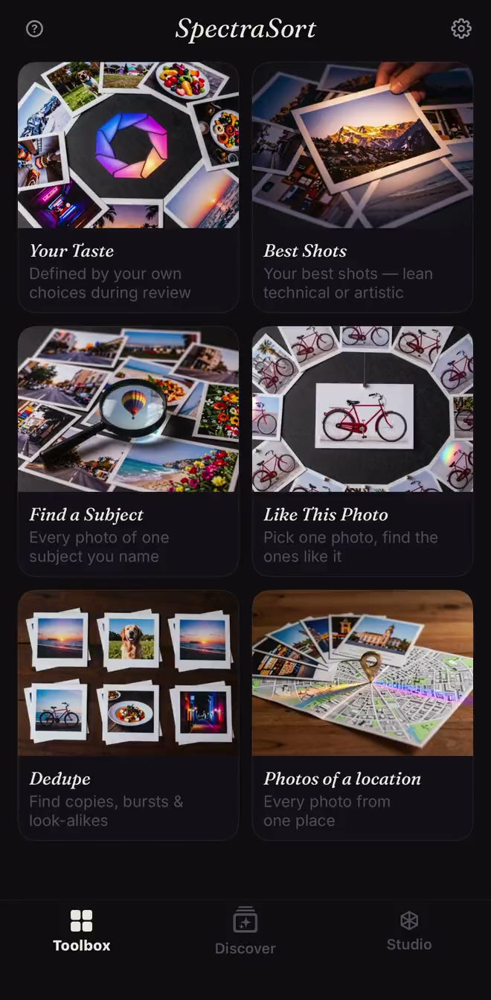
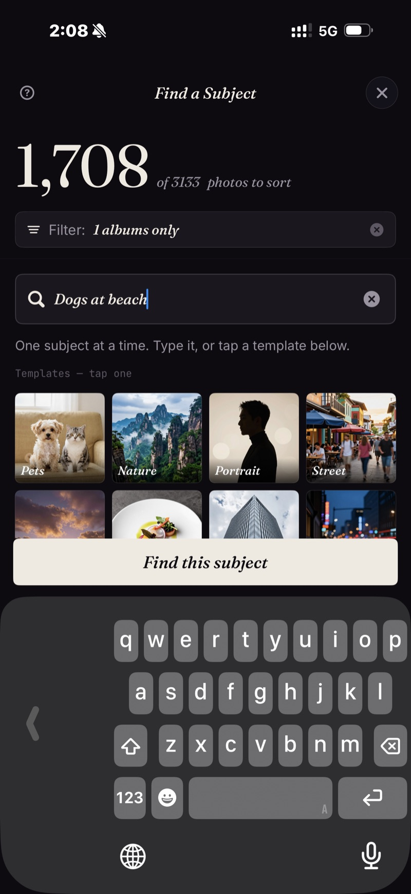

<section class="page-hero">
  

    
<a href="/es/">SpectraSort</a>&#8250;Prensa

    <h1>Kit de prensa.</h1>
    
Todo lo que un periodista necesita para verificar SpectraSort: los datos, las capturas de pantalla y un contacto. Actualizado el 31 de octubre de 2026, con la versión 3.2.

    

      <a class="cta" href="/press/spectrasort-press-kit.zip">Descargar el kit de prensa</a>
      ZIP &middot; icono, capturas de pantalla, ficha de datos
    

  

</section>

<section class="slab">
  

    

      Los datos
      <h2>Qué es SpectraSort, en una tabla.</h2>
      
SpectraSort es un selector de fotos con IA para iPhone que funciona en el dispositivo y clasifica tu carrete por calidad y por tu propio gusto. También selecciona, elimina duplicados y limpia. Un solo pago, sin suscripción.

    

    

      <table class="cmp">
        <tbody>
          <tr><th>Nombre</th><td>SpectraSort</td></tr>
          <tr><th>Qué es</th><td>Un selector de fotos con IA para iPhone que funciona en el dispositivo. Clasifica un carrete por calidad y por un perfil de gustos aprendido de lo que el usuario conserva y descarta. También selecciona, elimina duplicados y limpia.</td></tr>
          <tr><th>Plataforma</th><td>iPhone, iOS 18.5 o posterior. Sin versión para iPad, Mac, Android ni web.</td></tr>
          <tr><th>Idiomas</th><td>Inglés, francés, alemán, italiano, español y portugués (Brasil). La edición para China continental es 光谱挑片.</td></tr>
          <tr><th>Precio</th><td>Descarga gratis. Cinco acciones por semana son gratis para siempre; un solo pago para acciones ilimitadas y Studio. Sin suscripción, sin cuenta y sin tarjeta para empezar.</td></tr>
          <tr><th>Privacidad</th><td>100% en el dispositivo. La búsqueda, la puntuación y el perfil de gustos se ejecutan en el Neural Engine del iPhone. Sin subir fotos, sin cuenta y sin servidor de SpectraSort.</td></tr>
          <tr><th>Velocidad</th><td>Hasta 100 fotos por segundo en iPhones recientes. El índice se crea en la primera ordenación y después se mantiene al día automáticamente.</td></tr>
          <tr><th>Herramientas</th><td>Seis herramientas de un toque: Tu gusto, Mejores fotos, Buscar un sujeto, Como esta foto, Duplicados y Fotos de un lugar. Studio añade siete ejes de calidad, hasta tres sujetos y perfiles guardados. La búsqueda escrita de Buscar un sujeto funciona por ahora en inglés; las plantillas funcionan en cualquier idioma.</td></tr>
          <tr><th>Primera versión</th><td>Enero de 2026. La versión 3.2 llegó en noviembre de 2026.</td></tr>
          <tr><th>Creador</th><td>Mike Lu, desarrollador independiente.</td></tr>
          <tr><th>Contacto</th><td><a href="mailto:spectrasortapp@gmail.com">spectrasortapp@gmail.com</a></td></tr>
        </tbody>
      </table>
    

  

</section>

<section class="slab rise">
  

    

      Novedades en 3.2
      <h2>Cinco idiomas. Menos papel.</h2>
      
La versión 3.2 añade francés, alemán, italiano, español y portugués (Brasil) a toda la interfaz y a la ficha del App Store. También añade un interruptor <b>Documentos y recibos</b> en Filtros → Excluir: las capturas de pantalla, los formularios y las fotos de papel se quedan fuera antes de ordenar, así que la revisión son las fotos que el usuario quería conservar.

      
El uso compartido se corrigió en la misma versión: Instagram, WeChat y Xiaohongshu ya aceptan la foto con la orientación correcta, tanto en envíos de una foto como de varias. <a href="/es/changelog/">Las notas completas de la 3.2 →</a>

    

  

</section>

<section class="slab">
  

    

      El creador
      <h2>Hecho por Mike Lu.</h2>
      
Mike Lu es el desarrollador independiente detrás de SpectraSort. Construyó la app en torno a una pregunta que casi todas las herramientas de fotos se saltan: no «¿es una buena foto?», sino «¿la conservarías?». La app aprende de las decisiones de conservar y descartar que una persona ya toma, y luego clasifica la fototeca del mismo modo.

      
SpectraSort se lanzó por primera vez en enero de 2026. Está hecha sin servidor, sin cuenta y sin suscripción: la app y el modelo de negocio son pequeños a propósito.

    

  

</section>

<section class="slab rise">
  

    

      Capturas de pantalla
      <h2>Tres capturas reales.</h2>
      
Los archivos a tamaño completo están en el kit de prensa. La app funciona en el dispositivo; las capturas son de una fototeca real.

      

        <figure><figcaption>La caja de herramientas: seis herramientas de un toque, con Tu gusto arriba.</figcaption></figure>
        <figure><figcaption>Buscar un sujeto: escribe una frase y obtén coincidencias ordenadas de mejor a peor.</figcaption></figure>
        <figure><figcaption>Acciones en lote: las elegidas a un álbum, las favoritas marcadas y el resto fuera.</figcaption></figure>
      

      

        <a class="cta" href="/press/spectrasort-press-kit.zip">Descargar el kit de prensa</a>
        ZIP &middot; icono, 3 capturas de pantalla, ficha de datos
      

    

  

</section>

<section class="slab">
  

    Enfoques que merecen una mirada
    <h2>Tres historias dentro de la app.</h2>
    <ul>
      <li><b>La utilidad antisuscripción.</b> Una sola compra, sin suscripción, sin cuenta y sin servidor. Una app de fotos que no necesita la nube.</li>
      <li><b>IA en el dispositivo sin necesidad de Apple Intelligence.</b> La puntuación, la búsqueda y el perfil de gustos se ejecutan en el Neural Engine, sin conexión, en iOS 18.5 o posterior.</li>
      <li><b>Cinco idiomas a la vez.</b> La versión 3.2 traduce toda la interfaz y la ficha del App Store al francés, alemán, italiano, español y portugués (Brasil).</li>
    </ul>
    

      
Lo que no vamos a afirmar

      <ul>
        <li>Nada de «mejor que Apple Photos». Están hechas para trabajos distintos: Apple Photos navega y guarda; SpectraSort elige y clasifica.</li>
        <li>Ningún porcentaje de acierto para el clasificador de documentos. Es un filtro, no una promesa.</li>
        <li>Sin nube, sin cuenta y sin entrenamiento con las fotos del usuario: son hechos de arquitectura, no eslóganes de marketing.</li>
      </ul>
    

  

</section>
