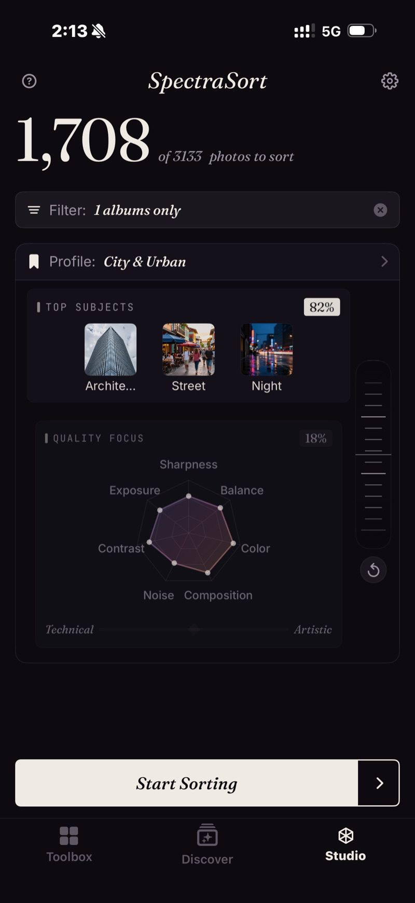

<section class="page-hero">
  

    
<a href="/es/">SpectraSort</a>&#8250;Studio

    <h1>Studio. Cuando quieres los controles.</h1>
    
Las herramientas de un toque deciden qué significa «mejor». Studio te pasa esa decisión a ti: cuáles de los siete ejes de calidad cuentan, qué sujetos importan y cuánto debe pesar una coincidencia con el sujeto frente a una toma nítida. Guárdalo como perfil y todas las ordenaciones siguientes serán tuyas.

    

      <a class="cta" href="https://apps.apple.com/us/app/spectrasort-ai-photo-picker/id6757512134?ppid=5fd01708-3a73-4412-9bea-b411522af1f3"><svg viewBox="0 0 24 24" aria-hidden="true"><path d="M17.05 12.04c-.02-2.16 1.77-3.2 1.85-3.25-1.01-1.48-2.59-1.68-3.14-1.7-1.33-.13-2.61.78-3.29.78-.69 0-1.73-.76-2.85-.74-1.46.02-2.83.85-3.59 2.17-1.54 2.66-.39 6.59 1.1 8.75.73 1.06 1.6 2.24 2.73 2.2 1.1-.04 1.51-.71 2.84-.71 1.32 0 1.7.71 2.85.69 1.18-.02 1.92-1.07 2.64-2.13.84-1.22 1.18-2.42 1.2-2.48-.03-.01-2.3-.88-2.34-3.58zM14.95 5.6c.61-.74 1.02-1.77.9-2.8-.88.04-1.94.58-2.57 1.31-.56.65-1.06 1.7-.93 2.71.98.07 1.99-.5 2.6-1.22z"/></svg>
        Descargar en el App Store
      </a>
      Gratis &middot; iPhone &middot; iOS 18.5+
    

    

      <b>Siete</b> ejes de calidad
      <b>Hasta tres</b> sujetos por ordenación
      <b>Incluido</b> con Premium: un solo pago
    

  

</section>

<section id="quality-focus" class="slab">
  

    

      

        Enfoque en calidad: siete ejes
        <h2>Nitidez para la fauna. Composición para la calle.</h2>
        
Nitidez, exposición, contraste y ruido en el lado técnico. Composición, armonía de color y equilibrio visual en el lado artístico. Arrastra cualquier punto del radar para ponderarlo, o mueve el control Técnico / Artístico para desplazar los siete a la vez.

      

      

        

          

          
Un perfil guardado, Ciudad y urbano: tres temas al 82 %, calidad al 18 %, con contraste y color por delante.

        

      

    

  

</section>

<section id="balance-wheel" class="slab rise">
  

    

      

        Sujetos y la rueda de equilibrio
        <h2>La coincidencia con el sujeto frente a la calidad.</h2>
        
Hasta tres sujetos en una ordenación: plantillas o cualquier cosa que puedas escribir. La rueda decide cuánto debe contar una coincidencia. Gírala hacia Sujetos y gana una buena foto de lo correcto. Gírala hacia Calidad y gana la toma más nítida y mejor compuesta, sea lo que sea que muestre.

      

      

        

          

            <video class="screen-loop" src="/video/web-studio-wheel.mp4"
                   poster="/images/shots/studio-wheel-poster.jpg"
                   loop muted playsinline preload="none"
                   width="920" height="852"
                   aria-label="La rueda de equilibrio de Studio girando de un lado a otro: el peso de Temas principales baja del 75 % al 25 % mientras el radar de Enfoque en calidad sube del 25 % al 75 %, y luego vuelve"></video>
          

        

      

    

  

</section>

<section id="profiles" class="slab">
  

    Perfiles
    <h2>Configúralo una vez. Reutilízalo siempre.</h2>
    
Marca cualquier configuración con su propio nombre y cambia entre ellas desde la pantalla de inicio. Parte de Tu gusto y ajústalo: la app crea una copia personalizada, así que el perfil aprendido sigue intacto y sigue aprendiendo.

    
El perfil que elijas gobierna todas las ordenaciones, incluidos Duplicados y Fotos de un lugar, así que la que se queda en una pila o la mejor foto de una ciudad se juzga con tus criterios. La cuadrícula de revisión indica el perfil que hizo la ordenación.

  

</section>

<section id="pricing" class="slab rise">
  

    

      Precios
      <h2>Incluido con Premium: un solo pago.</h2>
      
Las seis herramientas de un toque son gratis, con cinco acciones gratuitas a la semana. Studio forma parte de Premium: ordenaciones personalizadas y perfiles guardados, además de acciones ilimitadas. Una sola compra, sin suscripción.

      <a class="cta" href="https://apps.apple.com/us/app/spectrasort-ai-photo-picker/id6757512134?ppid=5fd01708-3a73-4412-9bea-b411522af1f3"><svg viewBox="0 0 24 24" aria-hidden="true"><path d="M17.05 12.04c-.02-2.16 1.77-3.2 1.85-3.25-1.01-1.48-2.59-1.68-3.14-1.7-1.33-.13-2.61.78-3.29.78-.69 0-1.73-.76-2.85-.74-1.46.02-2.83.85-3.59 2.17-1.54 2.66-.39 6.59 1.1 8.75.73 1.06 1.6 2.24 2.73 2.2 1.1-.04 1.51-.71 2.84-.71 1.32 0 1.7.71 2.85.69 1.18-.02 1.92-1.07 2.64-2.13.84-1.22 1.18-2.42 1.2-2.48-.03-.01-2.3-.88-2.34-3.58zM14.95 5.6c.61-.74 1.02-1.77.9-2.8-.88.04-1.94.58-2.57 1.31-.56.65-1.06 1.7-.93 2.71.98.07 1.99-.5 2.6-1.22z"/></svg>
        Descargar en el App Store
      </a>
    

  

</section>

<section id="faq" class="slab">
  

    

      Preguntas frecuentes
      <h2>Preguntas sobre Studio.</h2>
    

    

      

¿Para quién es Studio?

Para quien hace muchas fotos y selecciona en el teléfono: trabajos de eventos y viajes con nitidez y exposición primero, y el ruido ignorado en las fotos de noche. Para quien tiene un estilo propio que los valores predeterminados no capturan: color y composición por delante, uno o dos sujetos fijados. Y para quien simplemente no está de acuerdo con Mejores fotos y quiere dejar el control a su manera, una sola vez.

      

¿Cuál es la diferencia entre Studio y Mejores fotos?

Mejores fotos es un solo control: lo técnico en un extremo y lo artístico en el otro. Studio lo divide en siete ejes que ponderas por separado, añade hasta tres sujetos y la rueda de equilibrio, y te deja guardar el resultado como perfil.

      

¿Personalizar cambia mi perfil de gustos?

No. Al personalizar se crea una copia a medida; el perfil aprendido sigue intacto y sigue aprendiendo. Puedes restablecerlo o reconstruirlo desde Ajustes cuando quieras.

      

¿Puedo ordenar por sujeto y por calidad en la misma ordenación?

Sí: para eso está la rueda de equilibrio. Gírala hacia Sujetos y gana una buena foto de lo correcto; gírala hacia Calidad y gana la toma más nítida y mejor compuesta, sea lo que sea que muestre.

      

¿Un perfil de Studio se aplica a Duplicados y a las ordenaciones por lugar?

Sí. El perfil que elijas gobierna todas las ordenaciones, así que la que se queda en una pila o la mejor foto de una ciudad se juzga con tus criterios. La cuadrícula de revisión indica el perfil que hizo la ordenación.

      

¿Studio es gratis?

Studio forma parte de Premium: un solo pago, sin suscripción. Puedes abrirlo en la versión gratuita y verlo; las ordenaciones personalizadas y los perfiles guardados requieren Premium. Las seis herramientas de un toque siguen siendo gratis, con cinco acciones gratuitas a la semana.

    

  

</section>

<section class="slab">
  

    

      Sigue leyendo
      

        <a href="/es/photo-culling-iphone/">Selección de fotos en iPhonePrimero ordenar, luego deslizar</a>
        <a href="/es/features/">Todas las funcionesHerramientas, controles y límites en una página</a>
        <a href="/es/find-best-photos-iphone/">Encuentra tus mejores fotosPor frase, por ejemplo, por gusto</a>
      

    

  

</section>
