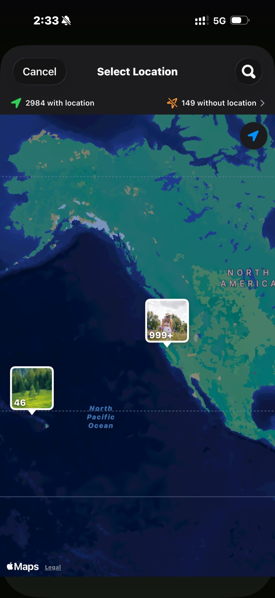

<section class="page-hero">
  

    
<a href="/es/">SpectraSort</a>&#8250;Fotos de vacaciones

    <h1>1.200 fotos de vacaciones → el álbum que merece mostrarse.</h1>
    
Un viaje de dos semanas vuelve a casa como mil fotos y una promesa de «ya las miraré». SpectraSort hace ese repaso: el viaje ya está reunido en una Escena, cada foto vuelve clasificada, las once puestas de sol están en una sola pila y tus elegidas acaban en un álbum, en el vuelo de vuelta.

    

      <a class="cta" href="https://apps.apple.com/us/app/spectrasort-ai-photo-picker/id6757512134?ppid=5fd01708-3a73-4412-9bea-b411522af1f3"><svg viewBox="0 0 24 24" aria-hidden="true"><path d="M17.05 12.04c-.02-2.16 1.77-3.2 1.85-3.25-1.01-1.48-2.59-1.68-3.14-1.7-1.33-.13-2.61.78-3.29.78-.69 0-1.73-.76-2.85-.74-1.46.02-2.83.85-3.59 2.17-1.54 2.66-.39 6.59 1.1 8.75.73 1.06 1.6 2.24 2.73 2.2 1.1-.04 1.51-.71 2.84-.71 1.32 0 1.7.71 2.85.69 1.18-.02 1.92-1.07 2.64-2.13.84-1.22 1.18-2.42 1.2-2.48-.03-.01-2.3-.88-2.34-3.58zM14.95 5.6c.61-.74 1.02-1.77.9-2.8-.88.04-1.94.58-2.57 1.31-.56.65-1.06 1.7-.93 2.71.98.07 1.99-.5 2.6-1.22z"/></svg>
        Descargar en el App Store
      </a>
      Gratis &middot; iPhone &middot; iOS 18.5+ &middot; Actualizado el 31 de octubre de 2026
    

    

      <b>100% en el dispositivo</b> — nada se sube
      <b>Gratis</b> — 5 acciones por semana
      <b>Un solo pago</b> — acciones ilimitadas
    

  

</section>

<section id="find-the-trip" class="slab">
  

    

      

        Encuentra el viaje
        <h2>Ya es una Escena.</h2>
        
Abre Descubrir y el viaje está ahí, reunido por fecha y lugar, sin necesidad de álbum. O toca Fotos de un lugar y marca la ciudad: todas las fotos hechas allí, nada más.

        
Las fotos de hace años también cuentan. El marcador encuentra aquel viaje anterior que olvidaste que fotografiaste.

      

      

        

          

        

      

    

  

</section>

<section id="rank" class="slab rise">
  

    

      

        Clasifica
        <h2>Las que se quedan suben antes de que deslices.</h2>
        
Mejores fotos pone arriba los fotogramas más nítidos y mejor compuestos. Tu gusto, cuando ya te conoce, pone arriba las que habrías elegido. En cualquier caso, la revisión empieza por las ganadoras y no por la foto 1 de 1.200.

        
Inclina el control hacia artístico para las puestas de sol y hacia técnico para las fotos de grupo.

      

      

        

          

        

      

    

  

</section>

<section id="retakes" class="slab">
  

    

      

        Repeticiones
        <h2>11 fotos de la misma puesta de sol → un solo deslizamiento.</h2>
        
Puestas de sol, fotos de grupo, las vistas desde el hotel: cada momento que fotografiaste seis veces llega como una sola pila con la más nítida marcada. Gira la rueda, quédate con una y sigue.

      

      

        

          

        

      

    

  

</section>

<section id="finish" class="slab rise">
  

    

      

        Termina
        <h2>Álbum hecho. El resto, eliminado.</h2>
        
Acciones en lote pone las conservadas en un álbum que aparece en Apple Photos, y también en la hoja de compartir para el chat del grupo. Mantén el resto o elimínalo desde el diálogo del sistema hasta Eliminados recientemente.

      

      

        

          

        

      

    

  

</section>

<section id="the-trip-in-three-steps" class="slab">
  

    
El viaje, en tres pasos

    

      

Encuentra

La Escena, el marcador en el mapa o los meses en la Cronología.

      

Desliza

Resultados clasificados, repeticiones apiladas, tres gestos. Autoselección si prefieres ojear a deslizar.

      

Archiva

Un álbum, la hoja de compartir y el resto eliminado: una sola pantalla.

    

  

</section>

<section class="slab rise">
  

    <h2>La letra pequeña</h2>
    
Las Escenas, las puntuaciones y el perfil de gustos se ejecutan en el Neural Engine del iPhone. Nada se sube y no hay cuenta. <a href="/es/private-ai-photo-app/">Más sobre cómo funciona →</a>

    

      
Dónde no ayuda

      <ul>
        <li>Solo iPhone, iOS 18.5 o posterior. Sin versión para iPad, Android ni escritorio.</li>
        <li>El primer índice de una fototeca grande tarda un poco. Después es automático: las fotos nuevas se indexan según aparecen, así que no vuelves a esperar.</li>
        <li>La búsqueda de lugares por nombre usa Apple Maps y necesita conexión. Las Escenas, la Cronología y la ordenación en sí funcionan sin conexión.</li>
        <li>Las fotos eliminadas pasan por la papelera de iOS: van a Eliminados recientemente y el espacio vuelve en cuanto vacías ese álbum allí, o automáticamente a los 30 días.</li>
      </ul>
    

  

</section>

<section id="pricing" class="slab">
  

    

      Precio
      <h2>Cinco acciones gratis por semana. Un solo pago para tenerlas ilimitadas.</h2>
      
Cinco acciones gratis por semana, sin cuenta y sin tarjeta. Un solo pago para tener acciones ilimitadas. Sin suscripción, nunca. Hecho por un desarrollador independiente que la usa cada día.

      <a class="cta" href="https://apps.apple.com/us/app/spectrasort-ai-photo-picker/id6757512134?ppid=5fd01708-3a73-4412-9bea-b411522af1f3"><svg viewBox="0 0 24 24" aria-hidden="true"><path d="M17.05 12.04c-.02-2.16 1.77-3.2 1.85-3.25-1.01-1.48-2.59-1.68-3.14-1.7-1.33-.13-2.61.78-3.29.78-.69 0-1.73-.76-2.85-.74-1.46.02-2.83.85-3.59 2.17-1.54 2.66-.39 6.59 1.1 8.75.73 1.06 1.6 2.24 2.73 2.2 1.1-.04 1.51-.71 2.84-.71 1.32 0 1.7.71 2.85.69 1.18-.02 1.92-1.07 2.64-2.13.84-1.22 1.18-2.42 1.2-2.48-.03-.01-2.3-.88-2.34-3.58zM14.95 5.6c.61-.74 1.02-1.77.9-2.8-.88.04-1.94.58-2.57 1.31-.56.65-1.06 1.7-.93 2.71.98.07 1.99-.5 2.6-1.22z"/></svg>
        Descargar en el App Store
      </a>
    

  

</section>

<section id="faq" class="slab rise">
  

    

      FAQ
      <h2>Preguntas sobre viajes.</h2>
    

    

      

¿Cuánto se tarda en repasar las fotos de un viaje?

La ordenación en sí tarda un momento una vez indexada la fototeca: el primer índice va a hasta 100 fotos por segundo en iPhones recientes y ocurre una sola vez. Tus deslizamientos son el tiempo real, y la clasificación y el apilado los reducen: las ganadoras están arriba y cada repetición cuesta un gesto.

      

¿Qué pasa con las fotos que no elijo?

Nada, salvo que tú digas lo contrario. Mantener es un grupo, no un borrado. Todo lo que elimines pasa por el diálogo del sistema hasta Eliminados recientemente, donde se queda 30 días.

      

¿Puedo hacerlo en el avión, sin conexión?

Ordenar, clasificar y revisar se ejecutan por completo en el teléfono, así que sí. Buscar un lugar por nombre usa Apple Maps y necesita conexión; abrir el viaje desde las Escenas o la Cronología, no.

      

¿Puedo ordenar varios viajes a la vez?

En la Cronología, marca todos los meses que quieras y ordénalos juntos. O filtra por un rango de fechas personalizado que abarque todo el verano.

      

¿Sube mis fotos del viaje?

No. Las Escenas, las puntuaciones y el perfil de gustos se calculan y se guardan en tu iPhone. Sin subidas, sin cuenta.

    

  

</section>

<section class="slab">
  

    

      Sigue leyendo
      

        <a href="/es/photo-culling-iphone/">Descarte de fotos en iPhoneEl flujo completo de mantener o eliminar</a>
        <a href="/es/photo-organizer-iphone/">Organizador de fotos con IAAgrupadas, ordenadas y archivadas</a>
        <a href="/es/duplicate-photo-finder-iphone/">Buscador de fotos duplicadasRáfagas y parecidos, apilados</a>
      

    

  

</section>
