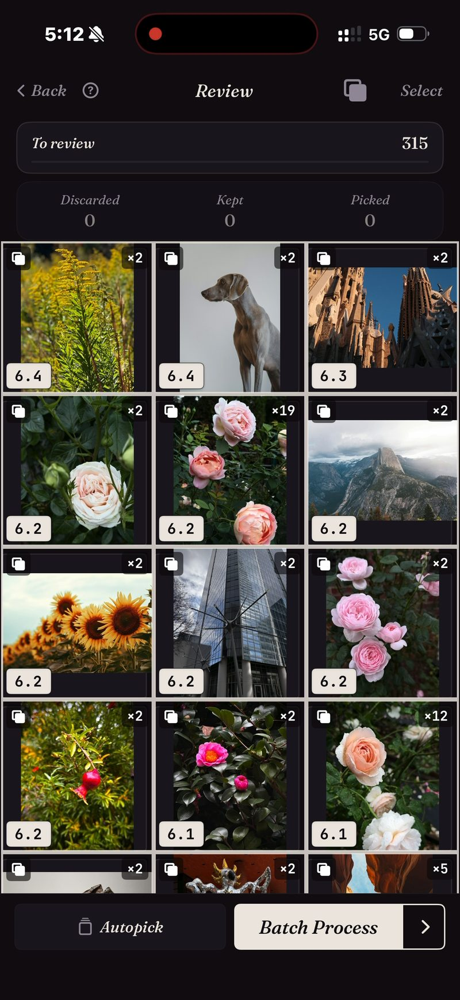

<section class="page-hero">
  

    
<a href="/fr/">SpectraSort</a>&#8250;Détecteur de doublons

    <h1>Les photos en double, empilées et réglées.</h1>
    
Une même rose photographiée 19 fois. Le même skyline, neuf voyages de suite. Toutes les rafales que vous n'avez jamais triées. SpectraSort empile les trois cas, signale la plus nette et supprime le reste en un seul lot.

    

      <a class="cta" href="https://apps.apple.com/us/app/spectrasort-ai-photo-picker/id6757512134?ppid=5fd01708-3a73-4412-9bea-b411522af1f3"><svg viewBox="0 0 24 24" aria-hidden="true"><path d="M17.05 12.04c-.02-2.16 1.77-3.2 1.85-3.25-1.01-1.48-2.59-1.68-3.14-1.7-1.33-.13-2.61.78-3.29.78-.69 0-1.73-.76-2.85-.74-1.46.02-2.83.85-3.59 2.17-1.54 2.66-.39 6.59 1.1 8.75.73 1.06 1.6 2.24 2.73 2.2 1.1-.04 1.51-.71 2.84-.71 1.32 0 1.7.71 2.85.69 1.18-.02 1.92-1.07 2.64-2.13.84-1.22 1.18-2.42 1.2-2.48-.03-.01-2.3-.88-2.34-3.58zM14.95 5.6c.61-.74 1.02-1.77.9-2.8-.88.04-1.94.58-2.57 1.31-.56.65-1.06 1.7-.93 2.71.98.07 1.99-.5 2.6-1.22z"/></svg>
        Télécharger sur l'App Store
      </a>
      Gratuit &middot; iPhone &middot; iOS 18.5+ &middot; Mis à jour le 31 octobre 2026
    

    

      <b>100 % sur l'appareil</b> — rien n'est envoyé
      <b>Gratuit</b> 5 actions par semaine
      <b>Un seul paiement</b> — actions illimitées
    

  

</section>

<section class="slab">
  

    <h2>iOS trouve un type de doublon. Il y en a trois.</h2>
    
<b>Doublons</b> — copies exactes du même fichier. <b>Rafales</b> — prises à quelques secondes d'intervalle, aucune identique à l'octet près. <b>Similaires</b> — la même scène, photographiée de nouveau des mois plus tard.

    
Photos Apple fusionne le premier type. Les deux autres représentent l'essentiel de l'encombrement. SpectraSort compare le contenu de l'image, donc les trois finissent en piles.

  

</section>

<section id="stacked-before-you-look" class="slab rise">
  

    

      

        Empilées avant votre regard
        <h2>315 photos → les piles qui comptent.</h2>
        
Lancez Doublons sur un voyage, un mois ou toute la photothèque et la grille revient groupée. Chaque pile indique combien de prises elle contient et le score de sa meilleure prise. Les photos seules restent à l'écart.

      

      

        

          

          
Une vraie passe : 315 photos, la plupart des piles sont des paires, quelques-unes une douzaine de prises, une rose ×19.

        

      

    

  

</section>

<section id="one-stack-one-decision" class="slab">
  

    

      

        Une pile, une décision
        <h2>19 prises → une seule à garder.</h2>
        
Dans une pile, les prises sont sur une roue. Faites-les défiler sans quitter la photo, gardez celle que vous voulez, et la pile est réglée.

        
Ou laissez Sélection auto s'en charger : les copies passent dans Écarter et la meilleure de chaque pile reste pour que vous décidiez. Ensuite, un seul lot supprime les rejets — derrière la boîte de confirmation du système, vers Supprimés récemment.

      

      

        

          

        

      

    

  

</section>

<section id="how-it-works" class="slab rise">
  

    
Comment ça marche

    

      

Analyser

Doublons lit l'index local — construit une fois, puis tenu à jour à mesure que de nouvelles photos arrivent. Jusqu'à 100 photos par seconde à la première passe.

      

Choisir

La plus nette est signalée dans chaque pile. Confirmez-la, ou faites tourner la roue et choisissez-en une autre.

      

Supprimer

Un seul lot. Les suppressions passent par la boîte du système, vers Supprimés récemment.

    

    

      
C'est en supprimant les doublons qu'on récupère l'essentiel de l'espace d'une pellicule. Les photos supprimées arrivent dans l'album Supprimés récemment d'iOS ; videz-le et l'espace revient aussitôt, ou laissez-le et iOS le libère après 30 jours. Chaque suppression dans SpectraSort affiche l'espace libéré avant que vous confirmiez.

    

  

</section>

<section class="slab">
  

    <h2>Les détails</h2>
    
La comparaison tourne sur le Neural Engine de l'iPhone. Rien n'est envoyé et il n'y a pas de compte. <a href="/fr/private-ai-photo-app/">En savoir plus sur ce fonctionnement →</a>

    

      
Là où ça ne vous aidera pas

      <ul>
        <li>Il ne regarde que votre photothèque — pas les fichiers, les téléchargements ni le reste du téléphone.</li>
        <li>iPhone uniquement, iOS 18.5 ou ultérieur. Pas de version iPad, Android ni ordinateur.</li>
        <li>Le tout premier index d'une grande photothèque prend du temps. Ensuite, c'est automatique : les nouvelles photos sont indexées à leur arrivée, vous n'attendez plus.</li>
        <li>Les photos supprimées passent par la corbeille d'iOS : elles arrivent dans Supprimés récemment, et l'espace revient dès que vous videz cet album — ou automatiquement après 30 jours.</li>
      </ul>
    

  

</section>

<section id="pricing" class="slab rise">
  

    

      Tarifs
      <h2>Cinq actions gratuites par semaine. Un seul paiement pour l'illimité.</h2>
      
Cinq actions gratuites par semaine, sans compte et sans carte bancaire. Un seul paiement pour des actions illimitées. Sans abonnement, jamais. Conçu par un développeur indépendant qui l'utilise tous les jours.

      <a class="cta" href="https://apps.apple.com/us/app/spectrasort-ai-photo-picker/id6757512134?ppid=5fd01708-3a73-4412-9bea-b411522af1f3"><svg viewBox="0 0 24 24" aria-hidden="true"><path d="M17.05 12.04c-.02-2.16 1.77-3.2 1.85-3.25-1.01-1.48-2.59-1.68-3.14-1.7-1.33-.13-2.61.78-3.29.78-.69 0-1.73-.76-2.85-.74-1.46.02-2.83.85-3.59 2.17-1.54 2.66-.39 6.59 1.1 8.75.73 1.06 1.6 2.24 2.73 2.2 1.1-.04 1.51-.71 2.84-.71 1.32 0 1.7.71 2.85.69 1.18-.02 1.92-1.07 2.64-2.13.84-1.22 1.18-2.42 1.2-2.48-.03-.01-2.3-.88-2.34-3.58zM14.95 5.6c.61-.74 1.02-1.77.9-2.8-.88.04-1.94.58-2.57 1.31-.56.65-1.06 1.7-.93 2.71.98.07 1.99-.5 2.6-1.22z"/></svg>
        Télécharger sur l'App Store
      </a>
    

  

</section>

<section id="faq" class="slab">
  

    

      FAQ
      <h2>Questions sur les doublons.</h2>
    

    

      

En quoi est-ce différent du détecteur de doublons intégré d'Apple ?

L'album Doublons de Photos Apple fusionne les copies exactes et quasi exactes d'une même prise. SpectraSort empile aussi les rafales, les reprises et les similaires — des fichiers différents d'un même moment — et signale la plus nette de chaque pile. C'est l'essentiel de l'encombrement.

      

Peut-il supprimer des photos sans demander ?

Non. Rien ne change tant que vous ne touchez pas, et chaque suppression passe par la boîte de confirmation de Photos, vers Supprimés récemment, où elle reste 30 jours.

      

Supprimer les doublons libère-t-il l'espace tout de suite ?

Les photos supprimées arrivent dans l'album Supprimés récemment d'iOS. Videz cet album et l'espace revient immédiatement ; laissez-le et iOS l'efface après 30 jours. SpectraSort affiche l'espace libéré par chaque suppression avant que vous confirmiez.

      

Puis-je choisir ce qui compte comme doublon ?

Oui. Trois interrupteurs d'empilement dans la Vérification : Doublons (copies exactes), Rafales (prises à quelques secondes d'intervalle) et Similaires (la même scène). Désactivez-en un et ces photos s'affichent seules.

      

Peut-il trouver des photos similaires, pas seulement des doublons ?

Même moteur. Comme cette photo classe toute la photothèque par ressemblance avec une image que vous choisissez ; l'interrupteur Similaires regroupe les similaires en piles dans n'importe quel tri. <a href="/fr/find-best-photos-iphone/">Trois façons de trouver vos meilleures photos →</a>

      

Le détecteur de doublons est-il gratuit ?

L'outil Doublons est gratuit à lancer, aussi souvent que vous voulez. Supprimer les copies compte pour une action, quel que soit leur nombre, et cinq actions par semaine sont gratuites. Premium (un seul paiement, sans abonnement) les rend illimitées.

    

  

</section>

<section class="slab">
  

    

      À lire aussi
      

        <a href="/fr/photo-culling-iphone/">Tri de photos sur iPhoneLe flux complet garder ou supprimer</a>
        <a href="/fr/vacation-photos-iphone/">Photos de vacances → un album1 200 clichés, une seule séance</a>
        <a href="/fr/ai-photo-organizer-vs-apple-photos/">vs Photos AppleOù s'arrêtent les outils intégrés</a>
      

    

  

</section>
