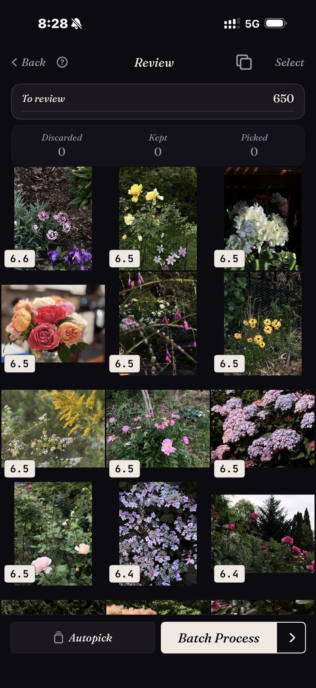

<section class="page-hero">
  

    
<a href="/fr/">SpectraSort</a>&#8250;Trouver vos meilleures photos

    <h1>Trouvez vos meilleures photos sur iPhone.</h1>
    
Quelque part dans votre pellicule se trouvent les photos que vous encadreriez vraiment. Elles sont enfouies sous tout le reste de ce que vous avez pris ce jour-là. SpectraSort vous donne trois façons de les en sortir : les décrire, en montrer une, ou laisser un profil de goût appris les faire remonter tout seul.

    

      <a class="cta" href="https://apps.apple.com/us/app/spectrasort-ai-photo-picker/id6757512134?ppid=5fd01708-3a73-4412-9bea-b411522af1f3"><svg viewBox="0 0 24 24" aria-hidden="true"><path d="M17.05 12.04c-.02-2.16 1.77-3.2 1.85-3.25-1.01-1.48-2.59-1.68-3.14-1.7-1.33-.13-2.61.78-3.29.78-.69 0-1.73-.76-2.85-.74-1.46.02-2.83.85-3.59 2.17-1.54 2.66-.39 6.59 1.1 8.75.73 1.06 1.6 2.24 2.73 2.2 1.1-.04 1.51-.71 2.84-.71 1.32 0 1.7.71 2.85.69 1.18-.02 1.92-1.07 2.64-2.13.84-1.22 1.18-2.42 1.2-2.48-.03-.01-2.3-.88-2.34-3.58zM14.95 5.6c.61-.74 1.02-1.77.9-2.8-.88.04-1.94.58-2.57 1.31-.56.65-1.06 1.7-.93 2.71.98.07 1.99-.5 2.6-1.22z"/></svg>
        Télécharger sur l'App Store
      </a>
      Gratuit &middot; iPhone &middot; iOS 18.5+ &middot; Mis à jour le 31 octobre 2026
    

    

      <b>100 % sur l'appareil</b> — rien n'est envoyé
      <b>Gratuit</b> 5 actions par semaine
      <b>Un seul paiement</b> — actions illimitées
    

  

</section>

<section id="way-1" class="slab">
  

    

      

        Façon 1 — la décrire
        <h2>Saisissez ce dont vous vous souvenez. Récupérez-le, du meilleur au moins bon.</h2>
        
Touchez un modèle comme « Portrait » ou « Nuit », ou saisissez un mot — la recherche saisie fonctionne en anglais pour l'instant. <b>Trouver un sujet</b> accepte tout ce que vous pouvez mettre en mots, qu'il soit concret, composé ou abstrait. Aucune exigence d'Apple Intelligence.

        
Ce qui diffère de la recherche intégrée, c'est l'ordre. Chaque correspondance est notée, donc le meilleur cliché de ce dont vous vous souveniez se trouve en tête au lieu d'être quelque part en neuvième ligne. La grille ici est un vrai résultat : une recherche de fleurs dans la photothèque, notée et ordonnée.

      

      

        

          

        

      

    

  

</section>

<section id="way-2" class="slab rise">
  

    

      

        Façon 2 — en montrer une
        <h2>Une bonne photo trouve les autres.</h2>
        
Parfois la requête est une photo, pas une phrase. Vous avez un bon cliché de la maison au bord du lac et vous savez qu'il y en a d'autres. <b>Comme cette photo</b> prend cet exemple et classe toute la photothèque par rapport à lui. La capture montre un vrai tri : 1 708 photos classées par rapport à une seule référence.

        
C'est la réponse la plus rapide à « je sais que cette photo existe mais je ne la trouve pas », y compris pour des photos qui datent de trois ans.

      

      

        

          

        

      

    

  

</section>

<section id="way-3" class="slab">
  

    

      

        Façon 3 — sans aucune requête
        <h2>Ou demandez simplement le meilleur.</h2>
        
<b>Meilleurs clichés</b> font remonter les images les plus nettes, les mieux exposées et les mieux composées de n'importe quelle tranche de la photothèque, et vous pouvez l'orienter vers le technique ou l'artistique.

        
<b>Vos goûts</b> vont plus loin. C'est un profil appris de vos propres choix et rejets, donc ce qui remonte est ce que <em>vous</em> auriez choisi, et non ce qu'aime un modèle générique. Aucune autre app ne fait cela.

      

      

        

          

        

      

    

  

</section>

<section id="how-it-works" class="slab rise">
  

    
Comment ça marche

    

      

Trouver

Une phrase, une photo d'exemple, un lieu ou vos goûts — six outils, un geste chacun.

      

Classer

Noté sur l'appareil pour la netteté, l'exposition, la composition et la ressemblance.

      

Terminer

Favoris marqués, album rempli ou partage — en un seul écran de lot.

    

  

</section>

<section class="slab">
  

    <h2>Tout sur votre téléphone</h2>
    
L'index, la recherche et les scores sont tous calculés sur le Neural Engine de l'iPhone : vos photos ne sont jamais envoyées et il n'y a aucun compte à créer. Une recherche dans des milliers de photos prend un instant, parce qu'elle s'appuie sur un index que l'app construit une fois — jusqu'à 100 photos par seconde sur les iPhone récents — puis tient à jour à mesure que de nouvelles photos arrivent.

    

      
Là où ça ne vous aidera pas

      <ul>
        <li>Il ne peut trouver que le meilleur de ce que vous avez pris. Il ne peut pas sauver un moment que vous n'avez pas capturé.</li>
        <li>iPhone uniquement, iOS 18.5 ou ultérieur. Pas de version iPad, Android ni ordinateur.</li>
        <li>Le tout premier index d'une grande photothèque prend du temps. Ensuite, c'est automatique : les nouvelles photos sont indexées à leur arrivée, vous n'attendez plus.</li>
        <li>Les photos supprimées passent par la corbeille d'iOS : elles arrivent dans Supprimés récemment, et l'espace revient dès que vous videz cet album — ou automatiquement après 30 jours. Chaque suppression dans SpectraSort affiche l'espace libéré avant que vous confirmiez.</li>
      </ul>
    

  

</section>

<section id="pricing" class="slab rise">
  

    

      Tarifs
      <h2>Cinq actions gratuites par semaine. Un seul paiement pour l'illimité.</h2>
      
Cinq actions gratuites par semaine, sans compte et sans carte bancaire. Un seul paiement pour des actions illimitées. Sans abonnement, jamais. Conçu par un développeur indépendant qui l'utilise tous les jours.

      <a class="cta" href="https://apps.apple.com/us/app/spectrasort-ai-photo-picker/id6757512134?ppid=5fd01708-3a73-4412-9bea-b411522af1f3"><svg viewBox="0 0 24 24" aria-hidden="true"><path d="M17.05 12.04c-.02-2.16 1.77-3.2 1.85-3.25-1.01-1.48-2.59-1.68-3.14-1.7-1.33-.13-2.61.78-3.29.78-.69 0-1.73-.76-2.85-.74-1.46.02-2.83.85-3.59 2.17-1.54 2.66-.39 6.59 1.1 8.75.73 1.06 1.6 2.24 2.73 2.2 1.1-.04 1.51-.71 2.84-.71 1.32 0 1.7.71 2.85.69 1.18-.02 1.92-1.07 2.64-2.13.84-1.22 1.18-2.42 1.2-2.48-.03-.01-2.3-.88-2.34-3.58zM14.95 5.6c.61-.74 1.02-1.77.9-2.8-.88.04-1.94.58-2.57 1.31-.56.65-1.06 1.7-.93 2.71.98.07 1.99-.5 2.6-1.22z"/></svg>
        Télécharger sur l'App Store
      </a>
    

  

</section>

<section id="faq" class="slab">
  

    

      FAQ
      <h2>Trouver vos meilleures photos.</h2>
    

    

      

Comment trouver mes meilleures photos sans tout faire défiler ?

Donnez-lui un point de départ : une phrase, une photo d'exemple, un lieu, ou simplement Meilleurs clichés sur une période. Puis vérifiez le résultat classé au lieu de la pellicule brute. Les gagnantes probables sont en tête avant que vous commenciez.

      

Peut-il trouver des photos qui datent de plusieurs années ?

Oui. L'index couvre toute votre photothèque, et la Chronologie de Découvrir va de l'année au mois puis au jour si vous préférez parcourir une période plutôt que la rechercher.

      

A-t-il besoin d'une connexion internet ?

Non. La recherche, le classement et le profil de goût tournent sur l'appareil : trouver des photos ne dépend pas d'une connexion.

      

Que signifie vraiment « meilleur » ?

Par défaut, cela veut dire netteté, exposition et composition, notées photo par photo. Avec Vos goûts, cela devient personnel : le classement se fait par ressemblance avec les photos que vous gardez. Dans Studio, vous pouvez pondérer vous-même sept axes de qualité.

    

  

</section>

<section class="slab">
  

    

      À lire aussi
      

        <a href="/fr/how-to-pick-best-photos-from-camera-roll/">Choisir les meilleures photos de votre pelliculeLa méthode pas à pas</a>
        <a href="/fr/ai-photo-picker-iphone/">Sélecteur de photos IA pour iPhoneCe que fait vraiment un sélecteur</a>
        <a href="/fr/photo-organizer-iphone/">Organisateur de photos IAScènes, Chronologie et albums</a>
      

    

  

</section>
