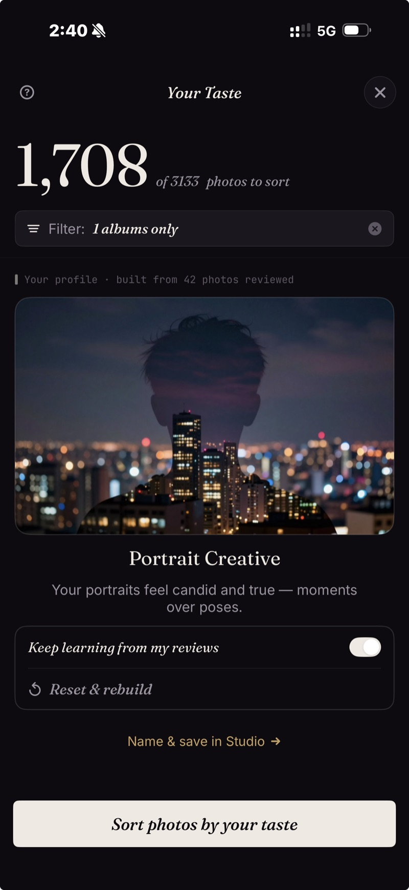
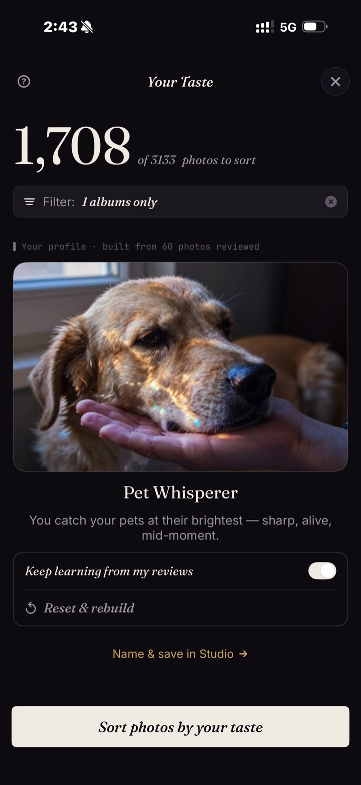
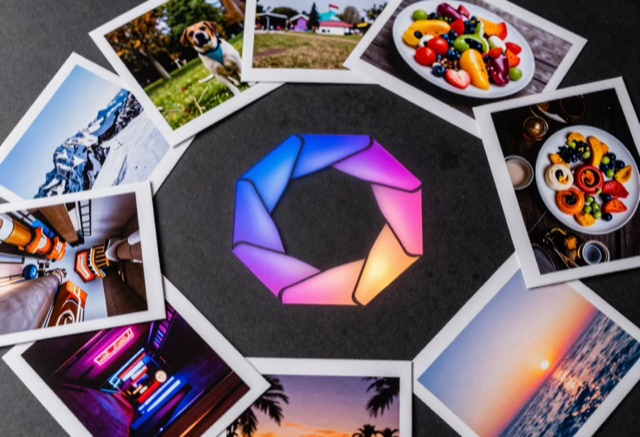
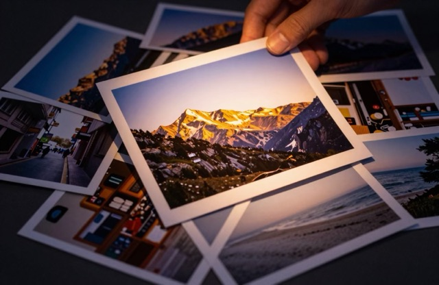
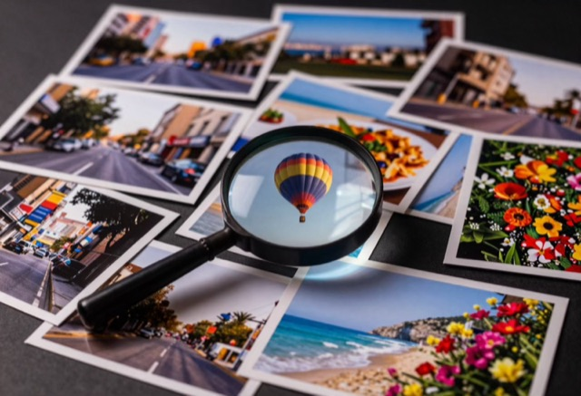
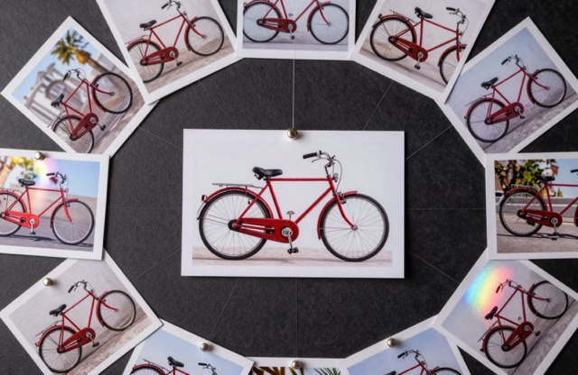
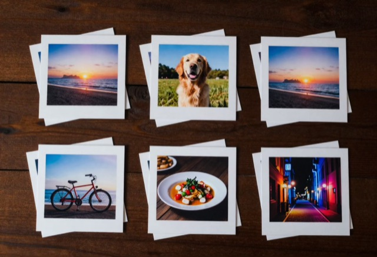
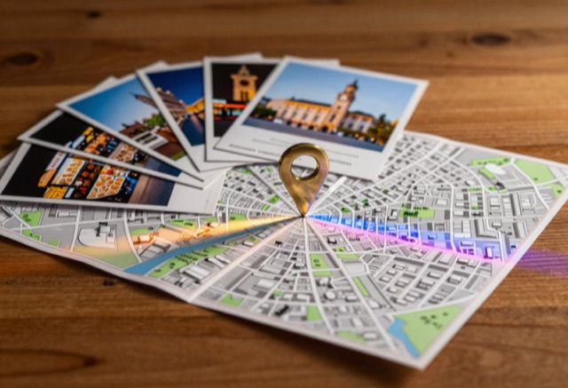
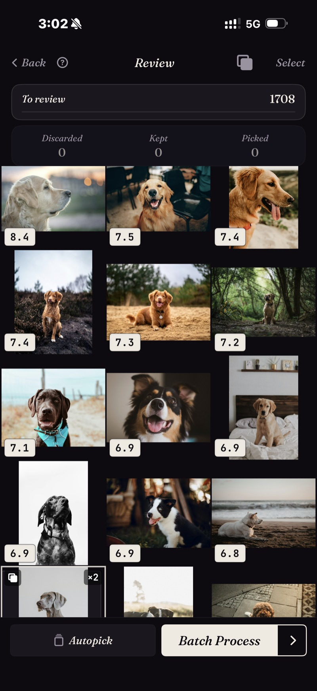

<section class="hero">
  

    

      

        Sélecteur de photos IA et tri de photos · iPhone
        <h1>Vos meilleures photos. Trouvées.</h1>
        
La plupart des apps photo demandent « cette photo est-elle bonne ? ». SpectraSort demande « <em>vous</em>, la garderiez-vous ? ». Chaque fois que vous gardez ou écartez une photo, il apprend — et votre pellicule revient classée, les meilleures en premier.

        
SpectraSort est un sélecteur de photos IA embarqué pour iPhone qui classe votre pellicule selon la qualité et vos goûts. Il trie aussi, supprime les doublons et nettoie. Un seul paiement, sans abonnement.

        

          <a class="cta" href="https://apps.apple.com/us/app/spectrasort-ai-photo-picker/id6757512134?ppid=5fd01708-3a73-4412-9bea-b411522af1f3">
            <svg viewBox="0 0 24 24" aria-hidden="true"><path d="M17.05 12.04c-.02-2.16 1.77-3.2 1.85-3.25-1.01-1.48-2.59-1.68-3.14-1.7-1.33-.13-2.61.78-3.29.78-.69 0-1.73-.76-2.85-.74-1.46.02-2.83.85-3.59 2.17-1.54 2.66-.39 6.59 1.1 8.75.73 1.06 1.6 2.24 2.73 2.2 1.1-.04 1.51-.71 2.84-.71 1.32 0 1.7.71 2.85.69 1.18-.02 1.92-1.07 2.64-2.13.84-1.22 1.18-2.42 1.2-2.48-.03-.01-2.3-.88-2.34-3.58zM14.95 5.6c.61-.74 1.02-1.77.9-2.8-.88.04-1.94.58-2.57 1.31-.56.65-1.06 1.7-.93 2.71.98.07 1.99-.5 2.6-1.22z"/></svg>
            Télécharger sur l'App Store
          </a>
          Gratuit · iPhone · iOS 18.5+ Mis à jour le 31 octobre 2026
        

        

          <b>100 % sur l'appareil</b> — rien n'est envoyé
          <b>Gratuit</b> 5 actions par semaine
          <b>Un seul paiement</b> — actions illimitées
        

      

      

        

          

            <video class="screen-loop" src="/video/web-hero.mp4"
                   poster="/images/shots/hero-poster.jpg"
                   loop muted playsinline preload="metadata"
                   width="660" height="1344"
                   aria-label="La boîte à outils de SpectraSort ouvre Vos goûts, avec un profil appris nommé Nature Explorer, puis une grille de paysages notés 8,7, 8,6, 8,6 — les meilleures en premier"></video>
          

        

      

    

  

</section>

<section id="taste" class="rise">
  

    

      

        Vos goûts — la seule app qui le fasse
        <h2>Il apprend ce que vous auriez gardé.</h2>
        
Chaque vérification lui apprend quelque chose. L'app construit un profil personnalisé autour de vos goûts. Ce qu'elle sélectionne ressemble de plus en plus à ce que vous auriez choisi vous-même.

        
Mettez son apprentissage en pause, réinitialisez-le ou affinez-le. Enregistrez autant de profils que vous voulez.

        <a class="learn-more" href="/fr/ai-photo-picker-iphone/">Comment fonctionne la sélection &rsaquo;</a>
      

      

        

          

            
          

          

            
          

          

            
          

        

        
Votre profil de goût apprend ce que vous gardez, puis trie vos photos de cette façon.

      

    

  

</section>

<section id="tools">
  

    

      Boîte à outils IA
      <h2>Six entrées. Un geste chacune.</h2>
    

    

      

        

        

Vos goûts

Construit à partir des photos que vous gardez et de celles que vous écartez.

      

      

        

        

Meilleurs clichés

Les plus nettes, les mieux exposées, les mieux composées d'abord. Plutôt technique ou artistique.

      

      

        

        

Trouver un sujet

Touchez un modèle comme « Portrait » ou « Nuit » — la recherche saisie fonctionne en anglais pour l'instant.

      

      

        

        

Comme cette photo

Pointez une photo, obtenez tout ce qui lui ressemble.

      

      

        

        

Doublons

Doublons, rafales et quasi-identiques, empilés pour être écartés.

      

      

        

        

Photos d'un lieu

Épinglez un lieu, voyez tout ce qui y a été pris.

      

    

    
<a class="learn-more" href="/fr/features/">Tous les outils, réglages et limites sur une page &rsaquo;</a>

  

</section>

<section id="find-subject" class="rise">
  

    

      

        Trouver un sujet
        <h2>Cherchez n'importe quoi — et obtenez-le classé, les meilleures d'abord.</h2>
        
Touchez un modèle comme « Portrait » ou « Nuit », ou saisissez un mot — la recherche saisie fonctionne en anglais pour l'instant. Tous les clichés arrivent dans une seule grille, classés — pas seulement trouvés.

        <a class="learn-more" href="/fr/find-best-photos-iphone/">Trois façons de retrouver une photo &rsaquo;</a>
      

      

        

          

            <video class="screen-loop" src="/video/web-find-subject.mp4"
                   poster="/images/shots/find-subject-poster.jpg"
                   loop muted playsinline preload="none"
                   width="660" height="1344"
                   aria-label="Saisie d'une recherche dans Trouver un sujet, puis la grille classée des résultats"></video>
          

        

      

    

  

</section>

<section id="like-this">
  

    

      Comme cette photo
      <h2>Choisissez une photo, retrouvez les autres.</h2>
      
Choisissez une photo et obtenez celles qui lui ressemblent, les plus proches d'abord.

        <a class="learn-more" href="/fr/find-best-photos-iphone/">La recherche par l'exemple, expliquée &rsaquo;</a>
    

    

      

        

      

      
&rarr;

      

        

      

    

  

</section>

<section id="dedupe" class="rise">
  

    

      

        Doublons
        <h2>11 clichés du même coucher de soleil &rarr; un balayage garde le plus net.</h2>
        
Les doublons, les rafales et les clichés presque identiques arrivent déjà groupés : vous choisissez celui que vous préférez et vous passez au suivant.

        <a class="learn-more" href="/fr/duplicate-photo-finder-iphone/">Comment fonctionne le détecteur de doublons &rsaquo;</a>
      

      

        

          

          

          

          

          

            Le plus net &check;
            11 photos
          

        

      

    

  

</section>

<section id="discover">
  

    

      Découvrir — scènes et chronologie
      <h2>La photothèque, un morceau à la fois.</h2>
      
Les scènes rassemblent vos voyages, vos thèmes et vos séries d'elles-mêmes. La chronologie vous fait parcourir vos jours, vos mois et vos années.

      <a class="learn-more" href="/fr/photo-organizer-iphone/">Comment fonctionne le rangement &rsaquo;</a>
    

    

      

        

      

      

        

      

    

  

</section>

<section id="done" class="rise">
  

    

      

        Vérification &rarr; Terminé
        <h2>Balayez pour garder les gagnantes. Terminez en un écran.</h2>
        
Les meilleures remontent. À droite pour conserver, vers le bas pour garder, à gauche pour écarter. Utilisez la molette pour comparer des photos similaires.

        <a class="learn-more" href="/fr/photo-culling-iphone/">Le parcours de vérification complet &rsaquo;</a>
      

      

        

          

            <video class="screen-loop" src="/video/web-review-swipe.mp4"
                   poster="/images/shots/review-swipe-poster.jpg"
                   loop muted playsinline preload="none"
                   width="660" height="1344"
                   aria-label="Deux prises presque identiques du même chien sur une molette — passage de Similaires 1 sur 2, notée 6,8, à Similaires 2 sur 2, puis sélection de l'une des deux"></video>
          

        

      

    

  

</section>

<section id="studio">
  

    

      

        Studio — réglages personnalisés
        <h2>Quand vous voulez tout régler.</h2>
        
Sept axes de qualité à régler. Jusqu'à trois sujets. Une molette d'équilibre pour arbitrer entre correspondance du sujet et qualité. Enregistrez le tout en profils de tri personnalisés.

        <a class="learn-more" href="/fr/studio/">Découvrir Studio &rsaquo;</a>
      

      

        

          

            <video class="screen-loop" src="/video/web-studio-wheel.mp4"
                   poster="/images/shots/studio-wheel-poster.jpg"
                   loop muted playsinline preload="none"
                   width="920" height="852"
                   aria-label="La molette d'équilibre de Studio tournée dans les deux sens : le poids des sujets principaux passe de 75 % à 25 % pendant que le radar Priorité qualité monte de 25 % à 75 %, puis revient"></video>
          

        

      

    

  

</section>

<section id="privacy">
  

    

      
      

      

        Privé
        <h2>Rien ne quitte votre téléphone.</h2>
        
La recherche, le classement et votre profil de goût tournent sur votre téléphone. Vos photos ne sont jamais envoyées nulle part.

        <a class="learn-more" href="/fr/private-ai-photo-app/">Comment fonctionne le traitement sur l'appareil &rsaquo;</a>
      

    

  

</section>

<section id="uses">
  

    

      À quoi ça sert
      <h2>Quatre usages. Une app.</h2>
      
Les captures de cette page et des guides sont de vrais tris, pas des maquettes : 1 708 photos classées par rapport à un exemple, un profil de goût construit à partir de 1 082 vérifications, et un tri de 650 photos qui s'est terminé avec 4 conservées, 484 gardées et 162 écartées.

    

    

      <a class="usecase" href="/fr/vacation-photos-iphone/">
        Trier un voyage
        <h3>1 200 photos de vacances &rarr; l'album qui vaut le coup d'être montré</h3>
        
Lancez un tri sur le voyage et vérifiez les gagnantes au lieu de balayer chaque prise. Les doublons et les rafales arrivent déjà empilés : chaque moment coûte une seule décision.

        Comment trier un voyage sur iPhone &rarr;
      </a>
      <a class="usecase" href="/fr/find-best-photos-iphone/">
        Retrouver d'anciens favoris
        <h3>La photo dont vous savez qu'elle existe, mais que vous ne trouvez pas</h3>
        
Décrivez-la avec des mots, ou pointez une photo qui lui ressemble. Les résultats arrivent classés, y compris ceux enfouis depuis trois ans.

        Comment retrouver vos meilleures photos &rarr;
      </a>
      <a class="usecase" href="/fr/duplicate-photo-finder-iphone/">
        Éliminer les doublons
        <h3>19 versions du même cliché, une seule à garder</h3>
        
Les doublons exacts, les rafales et les prises presque identiques arrivent groupés, la plus nette signalée. Dans la photothèque de démonstration, une rose apparaissait 19 fois ; une décision a réglé toute la pile.

        Comment fonctionne le détecteur de doublons &rarr;
      </a>
      <a class="usecase" href="/fr/ai-photo-picker-iphone/">
        Construire votre collection
        <h3>Une pellicule qui apprend ce que vous aimez</h3>
        
Chaque photo gardée ou écartée affine votre profil de goût. Au bout d'un moment, trier avec Vos goûts produit l'album que vous auriez choisi à la main.

        Ce que fait un sélecteur de photos IA &rarr;
      </a>
    

  

</section>

<section id="how" class="rise" style="padding-bottom:0;">
  

    

      Chaque tri en trois étapes
    

    

      

Trouver

Six outils, un geste chacun : mots, photo d'exemple, lieu, goûts.

      

Classer

Notée pour la netteté, l'exposition, la composition et sa ressemblance avec ce que vous gardez.

      

Terminer

Un écran : album rempli, favoris ajoutés, le reste écarté.

    

  

</section>

<section id="pricing" class="rise">
  

    Tarifs
    <h2>Cinq actions gratuites par semaine. Un seul paiement pour l'illimité.</h2>
    

      

        

          Gratuit
          
5 actions par semaine

          <ul>
            <li><b>Tri illimité</b> — les six outils, Découvrir, tous les filtres</li>
            <li>Partager, ajouter aux favoris, ajouter à un album, supprimer — chacune compte une fois</li>
            <li>Pas de compte, pas de carte bancaire</li>
            <li>Vos photos restent sur votre téléphone</li>
          </ul>
        

        

          Premium
          
Un seul paiement

          <ul>
            <li><b>Actions illimitées</b></li>
            <li>Tous les réglages de Studio — sept axes de qualité, la molette d'équilibre, des profils enregistrés</li>
            <li>Un achat lié à votre compte Apple — restaurable sur un nouveau téléphone</li>
            <li><b>Pas d'abonnement. Jamais.</b></li>
          </ul>
        

      

      

        <a class="cta grad" href="https://apps.apple.com/us/app/spectrasort-ai-photo-picker/id6757512134?ppid=5fd01708-3a73-4412-9bea-b411522af1f3">
          <svg viewBox="0 0 24 24" aria-hidden="true"><path d="M17.05 12.04c-.02-2.16 1.77-3.2 1.85-3.25-1.01-1.48-2.59-1.68-3.14-1.7-1.33-.13-2.61.78-3.29.78-.69 0-1.73-.76-2.85-.74-1.46.02-2.83.85-3.59 2.17-1.54 2.66-.39 6.59 1.1 8.75.73 1.06 1.6 2.24 2.73 2.2 1.1-.04 1.51-.71 2.84-.71 1.32 0 1.7.71 2.85.69 1.18-.02 1.92-1.07 2.64-2.13.84-1.22 1.18-2.42 1.2-2.48-.03-.01-2.3-.88-2.34-3.58zM14.95 5.6c.61-.74 1.02-1.77.9-2.8-.88.04-1.94.58-2.57 1.31-.56.65-1.06 1.7-.93 2.71.98.07 1.99-.5 2.6-1.22z"/></svg>
          Télécharger gratuitement
        </a>
        
iPhone · iOS 18.5+ · Passez à Premium dans l'app, quand vous voulez.

        
<a class="learn-more" href="/fr/pricing/">Ce qui compte comme action, et ce que Premium ajoute &rsaquo;</a>

      

    

  

</section>

<section id="faq">
  

    

      FAQ
      <h2>Questions fréquentes.</h2>
    

    

      

Mes photos quittent-elles un jour mon téléphone ?

Non. Chaque étape — la recherche, le classement, le profil de goût — tourne sur le Neural Engine de votre iPhone. Aucun envoi, aucun compte, aucun serveur SpectraSort dans le circuit.

      

SpectraSort utilise-t-il mes photos pour entraîner une IA ?

Non. Rien n'est envoyé, donc il n'y a rien sur quoi entraîner. Tout se passe sur votre iPhone, et l'auteur ne voit jamais vos photos.

      

En quoi est-ce différent de Photos Apple ou de Google Photos ?

Ces apps sont faites pour parcourir et stocker. SpectraSort est fait pour sélectionner — il classe ce qu'il trouve selon ce que vous avez demandé, ou selon ce qu'il a appris de vos goûts, puis vous propose un parcours de vérification pour agir. Et tout est 100 % local : rien sur votre photothèque ne quitte le téléphone.

      

C'est rapide à quel point ?

Quasi instantané une fois l'index sur l'appareil en place, même sur des milliers de photos. L'index se construit au premier tri — jusqu'à 100 photos par seconde sur les iPhone récents — et se met à jour automatiquement à l'arrivée de nouvelles photos.

      

Qu'est-ce qui est gratuit, et que débloque Premium ?

Cinq actions par semaine sont gratuites pour tout le monde, pour toujours — partager, ajouter aux favoris, ajouter à un album ou supprimer. Chacune compte une fois, quel que soit le nombre de photos, et le compteur se recharge le lundi. Le tri et la vérification sont gratuits et illimités. Un seul paiement débloque les actions illimitées et Studio (axes de qualité, molette d'équilibre, profils enregistrés). Sans abonnement.

      

Est-ce que ça libère de l'espace ?

Il supprime les photos que vous lui indiquez, via le circuit de suppression d'iOS : elles vont dans <b>Supprimés récemment</b>, et l'espace revient dès que vous videz cet album — ou automatiquement au bout de 30 jours. SpectraSort ne touche qu'à votre photothèque, jamais au reste du téléphone.

      

Qu'est-ce que le profil Vos goûts ?

Un profil personnel qui se dessine à mesure que vous utilisez l'app, construit à partir des photos que vous gardez et de celles que vous écartez — tout sur votre appareil. Une fois qu'il a assez appris, il trie selon vos préférences. Affinez-le dans Studio, ou réinitialisez-le et reconstruisez-le quand vous voulez. Il ne quitte jamais votre téléphone.

      

J'ai acheté Premium dans SpectraSort 2.x — est-ce que je le garde ?

Oui — même achat, il est repris automatiquement. S'il n'apparaît pas sur un nouveau téléphone, touchez Restaurer les achats dans les Réglages.

      

Sur quels appareils fonctionne-t-il ?

iPhone sous iOS 18.5 ou ultérieur. Tout le traitement tourne sur le Neural Engine d'Apple ; les puces récentes indexent et trient plus vite. Aucune fonction Apple Intelligence requise et aucun blocage par région.

    

    
<a class="learn-more" href="/fr/features/">D'autres questions ? Tous les détails sont sur la page Fonctionnalités &rsaquo;</a>

  

</section>
