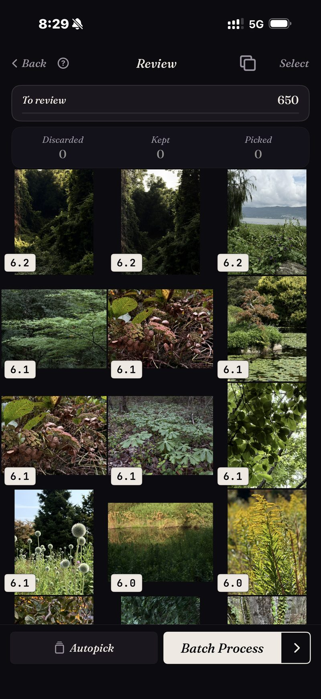

<section class="page-hero">
  

    
<a href="/fr/">SpectraSort</a>&#8250;Choisir les meilleures de votre pellicule

    <h1>Comment choisir les meilleures photos de votre pellicule.</h1>
    
Une méthode qui marche pour passer de milliers de photos aux quelques centaines qui comptent. La version à la main d'abord, puis la version assistée. Les deux fonctionnent ; une seule passe à l'échelle.

    

      <a class="cta" href="https://apps.apple.com/us/app/spectrasort-ai-photo-picker/id6757512134?ppid=5fd01708-3a73-4412-9bea-b411522af1f3"><svg viewBox="0 0 24 24" aria-hidden="true"><path d="M17.05 12.04c-.02-2.16 1.77-3.2 1.85-3.25-1.01-1.48-2.59-1.68-3.14-1.7-1.33-.13-2.61.78-3.29.78-.69 0-1.73-.76-2.85-.74-1.46.02-2.83.85-3.59 2.17-1.54 2.66-.39 6.59 1.1 8.75.73 1.06 1.6 2.24 2.73 2.2 1.1-.04 1.51-.71 2.84-.71 1.32 0 1.7.71 2.85.69 1.18-.02 1.92-1.07 2.64-2.13.84-1.22 1.18-2.42 1.2-2.48-.03-.01-2.3-.88-2.34-3.58zM14.95 5.6c.61-.74 1.02-1.77.9-2.8-.88.04-1.94.58-2.57 1.31-.56.65-1.06 1.7-.93 2.71.98.07 1.99-.5 2.6-1.22z"/></svg>
        Télécharger sur l'App Store
      </a>
      Gratuit &middot; iPhone &middot; iOS 18.5+ &middot; Mis à jour le 31 octobre 2026
    

    

      <b>100 % sur l'appareil</b> — rien n'est envoyé
      <b>Gratuit</b> 5 actions par semaine
      <b>Un seul paiement</b> — actions illimitées
    

  

</section>

<section class="slab">
  

    <h2>La méthode manuelle (sans app)</h2>
    <ol>
      <li><b>Travaillez par découpes, jamais sur toute la photothèque.</b> Un voyage, un mois, un événement. Une découpe terminée est un progrès ; une photothèque à moitié parcourue n'en est pas un.</li>
      <li><b>Deux passages.</b> Au premier, coupez vite les ratés évidents : flou, photos accidentelles, ratées. Au second, choisissez entre les similaires qui restent.</li>
      <li><b>Réglez les quasi-identiques côte à côte.</b> Ouvrez la rafale, comparez, gardez-en exactement une. Ne repoussez pas : c'est en différant les piles qu'on en arrive là.</li>
      <li><b>Marquez les photos gardées comme favorites</b> (ou rangez-les dans un album) pour que la décision soit notée quelque part.</li>
      <li><b>Terminez la découpe</b>, album rempli et photos écartées réglées, avant d'ouvrir la suivante.</li>
    </ol>
    
Ça marche. Ça coûte environ une soirée pour mille photos, et c'est la vraie raison pour laquelle la plupart des photothèques ne sont jamais triées.

    <h3>Pourquoi ça craque à l'échelle</h3>
    
Trois problèmes se cumulent. Rien n'est classé, donc chaque photo coûte une décision au prix fort. Les quasi-identiques sont éparpillés, donc comparer veut dire chercher. Et la fatigue décisionnelle arrive bien avant la fin de la découpe. La méthode est bonne ; l'économie ne l'est pas.

  

</section>

<section id="the-assisted-version" class="slab rise">
  

    

      

        La version assistée
        <h2>La même méthode, pré-triée.</h2>
        
SpectraSort exécute les mêmes cinq étapes avec les parties coûteuses faites avant que vous regardiez. Choisissez une découpe — une scène, une période ou une recherche par sujet — et elle revient <b>classée</b>, les quasi-identiques déjà empilés.

        
Ensuite, la vérification : balayez à droite pour conserver, vers le bas pour garder, à gauche pour écarter, ou laissez Sélection auto tout ranger par note et survolez le résultat. Les similaires empilés tiennent sur une roue : une rafale coûte une décision.

        
Actions par lot termine la découpe en un écran : les photos conservées dans un album ou la feuille de partage, le reste supprimé via la boîte de dialogue du système.

      

      

        

          

        

      

    

  

</section>

<section id="the-method" class="slab rise">
  

    
La même méthode, compressée

    

      

Découper

Les scènes et la chronologie découpent la photothèque en morceaux terminables.

      

Vérifier

Classées et empilées : vous décidez des gagnantes, vous ne traitez pas tout.

      

Terminer

Un seul lot : album, favoris, partage ou suppression.

    

  

</section>

<section class="slab">
  

    <h2>Les détails qui protègent</h2>
    
Un balayage vers le bas garde simplement la photo ; ne pas la conserver ne la supprime jamais. Les suppressions n'arrivent que dans Actions par lot, passent par la fenêtre de confirmation du système et atterrissent dans l'album Supprimés récemment d'iOS — récupérables 30 jours, ou effacées dès que vous videz cet album. Le classement lui-même tourne sur le Neural Engine de votre iPhone, donc <a href="/fr/private-ai-photo-app/">rien n'est envoyé</a>.

    

      
Les limites

      <ul>
        <li>Le dernier mot reste le vôtre. Le classement juge chaque image et Sélection auto peut tout ranger par note ; ce qui leur arrive vraiment attend votre toucher.</li>
        <li>iPhone uniquement, iOS 18.5 ou ultérieur. Pas de version iPad, Android ou ordinateur.</li>
        <li>Le tout premier index d'une grande photothèque prend un peu de temps. Ensuite, c'est automatique : les nouvelles photos sont indexées à leur arrivée, vous n'attendez plus.</li>
        <li>Les photos supprimées passent par la corbeille d'iOS : elles arrivent dans Supprimés récemment, et l'espace revient dès que vous videz cet album — ou automatiquement après 30 jours. Chaque suppression dans SpectraSort indique l'espace libéré avant que vous confirmiez.</li>
      </ul>
    

  

</section>

<section id="pricing" class="slab rise">
  

    

      Tarifs
      <h2>Cinq actions gratuites par semaine. Un seul paiement pour l'illimité.</h2>
      
Cinq actions gratuites par semaine, sans compte et sans carte bancaire. Un seul paiement pour des actions illimitées. Sans abonnement, jamais. Développé par un développeur indépendant qui l'utilise tous les jours.

      <a class="cta" href="https://apps.apple.com/us/app/spectrasort-ai-photo-picker/id6757512134?ppid=5fd01708-3a73-4412-9bea-b411522af1f3"><svg viewBox="0 0 24 24" aria-hidden="true"><path d="M17.05 12.04c-.02-2.16 1.77-3.2 1.85-3.25-1.01-1.48-2.59-1.68-3.14-1.7-1.33-.13-2.61.78-3.29.78-.69 0-1.73-.76-2.85-.74-1.46.02-2.83.85-3.59 2.17-1.54 2.66-.39 6.59 1.1 8.75.73 1.06 1.6 2.24 2.73 2.2 1.1-.04 1.51-.71 2.84-.71 1.32 0 1.7.71 2.85.69 1.18-.02 1.92-1.07 2.64-2.13.84-1.22 1.18-2.42 1.2-2.48-.03-.01-2.3-.88-2.34-3.58zM14.95 5.6c.61-.74 1.02-1.77.9-2.8-.88.04-1.94.58-2.57 1.31-.56.65-1.06 1.7-.93 2.71.98.07 1.99-.5 2.6-1.22z"/></svg>
        Télécharger sur l'App Store
      </a>
    

  

</section>

<section id="faq" class="slab">
  

    

      FAQ
      <h2>Questions de méthode.</h2>
    

    

      

À quelle fréquence faut-il parcourir sa pellicule ?

Peu et souvent vaut mieux que les grands nettoyages héroïques. Une découpe par semaine, les photos de la semaine dernière ou un vieux voyage, et la photothèque reste décidée. Le tri est gratuit et illimité : le rythme ne coûte rien.

      

Que faire des photos gardées ?

Notez la décision : un album, les favoris, ou un partage quelque part. Actions par lot de SpectraSort fait tout cela en une étape, et ses albums apparaissent dans Photos Apple. Le <a href="/fr/photo-organizer-iphone/">guide d'organisation</a> détaille les albums et les scènes.

      

Comment éviter de supprimer une photo que je regretterai ?

Il y a trois filets de sécurité. Ne pas conserver une photo ne la supprime jamais. Les suppressions exigent la fenêtre de confirmation du système. Et les photos supprimées restent récupérables dans Supprimés récemment pendant 30 jours.

      

Puis-je le faire sans aucune app ?

Oui. La méthode manuelle en haut de cette page ne demande que l'app Photos et de la patience. La version avec app existe parce que la patience est souvent ce qui manque.

    

  

</section>

<section class="slab">
  

    

      À lire aussi
      

        <a href="/fr/find-best-photos-iphone/">Trouver vos meilleures photosTrois façons de faire remonter les bonnes</a>
        <a href="/fr/photo-culling-iphone/">Tri de photos sur iPhoneLe flux complet</a>
        <a href="/fr/duplicate-photo-finder-iphone/">Détecteur de doublonsRéglez d'abord les répétitions</a>
      

    

  

</section>
