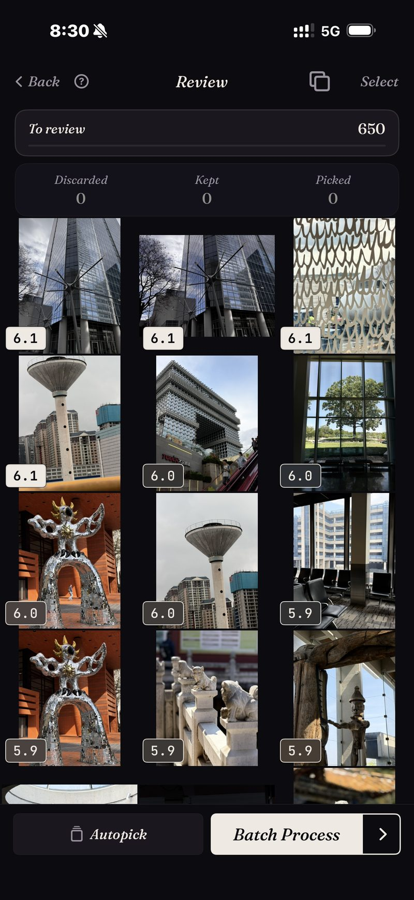
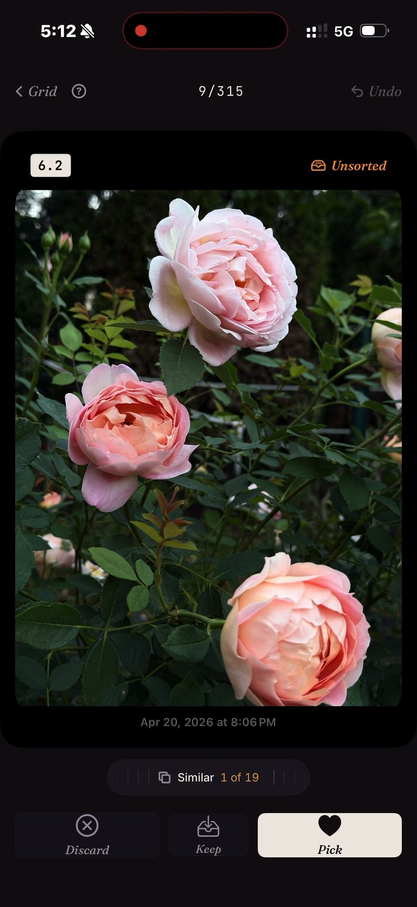

<section class="page-hero">
  

    
<a href="/fr/">SpectraSort</a>&#8250;Tri de photos sur iPhone

    <h1>Le tri de photos, sur votre iPhone.</h1>
    
Trier, c'est garder le meilleur et laisser le reste. Cela demandait autrefois un ordinateur, un import et une soirée libre. SpectraSort fait tourner tout le flux sur le téléphone où vos photos se trouvent déjà, et il classe chaque image avant que vous n'ayez balayé la première.

    

      <a class="cta" href="https://apps.apple.com/us/app/spectrasort-ai-photo-picker/id6757512134?ppid=5fd01708-3a73-4412-9bea-b411522af1f3"><svg viewBox="0 0 24 24" aria-hidden="true"><path d="M17.05 12.04c-.02-2.16 1.77-3.2 1.85-3.25-1.01-1.48-2.59-1.68-3.14-1.7-1.33-.13-2.61.78-3.29.78-.69 0-1.73-.76-2.85-.74-1.46.02-2.83.85-3.59 2.17-1.54 2.66-.39 6.59 1.1 8.75.73 1.06 1.6 2.24 2.73 2.2 1.1-.04 1.51-.71 2.84-.71 1.32 0 1.7.71 2.85.69 1.18-.02 1.92-1.07 2.64-2.13.84-1.22 1.18-2.42 1.2-2.48-.03-.01-2.3-.88-2.34-3.58zM14.95 5.6c.61-.74 1.02-1.77.9-2.8-.88.04-1.94.58-2.57 1.31-.56.65-1.06 1.7-.93 2.71.98.07 1.99-.5 2.6-1.22z"/></svg>
        Télécharger sur l'App Store
      </a>
      Gratuit &middot; iPhone &middot; iOS 18.5+ &middot; Mis à jour le 31 octobre 2026
    

    

      <b>100 % sur l'appareil</b> — rien n'est envoyé
      <b>Gratuit</b> 5 actions par semaine
      <b>Un seul paiement</b> — actions illimitées
    

  

</section>

<section class="slab">
  

    <h2>Pourquoi le tri existe</h2>
    
Les photographes trient parce qu'une séance produit toujours plus d'images qu'elle ne doit en livrer. Vous en prenez 500 et vous en remettez 40. Une pellicule suit le même calcul sans en avoir les outils : un voyage de deux semaines revient avec 1 200 photos, et la méthode intégrée pour les gérer, c'est de faire défiler.

    
Les outils de bureau ont résolu cela pour les photographes professionnels, avec des notes, des comparaisons côte à côte et une vérification au clavier. Votre pellicule vit ailleurs. SpectraSort reconstruit ce flux pour le téléphone et ajoute ce que les outils de bureau n'ont jamais eu : les images arrivent <b>déjà classées</b>.

  

</section>

<section id="ranked-before-you-review" class="slab rise">
  

    

      

        Classées avant votre vérification
        <h2>La vérification commence en haut de la pile.</h2>
        
Pointez un tri vers un voyage, une scène ou une recherche, et chaque image revient notée sur la netteté, l'exposition et la composition. Demandez-le, et il pèsera aussi la ressemblance de chaque photo avec celles que vous gardez d'habitude. Les images les plus fortes sont en tête avant que vous n'ayez pris une seule décision.

        
La capture ici est une vraie passe : une tranche de 650 photos d'architecture, chaque image notée, de la plus forte à la plus faible — et elle est revenue en un instant, parce que la photothèque était déjà indexée par des tris précédents. L'indexation a lieu une fois, puis se tient à jour : l'app repère les nouvelles photos à leur arrivée, jusqu'à 100 photos par seconde sur les iPhone récents.

        
Si vous voulez d'autres critères, <b>Studio</b> propose sept axes de qualité, une roue qui arbitre entre correspondance du sujet et qualité, et des profils que vous pouvez enregistrer.

      

      

        

          

        

      

    

  

</section>

<section id="bursts-and-retakes" class="slab">
  

    

      

        Rafales et reprises
        <h2>Dix-neuf prises d'un même moment coûtent une décision.</h2>
        
Les prises presque identiques sont ce qui ralentit un tri manuel, car chaque prise supplémentaire est une comparaison de plus. SpectraSort regroupe les doublons, les rafales et les similaires en piles avant le début de la vérification.

        
Une pile tient sur une seule roue. Vous faites défiler les prises sans quitter la photo, gardez celle que vous voulez, et la pile est réglée. La capture vient d'une vraie passe de doublons : la même rose, 19 prises, une roue.

        
Puis les balayages : à droite pour conserver, vers le bas pour garder, à gauche pour écarter. Ou laissez Sélection auto ranger toute la tranche par score en un seul geste, et contentez-vous de survoler le résultat.

      

      

        

          

        

      

    

  

</section>

<section id="the-culling-loop" class="slab rise">
  

    
La boucle du tri

    

      

Tranche

Ne commencez pas par toute la photothèque. Scènes rassemble les voyages et les thèmes tout seul, et la Chronologie va de l'année au mois puis au jour.

      

Balayer

Résultats classés, similaires empilés, trois gestes. Sélection auto si vous préférez survoler plutôt que balayer.

      

Terminer

Actions par lot place vos photos retenues dans un album ou dans la feuille de partage et supprime le reste, derrière la boîte de confirmation du système.

    

  

</section>

<section class="slab">
  

    <h2>Les détails</h2>
    
L'indexation, le classement et le profil de goût tournent sur le Neural Engine de l'iPhone. Rien n'est envoyé et il n'y a pas de compte. <a href="/fr/private-ai-photo-app/">En savoir plus sur ce fonctionnement →</a>

    

      
Là où ça ne vous aidera pas

      <ul>
        <li>Votre attention reste le point lent. Le classement fait déjà le jugement — les gagnantes en tête, et Sélection auto peut ranger toute la file par score en un geste — mais survoler le résultat vous revient, et rien ne touche votre photothèque avant que vous agissiez.</li>
        <li>iPhone uniquement, iOS 18.5 ou ultérieur. Pas de version iPad, Android ni ordinateur.</li>
        <li>Le tout premier index d'une grande photothèque prend du temps. Ensuite, c'est automatique : les nouvelles photos sont indexées à leur arrivée, vous n'attendez plus.</li>
        <li>Les photos supprimées passent par la corbeille d'iOS : elles arrivent dans Supprimés récemment, et l'espace revient dès que vous videz cet album — ou automatiquement après 30 jours. Chaque suppression dans SpectraSort affiche l'espace libéré avant que vous confirmiez.</li>
      </ul>
    

  

</section>

<section id="pricing" class="slab rise">
  

    

      Tarifs
      <h2>Cinq actions gratuites par semaine. Un seul paiement pour l'illimité.</h2>
      
Cinq actions gratuites par semaine, sans compte et sans carte bancaire. Un seul paiement pour des actions illimitées. Sans abonnement, jamais. Conçu par un développeur indépendant qui l'utilise tous les jours.

      <a class="cta" href="https://apps.apple.com/us/app/spectrasort-ai-photo-picker/id6757512134?ppid=5fd01708-3a73-4412-9bea-b411522af1f3"><svg viewBox="0 0 24 24" aria-hidden="true"><path d="M17.05 12.04c-.02-2.16 1.77-3.2 1.85-3.25-1.01-1.48-2.59-1.68-3.14-1.7-1.33-.13-2.61.78-3.29.78-.69 0-1.73-.76-2.85-.74-1.46.02-2.83.85-3.59 2.17-1.54 2.66-.39 6.59 1.1 8.75.73 1.06 1.6 2.24 2.73 2.2 1.1-.04 1.51-.71 2.84-.71 1.32 0 1.7.71 2.85.69 1.18-.02 1.92-1.07 2.64-2.13.84-1.22 1.18-2.42 1.2-2.48-.03-.01-2.3-.88-2.34-3.58zM14.95 5.6c.61-.74 1.02-1.77.9-2.8-.88.04-1.94.58-2.57 1.31-.56.65-1.06 1.7-.93 2.71.98.07 1.99-.5 2.6-1.22z"/></svg>
        Télécharger sur l'App Store
      </a>
    

  

</section>

<section id="faq" class="slab">
  

    

      FAQ
      <h2>Questions sur le tri de photos.</h2>
    

    

      

Combien de temps faut-il pour trier des milliers de photos ?

Les tris reviennent en un instant, parce qu'ils s'appuient sur un index que l'app construit une fois puis tient à jour automatiquement — les nouvelles photos sont prises en compte à leur arrivée. Même l'index initial avance jusqu'à 100 photos par seconde sur les iPhone récents. Votre temps de vérification reste le vrai coût, et c'est le classement et l'empilement qui le réduisent : vous consacrez votre attention aux candidates probables, et chaque pile demande un seul geste.

      

Peut-il trier automatiquement ?

Oui, en grande partie. Le classement juge déjà chaque image, et Sélection auto range toute la file selon ces scores en un geste : les meilleures dans Conservées, le milieu dans Gardées, les plus faibles dans Écartées. Vous survolez le résultat, et rien n'est appliqué à votre photothèque avant que vous touchiez une action.

      

Trier, est-ce juste supprimer des photos ?

Non. Trier, c'est décider ; supprimer est une dernière étape facultative. Actions par lot peut tout aussi bien enregistrer vos choix dans un album ou dans la feuille de partage et laisser le reste intact. Voir <a href="/fr/ai-photo-picker-vs-photo-culling/">sélection vs tri de photos</a> pour en savoir plus sur la différence.

      

Supprimer les photos triées libère-t-il l'espace tout de suite ?

Aussi vite que vous le voulez. Les photos supprimées arrivent dans l'album Supprimés récemment d'iOS ; videz-le et l'espace revient immédiatement, ou laissez-le et iOS l'efface après 30 jours. SpectraSort affiche l'espace libéré par chaque suppression avant que vous confirmiez.

      

Combien ça coûte ?

Cinq actions par semaine sont gratuites, pour toujours. Premium, c'est un seul paiement pour des actions illimitées et tous les réglages de Studio. Sans abonnement.

    

  

</section>

<section class="slab">
  

    

      À lire aussi
      

        <a href="/fr/ai-photo-picker-vs-photo-culling/">Sélection vs tri de photosLequel vous avez vraiment besoin</a>
        <a href="/fr/duplicate-photo-finder-iphone/">Détecteur de doublonsRafales et similaires, empilées</a>
        <a href="/fr/ai-photo-picker-iphone/">Sélecteur de photos IA pour iPhoneCe que fait vraiment un sélecteur</a>
      

    

  

</section>
