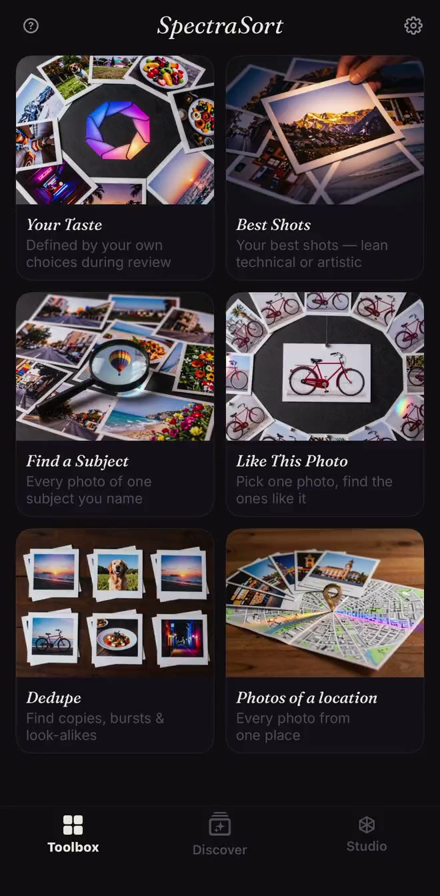
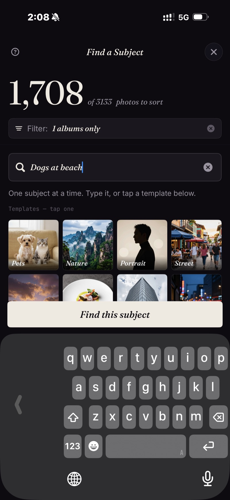

<section class="page-hero">
  

    
<a href="/fr/">SpectraSort</a>&#8250;Presse

    <h1>Dossier de presse.</h1>
    
Tout ce qu'il faut à un journaliste pour vérifier SpectraSort : les faits, les captures d'écran et un contact. Mis à jour le 31 octobre 2026, avec la version 3.2.

    

      <a class="cta" href="/press/spectrasort-press-kit.zip">Télécharger le dossier de presse</a>
      ZIP &middot; icône, captures d'écran, fiche d'information
    

  

</section>

<section class="slab">
  

    

      Les faits
      <h2>Ce qu'est SpectraSort, en un tableau.</h2>
      
SpectraSort est un sélecteur de photos IA pour iPhone qui classe votre pellicule selon la qualité et selon vos goûts. Il sert aussi à faire le tri, à supprimer les doublons et à nettoyer. Un seul paiement, sans abonnement.

    

    

      <table class="cmp">
        <tbody>
          <tr><th>Nom</th><td>SpectraSort</td></tr>
          <tr><th>Ce que c'est</th><td>Un sélecteur de photos IA pour iPhone, qui tourne en local. Il classe une pellicule selon la qualité et selon un profil de goût appris à partir de ce que l'utilisateur garde et écarte. Il sert aussi à faire le tri, à supprimer les doublons et à nettoyer.</td></tr>
          <tr><th>Plateforme</th><td>iPhone, iOS 18.5 ou ultérieur. Pas de version iPad, Mac, Android ni web.</td></tr>
          <tr><th>Langues</th><td>Anglais, français, allemand, italien, espagnol et portugais (Brésil). L'édition pour la Chine continentale s'appelle 光谱挑片.</td></tr>
          <tr><th>Prix</th><td>Téléchargement gratuit. Cinq actions par semaine sont gratuites pour toujours ; un seul paiement pour les actions illimitées et Studio. Sans abonnement, sans compte, sans carte bancaire pour commencer.</td></tr>
          <tr><th>Confidentialité</th><td>100 % en local. La recherche, le classement et le profil de goût tournent sur le Neural Engine de l'iPhone. Aucun envoi de photo, aucun compte, aucun serveur SpectraSort.</td></tr>
          <tr><th>Vitesse</th><td>Jusqu'à 100 photos par seconde sur les iPhone récents. L'index est construit au premier tri, puis tenu à jour automatiquement.</td></tr>
          <tr><th>Outils</th><td>Six outils en un geste : Vos goûts, Meilleurs clichés, Trouver un sujet, Comme cette photo, Doublons, Photos d'un lieu. Studio ajoute sept axes de qualité, jusqu'à trois sujets et des profils enregistrés. La recherche saisie de Trouver un sujet fonctionne en anglais pour l'instant ; les modèles fonctionnent dans toutes les langues.</td></tr>
          <tr><th>Première version</th><td>Janvier 2026. La version 3.2 est sortie en novembre 2026.</td></tr>
          <tr><th>Créateur</th><td>Mike Lu, développeur indépendant.</td></tr>
          <tr><th>Contact</th><td><a href="mailto:spectrasortapp@gmail.com">spectrasortapp@gmail.com</a></td></tr>
        </tbody>
      </table>
    

  

</section>

<section class="slab rise">
  

    

      Nouveau dans la 3.2
      <h2>Cinq langues. Moins de papier.</h2>
      
La version 3.2 ajoute le français, l'allemand, l'italien, l'espagnol et le portugais (Brésil) à toute l'interface, ainsi qu'à la fiche App Store. Elle ajoute aussi un filtre <b>Documents et reçus</b> dans Filtres → Exclure : les captures d'écran, les formulaires et les photos de papier sont mis de côté avant un tri, pour que la vérification ne contienne que les photos que l'utilisateur voulait garder.

      
Le partage a été corrigé dans la même version : Instagram, WeChat et Xiaohongshu acceptent désormais la photo, dans le bon sens, pour les partages d'une ou de plusieurs photos. <a href="/fr/changelog/">Les notes complètes de la 3.2 →</a>

    

  

</section>

<section class="slab">
  

    

      Le créateur
      <h2>Fait par Mike Lu.</h2>
      
Mike Lu est le développeur indépendant derrière SpectraSort. Il a construit l'app autour d'une question que la plupart des outils photo évitent : non pas « est-ce une bonne photo ? », mais « garderiez-vous celle-ci ? ». L'app apprend à partir des décisions de garder ou d'écarter qu'une personne prend déjà, puis classe la photothèque de la même façon.

      
SpectraSort est sorti pour la première fois en janvier 2026. Il est conçu sans serveur, sans compte et sans abonnement : l'app et le modèle économique sont tous deux volontairement modestes.

    

  

</section>

<section class="slab rise">
  

    

      Captures d'écran
      <h2>Trois vraies captures.</h2>
      
Les fichiers en pleine taille sont dans le dossier de presse. L'app tourne sur l'appareil ; les captures viennent d'une vraie photothèque.

      

        <figure><figcaption>La boîte à outils : six outils en un geste, avec Vos goûts en tête.</figcaption></figure>
        <figure><figcaption>Trouver un sujet : saisissez une phrase, obtenez les correspondances classées du meilleur au moins bon.</figcaption></figure>
        <figure><figcaption>Actions par lot : les photos retenues dans un album, les favoris marqués, le reste supprimé.</figcaption></figure>
      

      

        <a class="cta" href="/press/spectrasort-press-kit.zip">Télécharger le dossier de presse</a>
        ZIP &middot; icône, 3 captures d'écran, fiche d'information
      

    

  

</section>

<section class="slab">
  

    Angles à vérifier
    <h2>Trois sujets dans l'app.</h2>
    <ul>
      <li><b>L'utilitaire anti-abonnement.</b> Un seul paiement, sans abonnement, sans compte, sans serveur. Une app photo qui n'a pas besoin du cloud.</li>
      <li><b>De l'IA en local, sans exiger Apple Intelligence.</b> Le classement, la recherche et le profil de goût tournent sur le Neural Engine, hors ligne, sous iOS 18.5 ou ultérieur.</li>
      <li><b>Cinq langues d'un coup.</b> La version 3.2 traduit toute l'interface et la fiche App Store en français, allemand, italien, espagnol et portugais (Brésil).</li>
    </ul>
    

      
Ce que nous ne prétendrons pas

      <ul>
        <li>Aucune affirmation « meilleur que Photos Apple ». Les deux apps sont faites pour des tâches différentes : Photos Apple parcourt et stocke ; SpectraSort choisit et classe.</li>
        <li>Aucun pourcentage de précision pour le classificateur de documents. C'est un filtre, pas une promesse.</li>
        <li>Pas de cloud, pas de compte, aucun entraînement sur les photos des utilisateurs : ce sont des faits d'architecture, pas des arguments marketing.</li>
      </ul>
    

  

</section>
