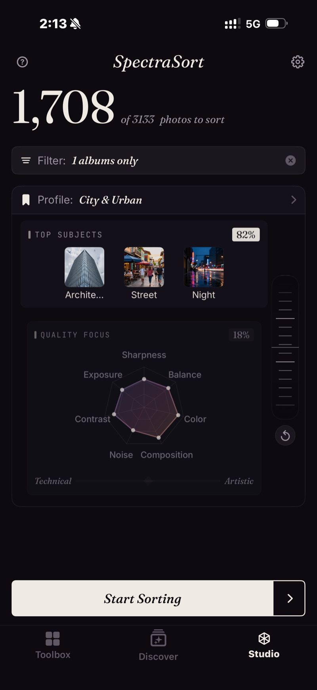

<section class="page-hero">
  

    
<a href="/fr/">SpectraSort</a>&#8250;Studio

    <h1>Studio. Quand vous voulez tout régler.</h1>
    
Les outils en un geste décident ce que « meilleur » veut dire. Studio vous laisse cette décision : quels axes de qualité comptent parmi les sept, quels sujets importent, et combien une correspondance de sujet doit peser face à une image nette. Enregistrez le tout en profil, et chaque tri ensuite est le vôtre.

    

      <a class="cta" href="https://apps.apple.com/us/app/spectrasort-ai-photo-picker/id6757512134?ppid=5fd01708-3a73-4412-9bea-b411522af1f3"><svg viewBox="0 0 24 24" aria-hidden="true"><path d="M17.05 12.04c-.02-2.16 1.77-3.2 1.85-3.25-1.01-1.48-2.59-1.68-3.14-1.7-1.33-.13-2.61.78-3.29.78-.69 0-1.73-.76-2.85-.74-1.46.02-2.83.85-3.59 2.17-1.54 2.66-.39 6.59 1.1 8.75.73 1.06 1.6 2.24 2.73 2.2 1.1-.04 1.51-.71 2.84-.71 1.32 0 1.7.71 2.85.69 1.18-.02 1.92-1.07 2.64-2.13.84-1.22 1.18-2.42 1.2-2.48-.03-.01-2.3-.88-2.34-3.58zM14.95 5.6c.61-.74 1.02-1.77.9-2.8-.88.04-1.94.58-2.57 1.31-.56.65-1.06 1.7-.93 2.71.98.07 1.99-.5 2.6-1.22z"/></svg>
        Télécharger sur l'App Store
      </a>
      Gratuit &middot; iPhone &middot; iOS 18.5+
    

    

      <b>Sept</b> axes de qualité
      <b>Jusqu'à trois</b> sujets par tri
      <b>Inclus</b> avec Premium — un seul paiement
    

  

</section>

<section id="quality-focus" class="slab">
  

    

      

        Priorité qualité — sept axes
        <h2>La netteté pour l'animalier. La composition pour la rue.</h2>
        
Netteté, exposition, contraste et bruit du côté technique. Composition, harmonie colorée et équilibre visuel du côté artistique. Faites glisser un point du radar pour le pondérer, ou déplacez le curseur Technique / Artistique pour bouger les sept ensemble.

      

      

        

          

          
Un profil enregistré, City &amp; Urban : trois sujets à 82 %, la qualité à 18 %, contraste et couleur mis en avant.

        

      

    

  

</section>

<section id="balance-wheel" class="slab rise">
  

    

      

        Sujets et molette d'équilibre
        <h2>La correspondance du sujet face à la qualité.</h2>
        
Jusqu'à trois sujets dans un même tri — des modèles, ou tout ce que vous pouvez saisir. La molette décide du poids d'une correspondance. Tournez-la vers Sujets et une bonne photo du bon sujet l'emporte. Tournez-la vers Qualité et l'image la plus nette et la mieux composée l'emporte, quel que soit son contenu.

      

      

        

          

            <video class="screen-loop" src="/video/web-studio-wheel.mp4"
                   poster="/images/shots/studio-wheel-poster.jpg"
                   loop muted playsinline preload="none"
                   width="920" height="852"
                   aria-label="La molette d'équilibre de Studio tournée dans les deux sens : le poids des sujets principaux passe de 75 % à 25 % pendant que le radar Priorité qualité monte de 25 % à 75 %, puis revient"></video>
          

        

      

    

  

</section>

<section id="profiles" class="slab">
  

    Profils
    <h2>Réglé une fois. Réutilisé à chaque fois.</h2>
    
Enregistrez n'importe quelle configuration sous son propre nom et passez de l'une à l'autre depuis l'écran d'accueil. Partez de Vos goûts et ajustez : l'app crée une copie personnalisée, donc le profil appris reste intact et continue d'apprendre.

    
Le profil choisi pilote chaque tri, Doublons et Photos d'un lieu compris : la photo gardée d'une pile ou le meilleur cliché d'une ville est jugé selon vos critères. La grille de vérification indique le profil qui a trié.

  

</section>

<section id="pricing" class="slab rise">
  

    

      Tarifs
      <h2>Inclus avec Premium — un seul paiement.</h2>
      
Les six outils en un geste sont gratuits, avec cinq actions gratuites par semaine. Studio fait partie de Premium : tris personnalisés et profils enregistrés, plus les actions illimitées — un seul paiement, sans abonnement.

      <a class="cta" href="https://apps.apple.com/us/app/spectrasort-ai-photo-picker/id6757512134?ppid=5fd01708-3a73-4412-9bea-b411522af1f3"><svg viewBox="0 0 24 24" aria-hidden="true"><path d="M17.05 12.04c-.02-2.16 1.77-3.2 1.85-3.25-1.01-1.48-2.59-1.68-3.14-1.7-1.33-.13-2.61.78-3.29.78-.69 0-1.73-.76-2.85-.74-1.46.02-2.83.85-3.59 2.17-1.54 2.66-.39 6.59 1.1 8.75.73 1.06 1.6 2.24 2.73 2.2 1.1-.04 1.51-.71 2.84-.71 1.32 0 1.7.71 2.85.69 1.18-.02 1.92-1.07 2.64-2.13.84-1.22 1.18-2.42 1.2-2.48-.03-.01-2.3-.88-2.34-3.58zM14.95 5.6c.61-.74 1.02-1.77.9-2.8-.88.04-1.94.58-2.57 1.31-.56.65-1.06 1.7-.93 2.71.98.07 1.99-.5 2.6-1.22z"/></svg>
        Télécharger sur l'App Store
      </a>
    

  

</section>

<section id="faq" class="slab">
  

    

      FAQ
      <h2>Questions sur Studio.</h2>
    

    

      

À qui s'adresse Studio ?

À ceux qui photographient beaucoup et trient sur le téléphone — de l'événementiel ou du voyage avec la netteté et l'exposition en tête, le bruit ignoré pour les photos de nuit. À ceux qui ont un style maison que les réglages par défaut ne captent pas : couleur et composition en avant, un ou deux sujets épinglés. Et à quiconque n'est simplement pas d'accord avec Meilleurs clichés et veut régler le curseur à sa façon, une fois pour toutes.

      

Quelle différence entre Studio et Meilleurs clichés ?

Meilleurs clichés, c'est un seul curseur : technique d'un côté, artistique de l'autre. Studio le découpe en sept axes que vous pondérez un par un, ajoute jusqu'à trois sujets et la molette d'équilibre, et permet d'enregistrer le résultat en profil.

      

Personnaliser change-t-il mon profil Vos goûts ?

Non. La personnalisation crée une copie personnalisée ; le profil appris reste intact et continue d'apprendre. Vous pouvez le réinitialiser ou le reconstruire depuis les Réglages à tout moment.

      

Peut-on trier par sujet et par qualité dans le même tri ?

Oui — c'est fait pour ça, la molette d'équilibre. Tournez-la vers Sujets et une bonne photo du bon sujet l'emporte ; vers Qualité, l'image la plus nette et la mieux composée l'emporte, quel que soit son contenu.

      

Un profil Studio s'applique-t-il aux tris Doublons et lieu ?

Oui. Le profil sélectionné pilote chaque tri, donc la photo gardée d'une pile ou le meilleur cliché d'une ville est jugé selon vos critères. La grille de vérification indique le profil qui a trié.

      

Studio est-il gratuit ?

Studio fait partie de Premium — un seul paiement, sans abonnement. Vous pouvez l'ouvrir dans l'offre gratuite et regarder ; les tris personnalisés et les profils enregistrés demandent Premium. Les six outils en un geste restent gratuits, avec cinq actions gratuites par semaine.

    

  

</section>

<section class="slab">
  

    

      À lire aussi
      

        <a href="/fr/photo-culling-iphone/">Tri de photos sur iPhoneClasser d'abord, balayer ensuite</a>
        <a href="/fr/features/">Toutes les fonctionnalitésOutils, réglages et limites sur une page</a>
        <a href="/fr/find-best-photos-iphone/">Retrouvez vos meilleures photosPar mots, par exemple, par goût</a>
      

    

  

</section>
