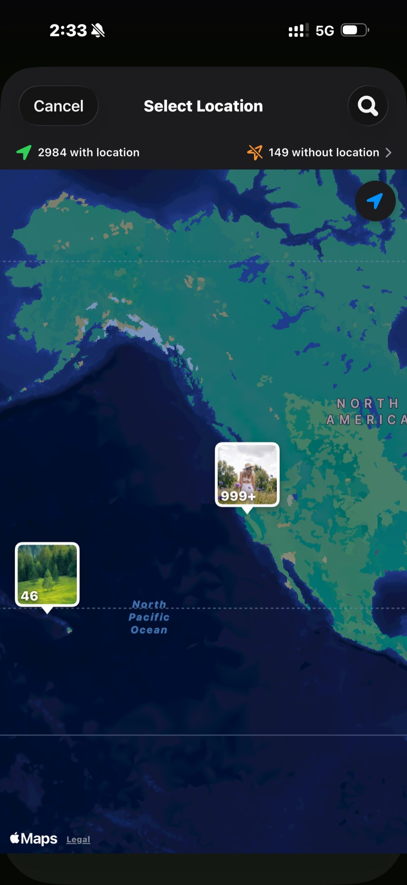

<section class="page-hero">
  

    
<a href="/fr/">SpectraSort</a>&#8250;Photos de vacances

    <h1>1 200 photos de vacances → l'album qui vaut d'être montré.</h1>
    
Deux semaines de voyage reviennent avec mille photos et la promesse de « s'en occuper ». SpectraSort s'en occupe : le voyage est déjà rassemblé en une scène, chaque cliché revient classé, les onze couchers de soleil tiennent en une pile, et vos photos conservées arrivent dans un album — dans l'avion du retour.

    

      <a class="cta" href="https://apps.apple.com/us/app/spectrasort-ai-photo-picker/id6757512134?ppid=5fd01708-3a73-4412-9bea-b411522af1f3"><svg viewBox="0 0 24 24" aria-hidden="true"><path d="M17.05 12.04c-.02-2.16 1.77-3.2 1.85-3.25-1.01-1.48-2.59-1.68-3.14-1.7-1.33-.13-2.61.78-3.29.78-.69 0-1.73-.76-2.85-.74-1.46.02-2.83.85-3.59 2.17-1.54 2.66-.39 6.59 1.1 8.75.73 1.06 1.6 2.24 2.73 2.2 1.1-.04 1.51-.71 2.84-.71 1.32 0 1.7.71 2.85.69 1.18-.02 1.92-1.07 2.64-2.13.84-1.22 1.18-2.42 1.2-2.48-.03-.01-2.3-.88-2.34-3.58zM14.95 5.6c.61-.74 1.02-1.77.9-2.8-.88.04-1.94.58-2.57 1.31-.56.65-1.06 1.7-.93 2.71.98.07 1.99-.5 2.6-1.22z"/></svg>
        Télécharger sur l'App Store
      </a>
      Gratuit &middot; iPhone &middot; iOS 18.5+ &middot; Mis à jour le 31 octobre 2026
    

    

      <b>100 % sur l'appareil</b> — rien n'est envoyé
      <b>Gratuit</b> 5 actions par semaine
      <b>Un seul paiement</b> — actions illimitées
    

  

</section>

<section id="find-the-trip" class="slab">
  

    

      

        Trouver le voyage
        <h2>C'est déjà une scène.</h2>
        
Ouvrez Découvrir et le voyage est là, rassemblé par le temps et le lieu — sans album. Ou touchez Photos d'un lieu et épinglez la ville : chaque photo prise là, rien d'autre.

        
Les photos d'il y a des années comptent aussi. L'épingle retrouve le voyage plus ancien que vous aviez oublié avoir photographié.

      

      

        

          

        

      

    

  

</section>

<section id="rank" class="slab rise">
  

    

      

        Classer
        <h2>Les bonnes remontent avant que vous balayiez.</h2>
        
Meilleurs clichés met en tête les images les plus nettes et les mieux composées. Vos goûts, une fois qu'il vous connaît, met en tête celles que vous auriez choisies. Dans les deux cas, la vérification commence par les gagnantes, pas par la photo 1 sur 1 200.

        
Penchez le curseur côté artistique pour les couchers de soleil, côté technique pour les photos de groupe.

      

      

        

          

        

      

    

  

</section>

<section id="retakes" class="slab">
  

    

      

        Reprises
        <h2>11 clichés du même coucher de soleil → un seul balayage.</h2>
        
Couchers de soleil, photos de groupe, la vue depuis l'hôtel : chaque moment photographié six fois arrive en une pile avec la plus nette signalée. Faites tourner la roue, gardez-en une, passez à la suite.

      

      

        

          

        

      

    

  

</section>

<section id="finish" class="slab rise">
  

    

      

        Terminer
        <h2>Album créé. Le reste supprimé.</h2>
        
Actions par lot range les photos conservées dans un album qui apparaît dans Photos Apple — et dans la feuille de partage, pour le groupe de discussion. Gardez le reste, ou supprimez-le via la boîte de dialogue du système vers Supprimés récemment.

      

      

        

          

        

      

    

  

</section>

<section id="the-trip-in-three-steps" class="slab">
  

    
Le voyage, en trois étapes

    

      

Trouver

La scène, l'épingle sur la carte, ou les mois dans la chronologie.

      

Balayer

Des résultats classés, des reprises empilées, trois gestes. Sélection auto si vous préférez survoler que balayer.

      

Ranger

Un album, la feuille de partage et le reste supprimé — un seul écran.

    

  

</section>

<section class="slab rise">
  

    <h2>Les détails</h2>
    
Les scènes, les notes et le profil de goût tournent tous sur le Neural Engine de l'iPhone. Rien n'est envoyé et il n'y a aucun compte. <a href="/fr/private-ai-photo-app/">En savoir plus sur le fonctionnement →</a>

    

      
Les limites

      <ul>
        <li>iPhone uniquement, iOS 18.5 ou ultérieur. Pas de version iPad, Android ou ordinateur.</li>
        <li>Le tout premier index d'une grande photothèque prend un peu de temps. Ensuite, c'est automatique : les nouvelles photos sont indexées à leur arrivée, vous n'attendez plus.</li>
        <li>La recherche d'un lieu par son nom utilise Apple Maps et demande une connexion. Les scènes, la chronologie et le tri lui-même fonctionnent hors ligne.</li>
        <li>Les photos supprimées passent par la corbeille d'iOS : elles arrivent dans Supprimés récemment, et l'espace revient dès que vous videz cet album — ou automatiquement après 30 jours.</li>
      </ul>
    

  

</section>

<section id="pricing" class="slab">
  

    

      Tarifs
      <h2>Cinq actions gratuites par semaine. Un seul paiement pour l'illimité.</h2>
      
Cinq actions gratuites par semaine, sans compte et sans carte bancaire. Un seul paiement pour des actions illimitées. Sans abonnement, jamais. Développé par un développeur indépendant qui l'utilise tous les jours.

      <a class="cta" href="https://apps.apple.com/us/app/spectrasort-ai-photo-picker/id6757512134?ppid=5fd01708-3a73-4412-9bea-b411522af1f3"><svg viewBox="0 0 24 24" aria-hidden="true"><path d="M17.05 12.04c-.02-2.16 1.77-3.2 1.85-3.25-1.01-1.48-2.59-1.68-3.14-1.7-1.33-.13-2.61.78-3.29.78-.69 0-1.73-.76-2.85-.74-1.46.02-2.83.85-3.59 2.17-1.54 2.66-.39 6.59 1.1 8.75.73 1.06 1.6 2.24 2.73 2.2 1.1-.04 1.51-.71 2.84-.71 1.32 0 1.7.71 2.85.69 1.18-.02 1.92-1.07 2.64-2.13.84-1.22 1.18-2.42 1.2-2.48-.03-.01-2.3-.88-2.34-3.58zM14.95 5.6c.61-.74 1.02-1.77.9-2.8-.88.04-1.94.58-2.57 1.31-.56.65-1.06 1.7-.93 2.71.98.07 1.99-.5 2.6-1.22z"/></svg>
        Télécharger sur l'App Store
      </a>
    

  

</section>

<section id="faq" class="slab rise">
  

    

      FAQ
      <h2>Questions de voyage.</h2>
    

    

      

Combien de temps faut-il pour parcourir les photos d'un voyage ?

Le tri lui-même prend un instant une fois la photothèque indexée — le premier index tourne à jusqu'à 100 photos par seconde sur les iPhone récents et n'a lieu qu'une fois. Vos balayages sont le vrai temps, et le classement plus l'empilement les réduisent : les gagnantes sont en haut et chaque reprise coûte un geste.

      

Qu'advient-il des photos que je ne conserve pas ?

Rien, sauf si vous le demandez. Garder est un panier, pas une suppression. Tout ce que vous supprimez passe par la boîte de dialogue du système vers Supprimés récemment, où les photos restent 30 jours.

      

Puis-je faire ça dans l'avion, hors ligne ?

Le tri, le classement et la vérification tournent entièrement sur le téléphone, donc oui. Chercher un lieu par son nom utilise Apple Maps et demande une connexion ; ouvrir le voyage depuis les scènes ou la chronologie, non.

      

Puis-je trier plusieurs voyages à la fois ?

Dans la chronologie, cochez autant de mois que vous voulez et triez-les ensemble. Ou filtrez par une période personnalisée qui couvre tout l'été.

      

Mes photos de voyage sont-elles envoyées ?

Non. Les scènes, les notes et le profil de goût sont calculés et stockés sur votre iPhone. Aucun envoi, aucun compte.

    

  

</section>

<section class="slab">
  

    

      À lire aussi
      

        <a href="/fr/photo-culling-iphone/">Tri de photos sur iPhoneLe flux complet garder ou supprimer</a>
        <a href="/fr/photo-organizer-iphone/">Organisateur de photos IARegroupées, classées, rangées</a>
        <a href="/fr/duplicate-photo-finder-iphone/">Détecteur de doublonsRafales et sosies, empilés</a>
      

    

  

</section>
