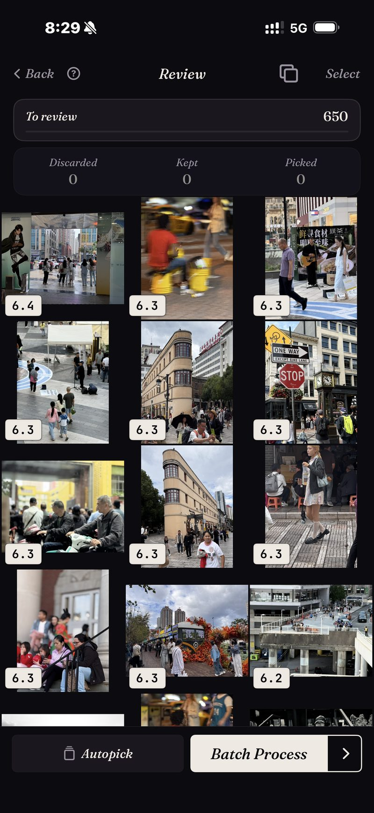

<section class="page-hero">
  

    
<a href="/it/">SpectraSort</a>›Selettore foto IA per iPhone

    <h1>Il selettore foto IA per iPhone.</h1>
    
La ricerca può trovare ogni foto di mare che tu abbia mai scattato. Non sa dirti quali tre vale la pena tenere. È proprio a questa seconda domanda che serve SpectraSort: valuta le tue foto per qualità, impara il tuo gusto da quelle che conservi e mette i vincitori in cima.

    

      <a class="cta" href="https://apps.apple.com/us/app/spectrasort-ai-photo-picker/id6757512134?ppid=5fd01708-3a73-4412-9bea-b411522af1f3">
        <svg viewBox="0 0 24 24" aria-hidden="true"><path d="M17.05 12.04c-.02-2.16 1.77-3.2 1.85-3.25-1.01-1.48-2.59-1.68-3.14-1.7-1.33-.13-2.61.78-3.29.78-.69 0-1.73-.76-2.85-.74-1.46.02-2.83.85-3.59 2.17-1.54 2.66-.39 6.59 1.1 8.75.73 1.06 1.6 2.24 2.73 2.2 1.1-.04 1.51-.71 2.84-.71 1.32 0 1.7.71 2.85.69 1.18-.02 1.92-1.07 2.64-2.13.84-1.22 1.18-2.42 1.2-2.48-.03-.01-2.3-.88-2.34-3.58zM14.95 5.6c.61-.74 1.02-1.77.9-2.8-.88.04-1.94.58-2.57 1.31-.56.65-1.06 1.7-.93 2.71.98.07 1.99-.5 2.6-1.22z"/></svg>
        Scarica sull'App Store
      </a>
      Gratis · iPhone · iOS 18.5+ · Aggiornato il 31 ottobre 2026
    

    

      <b>100% sul dispositivo</b> — niente caricamenti
      <b>Gratis</b> 5 azioni a settimana
      <b>Un solo pagamento</b> — azioni illimitate
    

  

</section>

<section class="slab">
  

    <h2>Cos'è un selettore foto</h2>
    
Il termine viene usato con leggerezza, quindi aiuta a separare tre tipi di app:

    <ul>
      <li><b>Ricerca foto</b> trova le corrispondenze. Chiedi «mare» e ottieni tutte le 87 foto di mare che hai mai scattato, in un'unica griglia lunga, in ordine di data.</li>
      <li><b>Pulitori di foto</b> cercano la robaccia: duplicati, screenshot, scatti mossi. Utili, ma possono solo dirti cosa è brutto.</li>
      <li><b>Un selettore foto</b> prende la decisione. Valuta ogni foto per nitidezza, esposizione, composizione e quanto corrisponde a ciò che hai chiesto, poi ti consegna l'insieme <em>classificato, dal migliore</em>, con un modo per agire.</li>
    </ul>
    
Quasi nessuno fatica a trovare le proprie foto. Si fatica a scegliere tra loro. SpectraSort è costruita per la scelta.

  

</section>

<section id="ranked-not-just-matched" class="slab rise">
  

    

      

        Classificato, non solo trovato
        <h2>Ogni risultato torna con il migliore in cima.</h2>
        
Ci sono sei strumenti, un tocco ciascuno: <b>Il tuo gusto</b>, <b>Migliori scatti</b>, <b>Trova un soggetto</b>, <b>Foto simili a questa</b>, <b>Duplicati</b> e <b>Foto di un luogo</b>.

        
Qualunque usi, i risultati tornano valutati e ordinati. La cattura qui è un ordinamento reale: una sezione di strada da 650 foto, ogni scatto valutato, il migliore per primo.

        
Gli ordinamenti tornano quasi all'istante, perché girano su un indice sul dispositivo. Si costruisce una volta — fino a 100 foto al secondo sugli iPhone recenti — poi resta aggiornato da solo man mano che arrivano nuove foto.

      

      

        

          

        

      

    

  

</section>

<section id="your-taste" class="slab">
  

    

      

        La parte che nessun'altra app fa
        <h2>Impara quali foto tenderesti.</h2>
        
Quasi tutta l'IA per le foto valuta rispetto a un'idea universale di buona foto: nitida, ben esposta, centrata. I tuoi preferiti non sempre rientrano in quello stampo. Magari ti piace quella in controluce, il cane a metà scrollata o un fotogramma un po' morbido che stamperesti comunque.

        
Così SpectraSort osserva ciò che conservi e ciò che lasci andare durante la revisione, e ne costruisce un <b>profilo di gusto</b>. Dopo abbastanza revisioni, ordinare per Il tuo gusto inizia a somigliare a un album scelto a mano. Puoi mettere in pausa l'apprendimento, azzerarlo o tenere più profili, e tutto resta sul tuo telefono.

      

      

        

          

        

      

    

  

</section>

<section id="how-a-sort-works" class="slab rise">
  

    
Come funziona un ordinamento

    

      

Trova

Scegli uno strumento: una frase, una foto di esempio, un luogo o il tuo gusto.

      

Classifica

Tutto valutato sul dispositivo: nitidezza, esposizione, composizione, somiglianza.

      

Completa

Conserva i vincitori con uno swipe, poi salva, condividi o elimina il resto in una sola schermata.

    

  

</section>

<section class="slab">
  

    <h2>Niente lascia il telefono</h2>
    
Tutta la valutazione avviene sul Neural Engine del tuo iPhone. Le tue foto non vengono caricate da nessuna parte, non c'è nessun account e i modelli arrivano già addestrati, quindi nulla della tua libreria raggiunge mai qualcun altro. <a href="/it/private-ai-photo-app/">Come funziona l'elaborazione sul dispositivo →</a>

    

      
Dove non aiuta

      <ul>
        <li>Solo iPhone, iOS 18.5 o successivo. Nessuna versione per iPad, Android o desktop.</li>
        <li>Il primissimo indice di una libreria grande richiede un po' di tempo. Dopo è automatico: le nuove foto vengono indicizzate quando arrivano, quindi non aspetti di nuovo.</li>
        <li>Il profilo di gusto vale quanto le revisioni che gli hai dato. Parte generico.</li>
        <li>Le foto eliminate passano nel cestino di iOS: finiscono in Eliminati di recente e lo spazio torna nel momento in cui svuoti quell'album lì, oppure automaticamente dopo 30 giorni. Ogni Elimina in SpectraSort mostra lo spazio che libera prima che tu confermi.</li>
      </ul>
    

  

</section>

<section id="pricing" class="slab rise">
  

    

      Prezzi
      <h2>Cinque azioni gratis a settimana. Paghi una volta per averle illimitate.</h2>
      
Cinque azioni gratuite a settimana, per sempre: nessun account, nessuna carta di credito. Paghi una volta per azioni illimitate. Nessun abbonamento. Mai.

      <a class="cta" href="https://apps.apple.com/us/app/spectrasort-ai-photo-picker/id6757512134?ppid=5fd01708-3a73-4412-9bea-b411522af1f3">
        <svg viewBox="0 0 24 24" aria-hidden="true"><path d="M17.05 12.04c-.02-2.16 1.77-3.2 1.85-3.25-1.01-1.48-2.59-1.68-3.14-1.7-1.33-.13-2.61.78-3.29.78-.69 0-1.73-.76-2.85-.74-1.46.02-2.83.85-3.59 2.17-1.54 2.66-.39 6.59 1.1 8.75.73 1.06 1.6 2.24 2.73 2.2 1.1-.04 1.51-.71 2.84-.71 1.32 0 1.7.71 2.85.69 1.18-.02 1.92-1.07 2.64-2.13.84-1.22 1.18-2.42 1.2-2.48-.03-.01-2.3-.88-2.34-3.58zM14.95 5.6c.61-.74 1.02-1.77.9-2.8-.88.04-1.94.58-2.57 1.31-.56.65-1.06 1.7-.93 2.71.98.07 1.99-.5 2.6-1.22z"/></svg>
        Scarica sull'App Store
      </a>
    

  

</section>

<section id="faq" class="slab">
  

    

      FAQ
      <h2>Domande sul selettore foto IA.</h2>
    

    

      

Cos'è un selettore foto IA?

Un'app che decide quali delle tue foto vale la pena tenere, non solo quali corrispondono a una ricerca. Valuta ogni foto per nitidezza, esposizione, composizione o somiglianza con le foto che tendi a conservare, e le restituisce classificate dal migliore, con un flusso per conservare, condividere o eliminare il resto.

      

In cosa è diverso dalla ricerca foto?

La ricerca ti dice quali foto corrispondono, quindi una ricerca «mare» restituisce tutte le 87 foto di mare. Un selettore classifica quelle 87 e mette in cima le migliori. SpectraSort fa entrambe le cose; ogni ricerca torna classificata. Vedi <a href="/it/ai-photo-picker-vs-photo-culling/">selezione vs scrematura delle foto</a> per il confronto completo.

      

SpectraSort carica le mie foto per sceglierle?

No. La ricerca, la valutazione e il profilo di gusto girano tutti sul Neural Engine del tuo iPhone. Nessun caricamento, nessun account, nessun server SpectraSort nel mezzo.

      

Elimina le foto da solo?

No. Niente viene applicato finché non tocchi, e le eliminazioni passano sempre dalla finestra di conferma di Foto di sistema, nell'album Eliminati di recente di iOS: recuperabili per 30 giorni, o cancellate nel momento in cui lo svuoti.

      

Quanto costa?

Cinque azioni a settimana sono gratuite, per sempre: non è una prova. Un solo pagamento per azioni illimitate e tutti i controlli dello Studio. Nessun abbonamento.

    

  

</section>

<section class="slab">
  

    

      Continua a leggere
      

        <a href="/it/photo-culling-iphone/">Selezione foto su iPhoneIl flusso del fotografo, sul telefono</a>
        <a href="/it/best-photo-picker/">Scegliere un selettore di fotoCosa distingue queste app</a>
        <a href="/it/how-to-pick-best-photos-from-camera-roll/">Scegli il meglio del tuo rullinoPasso dopo passo, con o senza app</a>
      

    

  

</section>
