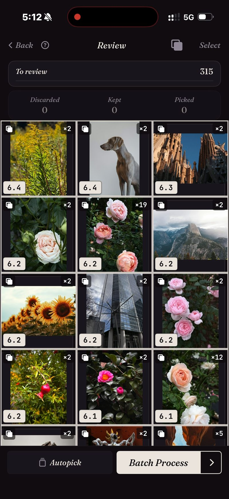

<section class="page-hero">
  

    
<a href="/it/">SpectraSort</a>&#8250;Ricerca duplicati

    <h1>Foto duplicate, impilate e risolte.</h1>
    
Una rosa fotografata 19 volte. Lo stesso skyline, nove viaggi di fila. Ogni raffica che non hai mai sfoltito. SpectraSort impila tutte e tre le cose, segnala la più nitida e cancella il resto in un'unica azione.

    

      <a class="cta" href="https://apps.apple.com/us/app/spectrasort-ai-photo-picker/id6757512134?ppid=5fd01708-3a73-4412-9bea-b411522af1f3"><svg viewBox="0 0 24 24" aria-hidden="true"><path d="M17.05 12.04c-.02-2.16 1.77-3.2 1.85-3.25-1.01-1.48-2.59-1.68-3.14-1.7-1.33-.13-2.61.78-3.29.78-.69 0-1.73-.76-2.85-.74-1.46.02-2.83.85-3.59 2.17-1.54 2.66-.39 6.59 1.1 8.75.73 1.06 1.6 2.24 2.73 2.2 1.1-.04 1.51-.71 2.84-.71 1.32 0 1.7.71 2.85.69 1.18-.02 1.92-1.07 2.64-2.13.84-1.22 1.18-2.42 1.2-2.48-.03-.01-2.3-.88-2.34-3.58zM14.95 5.6c.61-.74 1.02-1.77.9-2.8-.88.04-1.94.58-2.57 1.31-.56.65-1.06 1.7-.93 2.71.98.07 1.99-.5 2.6-1.22z"/></svg>
        Scarica sull'App Store
      </a>
      Gratis &middot; iPhone &middot; iOS 18.5+ &middot; Aggiornato il 31 ottobre 2026
    

    

      <b>100% sul dispositivo</b> — niente caricamenti
      <b>Gratis</b> 5 azioni a settimana
      <b>Un solo pagamento</b> — azioni illimitate
    

  

</section>

<section class="slab">
  

    <h2>iOS trova un tipo di duplicato. Ce ne sono tre.</h2>
    
<b>Duplicati</b> — copie esatte dello stesso file. <b>Raffiche</b> — scatti a pochi secondi di distanza, nessuno identico byte per byte. <b>Simili</b> — la stessa scena, scattata di nuovo mesi dopo.

    
Foto di Apple unisce il primo tipo. Gli altri due sono la maggior parte del disordine. SpectraSort confronta ciò che c'è nell'immagine, quindi tutti e tre finiscono in pile.

  

</section>

<section id="stacked-before-you-look" class="slab rise">
  

    

      

        Impilate prima che tu guardi
        <h2>315 foto → le pile che contano.</h2>
        
Lancia Duplicati su un viaggio, un mese o tutta la libreria e la griglia torna raggruppata. Ogni pila mostra quanti scatti contiene e il punteggio del migliore. Le foto singole restano fuori dai piedi.

      

      

        

          

          
Un passaggio reale: 315 foto, la maggior parte pile da due, alcune da una dozzina, una rosa ×19.

        

      

    

  

</section>

<section id="one-stack-one-decision" class="slab">
  

    

      

        Una pila, una decisione
        <h2>19 scatti → un solo da tenere.</h2>
        
Dentro una pila gli scatti stanno su una rotella. Scorri tra loro senza uscire dalla foto, tieni quello che vuoi e la pila è chiusa.

        
Oppure lascia fare ad Autoselezione: le copie vanno in Scartate e il migliore di ogni pila resta lì per la tua decisione. Poi un'unica azione elimina gli scarti, dietro la finestra di conferma di sistema, in Eliminati di recente.

      

      

        

          

        

      

    

  

</section>

<section id="how-it-works" class="slab rise">
  

    
Come funziona

    

      

Scansione

Duplicati legge l'indice sul dispositivo: costruito una volta, poi tenuto aggiornato man mano che arrivano nuove foto. Fino a 100 foto al secondo al primo passaggio.

      

Scegli

La più nitida segnalata in ogni pila. Confermala, oppure gira la rotella e scegline un'altra.

      

Pulisci

Un'unica azione in blocco. Le eliminazioni passano dalla finestra di sistema in Eliminati di recente.

    

    

      
È sull'eliminazione dei duplicati che se ne va la maggior parte dello spazio di un rullino. Le foto eliminate finiscono nell'album Eliminati di recente di iOS: svuotalo lì e lo spazio torna subito, oppure lascialo e iOS lo libera dopo 30 giorni. Ogni Elimina in SpectraSort mostra lo spazio che libera prima che tu confermi.

    

  

</section>

<section class="slab">
  

    <h2>Le note in piccolo</h2>
    
Il confronto gira sul Neural Engine dell'iPhone. Niente viene caricato e non c'è nessun account. <a href="/it/private-ai-photo-app/">Come funziona →</a>

    

      
Dove non aiuta

      <ul>
        <li>Guarda solo la tua libreria foto, non file, download o altro sul telefono.</li>
        <li>Solo iPhone, iOS 18.5 o successivo. Nessuna versione per iPad, Android o desktop.</li>
        <li>Il primissimo indice di una libreria grande richiede un po' di tempo. Dopo è automatico: le nuove foto vengono indicizzate quando arrivano, quindi non aspetti di nuovo.</li>
        <li>Le foto eliminate passano nel cestino di iOS: finiscono in Eliminati di recente e lo spazio torna nel momento in cui svuoti quell'album lì, oppure automaticamente dopo 30 giorni.</li>
      </ul>
    

  

</section>

<section id="pricing" class="slab rise">
  

    

      Prezzi
      <h2>Cinque azioni gratis a settimana. Paghi una volta per averle illimitate.</h2>
      
Cinque azioni gratuite a settimana, senza account e senza carta di credito. Paghi una volta per azioni illimitate. Nessun abbonamento, mai. Fatta da uno sviluppatore indie che la usa ogni giorno.

      <a class="cta" href="https://apps.apple.com/us/app/spectrasort-ai-photo-picker/id6757512134?ppid=5fd01708-3a73-4412-9bea-b411522af1f3"><svg viewBox="0 0 24 24" aria-hidden="true"><path d="M17.05 12.04c-.02-2.16 1.77-3.2 1.85-3.25-1.01-1.48-2.59-1.68-3.14-1.7-1.33-.13-2.61.78-3.29.78-.69 0-1.73-.76-2.85-.74-1.46.02-2.83.85-3.59 2.17-1.54 2.66-.39 6.59 1.1 8.75.73 1.06 1.6 2.24 2.73 2.2 1.1-.04 1.51-.71 2.84-.71 1.32 0 1.7.71 2.85.69 1.18-.02 1.92-1.07 2.64-2.13.84-1.22 1.18-2.42 1.2-2.48-.03-.01-2.3-.88-2.34-3.58zM14.95 5.6c.61-.74 1.02-1.77.9-2.8-.88.04-1.94.58-2.57 1.31-.56.65-1.06 1.7-.93 2.71.98.07 1.99-.5 2.6-1.22z"/></svg>
        Scarica sull'App Store
      </a>
    

  

</section>

<section id="faq" class="slab">
  

    

      FAQ
      <h2>Domande sui duplicati.</h2>
    

    

      

In cosa è diverso dalla ricerca duplicati integrata di Apple?

L'album Duplicati di Foto di Apple unisce copie esatte e quasi esatte dello stesso scatto. SpectraSort impila anche raffiche, ripetizioni e simili — file diversi dello stesso momento — e segnala la più nitida di ogni pila. Sono proprio loro a fare la maggior parte del disordine.

      

Può eliminare foto senza chiedere?

No. Niente cambia finché non tocchi, e ogni eliminazione passa dalla finestra di conferma di Foto di sistema, in Eliminati di recente, dove resta per 30 giorni.

      

Eliminare i duplicati libera spazio subito?

Le foto eliminate finiscono nell'album Eliminati di recente di iOS. Svuota quell'album e lo spazio torna subito; lascialo e iOS lo cancella dopo 30 giorni. SpectraSort mostra lo spazio che ogni Elimina libera prima che tu confermi.

      

Posso scegliere cosa conta come duplicato?

Sì. Tre interruttori di impilamento nella revisione: Duplicati (copie esatte), Raffiche (scatti a pochi secondi) e Simili (la stessa scena). Disattivane uno e quelle foto compaiono come singole.

      

Può trovare foto simili, non solo duplicati?

Stesso motore. Foto simili a questa classifica tutta la libreria per somiglianza a una foto che scegli tu; l'interruttore Simili raggruppa le foto che si assomigliano in pile dentro qualsiasi ordinamento. <a href="/it/find-best-photos-iphone/">Tre modi per trovare le tue foto migliori →</a>

      

La ricerca duplicati è gratis?

Duplicati è gratis da eseguire, tutte le volte che vuoi. Eliminare le copie è una sola azione, non importa quante siano, e cinque azioni a settimana sono gratuite. Premium (un solo pagamento, nessun abbonamento) le rende illimitate.

    

  

</section>

<section class="slab">
  

    

      Continua a leggere
      

        <a href="/it/photo-culling-iphone/">Selezione foto su iPhoneIl flusso completo per tenere o eliminare</a>
        <a href="/it/vacation-photos-iphone/">Foto delle vacanze → un album1.200 scatti, una sola sessione</a>
        <a href="/it/ai-photo-organizer-vs-apple-photos/">vs Foto di AppleDove finiscono gli strumenti integrati</a>
      

    

  

</section>
