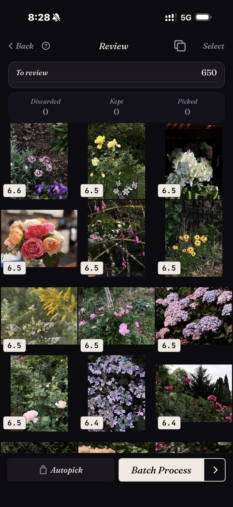

<section class="page-hero">
  

    
<a href="/it/">SpectraSort</a>&#8250;Trova le tue foto migliori

    <h1>Trova le tue foto migliori su iPhone.</h1>
    
Da qualche parte nel tuo rullino ci sono le foto che incorniceresti davvero. Sono sepolte sotto tutto il resto che hai scattato quel giorno. SpectraSort ti dà tre modi per tirarle fuori: descriverle, indicarne una o lasciare che un profilo di gusto appreso le faccia emergere da solo.

    

      <a class="cta" href="https://apps.apple.com/us/app/spectrasort-ai-photo-picker/id6757512134?ppid=5fd01708-3a73-4412-9bea-b411522af1f3"><svg viewBox="0 0 24 24" aria-hidden="true"><path d="M17.05 12.04c-.02-2.16 1.77-3.2 1.85-3.25-1.01-1.48-2.59-1.68-3.14-1.7-1.33-.13-2.61.78-3.29.78-.69 0-1.73-.76-2.85-.74-1.46.02-2.83.85-3.59 2.17-1.54 2.66-.39 6.59 1.1 8.75.73 1.06 1.6 2.24 2.73 2.2 1.1-.04 1.51-.71 2.84-.71 1.32 0 1.7.71 2.85.69 1.18-.02 1.92-1.07 2.64-2.13.84-1.22 1.18-2.42 1.2-2.48-.03-.01-2.3-.88-2.34-3.58zM14.95 5.6c.61-.74 1.02-1.77.9-2.8-.88.04-1.94.58-2.57 1.31-.56.65-1.06 1.7-.93 2.71.98.07 1.99-.5 2.6-1.22z"/></svg>
        Scarica sull'App Store
      </a>
      Gratis &middot; iPhone &middot; iOS 18.5+ &middot; Aggiornato il 31 ottobre 2026
    

    

      <b>100% sul dispositivo</b> — niente caricamenti
      <b>Gratis</b> 5 azioni a settimana
      <b>Un solo pagamento</b> — azioni illimitate
    

  

</section>

<section id="way-1" class="slab">
  

    

      

        Modo 1 — descrivila
        <h2>Scrivi ciò che ricordi. Te lo restituisce, dal migliore in giù.</h2>
        
Tocca un modello come «Ritratto» o «Notte», oppure scrivi una parola — la ricerca digitata funziona per ora in inglese. <b>Trova un soggetto</b> accetta tutto ciò che riesci a mettere in parole, che sia concreto, composto o astratto. Non serve Apple Intelligence.

        
La differenza rispetto alla ricerca integrata è l'ordine. Ogni corrispondenza è valutata, quindi lo scatto migliore di ciò che ricordavi sta in cima invece che da qualche parte nella nona riga. La griglia qui è un risultato reale: una ricerca di fiori su tutta la libreria, valutata e ordinata.

      

      

        

          

        

      

    

  

</section>

<section id="way-2" class="slab rise">
  

    

      

        Modo 2 — indicane una
        <h2>Una buona foto trova le altre.</h2>
        
A volte la richiesta è una foto, non una frase. Hai un buon scatto della casa sul lago e sai che ce ne sono altri. <b>Foto simili a questa</b> prende quell'unico esempio e classifica tutta la libreria rispetto a esso. Lo screenshot mostra un ordinamento reale, con 1.708 foto classificate rispetto a un solo riferimento.

        
È la risposta più veloce a «so che questa foto esiste ma non riesco a trovarla», anche per foto che stanno a tre anni di distanza.

      

      

        

          

        

      

    

  

</section>

<section id="way-3" class="slab">
  

    

      

        Modo 3 — nessuna richiesta
        <h2>Oppure chiedi semplicemente il meglio.</h2>
        
<b>Migliori scatti</b> fa emergere i fotogrammi più nitidi, meglio esposti e meglio composti da qualsiasi sezione della libreria, e puoi sbilanciarlo sul tecnico o sull'artistico.

        
<b>Il tuo gusto</b> va un passo oltre. È un profilo appreso dalle tue scelte di tenere e scartare, quindi ciò che sale in cima è quello che avresti scelto <em>tu</em>, non quello che piace a un modello generico. Nessun'altra app lo fa.

      

      

        

          

        

      

    

  

</section>

<section id="how-it-works" class="slab rise">
  

    
Come funziona

    

      

Trova

Una frase, una foto di esempio, un luogo o il tuo gusto: sei strumenti, un tocco ciascuno.

      

Classifica

Valutato sul dispositivo per nitidezza, esposizione, composizione e somiglianza.

      

Completa

Preferiti aggiunti, album riempito o condivisione: in un'unica schermata in blocco.

    

  

</section>

<section class="slab">
  

    <h2>Tutto sul tuo telefono</h2>
    
L'indice, la ricerca e i punteggi sono calcolati sul Neural Engine dell'iPhone, quindi le tue foto non vengono mai caricate e non c'è nessun account da creare. Una ricerca su migliaia di foto richiede un attimo, perché gira su un indice che l'app costruisce una volta — fino a 100 foto al secondo sugli iPhone recenti — e tiene aggiornato man mano che arrivano nuove foto.

    

      
Dove non aiuta

      <ul>
        <li>Può trovare solo il meglio di ciò che hai scattato. Non può salvare un momento che non hai catturato.</li>
        <li>Solo iPhone, iOS 18.5 o successivo. Nessuna versione per iPad, Android o desktop.</li>
        <li>Il primissimo indice di una libreria grande richiede un po' di tempo. Dopo è automatico: le nuove foto vengono indicizzate quando arrivano, quindi non aspetti di nuovo.</li>
        <li>Le foto eliminate passano nel cestino di iOS: finiscono in Eliminati di recente e lo spazio torna nel momento in cui svuoti quell'album lì, oppure automaticamente dopo 30 giorni. Ogni Elimina in SpectraSort mostra lo spazio che libera prima che tu confermi.</li>
      </ul>
    

  

</section>

<section id="pricing" class="slab rise">
  

    

      Prezzi
      <h2>Cinque azioni gratis a settimana. Paghi una volta per averle illimitate.</h2>
      
Cinque azioni gratuite a settimana, senza account e senza carta di credito. Paghi una volta per azioni illimitate. Nessun abbonamento, mai. Fatta da uno sviluppatore indie che la usa ogni giorno.

      <a class="cta" href="https://apps.apple.com/us/app/spectrasort-ai-photo-picker/id6757512134?ppid=5fd01708-3a73-4412-9bea-b411522af1f3"><svg viewBox="0 0 24 24" aria-hidden="true"><path d="M17.05 12.04c-.02-2.16 1.77-3.2 1.85-3.25-1.01-1.48-2.59-1.68-3.14-1.7-1.33-.13-2.61.78-3.29.78-.69 0-1.73-.76-2.85-.74-1.46.02-2.83.85-3.59 2.17-1.54 2.66-.39 6.59 1.1 8.75.73 1.06 1.6 2.24 2.73 2.2 1.1-.04 1.51-.71 2.84-.71 1.32 0 1.7.71 2.85.69 1.18-.02 1.92-1.07 2.64-2.13.84-1.22 1.18-2.42 1.2-2.48-.03-.01-2.3-.88-2.34-3.58zM14.95 5.6c.61-.74 1.02-1.77.9-2.8-.88.04-1.94.58-2.57 1.31-.56.65-1.06 1.7-.93 2.71.98.07 1.99-.5 2.6-1.22z"/></svg>
        Scarica sull'App Store
      </a>
    

  

</section>

<section id="faq" class="slab">
  

    

      FAQ
      <h2>Trovare il tuo meglio.</h2>
    

    

      

Come trovo le mie foto migliori senza scorrere tutto?

Dagli un punto di partenza: una frase, una foto di esempio, un luogo o semplicemente Migliori scatti su un intervallo di tempo. Poi rivedi il risultato classificato invece del rullino grezzo. I probabili vincitori sono in cima prima che tu inizi.

      

Può trovare foto di anni fa?

Sì. L'indice copre tutta la tua libreria, e la Cronologia di Scopri scende da anno a mese a giorno se preferisci sfogliare un periodo invece di cercarlo.

      

Serve una connessione internet?

No. Ricerca, valutazione e profilo di gusto girano sul dispositivo, quindi trovare le foto non dipende da una connessione.

      

Cosa significa davvero «migliore»?

Per impostazione predefinita significa nitidezza, esposizione e composizione, valutate per foto. Con Il tuo gusto diventa personale, classificato per somiglianza alle foto che conservi. In Studio puoi pesare tu sette assi di qualità.

    

  

</section>

<section class="slab">
  

    

      Continua a leggere
      

        <a href="/it/how-to-pick-best-photos-from-camera-roll/">Scegli il meglio del tuo rullinoIl metodo passo dopo passo</a>
        <a href="/it/ai-photo-picker-iphone/">Selettore foto IA per iPhoneCosa fa davvero un selettore</a>
        <a href="/it/photo-organizer-iphone/">Organizzatore foto IAScene, Cronologia e album</a>
      

    

  

</section>
