<section class="hero">
  

    

      

        Selettore foto IA e scrematura · iPhone
        <h1>Le tue foto migliori. Trovate.</h1>
        
Quasi tutte le app di foto chiedono «questa è una bella foto?». SpectraSort chiede «la terresti <em>tu</em>?». Ogni volta che conservi o scarti una foto impara qualcosa — e il rullino torna ordinato, con le migliori in cima.

        
SpectraSort è un selettore foto IA per iPhone che ordina il rullino in base alla qualità e al tuo gusto. In più screma, elimina i duplicati e fa pulizia. Un solo pagamento, nessun abbonamento.

        

          <a class="cta" href="https://apps.apple.com/us/app/spectrasort-ai-photo-picker/id6757512134?ppid=5fd01708-3a73-4412-9bea-b411522af1f3">
            <svg viewBox="0 0 24 24" aria-hidden="true"><path d="M17.05 12.04c-.02-2.16 1.77-3.2 1.85-3.25-1.01-1.48-2.59-1.68-3.14-1.7-1.33-.13-2.61.78-3.29.78-.69 0-1.73-.76-2.85-.74-1.46.02-2.83.85-3.59 2.17-1.54 2.66-.39 6.59 1.1 8.75.73 1.06 1.6 2.24 2.73 2.2 1.1-.04 1.51-.71 2.84-.71 1.32 0 1.7.71 2.85.69 1.18-.02 1.92-1.07 2.64-2.13.84-1.22 1.18-2.42 1.2-2.48-.03-.01-2.3-.88-2.34-3.58zM14.95 5.6c.61-.74 1.02-1.77.9-2.8-.88.04-1.94.58-2.57 1.31-.56.65-1.06 1.7-.93 2.71.98.07 1.99-.5 2.6-1.22z"/></svg>
            Scarica sull'App Store
          </a>
          Gratis · iPhone · iOS 18.5+ Aggiornato il 31 ottobre 2026
        

        

          <b>100% sul dispositivo</b> — niente viene caricato
          <b>Gratis</b> 5 azioni a settimana
          <b>Un solo pagamento</b> — azioni illimitate
        

      

      

        

          

            <video class="screen-loop" src="/video/web-hero.mp4"
                   poster="/images/shots/hero-poster.jpg"
                   loop muted playsinline preload="metadata"
                   width="660" height="1344"
                   aria-label="Gli strumenti di SpectraSort aprono Il tuo gusto, mostrano un profilo appreso chiamato Nature Explorer e poi una griglia di paesaggi ordinati 8.7, 8.6, 8.6 — i migliori per primi"></video>
          

        

      

    

  

</section>

<section id="taste" class="rise">
  

    

      

        Il tuo gusto — l'unica app che lo fa
        <h2>Impara cosa avresti scelto tu.</h2>
        
Ogni revisione gli insegna qualcosa. L'app costruisce un profilo personalizzato sul tuo gusto. Quello che sceglie inizia a somigliare a quello che avresti scelto tu.

        
Metti in pausa l'apprendimento, azzeralo o affinalo. Salva tutti i profili che vuoi.

        <a class="learn-more" href="/it/ai-photo-picker-iphone/">Come funziona la selezione &rsaquo;</a>
      

      

        

          

            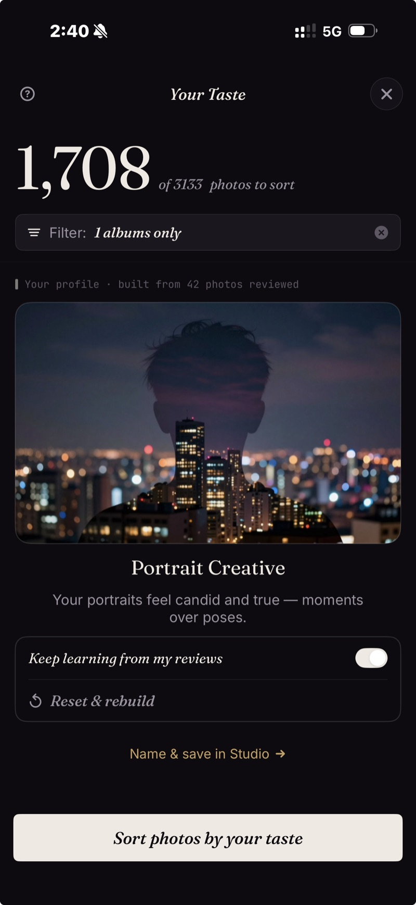
          

          

            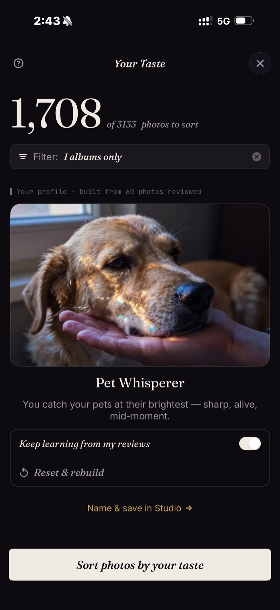
          

          

            
          

        

        
Il tuo profilo di gusto impara cosa scegli, poi ordina le foto di conseguenza.

      

    

  

</section>

<section id="tools">
  

    

      Strumenti foto IA
      <h2>Sei modi per iniziare. Un tocco ciascuno.</h2>
    

    

      

        
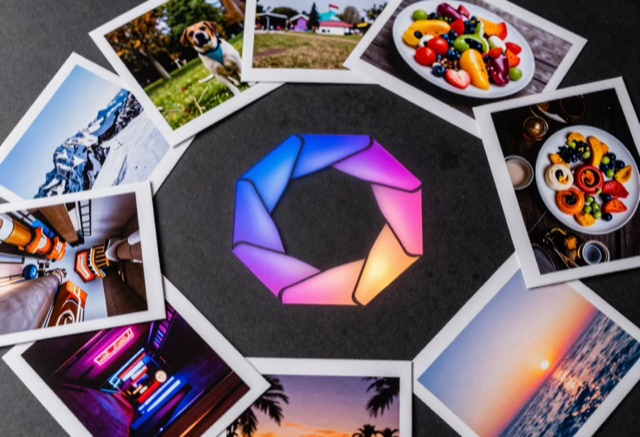

        

Il tuo gusto

Costruito dalle foto che conservi e da quelle che scarti.

      

      

        
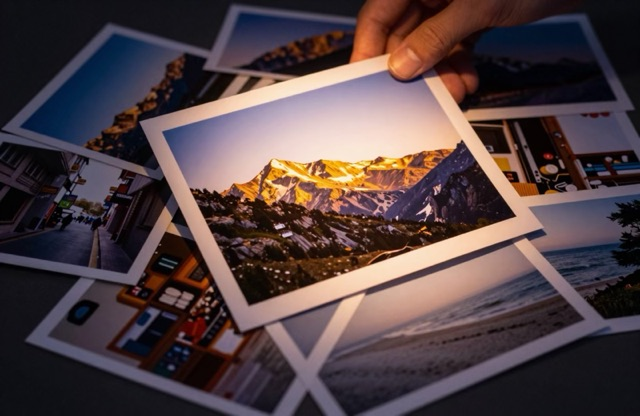

        

Migliori scatti

Prima le più nitide, meglio esposte e meglio composte. Più tecnico o più artistico, come vuoi.

      

      

        
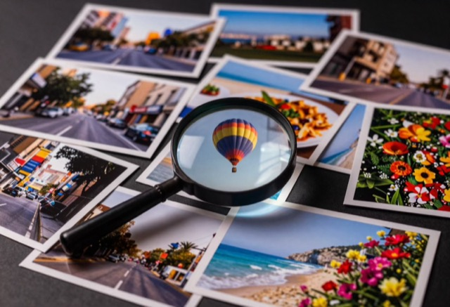

        

Trova un soggetto

Tocca un modello come «Ritratto» o «Notte» — la ricerca digitata funziona per ora in inglese.

      

      

        
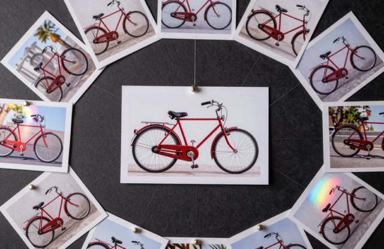

        

Foto simili a questa

Indica una foto e ottieni tutto ciò che le assomiglia.

      

      

        
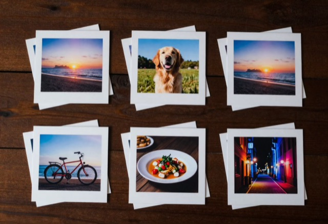

        

Duplicati

Duplicati, raffiche e foto quasi identiche, impilati da smaltire.

      

      

        
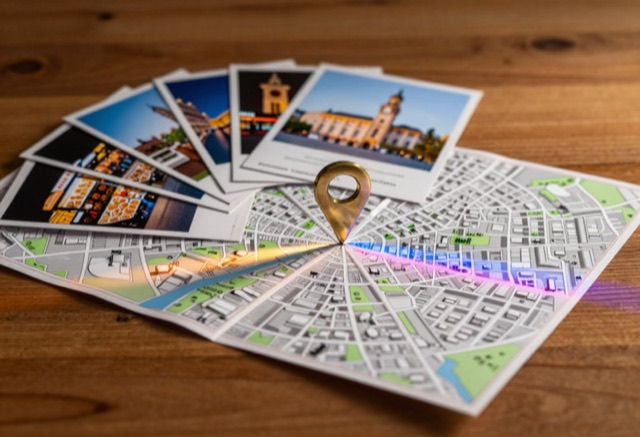

        

Foto di un luogo

Fissa un luogo e vedi tutto ciò che è stato scattato lì.

      

    

    
<a class="learn-more" href="/it/features/">Ogni strumento, controllo e limite in una pagina &rsaquo;</a>

  

</section>

<section id="find-subject" class="rise">
  

    

      

        Trova un soggetto
        <h2>Cerca qualsiasi cosa — e ricevila con le migliori in cima.</h2>
        
Tocca un modello come «Ritratto» o «Notte» — oppure scrivi una parola (la ricerca digitata funziona per ora in inglese). Ogni scatto finisce in un'unica griglia — ordinato, non solo trovato.

        <a class="learn-more" href="/it/find-best-photos-iphone/">Tre modi per trovare una foto &rsaquo;</a>
      

      

        

          

            <video class="screen-loop" src="/video/web-find-subject.mp4"
                   poster="/images/shots/find-subject-poster.jpg"
                   loop muted playsinline preload="none"
                   width="660" height="1344"
                   aria-label="Una ricerca digitata in Trova un soggetto, poi la griglia ordinata dei risultati"></video>
          

        

      

    

  

</section>

<section id="like-this">
  

    

      Foto simili a questa
      <h2>Scegli una foto, trova le altre.</h2>
      
Scegli una foto e ricevi le altre simili, ordinate dalla più simile.

        <a class="learn-more" href="/it/find-best-photos-iphone/">La ricerca per esempio, spiegata &rsaquo;</a>
    

    

      

        
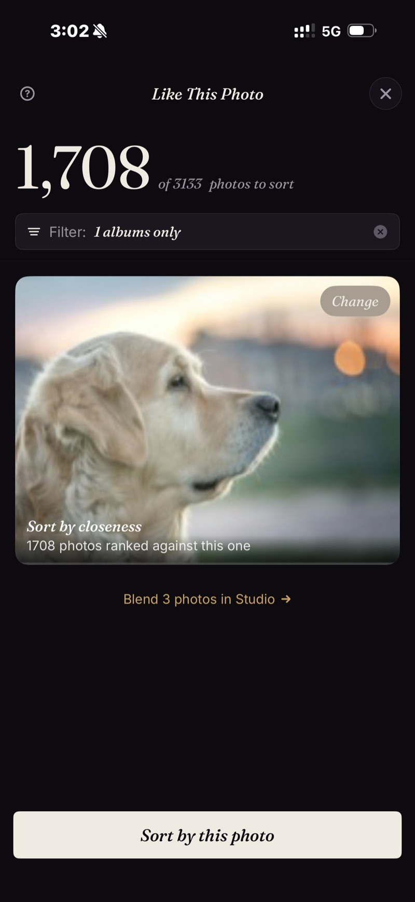

      

      
&rarr;

      

        
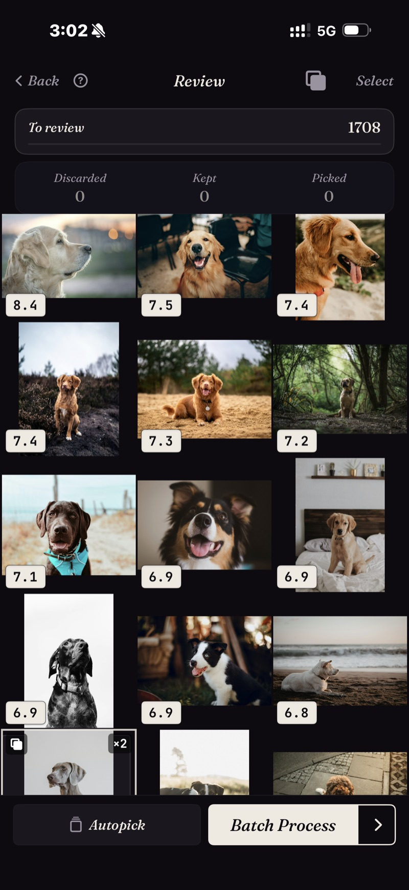

      

    

  

</section>

<section id="dedupe" class="rise">
  

    

      

        Duplicati
        <h2>11 scatti dello stesso tramonto &rarr; un gesto e tieni il più nitido.</h2>
        
Duplicati, raffiche e scatti quasi identici arrivano già raggruppati: scegli quello che ti piace e vai avanti.

        <a class="learn-more" href="/it/duplicate-photo-finder-iphone/">Come funziona la ricerca duplicati &rsaquo;</a>
      

      

        

          

          

          

          

          

            Il più nitido &check;
            11 foto
          

        

      

    

  

</section>

<section id="discover">
  

    

      Scopri — scene e cronologia
      <h2>Affronta la libreria un pezzo alla volta.</h2>
      
Le scene raccolgono da sole i tuoi viaggi, i temi e le serie. La cronologia ti guida tra giorni, mesi e anni.

      <a class="learn-more" href="/it/photo-organizer-iphone/">Come funziona l'organizzazione &rsaquo;</a>
    

    

      

        
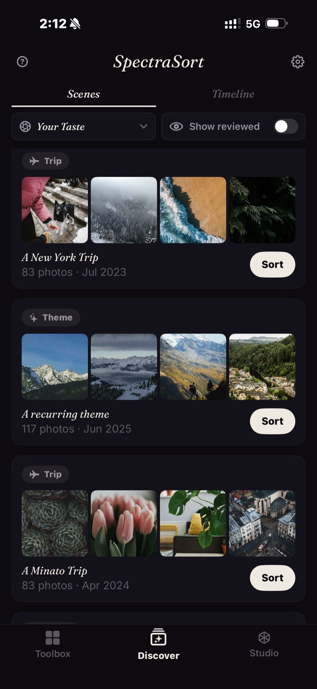

      

      

        
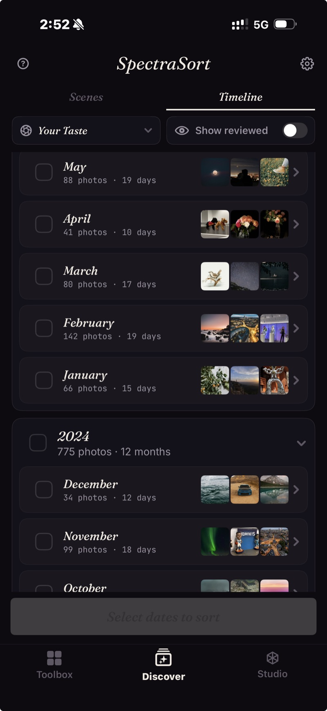

      

    

  

</section>

<section id="done" class="rise">
  

    

      

        Revisione &rarr; Fine
        <h2>Le migliori entrano con uno swipe. Finisci in una schermata.</h2>
        
Le migliori salgono in alto. A destra per conservare, in basso per tenere, a sinistra per scartare. Usa la rotella per confrontare le foto simili.

        <a class="learn-more" href="/it/photo-culling-iphone/">Tutto il flusso di revisione &rsaquo;</a>
      

      

        

          

            <video class="screen-loop" src="/video/web-review-swipe.mp4"
                   poster="/images/shots/review-swipe-poster.jpg"
                   loop muted playsinline preload="none"
                   width="660" height="1344"
                   aria-label="Due fotogrammi quasi identici dello stesso cane su una rotella — si passa da Simile 1 di 2, con 6.8, a Simile 2 di 2, poi se ne sceglie uno"></video>
          

        

      

    

  

</section>

<section id="studio">
  

    

      

        Studio — controlli personalizzati
        <h2>Quando vuoi i controlli.</h2>
        
Sette assi di qualità da regolare. Fino a tre soggetti. Una rotella di equilibrio per bilanciare corrispondenza del soggetto e qualità. Salva tutto come profili di ordinamento personalizzati.

        <a class="learn-more" href="/it/studio/">Scopri Studio &rsaquo;</a>
      

      

        

          

            <video class="screen-loop" src="/video/web-studio-wheel.mp4"
                   poster="/images/shots/studio-wheel-poster.jpg"
                   loop muted playsinline preload="none"
                   width="920" height="852"
                   aria-label="La rotella di equilibrio di Studio ruotata avanti e indietro: il peso dei soggetti principali scende dal 75% al 25% mentre il radar della qualità cresce dal 25% al 75%, poi torna"></video>
          

        

      

    

  

</section>

<section id="privacy">
  

    

      
      

      

        Privato
        <h2>Niente esce dal tuo telefono.</h2>
        
La ricerca, la valutazione e il profilo di gusto girano tutti sul tuo telefono. Le tue foto non vengono mai caricate da nessuna parte.

        <a class="learn-more" href="/it/private-ai-photo-app/">Come funziona l'elaborazione sul dispositivo &rsaquo;</a>
      

    

  

</section>

<section id="uses">
  

    

      A cosa serve
      <h2>Quattro lavori. Una sola app.</h2>
      
Le schermate di questa pagina e delle guide sono ordinamenti reali, non mockup: 1.708 foto ordinate rispetto a un esempio, un profilo di gusto costruito da 1.082 revisioni e una scrematura di 650 foto che si è chiusa con 4 conservate, 484 tenute e 162 scartate.

    

    

      <a class="usecase" href="/it/vacation-photos-iphone/">
        Screma un viaggio
        <h3>1.200 foto di vacanza &rarr; l'album che vale la pena mostrare</h3>
        
Lancia un ordinamento sul viaggio e rivedi le migliori invece di scorrere ogni scatto. Duplicati e raffiche arrivano già impilati: ogni momento è una sola decisione.

        Come scremare un viaggio su iPhone &rarr;
      </a>
      <a class="usecase" href="/it/find-best-photos-iphone/">
        Trova i vecchi preferiti
        <h3>La foto che sai che esiste, ma non trovi</h3>
        
Descrivila a parole o indica una foto simile. Le corrispondenze arrivano ordinate, prima le migliori, anche quelle sepolte a tre anni di distanza.

        Come trovare le tue foto migliori &rarr;
      </a>
      <a class="usecase" href="/it/duplicate-photo-finder-iphone/">
        Elimina i duplicati
        <h3>19 versioni dello stesso scatto, una sola da tenere</h3>
        
Duplicati esatti, raffiche e scatti quasi identici arrivano raggruppati, con il più nitido segnalato. Nella libreria di prova una rosa compariva 19 volte; una sola decisione ha chiuso l'intera pila.

        Come funziona la ricerca duplicati &rarr;
      </a>
      <a class="usecase" href="/it/ai-photo-picker-iphone/">
        Costruisci la tua collezione
        <h3>Un rullino che impara cosa ti piace</h3>
        
Ogni foto conservata o scartata affina il tuo profilo di gusto. Dopo un po', ordinare con Il tuo gusto inizia a produrre l'album che avresti scelto a mano.

        Cosa fa un selettore foto IA &rarr;
      </a>
    

  

</section>

<section id="how" class="rise" style="padding-bottom:0;">
  

    

      Ogni ordinamento è in tre passi
    

    

      

Trova

Sei strumenti, un tocco ciascuno: una frase, una foto di esempio, un luogo, il tuo gusto.

      

Ordina

Valutate per nitidezza, esposizione, composizione e quanto somigliano alle foto che conservi.

      

Finisci

Una schermata: album riempito, preferiti aggiunti, il resto eliminato.

    

  

</section>

<section id="pricing" class="rise">
  

    Prezzi
    <h2>Cinque azioni gratis a settimana. Paghi una volta per averle illimitate.</h2>
    

      

        

          Gratis
          
5 azioni a settimana

          <ul>
            <li><b>Ordinamento illimitato</b> — tutti e sei gli strumenti, Scopri, ogni filtro</li>
            <li>Condividi, aggiungi ai preferiti, aggiungi a un album, elimina — ognuna conta una volta</li>
            <li>Nessun account, nessuna carta di credito</li>
            <li>Le tue foto restano sul tuo telefono</li>
          </ul>
        

        

          Premium
          
Un solo pagamento

          <ul>
            <li><b>Azioni illimitate</b></li>
            <li>Tutti i controlli di Studio — sette assi di qualità, la rotella di equilibrio, i profili salvati</li>
            <li>Un solo acquisto, legato al tuo account Apple — si ripristina su un telefono nuovo</li>
            <li><b>Nessun abbonamento. Mai.</b></li>
          </ul>
        

      

      

        <a class="cta grad" href="https://apps.apple.com/us/app/spectrasort-ai-photo-picker/id6757512134?ppid=5fd01708-3a73-4412-9bea-b411522af1f3">
          <svg viewBox="0 0 24 24" aria-hidden="true"><path d="M17.05 12.04c-.02-2.16 1.77-3.2 1.85-3.25-1.01-1.48-2.59-1.68-3.14-1.7-1.33-.13-2.61.78-3.29.78-.69 0-1.73-.76-2.85-.74-1.46.02-2.83.85-3.59 2.17-1.54 2.66-.39 6.59 1.1 8.75.73 1.06 1.6 2.24 2.73 2.2 1.1-.04 1.51-.71 2.84-.71 1.32 0 1.7.71 2.85.69 1.18-.02 1.92-1.07 2.64-2.13.84-1.22 1.18-2.42 1.2-2.48-.03-.01-2.3-.88-2.34-3.58zM14.95 5.6c.61-.74 1.02-1.77.9-2.8-.88.04-1.94.58-2.57 1.31-.56.65-1.06 1.7-.93 2.71.98.07 1.99-.5 2.6-1.22z"/></svg>
          Scarica gratis
        </a>
        
iPhone · iOS 18.5+ · Passa a Premium dentro l'app, quando vuoi. Il prezzo locale è indicato sull'App Store.

        
<a class="learn-more" href="/it/pricing/">Cosa conta come azione e cosa aggiunge Premium &rsaquo;</a>

      

    

  

</section>

<section id="faq">
  

    

      FAQ
      <h2>Domande frequenti.</h2>
    

    

      

Le mie foto escono mai dal telefono?

No. Ogni passaggio — la ricerca, la valutazione, il profilo di gusto — gira sul Neural Engine del tuo iPhone. Non ci sono caricamenti, non c'è un account e non c'è nessun server di SpectraSort in mezzo.

      

SpectraSort usa le mie foto per addestrare l'IA?

No. Niente viene caricato, quindi non c'è niente su cui addestrare. Tutto accade sul tuo iPhone e chi ha fatto l'app non vede mai le tue foto.

      

In cosa si distingue da Foto di Apple o Google Foto?

Quelle sono fatte per sfogliare e archiviare. SpectraSort è fatta per scegliere — ordina ciò che trova rispetto a quello che hai chiesto o a quello che ha imparato sul tuo gusto, poi ti dà un flusso di revisione su cui agire. Ed è 100% locale: nulla della tua libreria foto esce dal telefono.

      

Quanto è veloce?

Quasi istantaneo una volta creato l'indice sul dispositivo, anche con migliaia di foto. L'indice si costruisce al primo ordinamento — fino a 100 foto al secondo sugli iPhone recenti — e resta aggiornato da solo quando arrivano nuove foto.

      

Cosa è gratis e cosa sblocca Premium?

Cinque azioni a settimana sono gratis per tutti, per sempre — condividi, aggiungi ai preferiti, aggiungi a un album o elimina. Ognuna conta una volta, quante foto copra non importa, e il conteggio si ricarica il lunedì. Ordinare e rivedere sono gratis e illimitati. Un solo pagamento per azioni illimitate più Studio (assi di qualità, la rotella di equilibrio, i profili salvati). Nessun abbonamento.

      

Libera spazio?

Elimina le foto che gli indichi, tramite il flusso di eliminazione di iOS: finiscono in <b>Eliminati di recente</b> e lo spazio torna appena svuoti quell'album — o automaticamente dopo 30 giorni. SpectraSort tocca solo la tua libreria foto, mai il resto del telefono.

      

Cos'è il profilo Il tuo gusto?

Un profilo personale che prende forma mentre usi l'app, costruito dalle foto che conservi e da quelle che scarti — tutto sul tuo dispositivo. Quando ha imparato abbastanza, ordina secondo le tue preferenze. Modellalo in Studio, oppure azzeralo e ricostruiscilo quando vuoi. Non lascia mai il tuo telefono.

      

Ho comprato Premium in SpectraSort 2.x — lo mantengo?

Sì — è lo stesso acquisto, si trasferisce da solo. Se non compare su un telefono nuovo, tocca Ripristina acquisti in Impostazioni.

      

Su quali dispositivi funziona?

iPhone con iOS 18.5 o successivo. Tutta l'elaborazione gira sul Neural Engine di Apple; i chip più recenti indicizzano e ordinano più in fretta. Non serve Apple Intelligence e non ci sono blocchi regionali.

    

    
<a class="learn-more" href="/it/features/">Altre domande? Ogni dettaglio è nella pagina delle funzioni &rsaquo;</a>

  

</section>
