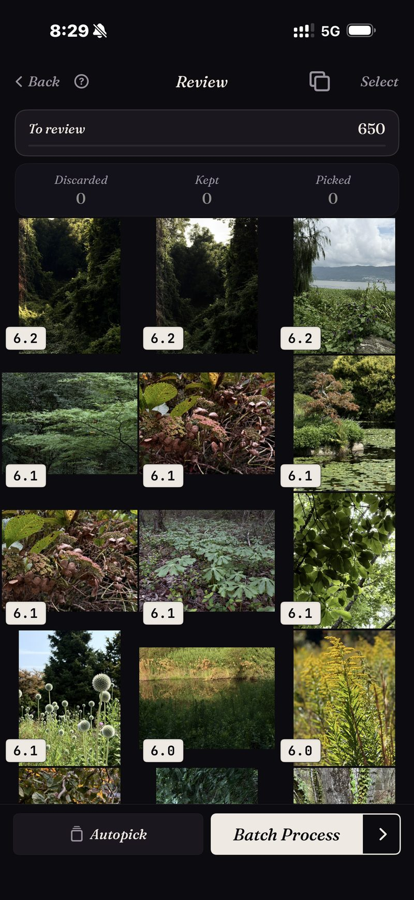

<section class="page-hero">
  

    
<a href="/it/">SpectraSort</a>&#8250;Scegli il meglio del rullino

    <h1>Come scegliere le foto migliori dal tuo rullino.</h1>
    
Un metodo che funziona per passare da migliaia di foto alle poche centinaia che ti interessano. Prima la versione a mano, poi quella assistita. Funzionano entrambe; solo una delle due regge su larga scala.

    

      <a class="cta" href="https://apps.apple.com/us/app/spectrasort-ai-photo-picker/id6757512134?ppid=5fd01708-3a73-4412-9bea-b411522af1f3"><svg viewBox="0 0 24 24" aria-hidden="true"><path d="M17.05 12.04c-.02-2.16 1.77-3.2 1.85-3.25-1.01-1.48-2.59-1.68-3.14-1.7-1.33-.13-2.61.78-3.29.78-.69 0-1.73-.76-2.85-.74-1.46.02-2.83.85-3.59 2.17-1.54 2.66-.39 6.59 1.1 8.75.73 1.06 1.6 2.24 2.73 2.2 1.1-.04 1.51-.71 2.84-.71 1.32 0 1.7.71 2.85.69 1.18-.02 1.92-1.07 2.64-2.13.84-1.22 1.18-2.42 1.2-2.48-.03-.01-2.3-.88-2.34-3.58zM14.95 5.6c.61-.74 1.02-1.77.9-2.8-.88.04-1.94.58-2.57 1.31-.56.65-1.06 1.7-.93 2.71.98.07 1.99-.5 2.6-1.22z"/></svg>
        Scarica sull'App Store
      </a>
      Gratis &middot; iPhone &middot; iOS 18.5+ &middot; Aggiornato il 31 ottobre 2026
    

    

      <b>100% sul dispositivo</b> — niente viene caricato
      <b>Gratis</b> 5 azioni a settimana
      <b>Un solo pagamento</b> — azioni illimitate
    

  

</section>

<section class="slab">
  

    <h2>Il metodo manuale (senza app)</h2>
    <ol>
      <li><b>Lavora per porzioni, mai su tutta la libreria.</b> Un viaggio, un mese, un evento. Una porzione finita è progresso; una libreria scorsa a metà no.</li>
      <li><b>Due passate.</b> Nella prima, taglia in fretta gli errori evidenti: sfocature, scatti accidentali, foto inutili. Nella seconda, scegli tra le simili che restano.</li>
      <li><b>Risolvi i quasi identici fianco a fianco.</b> Apri la raffica, confronta, tieni esattamente una. Non rimandare: è proprio rimandando le pile che la libreria è arrivata a questo punto.</li>
      <li><b>Segna le foto da tenere come Preferiti</b> (o spostale in un album) così la decisione è registrata da qualche parte.</li>
      <li><b>Chiudi la porzione</b>, album riempito e scarti sistemati, prima di aprirne un'altra.</li>
    </ol>
    
Funziona. Costa circa una serata ogni mille foto, ed è la vera ragione per cui la maggior parte delle librerie non viene mai sistemata.

    <h3>Perché non regge su larga scala</h3>
    
Tre problemi si sommano. Niente è ordinato, quindi ogni foto costa una decisione a prezzo pieno. I quasi identici sono sparsi, quindi confrontare significa andarli a cercare. E la stanchezza decisionale arriva molto prima della fine della porzione. Il metodo è valido; l'economia no.

  

</section>

<section id="the-assisted-version" class="slab rise">
  

    

      

        La versione assistita
        <h2>Stesso metodo, già ordinato.</h2>
        
SpectraSort esegue gli stessi cinque passi con le parti costose già fatte prima che tu guardi. Scegli una porzione, che sia una scena, un intervallo di tempo o una ricerca per soggetto, e torna <b>ordinata</b> con i quasi identici già impilati.

        
Poi rivedi: scorri a destra per conservare, in basso per tenere, a sinistra per scartare, oppure lascia che Autoselezione archivi tutto in base al punteggio e dai solo un'occhiata al risultato. Le simili impilate stanno su un'unica ruota, così una raffica richiede una sola decisione.

        
Azioni multiple chiude la porzione in una schermata: le foto conservate in un album o nel pannello di condivisione, il resto sistemato tramite la finestra di sistema.

      

      

        

          

        

      

    

  

</section>

<section id="the-method" class="slab rise">
  

    
Lo stesso metodo, compresso

    

      

Porzione

Le scene e la cronologia dividono già la libreria in porzioni che si possono chiudere.

      

Revisione

Ordinata e impilata, così scegli le migliori — non devi elaborare tutto.

      

Chiudi

Un solo blocco: album, preferiti, condivisione o eliminazione.

    

  

</section>

<section class="slab">
  

    <h2>Dettagli che lo rendono sicuro</h2>
    
Uno scorrimento verso il basso tiene solo la foto; rinunciare a conservarla non la elimina mai. Le eliminazioni avvengono solo in Azioni multiple, passano dalla finestra di conferma di sistema e finiscono nell'album Eliminati di recente di iOS: restano recuperabili per 30 giorni, oppure vengono cancellate nel momento in cui lo svuoti. L'ordinamento stesso gira sul Neural Engine del tuo iPhone, quindi <a href="/it/private-ai-photo-app/">niente viene caricato</a>.

    

      
Dove non aiuta

      <ul>
        <li>L'ultima parola è ancora tua. L'ordinamento giudica ogni scatto e Autoselezione può archiviarli tutti in base al punteggio; quello che succede davvero aspetta il tuo tocco.</li>
        <li>Solo iPhone, iOS 18.5 o successivo. Nessuna versione per iPad, Android o desktop.</li>
        <li>Il primo indice di una libreria grande richiede un po' di tempo. Dopo è automatico: le nuove foto vengono indicizzate appena compaiono, così non aspetti più.</li>
        <li>Le foto eliminate passano dal cestino di iOS: finiscono in Eliminati di recente e lo spazio torna libero nel momento in cui svuoti quell'album, oppure automaticamente dopo 30 giorni. Ogni Elimina in SpectraSort mostra lo spazio che libera prima che tu confermi.</li>
      </ul>
    

  

</section>

<section id="pricing" class="slab rise">
  

    

      Prezzi
      <h2>Cinque azioni gratuite a settimana. Un solo pagamento per averle illimitate.</h2>
      
Cinque azioni gratuite a settimana, senza account e senza carta di credito. Un solo pagamento per azioni illimitate. Nessun abbonamento, mai. Fatto da uno sviluppatore indipendente che la usa ogni giorno.

      <a class="cta" href="https://apps.apple.com/us/app/spectrasort-ai-photo-picker/id6757512134?ppid=5fd01708-3a73-4412-9bea-b411522af1f3"><svg viewBox="0 0 24 24" aria-hidden="true"><path d="M17.05 12.04c-.02-2.16 1.77-3.2 1.85-3.25-1.01-1.48-2.59-1.68-3.14-1.7-1.33-.13-2.61.78-3.29.78-.69 0-1.73-.76-2.85-.74-1.46.02-2.83.85-3.59 2.17-1.54 2.66-.39 6.59 1.1 8.75.73 1.06 1.6 2.24 2.73 2.2 1.1-.04 1.51-.71 2.84-.71 1.32 0 1.7.71 2.85.69 1.18-.02 1.92-1.07 2.64-2.13.84-1.22 1.18-2.42 1.2-2.48-.03-.01-2.3-.88-2.34-3.58zM14.95 5.6c.61-.74 1.02-1.77.9-2.8-.88.04-1.94.58-2.57 1.31-.56.65-1.06 1.7-.93 2.71.98.07 1.99-.5 2.6-1.22z"/></svg>
        Scarica sull'App Store
      </a>
    

  

</section>

<section id="faq" class="slab">
  

    

      FAQ
      <h2>Domande sul metodo.</h2>
    

    

      

Ogni quanto dovrei passare in rassegna il rullino?

Poco e spesso batte le grandi pulizie. Una porzione a settimana, magari le foto della settimana scorsa o un vecchio viaggio, tiene la libreria decisa. Ordinare è gratis e illimitato, quindi il ritmo non costa nulla.

      

Cosa faccio con le foto che tengo?

Registra la decisione: un album, i Preferiti o condividerle da qualche parte. Azioni multiple di SpectraSort fa una qualsiasi di queste cose in un solo passaggio, e i suoi album compaiono in Foto di Apple. La <a href="/it/photo-organizer-iphone/">guida all'organizzazione</a> tratta album e scene più in dettaglio.

      

Come evito di eliminare qualcosa di cui mi pentirò?

Ci sono tre reti di sicurezza. Rinunciare a conservare una foto non la elimina mai. Le eliminazioni richiedono la finestra di conferma di sistema. E le foto eliminate restano recuperabili in Eliminati di recente per 30 giorni.

      

Posso farlo senza nessuna app?

Sì. Il metodo manuale in cima a questa pagina non richiede altro che l'app Foto e pazienza. La versione con l'app esiste perché di solito la pazienza è la parte che manca.

    

  

</section>

<section class="slab">
  

    

      Leggi anche
      

        <a href="/it/find-best-photos-iphone/">Trova le tue foto miglioriTre modi per far emergere le foto da tenere</a>
        <a href="/it/photo-culling-iphone/">Scrematura delle foto su iPhoneIl flusso completo</a>
        <a href="/it/duplicate-photo-finder-iphone/">Ricerca duplicatiPrima sistema le ripetizioni</a>
      

    

  

</section>
