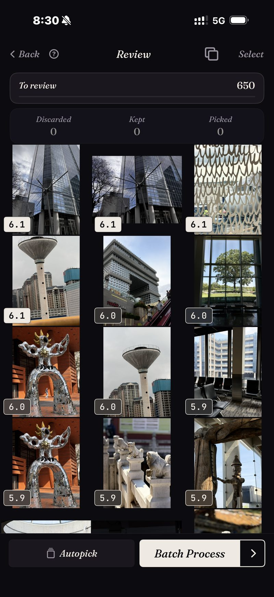

<section class="page-hero">
  

    
<a href="/it/">SpectraSort</a>&#8250;Selezione foto su iPhone

    <h1>Selezione foto, sul tuo iPhone.</h1>
    
La selezione significa tenere il meglio e lasciare andare il resto. Una volta serviva un computer, un'importazione e una serata libera. SpectraSort esegue l'intero flusso sul telefono dove le tue foto già sono, e classifica ogni scatto prima che tu ne scorra anche uno solo.

    

      <a class="cta" href="https://apps.apple.com/us/app/spectrasort-ai-photo-picker/id6757512134?ppid=5fd01708-3a73-4412-9bea-b411522af1f3"><svg viewBox="0 0 24 24" aria-hidden="true"><path d="M17.05 12.04c-.02-2.16 1.77-3.2 1.85-3.25-1.01-1.48-2.59-1.68-3.14-1.7-1.33-.13-2.61.78-3.29.78-.69 0-1.73-.76-2.85-.74-1.46.02-2.83.85-3.59 2.17-1.54 2.66-.39 6.59 1.1 8.75.73 1.06 1.6 2.24 2.73 2.2 1.1-.04 1.51-.71 2.84-.71 1.32 0 1.7.71 2.85.69 1.18-.02 1.92-1.07 2.64-2.13.84-1.22 1.18-2.42 1.2-2.48-.03-.01-2.3-.88-2.34-3.58zM14.95 5.6c.61-.74 1.02-1.77.9-2.8-.88.04-1.94.58-2.57 1.31-.56.65-1.06 1.7-.93 2.71.98.07 1.99-.5 2.6-1.22z"/></svg>
        Scarica sull'App Store
      </a>
      Gratis &middot; iPhone &middot; iOS 18.5+ &middot; Aggiornato il 31 ottobre 2026
    

    

      <b>100% sul dispositivo</b> — niente caricamenti
      <b>Gratis</b> 5 azioni a settimana
      <b>Un solo pagamento</b> — azioni illimitate
    

  

</section>

<section class="slab">
  

    <h2>Perché esiste la selezione</h2>
    
I fotografi selezionano perché un servizio fotografico produce sempre più fotogrammi di quanti dovrebbe consegnarne. Ne scatti 500 e ne consegni 40. Un rullino ha la stessa matematica e nessuno degli strumenti: un viaggio di due settimane torna a casa come 1.200 foto, e il modo integrato di gestirle è scorrere.

    
Gli strumenti desktop hanno risolto questo per i fotografi professionisti, con voti, confronti affiancati e revisione alla velocità della tastiera. Il tuo rullino vive da un'altra parte. SpectraSort ricostruisce quel flusso per il telefono e aggiunge qualcosa che gli strumenti desktop non hanno mai avuto: gli scatti arrivano <b>già classificati</b>.

  

</section>

<section id="ranked-before-you-review" class="slab rise">
  

    

      

        Classificato prima che tu riveda
        <h2>La revisione parte dalla cima della pila.</h2>
        
Punta un ordinamento su un viaggio, una scena o una ricerca, e ogni scatto torna valutato per nitidezza, esposizione e composizione. Se glielo chiedi, pesa anche quanto ogni foto somiglia a quelle che tendi a conservare. Gli scatti più forti sono in cima prima che tu abbia preso una sola decisione.

        
La cattura qui è un passaggio reale: una sezione di architettura da 650 foto, ogni scatto valutato, il più forte per primo — ed è tornata in un attimo, perché la libreria era già indicizzata dagli ordinamenti precedenti. L'indicizzazione avviene una volta e poi si tiene aggiornata: l'app raccoglie le nuove foto quando arrivano, fino a 100 foto al secondo sugli iPhone recenti.

        
Se vuoi criteri diversi, <b>Studio</b> ha sette assi di qualità, una rotella che bilancia corrispondenza del soggetto e qualità, e profili che puoi salvare.

      

      

        

          

        

      

    

  

</section>

<section id="bursts-and-retakes" class="slab">
  

    

      

        Raffiche e ripetizioni
        <h2>Diciannove scatti di un momento costano una decisione.</h2>
        
Gli scatti quasi identici sono ciò che rende lenta la selezione manuale, perché ogni scatto in più è un altro confronto. SpectraSort raggruppa duplicati, raffiche e simili in pile prima che la revisione inizi.

        
Una pila sta su un'unica rotella. Scorri gli scatti senza uscire dalla foto, tieni quello che vuoi e la pila è chiusa. Lo screenshot viene da un passaggio reale di eliminazione duplicati: la stessa rosa, 19 scatti, una rotella.

        
Poi gli swipe: a destra per conservare, in basso per tenere, a sinistra per lasciare andare. Oppure lascia che Autoselezione archivi l'intera sezione per punteggio con un tocco e limitati a scorrere il risultato.

      

      

        

          

        

      

    

  

</section>

<section id="the-culling-loop" class="slab rise">
  

    
Il ciclo della selezione

    

      

Sezione

Non partire da tutta la libreria. Scene raccoglie viaggi e temi da sola, e la Cronologia va da anno a mese a giorno.

      

Swipe

Risultati classificati, simili impilati, tre gesti. Autoselezione se preferisci scorrere invece di fare swipe.

      

Completa

Azioni multiple mette le tue scelte in un album o nel pannello di condivisione ed elimina il resto, dietro la finestra di conferma di sistema.

    

  

</section>

<section class="slab">
  

    <h2>Le note in piccolo</h2>
    
Indicizzazione, valutazione e profilo di gusto girano tutti sul Neural Engine dell'iPhone. Niente viene caricato e non c'è nessun account. <a href="/it/private-ai-photo-app/">Come funziona →</a>

    

      
Dove non aiuta

      <ul>
        <li>La tua attenzione resta la parte lenta. La classifica fa già il giudizio — i vincitori in cima, e Autoselezione può archiviare tutta la coda per punteggio con un tocco — ma scorrere il risultato tocca ancora a te, e niente tocca la tua libreria finché non agisci.</li>
        <li>Solo iPhone, iOS 18.5 o successivo. Nessuna versione per iPad, Android o desktop.</li>
        <li>Il primissimo indice di una libreria grande richiede un po' di tempo. Dopo è automatico: le nuove foto vengono indicizzate quando arrivano, quindi non aspetti di nuovo.</li>
        <li>Le foto eliminate passano nel cestino di iOS: finiscono in Eliminati di recente e lo spazio torna nel momento in cui svuoti quell'album lì, oppure automaticamente dopo 30 giorni. Ogni Elimina in SpectraSort mostra lo spazio che libera prima che tu confermi.</li>
      </ul>
    

  

</section>

<section id="pricing" class="slab rise">
  

    

      Prezzi
      <h2>Cinque azioni gratis a settimana. Paghi una volta per averle illimitate.</h2>
      
Cinque azioni gratuite a settimana, senza account e senza carta di credito. Paghi una volta per azioni illimitate. Nessun abbonamento, mai. Fatta da uno sviluppatore indie che la usa ogni giorno.

      <a class="cta" href="https://apps.apple.com/us/app/spectrasort-ai-photo-picker/id6757512134?ppid=5fd01708-3a73-4412-9bea-b411522af1f3"><svg viewBox="0 0 24 24" aria-hidden="true"><path d="M17.05 12.04c-.02-2.16 1.77-3.2 1.85-3.25-1.01-1.48-2.59-1.68-3.14-1.7-1.33-.13-2.61.78-3.29.78-.69 0-1.73-.76-2.85-.74-1.46.02-2.83.85-3.59 2.17-1.54 2.66-.39 6.59 1.1 8.75.73 1.06 1.6 2.24 2.73 2.2 1.1-.04 1.51-.71 2.84-.71 1.32 0 1.7.71 2.85.69 1.18-.02 1.92-1.07 2.64-2.13.84-1.22 1.18-2.42 1.2-2.48-.03-.01-2.3-.88-2.34-3.58zM14.95 5.6c.61-.74 1.02-1.77.9-2.8-.88.04-1.94.58-2.57 1.31-.56.65-1.06 1.7-.93 2.71.98.07 1.99-.5 2.6-1.22z"/></svg>
        Scarica sull'App Store
      </a>
    

  

</section>

<section id="faq" class="slab">
  

    

      FAQ
      <h2>Domande sulla selezione foto.</h2>
    

    

      

Quanto tempo serve per selezionare migliaia di foto?

Gli ordinamenti tornano in un attimo, perché girano su un indice che l'app costruisce una volta e poi tiene aggiornato da sola: le nuove foto vengono raccolte quando arrivano. Anche l'indice iniziale va fino a 100 foto al secondo sugli iPhone recenti. Il tempo di revisione è il vero costo, e classifica e impilamento sono ciò che lo riduce: spendi la tua attenzione sui probabili vincitori, e ogni pila costa un gesto.

      

Può selezionare automaticamente?

Sì, in gran parte. La classifica giudica già ogni scatto, e Autoselezione archivia tutta la coda secondo quei punteggi con un tocco: i migliori in Conservate, i medi in Tenute, i più deboli in Scartate. Tu scorri il risultato, e niente viene applicato alla tua libreria finché non tocchi un'azione.

      

Selezionare significa solo eliminare foto?

No. La selezione è decidere; eliminare è un ultimo passo opzionale. Azioni multiple può altrettanto facilmente salvare le tue scelte in un album o nel pannello di condivisione e lasciare il resto com'è. Vedi <a href="/it/ai-photo-picker-vs-photo-culling/">selezione vs scrematura delle foto</a> per maggiori dettagli sulla distinzione.

      

Eliminare le foto selezionate libera spazio subito?

Velocissimo, se vuoi. Le foto eliminate finiscono nell'album Eliminati di recente di iOS: svuotalo lì e lo spazio torna subito, oppure lascialo e iOS lo cancella dopo 30 giorni. SpectraSort mostra lo spazio che ogni Elimina libera prima che tu confermi.

      

Quanto costa?

Cinque azioni a settimana sono gratuite, per sempre. Premium è un solo pagamento per azioni illimitate e tutti i controlli dello Studio. Nessun abbonamento.

    

  

</section>

<section class="slab">
  

    

      Continua a leggere
      

        <a href="/it/ai-photo-picker-vs-photo-culling/">Selezione vs scrematura delle fotoQuale ti serve davvero</a>
        <a href="/it/duplicate-photo-finder-iphone/">Ricerca duplicatiRaffiche e simili, impilati</a>
        <a href="/it/ai-photo-picker-iphone/">Selettore foto IA per iPhoneCosa fa davvero un selettore</a>
      

    

  

</section>
