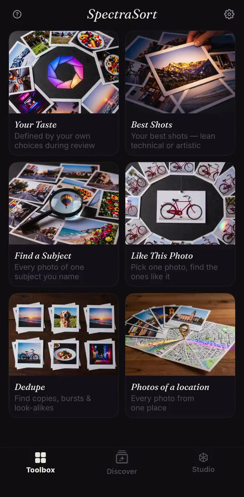
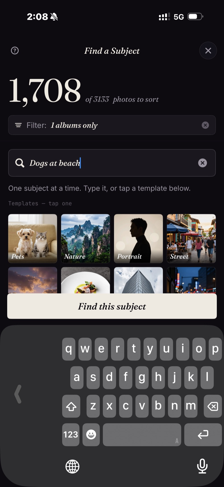

<section class="page-hero">
  

    
<a href="/it/">SpectraSort</a>&#8250;Stampa

    <h1>Cartella stampa.</h1>
    
Tutto ciò che serve a chi scrive per verificare SpectraSort: i fatti, gli screenshot e un contatto. Aggiornata il 31 ottobre 2026, con la versione 3.2.

    

      <a class="cta" href="/press/spectrasort-press-kit.zip">Scarica la cartella stampa</a>
      ZIP &middot; icona, screenshot, scheda informativa
    

  

</section>

<section class="slab">
  

    

      I fatti
      <h2>Cos'è SpectraSort, in una tabella.</h2>
      
SpectraSort è un selettore foto IA per iPhone che gira sul dispositivo e classifica il tuo rullino per qualità e per il tuo gusto. Inoltre fa selezione, eliminazione dei duplicati e pulizia. Un solo pagamento, nessun abbonamento.

    

    

      <table class="cmp">
        <tbody>
          <tr><th>Nome</th><td>SpectraSort</td></tr>
          <tr><th>Cos'è</th><td>Un selettore foto IA per iPhone che gira sul dispositivo. Classifica un rullino per qualità e per un profilo di gusto appreso da ciò che l'utente conserva e scarta. Inoltre fa selezione, eliminazione dei duplicati e pulizia.</td></tr>
          <tr><th>Piattaforma</th><td>iPhone, iOS 18.5 o successivo. Nessuna versione per iPad, Mac, Android o web.</td></tr>
          <tr><th>Lingue</th><td>Inglese, francese, tedesco, italiano, spagnolo e portoghese (Brasile). L'edizione per la Cina continentale è 光谱挑片.</td></tr>
          <tr><th>Prezzo</th><td>Download gratuito. Cinque azioni a settimana sono gratuite per sempre; un solo pagamento per azioni illimitate e Studio. Nessun abbonamento, nessun account, nessuna carta di credito per iniziare.</td></tr>
          <tr><th>Privacy</th><td>100% sul dispositivo. La ricerca, la valutazione e il profilo di gusto girano sul Neural Engine dell'iPhone. Nessun caricamento di foto, nessun account, nessun server SpectraSort.</td></tr>
          <tr><th>Velocità</th><td>Fino a 100 foto al secondo sugli iPhone recenti. L'indice si costruisce al primo ordinamento, poi resta aggiornato da solo.</td></tr>
          <tr><th>Strumenti</th><td>Sei strumenti, un tocco ciascuno: Il tuo gusto, Migliori scatti, Trova un soggetto, Foto simili a questa, Duplicati, Foto di un luogo. Studio aggiunge sette assi di qualità, fino a tre soggetti e profili salvati. La ricerca digitata di Trova un soggetto funziona per ora in inglese; i modelli funzionano in tutte le lingue.</td></tr>
          <tr><th>Prima uscita</th><td>Gennaio 2026. La versione 3.2 è uscita a novembre 2026.</td></tr>
          <tr><th>Autore</th><td>Mike Lu, sviluppatore indipendente.</td></tr>
          <tr><th>Contatti</th><td><a href="mailto:spectrasortapp@gmail.com">spectrasortapp@gmail.com</a></td></tr>
        </tbody>
      </table>
    

  

</section>

<section class="slab rise">
  

    

      Novità della 3.2
      <h2>Cinque lingue. Meno carta.</h2>
      
La versione 3.2 aggiunge francese, tedesco, italiano, spagnolo e portoghese (Brasile) a tutta l'interfaccia e alla scheda sull'App Store. Aggiunge anche un interruttore <b>Documenti e ricevute</b> in Filtri → Escludi: screenshot, moduli e foto di carta vengono messi da parte prima di un ordinamento, così la revisione è delle foto che l'utente voleva tenere.

      
La condivisione è stata corretta nella stessa versione: Instagram, WeChat e Xiaohongshu ora accettano la foto, dritta, per condivisioni singole e multiple. <a href="/it/changelog/">Le note complete della 3.2 →</a>

    

  

</section>

<section class="slab">
  

    

      Chi lo fa
      <h2>Fatto da Mike Lu.</h2>
      
Mike Lu è lo sviluppatore indipendente dietro SpectraSort. Ha costruito l'app intorno a una domanda che quasi tutti gli strumenti per le foto saltano: non «questa è una buona foto?», ma «la terresti?». L'app impara dalle decisioni di tenere e scartare che una persona già prende, poi classifica la libreria allo stesso modo.

      
SpectraSort è uscita per la prima volta a gennaio 2026. È fatta senza server, senza account e senza abbonamento: l'app e il modello di business sono entrambi volutamente piccoli.

    

  

</section>

<section class="slab rise">
  

    

      Screenshot
      <h2>Tre catture reali.</h2>
      
I file a dimensione piena sono nella cartella stampa. L'app gira sul dispositivo; gli screenshot vengono da una libreria reale.

      

        <figure><figcaption>La cassetta degli attrezzi: sei strumenti, un tocco ciascuno, con Il tuo gusto in cima.</figcaption></figure>
        <figure><figcaption>Trova un soggetto: scrivi una frase, ottieni le corrispondenze classificate dal migliore.</figcaption></figure>
        <figure><figcaption>Azioni multiple: le foto conservate in un album, i preferiti aggiunti, il resto eliminato.</figcaption></figure>
      

      

        <a class="cta" href="/press/spectrasort-press-kit.zip">Scarica la cartella stampa</a>
        ZIP &middot; icona, 3 screenshot, scheda informativa
      

    

  

</section>

<section class="slab">
  

    Angoli da verificare
    <h2>Tre storie nell'app.</h2>
    <ul>
      <li><b>L'utility anti-abbonamento.</b> Un solo pagamento, nessun abbonamento, nessun account, nessun server. Un'app per le foto che non ha bisogno del cloud.</li>
      <li><b>IA sul dispositivo senza requisito Apple Intelligence.</b> La valutazione, la ricerca e il profilo di gusto girano sul Neural Engine, offline, su iOS 18.5 o successivo.</li>
      <li><b>Cinque lingue in una volta.</b> La versione 3.2 localizza tutta l'interfaccia e la scheda sull'App Store in francese, tedesco, italiano, spagnolo e portoghese (Brasile).</li>
    </ul>
    

      
Cosa non dichiareremo

      <ul>
        <li>Nessuna affermazione «meglio di Foto di Apple». Sono costruite per lavori diversi: Foto di Apple sfoglia e archivia; SpectraSort sceglie e classifica.</li>
        <li>Nessuna percentuale di accuratezza per il classificatore dei documenti. È un filtro, non una promessa.</li>
        <li>Nessun cloud, nessun account, nessun addestramento sulle foto degli utenti: sono fatti di architettura, non frasi di marketing.</li>
      </ul>
    

  

</section>
