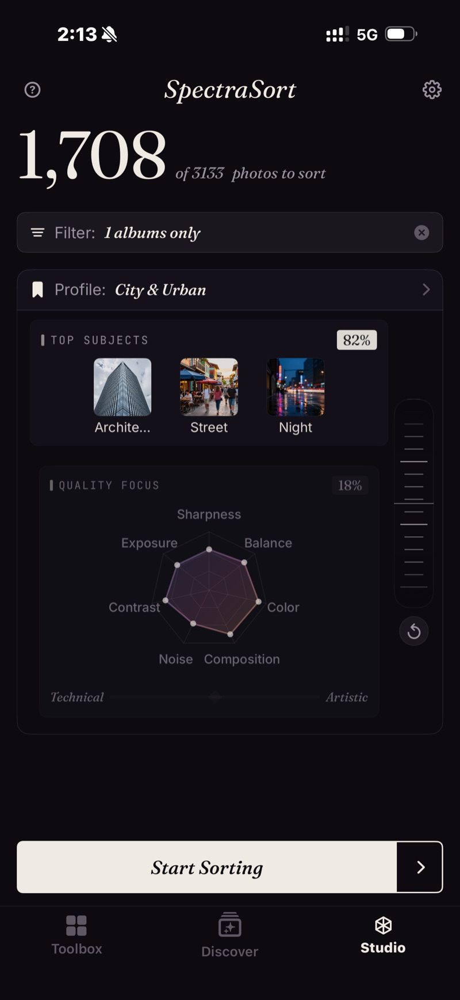

<section class="page-hero">
  

    
<a href="/it/">SpectraSort</a>&#8250;Studio

    <h1>Studio. Quando vuoi i controlli.</h1>
    
Gli strumenti con un tocco decidono cosa significa «migliore». Studio ti passa quella decisione: quali dei sette assi di qualità contano, quali soggetti importano e quanto una corrispondenza del soggetto deve pesare rispetto a uno scatto nitido. Salvalo come profilo e ogni ordinamento successivo è il tuo.

    

      <a class="cta" href="https://apps.apple.com/us/app/spectrasort-ai-photo-picker/id6757512134?ppid=5fd01708-3a73-4412-9bea-b411522af1f3"><svg viewBox="0 0 24 24" aria-hidden="true"><path d="M17.05 12.04c-.02-2.16 1.77-3.2 1.85-3.25-1.01-1.48-2.59-1.68-3.14-1.7-1.33-.13-2.61.78-3.29.78-.69 0-1.73-.76-2.85-.74-1.46.02-2.83.85-3.59 2.17-1.54 2.66-.39 6.59 1.1 8.75.73 1.06 1.6 2.24 2.73 2.2 1.1-.04 1.51-.71 2.84-.71 1.32 0 1.7.71 2.85.69 1.18-.02 1.92-1.07 2.64-2.13.84-1.22 1.18-2.42 1.2-2.48-.03-.01-2.3-.88-2.34-3.58zM14.95 5.6c.61-.74 1.02-1.77.9-2.8-.88.04-1.94.58-2.57 1.31-.56.65-1.06 1.7-.93 2.71.98.07 1.99-.5 2.6-1.22z"/></svg>
        Scarica sull'App Store
      </a>
      Gratis &middot; iPhone &middot; iOS 18.5+
    

    

      <b>Sette</b> assi di qualità
      <b>Fino a tre</b> soggetti per ordinamento
      <b>Incluso</b> in Premium — un solo pagamento
    

  

</section>

<section id="quality-focus" class="slab">
  

    

      

        Qualità — sette assi
        <h2>Nitidezza per la fauna. Composizione per la strada.</h2>
        
Nitidezza, esposizione, contrasto e rumore sul lato tecnico. Composizione, armonia dei colori ed equilibrio visivo sul lato artistico. Trascina un punto del radar per pesarlo, oppure muovi il cursore Tecnico / Artistico per spostare tutti e sette insieme.

      

      

        

          

          
Un profilo salvato, City &amp; Urban: tre soggetti all'82%, qualità al 18%, contrasto e colore in primo piano.

        

      

    

  

</section>

<section id="balance-wheel" class="slab rise">
  

    

      

        Soggetti e rotella di equilibrio
        <h2>Corrispondenza del soggetto contro qualità.</h2>
        
Fino a tre soggetti in un solo ordinamento — modelli predefiniti o qualsiasi cosa puoi scrivere. La rotella decide quanto deve contare una corrispondenza. Girala verso Soggetti e vince una buona foto della cosa giusta. Girala verso Qualità e vince lo scatto più nitido e meglio composto, qualunque cosa mostri.

      

      

        

          

            <video class="screen-loop" src="/video/web-studio-wheel.mp4"
                   poster="/images/shots/studio-wheel-poster.jpg"
                   loop muted playsinline preload="none"
                   width="920" height="852"
                   aria-label="La rotella di equilibrio di Studio ruotata avanti e indietro: il peso dei soggetti principali scende dal 75% al 25% mentre il radar della qualità cresce dal 25% al 75%, poi torna"></video>
          

        

      

    

  

</section>

<section id="profiles" class="slab">
  

    Profili
    <h2>Impostalo una volta. Riusalo ogni volta.</h2>
    
Salva qualsiasi configurazione con un nome e passa dall'una all'altra dalla schermata Home. Parti da Il tuo gusto e regolalo — l'app crea una copia personalizzata, così il profilo appreso resta intatto e continua a imparare.

    
Il profilo che scegli guida ogni ordinamento, Duplicati e Foto di un luogo compresi, così la foto da tenere in una pila o lo scatto migliore di una città viene giudicato secondo i tuoi criteri. La griglia di revisione indica il profilo che ha ordinato.

  

</section>

<section id="pricing" class="slab rise">
  

    

      Prezzi
      <h2>Incluso in Premium — un solo pagamento.</h2>
      
I sei strumenti con un tocco sono gratis, con cinque azioni gratuite a settimana. Studio fa parte di Premium: ordinamenti personalizzati e profili salvati, più azioni illimitate — un solo pagamento, nessun abbonamento. Il prezzo locale è indicato sull'App Store.

      <a class="cta" href="https://apps.apple.com/us/app/spectrasort-ai-photo-picker/id6757512134?ppid=5fd01708-3a73-4412-9bea-b411522af1f3"><svg viewBox="0 0 24 24" aria-hidden="true"><path d="M17.05 12.04c-.02-2.16 1.77-3.2 1.85-3.25-1.01-1.48-2.59-1.68-3.14-1.7-1.33-.13-2.61.78-3.29.78-.69 0-1.73-.76-2.85-.74-1.46.02-2.83.85-3.59 2.17-1.54 2.66-.39 6.59 1.1 8.75.73 1.06 1.6 2.24 2.73 2.2 1.1-.04 1.51-.71 2.84-.71 1.32 0 1.7.71 2.85.69 1.18-.02 1.92-1.07 2.64-2.13.84-1.22 1.18-2.42 1.2-2.48-.03-.01-2.3-.88-2.34-3.58zM14.95 5.6c.61-.74 1.02-1.77.9-2.8-.88.04-1.94.58-2.57 1.31-.56.65-1.06 1.7-.93 2.71.98.07 1.99-.5 2.6-1.22z"/></svg>
        Scarica sull'App Store
      </a>
    

  

</section>

<section id="faq" class="slab">
  

    

      FAQ
      <h2>Domande su Studio.</h2>
    

    

      

A chi serve Studio?

A chi scatta molto e seleziona sul telefono — lavori di eventi e viaggi con nitidezza ed esposizione in primo piano, rumore ignorato per gli scatti notturni. A chi ha uno stile personale che le impostazioni predefinite non catturano: colore e composizione davanti, uno o due soggetti fissati. E a chi semplicemente non è d'accordo con Migliori scatti e vuole il cursore regolato a modo suo, una volta per tutte.

      

Qual è la differenza tra Studio e Migliori scatti?

Migliori scatti è un solo cursore: tecnico da una parte, artistico dall'altra. Studio lo divide in sette assi che ponderi singolarmente, aggiunge fino a tre soggetti e la rotella di equilibrio e ti lascia salvare il risultato come profilo.

      

Personalizzare cambia il mio profilo Il tuo gusto?

No. Personalizzare crea una copia personalizzata; il profilo appreso resta intatto e continua a imparare. Puoi azzerarlo o ricostruirlo dalle Impostazioni quando vuoi.

      

Posso ordinare per soggetto e per qualità nello stesso ordinamento?

Sì — è a questo che serve la rotella di equilibrio. Girala verso Soggetti e vince una buona foto della cosa giusta; girala verso Qualità e vince lo scatto più nitido e meglio composto, qualunque cosa mostri.

      

Un profilo di Studio vale anche per Duplicati e per gli ordinamenti per luogo?

Sì. Il profilo che selezioni guida ogni ordinamento, quindi la foto da tenere in una pila o lo scatto migliore di una città viene giudicato secondo i tuoi criteri. La griglia di revisione indica il profilo che ha ordinato.

      

Studio è gratis?

Studio fa parte di Premium — un solo pagamento, nessun abbonamento. Con la versione gratis puoi aprirlo e guardare; ordinamenti personalizzati e profili salvati richiedono Premium. I sei strumenti con un tocco restano gratis, con cinque azioni gratuite a settimana.

    

  

</section>

<section class="slab">
  

    

      Continua a leggere
      

        <a href="/it/photo-culling-iphone/">Selezione foto su iPhonePrima ordina, poi scorri</a>
        <a href="/it/features/">Tutte le funzioniStrumenti, controlli e limiti in una pagina</a>
        <a href="/it/find-best-photos-iphone/">Trova le tue foto miglioriPer frase, per esempio, per gusto</a>
      

    

  

</section>
