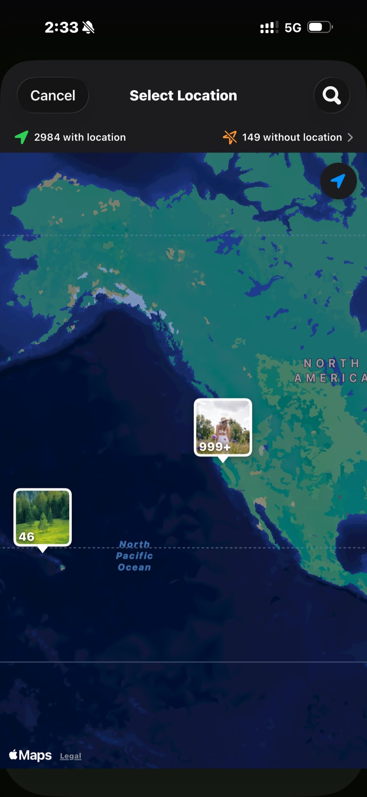
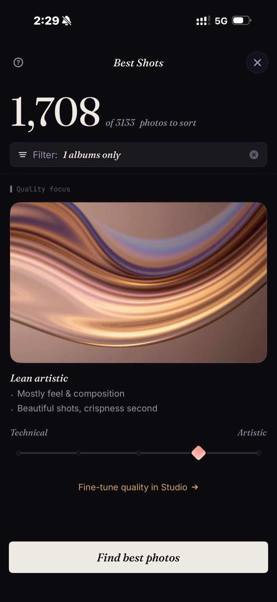

<section class="page-hero">
  

    
<a href="/it/">SpectraSort</a>&#8250;Foto delle vacanze

    <h1>1.200 foto di vacanza → l'album che vale la pena mostrare.</h1>
    
Un viaggio di due settimane torna a casa come mille foto e una promessa: «prima o poi le guardo». SpectraSort le guarda per te: il viaggio è già raccolto in una scena, ogni scatto torna ordinato, gli undici tramonti stanno in un'unica pila e le foto che conservi finiscono in un album — sul volo di ritorno.

    

      <a class="cta" href="https://apps.apple.com/us/app/spectrasort-ai-photo-picker/id6757512134?ppid=5fd01708-3a73-4412-9bea-b411522af1f3"><svg viewBox="0 0 24 24" aria-hidden="true"><path d="M17.05 12.04c-.02-2.16 1.77-3.2 1.85-3.25-1.01-1.48-2.59-1.68-3.14-1.7-1.33-.13-2.61.78-3.29.78-.69 0-1.73-.76-2.85-.74-1.46.02-2.83.85-3.59 2.17-1.54 2.66-.39 6.59 1.1 8.75.73 1.06 1.6 2.24 2.73 2.2 1.1-.04 1.51-.71 2.84-.71 1.32 0 1.7.71 2.85.69 1.18-.02 1.92-1.07 2.64-2.13.84-1.22 1.18-2.42 1.2-2.48-.03-.01-2.3-.88-2.34-3.58zM14.95 5.6c.61-.74 1.02-1.77.9-2.8-.88.04-1.94.58-2.57 1.31-.56.65-1.06 1.7-.93 2.71.98.07 1.99-.5 2.6-1.22z"/></svg>
        Scarica sull'App Store
      </a>
      Gratis &middot; iPhone &middot; iOS 18.5+ &middot; Aggiornato il 31 ottobre 2026
    

    

      <b>100% sul dispositivo</b> — niente viene caricato
      <b>Gratis</b> 5 azioni a settimana
      <b>Un solo pagamento</b> — azioni illimitate
    

  

</section>

<section id="find-the-trip" class="slab">
  

    

      

        Trova il viaggio
        <h2>È già una scena.</h2>
        
Apri Scopri e il viaggio è lì, raccolto per tempo e luogo: nessun album necessario. Oppure tocca Foto di un luogo e fissa la città: ogni scatto fatto lì, nient'altro.

        
Contano anche le foto di anni fa. Il segnaposto trova il viaggio precedente che avevi dimenticato di aver fotografato.

      

      

        

          

        

      

    

  

</section>

<section id="rank" class="slab rise">
  

    

      

        Ordina
        <h2>Le foto da tenere salgono prima che tu scorra.</h2>
        
Migliori scatti mette in cima le foto più nitide e meglio composte. Il tuo gusto, una volta che ti conosce, mette in cima quelle che avresti scelto tu. In entrambi i casi la revisione parte dalle foto migliori, non dalla foto 1 di 1.200.

        
Sposta il cursore verso artistico per i tramonti e verso tecnico per le foto di gruppo.

      

      

        

          

        

      

    

  

</section>

<section id="retakes" class="slab">
  

    

      

        Ripetizioni
        <h2>11 scatti dello stesso tramonto → un solo swipe.</h2>
        
Tramonti, foto di gruppo, la vista dall'hotel: ogni momento che hai fotografato sei volte arriva come un'unica pila con il più nitido segnalato. Gira la ruota, tieni una, passa avanti.

      

      

        

          

        

      

    

  

</section>

<section id="finish" class="slab rise">
  

    

      

        Chiudi
        <h2>Album fatto. Il resto sistemato.</h2>
        
Azioni multiple mette le foto conservate in un album che compare in Foto di Apple — e nel pannello di condivisione, per la chat di gruppo. Tieni il resto, oppure eliminalo tramite la finestra di sistema verso Eliminati di recente.

      

      

        

          

        

      

    

  

</section>

<section id="the-trip-in-three-steps" class="slab">
  

    
Il viaggio, in tre passi

    

      

Trova

La scena, il segnaposto sulla mappa o i mesi nella cronologia.

      

Scorri

Risultati ordinati, ripetizioni impilate, tre gesti. Autoselezione se preferisci dare un'occhiata invece di scorrere.

      

Archivia

Un album, il pannello di condivisione e il resto sistemato — una schermata.

    

  

</section>

<section class="slab rise">
  

    <h2>Le note</h2>
    
Le scene, i punteggi e il profilo di gusto girano tutti sul Neural Engine dell'iPhone. Niente viene caricato e non c'è alcun account. <a href="/it/private-ai-photo-app/">Come funziona nel dettaglio →</a>

    

      
Dove non aiuta

      <ul>
        <li>Solo iPhone, iOS 18.5 o successivo. Nessuna versione per iPad, Android o desktop.</li>
        <li>Il primo indice di una libreria grande richiede un po' di tempo. Dopo è automatico: le nuove foto vengono indicizzate appena compaiono, così non aspetti più.</li>
        <li>La ricerca di un luogo per nome usa Apple Maps e richiede una connessione. Le scene, la cronologia e l'ordinamento stesso funzionano offline.</li>
        <li>Le foto eliminate passano dal cestino di iOS: finiscono in Eliminati di recente e lo spazio torna libero nel momento in cui svuoti quell'album, oppure automaticamente dopo 30 giorni.</li>
      </ul>
    

  

</section>

<section id="pricing" class="slab">
  

    

      Prezzi
      <h2>Cinque azioni gratuite a settimana. Un solo pagamento per averle illimitate.</h2>
      
Cinque azioni gratuite a settimana, senza account e senza carta di credito. Un solo pagamento per azioni illimitate. Nessun abbonamento, mai. Fatto da uno sviluppatore indipendente che la usa ogni giorno.

      <a class="cta" href="https://apps.apple.com/us/app/spectrasort-ai-photo-picker/id6757512134?ppid=5fd01708-3a73-4412-9bea-b411522af1f3"><svg viewBox="0 0 24 24" aria-hidden="true"><path d="M17.05 12.04c-.02-2.16 1.77-3.2 1.85-3.25-1.01-1.48-2.59-1.68-3.14-1.7-1.33-.13-2.61.78-3.29.78-.69 0-1.73-.76-2.85-.74-1.46.02-2.83.85-3.59 2.17-1.54 2.66-.39 6.59 1.1 8.75.73 1.06 1.6 2.24 2.73 2.2 1.1-.04 1.51-.71 2.84-.71 1.32 0 1.7.71 2.85.69 1.18-.02 1.92-1.07 2.64-2.13.84-1.22 1.18-2.42 1.2-2.48-.03-.01-2.3-.88-2.34-3.58zM14.95 5.6c.61-.74 1.02-1.77.9-2.8-.88.04-1.94.58-2.57 1.31-.56.65-1.06 1.7-.93 2.71.98.07 1.99-.5 2.6-1.22z"/></svg>
        Scarica sull'App Store
      </a>
    

  

</section>

<section id="faq" class="slab rise">
  

    

      FAQ
      <h2>Domande sui viaggi.</h2>
    

    

      

Quanto tempo ci vuole per rivedere le foto di un viaggio?

L'ordinamento stesso richiede un attimo una volta indicizzata la libreria: il primo indice gira fino a 100 foto al secondo sugli iPhone recenti e avviene una sola volta. Il tempo vero sono i tuoi swipe, e ordinamento e impilamento li riducono: le foto migliori sono in cima e ogni ripetizione costa un solo gesto.

      

Cosa succede alle foto che non conservo?

Niente, a meno che tu non lo dica. Tenere è una categoria, non un'eliminazione. Qualunque cosa tu elimini passa dalla finestra di sistema verso Eliminati di recente, dove resta per 30 giorni.

      

Posso farlo in aereo, offline?

Ordinamento, valutazione e revisione girano interamente sul telefono, quindi sì. Cercare un luogo per nome usa Apple Maps e richiede una connessione; aprire il viaggio dalle scene o dalla cronologia no.

      

Posso ordinare più viaggi insieme?

Nella cronologia, seleziona tutti i mesi che vuoi e ordinali insieme. Oppure filtra per un intervallo di date personalizzato che copre tutta l'estate.

      

Carica le foto del mio viaggio?

No. Le scene, i punteggi e il profilo di gusto sono calcolati e conservati sul tuo iPhone. Nessun caricamento, nessun account.

    

  

</section>

<section class="slab">
  

    

      Leggi anche
      

        <a href="/it/photo-culling-iphone/">Scrematura delle foto su iPhoneIl flusso completo tenere o eliminare</a>
        <a href="/it/photo-organizer-iphone/">Organizzatore foto IARaggruppate, ordinate, archiviate</a>
        <a href="/it/duplicate-photo-finder-iphone/">Ricerca duplicatiRaffiche e sosia, impilati</a>
      

    

  

</section>
