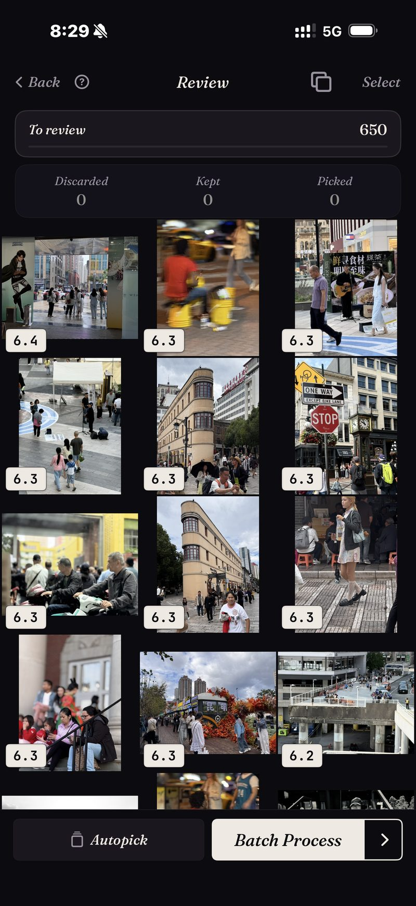

<section class="page-hero">
  

    
<a href="/pt/">SpectraSort</a>&rsaquo;Seletor de fotos com IA para iPhone

    <h1>O seletor de fotos com IA para iPhone.</h1>
    
A busca encontra todas as fotos de praia que você já tirou. Ela não consegue dizer quais três valem a pena guardar. É para essa segunda pergunta que o SpectraSort existe: ele pontua suas fotos por qualidade, aprende seu gosto com as que você mantém e coloca as vencedoras no topo.

    

      <a class="cta" href="https://apps.apple.com/us/app/spectrasort-ai-photo-picker/id6757512134?ppid=5fd01708-3a73-4412-9bea-b411522af1f3">
        <svg viewBox="0 0 24 24" aria-hidden="true"><path d="M17.05 12.04c-.02-2.16 1.77-3.2 1.85-3.25-1.01-1.48-2.59-1.68-3.14-1.7-1.33-.13-2.61.78-3.29.78-.69 0-1.73-.76-2.85-.74-1.46.02-2.83.85-3.59 2.17-1.54 2.66-.39 6.59 1.1 8.75.73 1.06 1.6 2.24 2.73 2.2 1.1-.04 1.51-.71 2.84-.71 1.32 0 1.7.71 2.85.69 1.18-.02 1.92-1.07 2.64-2.13.84-1.22 1.18-2.42 1.2-2.48-.03-.01-2.3-.88-2.34-3.58zM14.95 5.6c.61-.74 1.02-1.77.9-2.8-.88.04-1.94.58-2.57 1.31-.56.65-1.06 1.7-.93 2.71.98.07 1.99-.5 2.6-1.22z"/></svg>
        Baixar na App Store
      </a>
      Grátis · iPhone · iOS 18.5+ · Atualizado em 31 de outubro de 2026
    

    

      <b>100% no aparelho</b> — nada é enviado
      <b>Grátis</b> 5 ações por semana
      <b>Um único pagamento</b> — ações ilimitadas
    

  

</section>

<section class="slab">
  

    <h2>O que é um seletor de fotos</h2>
    
O termo é usado de forma solta, então ajuda separar três tipos de app:

    <ul>
      <li><b>Busca de fotos</b> encontra correspondências. Peça “praia” e você recebe todas as 87 fotos de praia que já tirou, em uma grade longa, em ordem de data.</li>
      <li><b>Limpadores de fotos</b> procuram lixo: duplicatas, capturas de tela, fotos tremidas. Úteis, mas só conseguem dizer o que é ruim.</li>
      <li><b>Um seletor de fotos</b> toma a decisão. Ele pontua cada foto por nitidez, exposição, composição e o quanto ela combina com o que você pediu, e então entrega o conjunto <em>classificado, as melhores primeiro</em>, com um jeito de agir sobre ele.</li>
    </ul>
    
A maioria das pessoas não tem dificuldade para encontrar suas fotos. Elas têm dificuldade para escolher entre elas. O SpectraSort é feito para a escolha.

  

</section>

<section id="ranked-not-just-matched" class="slab rise">
  

    

      

        Classificadas, não só encontradas
        <h2>Todo resultado volta com as melhores primeiro.</h2>
        
São seis ferramentas, um toque cada: <b>Seu gosto</b>, <b>Melhores fotos</b>, <b>Encontrar um assunto</b>, <b>Como esta foto</b>, <b>Duplicatas</b> e <b>Fotos de um lugar</b>.

        
Qualquer que seja a ferramenta, os resultados voltam pontuados e ordenados. A captura aqui é uma classificação real: um recorte de 650 fotos de rua, cada quadro pontuado, as melhores primeiro.

        
As classificações voltam quase instantaneamente, porque rodam sobre um índice no aparelho. Ele é criado uma vez — até 100 fotos por segundo em iPhones recentes — e depois mantido atualizado automaticamente conforme novas fotos aparecem.

      

      

        

          

        

      

    

  

</section>

<section id="your-taste" class="slab">
  

    

      

        A parte que nenhum outro app faz
        <h2>Ele aprende quais fotos você manteria.</h2>
        
A maioria das IAs de fotos pontua contra uma ideia universal de boa foto: nítida, bem iluminada, centralizada. Suas favoritas nem sempre cabem nesse molde. Talvez você goste daquela contraluz, do cachorro se sacudindo ou de um quadro um pouco mole que você imprimiria mesmo assim.

        
Então o SpectraSort observa o que você mantém e o que deixa passar durante a revisão, e constrói um <b>perfil de gosto</b> a partir disso. Depois de revisões suficientes, classificar por Seu gosto começa a parecer um álbum que você escolheu à mão. Você pode pausar o aprendizado, redefini-lo ou manter vários perfis, e tudo fica no seu telefone.

      

      

        

          

        

      

    

  

</section>

<section id="how-a-sort-works" class="slab rise">
  

    
Como uma classificação funciona

    

      

Encontrar

Escolha uma ferramenta: uma frase, uma foto de exemplo, um lugar ou o seu gosto.

      

Classificar

Tudo pontuado no aparelho — nitidez, exposição, composição, semelhança.

      

Concluir

Deslize as vencedoras para dentro e depois salve, compartilhe ou limpe o resto em uma tela.

    

  

</section>

<section class="slab">
  

    <h2>Nada sai do telefone</h2>
    
Toda a pontuação acontece no Neural Engine do seu iPhone. Suas fotos não são enviadas para lugar nenhum, não há conta, e os modelos já vêm treinados, então nada sobre a sua biblioteca chega a outra pessoa. <a href="/pt/private-ai-photo-app/">Mais sobre como a configuração no aparelho funciona →</a>

    

      
Onde ele não ajuda

      <ul>
        <li>Só iPhone, iOS 18.5 ou posterior. Sem versão para iPad, Android ou desktop.</li>
        <li>O primeiro índice de uma biblioteca grande leva algum tempo. Depois disso é automático — novas fotos são indexadas conforme aparecem, então você não espera de novo.</li>
        <li>O perfil de gosto é tão bom quanto as revisões que você deu a ele. Ele começa genérico.</li>
        <li>As fotos apagadas passam pela lixeira do próprio iOS: elas vão para Excluídos recentemente, e o espaço volta no momento em que você esvazia esse álbum lá — ou automaticamente depois de 30 dias. Cada exclusão mostra o espaço que libera antes de você confirmar.</li>
      </ul>
    

  

</section>

<section id="pricing" class="slab rise">
  

    

      Preços
      <h2>Cinco ações grátis por semana. Pague uma vez para ter ilimitado.</h2>
      
Cinco ações grátis por semana, para sempre — sem conta, sem cartão de crédito. Pague uma vez para ter ações ilimitadas. Sem assinatura. Nunca.

      <a class="cta" href="https://apps.apple.com/us/app/spectrasort-ai-photo-picker/id6757512134?ppid=5fd01708-3a73-4412-9bea-b411522af1f3">
        <svg viewBox="0 0 24 24" aria-hidden="true"><path d="M17.05 12.04c-.02-2.16 1.77-3.2 1.85-3.25-1.01-1.48-2.59-1.68-3.14-1.7-1.33-.13-2.61.78-3.29.78-.69 0-1.73-.76-2.85-.74-1.46.02-2.83.85-3.59 2.17-1.54 2.66-.39 6.59 1.1 8.75.73 1.06 1.6 2.24 2.73 2.2 1.1-.04 1.51-.71 2.84-.71 1.32 0 1.7.71 2.85.69 1.18-.02 1.92-1.07 2.64-2.13.84-1.22 1.18-2.42 1.2-2.48-.03-.01-2.3-.88-2.34-3.58zM14.95 5.6c.61-.74 1.02-1.77.9-2.8-.88.04-1.94.58-2.57 1.31-.56.65-1.06 1.7-.93 2.71.98.07 1.99-.5 2.6-1.22z"/></svg>
        Baixar na App Store
      </a>
    

  

</section>

<section id="faq" class="slab">
  

    

      FAQ
      <h2>Perguntas sobre seletores de fotos com IA.</h2>
    

    

      

O que é um seletor de fotos com IA?

Um app que decide quais das suas fotos valem a pena manter, não só quais correspondem a uma busca. Ele pontua cada foto por nitidez, exposição, composição ou semelhança com as fotos que você costuma manter, e devolve tudo classificado, as melhores primeiro, com um fluxo para manter, compartilhar ou limpar o resto.

      

Qual é a diferença em relação à busca de fotos?

A busca diz quais fotos correspondem, então uma pesquisa por “praia” devolve todas as 87 fotos de praia. Um seletor classifica essas 87 e coloca as melhores primeiro. O SpectraSort faz as duas coisas; toda busca volta classificada. Veja <a href="/pt/ai-photo-picker-vs-photo-culling/">seletor vs seleção de fotos</a> para o detalhamento completo.

      

O SpectraSort envia minhas fotos para escolhê-las?

Não. A busca, a pontuação e o perfil de gosto rodam no Neural Engine do seu iPhone. Sem envios, sem conta, sem servidor do SpectraSort no caminho.

      

Ele apaga fotos sozinho?

Não. Nada é aplicado até você tocar, e as exclusões sempre passam pelo diálogo de confirmação do Fotos do sistema e vão para Excluídos recentemente do iOS — recuperáveis por 30 dias, ou apagadas no momento em que você esvazia o álbum.

      

Quanto custa?

Cinco ações por semana são grátis, para sempre — não é um teste. Pague uma vez para ter ações ilimitadas e todos os controles do Studio. Sem assinatura.

    

  

</section>

<section class="slab">
  

    

      Continue lendo
      

        <a href="/pt/photo-culling-iphone/">Seleção de fotos no iPhoneO fluxo do fotógrafo, no telefone</a>
        <a href="/pt/best-photo-picker/">Escolher um seletor de fotosO que separa esses apps</a>
        <a href="/pt/how-to-pick-best-photos-from-camera-roll/">Escolha as melhores da sua galeriaPasso a passo, com ou sem app</a>
      

    

  

</section>
