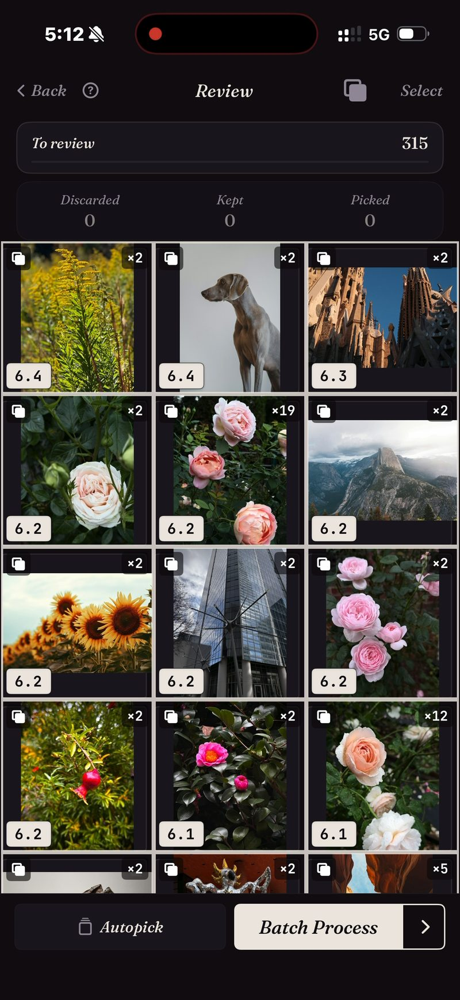

<section class="page-hero">
  

    
<a href="/pt/">SpectraSort</a>&#8250;Localizador de fotos duplicadas

    <h1>Fotos duplicadas, empilhadas e resolvidas.</h1>
    
Uma rosa fotografada 19 vezes. O mesmo horizonte, nove viagens seguidas. Cada sequência que você nunca aparou. O SpectraSort empilha as três, sinaliza a mais nítida e limpa o resto em um lote.

    

      <a class="cta" href="https://apps.apple.com/us/app/spectrasort-ai-photo-picker/id6757512134?ppid=5fd01708-3a73-4412-9bea-b411522af1f3"><svg viewBox="0 0 24 24" aria-hidden="true"><path d="M17.05 12.04c-.02-2.16 1.77-3.2 1.85-3.25-1.01-1.48-2.59-1.68-3.14-1.7-1.33-.13-2.61.78-3.29.78-.69 0-1.73-.76-2.85-.74-1.46.02-2.83.85-3.59 2.17-1.54 2.66-.39 6.59 1.1 8.75.73 1.06 1.6 2.24 2.73 2.2 1.1-.04 1.51-.71 2.84-.71 1.32 0 1.7.71 2.85.69 1.18-.02 1.92-1.07 2.64-2.13.84-1.22 1.18-2.42 1.2-2.48-.03-.01-2.3-.88-2.34-3.58zM14.95 5.6c.61-.74 1.02-1.77.9-2.8-.88.04-1.94.58-2.57 1.31-.56.65-1.06 1.7-.93 2.71.98.07 1.99-.5 2.6-1.22z"/></svg>
        Baixar na App Store
      </a>
      Grátis &middot; iPhone &middot; iOS 18.5+ &middot; Atualizado em 31 de outubro de 2026
    

    

      <b>100% no aparelho</b> — nada é enviado
      <b>Grátis</b> 5 ações por semana
      <b>Um único pagamento</b> — ações ilimitadas
    

  

</section>

<section class="slab">
  

    <h2>O iOS encontra um tipo de duplicata. Existem três.</h2>
    
<b>Duplicatas</b> — cópias exatas do mesmo arquivo. <b>Sequências</b> — fotos tiradas com segundos de diferença, nenhuma delas idêntica byte a byte. <b>Semelhantes</b> — a mesma cena, fotografada de novo meses depois.

    
O Fotos da Apple mescla o primeiro tipo. Os outros dois são a maior parte da bagunça. O SpectraSort compara o que está na imagem, então os três caem em pilhas.

  

</section>

<section id="stacked-before-you-look" class="slab rise">
  

    

      

        Empilhadas antes de você olhar
        <h2>315 fotos → as pilhas que importam.</h2>
        
Rode Duplicatas em uma viagem, um mês ou a biblioteca inteira e a grade volta agrupada. Cada pilha mostra quantas tomadas tem e a pontuação da melhor delas. As fotos sozinhas ficam fora do caminho.

      

      

        

          

          
Uma passada real: 315 fotos, a maioria das pilhas com pares, algumas com uma dúzia, uma rosa ×19.

        

      

    

  

</section>

<section id="one-stack-one-decision" class="slab">
  

    

      

        Uma pilha, uma decisão
        <h2>19 tomadas → uma escolhida.</h2>
        
Dentro de uma pilha, as tomadas ficam em uma roda. Role por elas sem sair da foto, mantenha a que quer, e a pilha está resolvida.

        
Ou deixe a Autoseleção fazer isso: as cópias vão para Descartadas e a melhor de cada pilha fica para você decidir. Depois um lote limpa as rejeitadas — atrás do diálogo de confirmação do sistema, para Excluídos recentemente.

      

      

        

          

        

      

    

  

</section>

<section id="how-it-works" class="slab rise">
  

    
Como funciona

    

      

Varredura

Duplicatas lê o índice no aparelho — criado uma vez e mantido atualizado conforme novas fotos chegam. Até 100 fotos por segundo na primeira passada.

      

Escolha

A mais nítida sinalizada em cada pilha. Confirme, ou role a roda e escolha outra.

      

Limpeza

Um lote. As exclusões passam pelo diálogo do sistema e vão para Excluídos recentemente.

    

    

      
Limpar duplicatas é onde vai a maior parte do armazenamento de uma galeria. As fotos apagadas vão para o álbum Excluídos recentemente do iOS; esvazie-o e o espaço volta na hora, ou deixe como está e o iOS libera depois de 30 dias. Cada exclusão mostra o espaço que libera antes de você confirmar.

    

  

</section>

<section class="slab">
  

    <h2>As letras miúdas</h2>
    
A comparação roda no Neural Engine do iPhone. Nada é enviado e não há conta. <a href="/pt/private-ai-photo-app/">Mais sobre como isso funciona →</a>

    

      
Onde ele não ajuda

      <ul>
        <li>Ele olha só a sua biblioteca de fotos — não arquivos, downloads ou qualquer outra coisa no telefone.</li>
        <li>Só iPhone, iOS 18.5 ou posterior. Sem versão para iPad, Android ou desktop.</li>
        <li>O primeiro índice de uma biblioteca grande leva algum tempo. Depois disso é automático — novas fotos são indexadas conforme aparecem, então você não espera de novo.</li>
        <li>As fotos apagadas passam pela lixeira do próprio iOS: elas vão para Excluídos recentemente, e o espaço volta no momento em que você esvazia esse álbum lá — ou automaticamente depois de 30 dias.</li>
      </ul>
    

  

</section>

<section id="pricing" class="slab rise">
  

    

      Preços
      <h2>Cinco ações grátis por semana. Pague uma vez para ter ilimitado.</h2>
      
Cinco ações grátis por semana, sem conta e sem cartão de crédito. Pague uma vez para ter ações ilimitadas. Sem assinatura, nunca. Feito por um desenvolvedor independente que usa o app todos os dias.

      <a class="cta" href="https://apps.apple.com/us/app/spectrasort-ai-photo-picker/id6757512134?ppid=5fd01708-3a73-4412-9bea-b411522af1f3"><svg viewBox="0 0 24 24" aria-hidden="true"><path d="M17.05 12.04c-.02-2.16 1.77-3.2 1.85-3.25-1.01-1.48-2.59-1.68-3.14-1.7-1.33-.13-2.61.78-3.29.78-.69 0-1.73-.76-2.85-.74-1.46.02-2.83.85-3.59 2.17-1.54 2.66-.39 6.59 1.1 8.75.73 1.06 1.6 2.24 2.73 2.2 1.1-.04 1.51-.71 2.84-.71 1.32 0 1.7.71 2.85.69 1.18-.02 1.92-1.07 2.64-2.13.84-1.22 1.18-2.42 1.2-2.48-.03-.01-2.3-.88-2.34-3.58zM14.95 5.6c.61-.74 1.02-1.77.9-2.8-.88.04-1.94.58-2.57 1.31-.56.65-1.06 1.7-.93 2.71.98.07 1.99-.5 2.6-1.22z"/></svg>
        Baixar na App Store
      </a>
    

  

</section>

<section id="faq" class="slab">
  

    

      FAQ
      <h2>Perguntas sobre duplicatas.</h2>
    

    

      

Como isso é diferente do localizador de duplicatas nativo da Apple?

O álbum Duplicatas do Fotos da Apple mescla cópias exatas e quase exatas da mesma foto. O SpectraSort também empilha sequências, repetições e fotos parecidas — arquivos diferentes do mesmo momento — e sinaliza a mais nítida de cada pilha. É a maior parte da bagunça.

      

Ele consegue apagar fotos sem perguntar?

Não. Nada muda até você tocar, e toda exclusão passa pelo diálogo de confirmação do Fotos do sistema e vai para Excluídos recentemente, onde fica por 30 dias.

      

Apagar duplicatas libera espaço na hora?

As fotos apagadas vão para o álbum Excluídos recentemente do iOS. Esvazie esse álbum e o espaço volta imediatamente; deixe como está e o iOS limpa depois de 30 dias. O SpectraSort mostra o espaço que a exclusão libera antes de você confirmar.

      

Posso escolher o que conta como duplicata?

Sim. Três interruptores de empilhamento na Revisão: Duplicatas (cópias exatas), Sequências (fotos tiradas com segundos de diferença) e Semelhantes (a mesma cena). Desligue qualquer um e essas fotos aparecem soltas.

      

Ele encontra fotos parecidas, não só duplicatas?

Mesmo motor. Como esta foto classifica a biblioteca inteira por semelhança com uma imagem que você escolhe; o interruptor Semelhantes agrupa as parecidas em pilhas dentro de qualquer classificação. <a href="/pt/find-best-photos-iphone/">Três jeitos de encontrar suas melhores fotos →</a>

      

O localizador de duplicatas é grátis?

Rodar Duplicatas é grátis, quantas vezes você quiser. Apagar as cópias é uma ação, não importa quantas sejam, e cinco ações por semana são grátis. O Premium (um único pagamento, sem assinatura) as torna ilimitadas.

    

  

</section>

<section class="slab">
  

    

      Continue lendo
      

        <a href="/pt/photo-culling-iphone/">Seleção de fotos no iPhoneO fluxo completo de manter ou limpar</a>
        <a href="/pt/vacation-photos-iphone/">Fotos de viagem → um álbum1.200 fotos, uma sessão</a>
        <a href="/pt/ai-photo-organizer-vs-apple-photos/">vs Fotos da AppleOnde as ferramentas nativas terminam</a>
      

    

  

</section>
