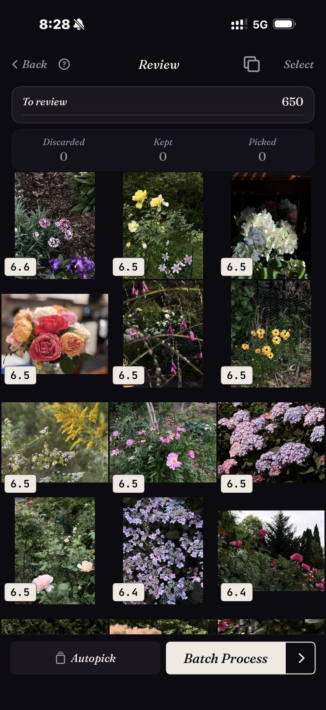

<section class="page-hero">
  

    
<a href="/pt/">SpectraSort</a>&#8250;Encontre suas melhores fotos

    <h1>Encontre suas melhores fotos no iPhone.</h1>
    
Em algum lugar da sua galeria estão as fotos que você realmente emolduraria. Elas estão enterradas sob tudo o mais que você tirou naquele dia. O SpectraSort dá três jeitos de tirá-las de lá: descreva-as, aponte para uma ou deixe um perfil de gosto aprendido trazê-las sozinho.

    

      <a class="cta" href="https://apps.apple.com/us/app/spectrasort-ai-photo-picker/id6757512134?ppid=5fd01708-3a73-4412-9bea-b411522af1f3"><svg viewBox="0 0 24 24" aria-hidden="true"><path d="M17.05 12.04c-.02-2.16 1.77-3.2 1.85-3.25-1.01-1.48-2.59-1.68-3.14-1.7-1.33-.13-2.61.78-3.29.78-.69 0-1.73-.76-2.85-.74-1.46.02-2.83.85-3.59 2.17-1.54 2.66-.39 6.59 1.1 8.75.73 1.06 1.6 2.24 2.73 2.2 1.1-.04 1.51-.71 2.84-.71 1.32 0 1.7.71 2.85.69 1.18-.02 1.92-1.07 2.64-2.13.84-1.22 1.18-2.42 1.2-2.48-.03-.01-2.3-.88-2.34-3.58zM14.95 5.6c.61-.74 1.02-1.77.9-2.8-.88.04-1.94.58-2.57 1.31-.56.65-1.06 1.7-.93 2.71.98.07 1.99-.5 2.6-1.22z"/></svg>
        Baixar na App Store
      </a>
      Grátis &middot; iPhone &middot; iOS 18.5+ &middot; Atualizado em 31 de outubro de 2026
    

    

      <b>100% no aparelho</b> — nada é enviado
      <b>Grátis</b> 5 ações por semana
      <b>Um único pagamento</b> — ações ilimitadas
    

  

</section>

<section id="way-1" class="slab">
  

    

      

        Jeito 1 — descreva
        <h2>Digite o que você lembra. Receba de volta, as melhores primeiro.</h2>
        
Toque em um modelo como “Retrato” ou “Noite”, ou digite uma palavra — a busca digitada funciona em inglês por enquanto. <b>Encontrar um assunto</b> aceita qualquer coisa que dê para colocar em palavras, seja concreta, composta ou abstrata. Não exige Apple Intelligence.

        
O que é diferente da busca nativa é a ordem. Cada correspondência é pontuada, então a melhor foto da coisa que você lembrou fica no topo em vez de em algum lugar da nona fileira. A grade aqui é um resultado real: uma busca de flores na biblioteca, pontuada e ordenada.

      

      

        

          

        

      

    

  

</section>

<section id="way-2" class="slab rise">
  

    

      

        Jeito 2 — aponte para uma
        <h2>Uma boa foto encontra o resto.</h2>
        
Às vezes a consulta é uma foto, não uma frase. Você tem uma boa foto da casa à beira do lago e sabe que existem mais. <b>Como esta foto</b> pega esse único exemplo e classifica a biblioteca inteira contra ele. A captura mostra uma classificação real, com 1.708 fotos classificadas contra uma única referência.

        
É a resposta mais rápida para “eu sei que esta foto existe, mas não consigo encontrá-la”, inclusive para fotos de três anos atrás.

      

      

        

          

        

      

    

  

</section>

<section id="way-3" class="slab">
  

    

      

        Jeito 3 — nenhuma consulta
        <h2>Ou só peça as melhores.</h2>
        
<b>Melhores fotos</b> revela os quadros mais nítidos, mais bem expostos e mais bem compostos de qualquer recorte da biblioteca, e você pode incliná-la para o técnico ou para o artístico.

        
<b>Seu gosto</b> vai um passo além. É um perfil aprendido com as fotos que você mantém e descarta, então o que sobe ao topo é o que <em>você</em> teria escolhido, e não o que um modelo genérico gosta. Nenhum outro app faz isso.

      

      

        

          

        

      

    

  

</section>

<section id="how-it-works" class="slab rise">
  

    
Como funciona

    

      

Encontrar

Uma frase, uma foto de exemplo, um lugar ou o seu gosto — seis ferramentas, um toque em cada.

      

Classificar

Pontuado no aparelho por nitidez, exposição, composição e semelhança.

      

Concluir

Favoritas marcadas, álbum preenchido ou compartilhado — em uma tela em lote.

    

  

</section>

<section class="slab">
  

    <h2>Tudo no seu telefone</h2>
    
O índice, a busca e as pontuações são todos calculados no Neural Engine do iPhone, então suas fotos nunca são enviadas e não há conta para criar. Uma busca em milhares de fotos leva um instante, porque roda sobre um índice que o app cria uma vez — até 100 fotos por segundo em iPhones recentes — e mantém atualizado conforme novas fotos aparecem.

    

      
Onde ele não ajuda

      <ul>
        <li>Ele só consegue encontrar o melhor do que você tirou. Não salva um momento que você não capturou.</li>
        <li>Só iPhone, iOS 18.5 ou posterior. Sem versão para iPad, Android ou desktop.</li>
        <li>O primeiro índice de uma biblioteca grande leva algum tempo. Depois disso é automático — novas fotos são indexadas conforme aparecem, então você não espera de novo.</li>
        <li>As fotos apagadas passam pela lixeira do próprio iOS: elas vão para Excluídos recentemente, e o espaço volta no momento em que você esvazia esse álbum lá — ou automaticamente depois de 30 dias. Cada exclusão mostra o espaço que libera antes de você confirmar.</li>
      </ul>
    

  

</section>

<section id="pricing" class="slab rise">
  

    

      Preços
      <h2>Cinco ações grátis por semana. Pague uma vez para ter ilimitado.</h2>
      
Cinco ações grátis por semana, sem conta e sem cartão de crédito. Pague uma vez para ter ações ilimitadas. Sem assinatura, nunca. Feito por um desenvolvedor independente que usa o app todos os dias.

      <a class="cta" href="https://apps.apple.com/us/app/spectrasort-ai-photo-picker/id6757512134?ppid=5fd01708-3a73-4412-9bea-b411522af1f3"><svg viewBox="0 0 24 24" aria-hidden="true"><path d="M17.05 12.04c-.02-2.16 1.77-3.2 1.85-3.25-1.01-1.48-2.59-1.68-3.14-1.7-1.33-.13-2.61.78-3.29.78-.69 0-1.73-.76-2.85-.74-1.46.02-2.83.85-3.59 2.17-1.54 2.66-.39 6.59 1.1 8.75.73 1.06 1.6 2.24 2.73 2.2 1.1-.04 1.51-.71 2.84-.71 1.32 0 1.7.71 2.85.69 1.18-.02 1.92-1.07 2.64-2.13.84-1.22 1.18-2.42 1.2-2.48-.03-.01-2.3-.88-2.34-3.58zM14.95 5.6c.61-.74 1.02-1.77.9-2.8-.88.04-1.94.58-2.57 1.31-.56.65-1.06 1.7-.93 2.71.98.07 1.99-.5 2.6-1.22z"/></svg>
        Baixar na App Store
      </a>
    

  

</section>

<section id="faq" class="slab">
  

    

      FAQ
      <h2>Encontrar as melhores.</h2>
    

    

      

Como encontro minhas melhores fotos sem rolar tudo?

Dê um ponto de partida: uma frase, uma foto de exemplo, um lugar ou apenas Melhores fotos em um intervalo de tempo. Depois revise o resultado classificado em vez da galeria crua. As prováveis vencedoras estão no topo antes de você começar.

      

Ele encontra fotos de anos atrás?

Sim. O índice cobre sua biblioteca inteira, e a Linha do tempo do Explorar vai de ano a mês a dia se você preferir navegar por um período em vez de buscá-lo.

      

Ele precisa de conexão com a internet?

Não. A busca, a pontuação e o perfil de gosto rodam no aparelho, então encontrar fotos não depende de conexão.

      

O que “melhor” realmente significa?

Por padrão, significa nitidez, exposição e composição, pontuadas por foto. Com Seu gosto, fica pessoal, classificado por semelhança com as fotos que você mantém. No Studio, você pode dar peso aos sete eixos de qualidade.

    

  

</section>

<section class="slab">
  

    

      Continue lendo
      

        <a href="/pt/how-to-pick-best-photos-from-camera-roll/">Escolha as melhores da sua galeriaO método passo a passo</a>
        <a href="/pt/ai-photo-picker-iphone/">Seletor de fotos com IA para iPhoneO que um seletor realmente faz</a>
        <a href="/pt/photo-organizer-iphone/">Organizador de fotos com IACenas, Linha do tempo e álbuns</a>
      

    

  

</section>
