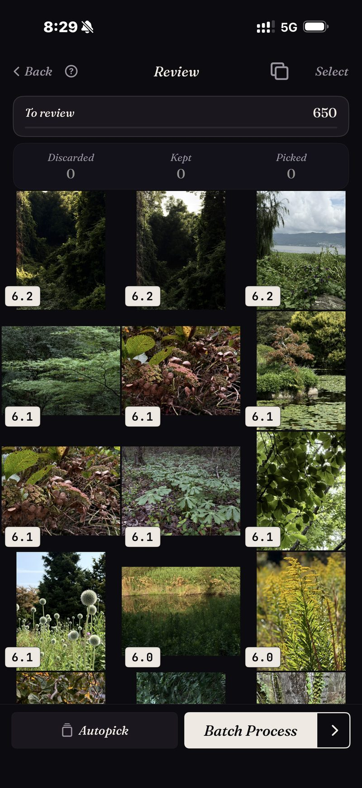

<section class="page-hero">
  

    
<a href="/pt/">SpectraSort</a>&#8250;Escolha o melhor do seu rolo da câmera

    <h1>Como escolher as melhores fotos do seu rolo da câmera.</h1>
    
Um método de trabalho para ir de milhares de fotos às poucas centenas que importam. A versão manual vem primeiro, depois a assistida. As duas funcionam; uma delas escala.

    

      <a class="cta" href="https://apps.apple.com/us/app/spectrasort-ai-photo-picker/id6757512134?ppid=5fd01708-3a73-4412-9bea-b411522af1f3"><svg viewBox="0 0 24 24" aria-hidden="true"><path d="M17.05 12.04c-.02-2.16 1.77-3.2 1.85-3.25-1.01-1.48-2.59-1.68-3.14-1.7-1.33-.13-2.61.78-3.29.78-.69 0-1.73-.76-2.85-.74-1.46.02-2.83.85-3.59 2.17-1.54 2.66-.39 6.59 1.1 8.75.73 1.06 1.6 2.24 2.73 2.2 1.1-.04 1.51-.71 2.84-.71 1.32 0 1.7.71 2.85.69 1.18-.02 1.92-1.07 2.64-2.13.84-1.22 1.18-2.42 1.2-2.48-.03-.01-2.3-.88-2.34-3.58zM14.95 5.6c.61-.74 1.02-1.77.9-2.8-.88.04-1.94.58-2.57 1.31-.56.65-1.06 1.7-.93 2.71.98.07 1.99-.5 2.6-1.22z"/></svg>
        Baixar na App Store
      </a>
      Grátis &middot; iPhone &middot; iOS 18.5+ &middot; Atualizado em 31 de outubro de 2026
    

    

      <b>100% no aparelho</b> — nada é enviado
      <b>Grátis</b> 5 ações por semana
      <b>Um único pagamento</b> — ações ilimitadas
    

  

</section>

<section class="slab">
  

    <h2>O método manual (sem app)</h2>
    <ol>
      <li><b>Trabalhe em recortes, nunca na biblioteca inteira.</b> Uma viagem, um mês, um evento. Um recorte concluído é progresso; uma biblioteca meio percorrida não é.</li>
      <li><b>Duas passadas.</b> Na primeira, corte as falhas óbvias rápido: desfoque, fotos acidentais, fotos ruins. Na segunda, escolha entre as parecidas que sobraram.</li>
      <li><b>Resolva os quase idênticos lado a lado.</b> Abra a rajada, compare, mantenha exatamente uma. Não deixe para depois; pilhas adiadas são como a biblioteca chegou a esse ponto.</li>
      <li><b>Marque as que ficam como Favoritas</b> (ou mova para um álbum) para que a decisão fique registrada em algum lugar.</li>
      <li><b>Conclua o recorte</b>, álbum preenchido e descartes resolvidos, antes de abrir o próximo.</li>
    </ol>
    
Isso funciona. Custa cerca de uma noite por mil fotos, que é o motivo real pelo qual a maioria das bibliotecas nunca fica pronta.

    <h3>Por que quebra em escala</h3>
    
Três problemas se somam. Nada é classificado, então cada foto exige o mesmo esforço de decisão. Os quase idênticos estão espalhados, então comparar significa caçar. E a fadiga de decisão chega muito antes do fim do recorte. O método é sólido; a economia não é.

  

</section>

<section id="the-assisted-version" class="slab rise">
  

    

      

        A versão assistida
        <h2>O mesmo método, pré-classificado.</h2>
        
O SpectraSort executa os mesmos cinco passos com as partes caras feitas antes de você olhar. Escolha um recorte, seja uma Cena, um intervalo de tempo ou uma busca por assunto, e ele volta <b>classificado</b>, com os quase idênticos já empilhados.

        
Depois revise: deslize para a direita para manter, para baixo para guardar, para a esquerda para descartar, ou deixe a Autoseleção arquivar tudo pela pontuação e apenas passe os olhos pelo resultado. As parecidas empilhadas ficam em uma roda só, então uma rajada leva uma decisão.

        
As Ações em lote concluem o recorte em uma tela: as escolhidas vão para um álbum ou para a folha de compartilhamento, o resto é limpo pelo diálogo do sistema.

      

      

        

          

        

      

    

  

</section>

<section id="the-method" class="slab rise">
  

    
O mesmo método, comprimido

    

      

Recorte

As Cenas e a Linha do tempo pré-cortam a biblioteca em pedaços termináveis.

      

Revisar

Classificado e empilhado, então você decide as vencedoras — não processa tudo.

      

Concluir

Um lote: álbum, favoritas, compartilhar ou limpar.

    

  

</section>

<section class="slab">
  

    <h2>Detalhes que mantêm tudo seguro</h2>
    
Um deslize para baixo apenas mantém a foto; recusar-se a escolher algo nunca a apaga. As exclusões acontecem só nas Ações em lote, passam pelo diálogo de confirmação do sistema e caem no álbum Excluídos recentemente do iOS — recuperáveis por 30 dias, ou limpas no momento em que você o esvazia. A classificação em si roda no Neural Engine do seu iPhone, então <a href="/pt/private-ai-photo-app/">nada é enviado</a>.

    

      
Onde ele não ajuda

      <ul>
        <li>A última palavra ainda é sua. A classificação julga cada quadro e a Autoseleção pode arquivar todos pela pontuação; o que acontece com eles de fato espera o seu toque.</li>
        <li>Só iPhone, iOS 18.5 ou posterior. Sem versão para iPad, Android ou computador.</li>
        <li>A primeira indexação de uma biblioteca grande leva algum tempo. Depois disso é automático — fotos novas são indexadas conforme aparecem, então você não espera de novo.</li>
        <li>Fotos apagadas passam pela lixeira do próprio iOS: vão para Excluídos recentemente, e o espaço volta no momento em que você esvazia esse álbum lá — ou automaticamente após 30 dias. Cada Apagar no SpectraSort mostra o espaço que libera antes de você confirmar.</li>
      </ul>
    

  

</section>

<section id="pricing" class="slab rise">
  

    

      Preços
      <h2>Cinco ações grátis por semana. Pague uma vez para ter ilimitado.</h2>
      
Cinco ações grátis por semana, sem conta e sem cartão de crédito. Um único pagamento libera ações ilimitadas. Sem assinatura, nunca. Feito por um desenvolvedor independente que usa o app todos os dias.

      <a class="cta" href="https://apps.apple.com/us/app/spectrasort-ai-photo-picker/id6757512134?ppid=5fd01708-3a73-4412-9bea-b411522af1f3"><svg viewBox="0 0 24 24" aria-hidden="true"><path d="M17.05 12.04c-.02-2.16 1.77-3.2 1.85-3.25-1.01-1.48-2.59-1.68-3.14-1.7-1.33-.13-2.61.78-3.29.78-.69 0-1.73-.76-2.85-.74-1.46.02-2.83.85-3.59 2.17-1.54 2.66-.39 6.59 1.1 8.75.73 1.06 1.6 2.24 2.73 2.2 1.1-.04 1.51-.71 2.84-.71 1.32 0 1.7.71 2.85.69 1.18-.02 1.92-1.07 2.64-2.13.84-1.22 1.18-2.42 1.2-2.48-.03-.01-2.3-.88-2.34-3.58zM14.95 5.6c.61-.74 1.02-1.77.9-2.8-.88.04-1.94.58-2.57 1.31-.56.65-1.06 1.7-.93 2.71.98.07 1.99-.5 2.6-1.22z"/></svg>
        Baixar na App Store
      </a>
    

  

</section>

<section id="faq" class="slab">
  

    

      Perguntas frequentes
      <h2>Perguntas sobre o método.</h2>
    

    

      

Com que frequência devo passar pelo meu rolo da câmera?

Pouco e sempre vence purgas heroicas. Um recorte por semana, talvez as fotos da semana passada ou uma viagem antiga, mantém a biblioteca decidida. A classificação é grátis e ilimitada, então o ritmo não custa nada.

      

O que devo fazer com as que ficam?

Registre a decisão: um álbum, Favoritas, ou compartilhe em algum lugar. As Ações em lote do SpectraSort fazem qualquer uma dessas em um passo, e os álbuns dele aparecem no Apple Photos. O <a href="/pt/photo-organizer-iphone/">guia de organização</a> cobre álbuns e Cenas em mais detalhe.

      

Como evito apagar algo de que vou me arrepender?

Há três redes de segurança. Recusar-se a escolher uma foto nunca a apaga. As exclusões exigem o diálogo de confirmação do sistema. E as fotos apagadas ficam recuperáveis em Excluídos recentemente por 30 dias.

      

Consigo fazer isso sem nenhum app?

Sim. O método manual no topo desta página não precisa de nada além do app Fotos e paciência. A versão com app existe porque a paciência costuma ser a parte que falta.

    

  

</section>

<section class="slab">
  

    

      Continue lendo
      

        <a href="/pt/find-best-photos-iphone/">Encontre suas melhores fotosTrês maneiras de trazer à tona as que ficam</a>
        <a href="/pt/photo-culling-iphone/">Seleção de fotos no iPhoneO fluxo completo</a>
        <a href="/pt/duplicate-photo-finder-iphone/">Localizador de fotos duplicadasResolva as repetidas primeiro</a>
      

    

  

</section>
