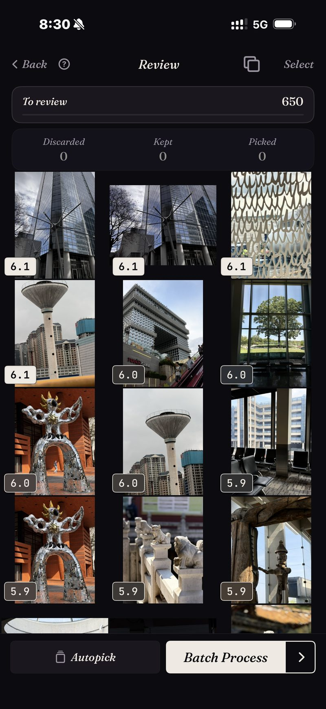

<section class="page-hero">
  

    
<a href="/pt/">SpectraSort</a>&#8250;Seleção de fotos no iPhone

    <h1>Seleção de fotos, no seu iPhone.</h1>
    
Fazer a seleção significa manter as melhores e deixar o resto ir. Isso costumava exigir um computador, uma importação e uma noite livre. O SpectraSort roda o fluxo inteiro no telefone onde suas fotos já estão, e classifica cada quadro antes de você deslizar o primeiro.

    

      <a class="cta" href="https://apps.apple.com/us/app/spectrasort-ai-photo-picker/id6757512134?ppid=5fd01708-3a73-4412-9bea-b411522af1f3"><svg viewBox="0 0 24 24" aria-hidden="true"><path d="M17.05 12.04c-.02-2.16 1.77-3.2 1.85-3.25-1.01-1.48-2.59-1.68-3.14-1.7-1.33-.13-2.61.78-3.29.78-.69 0-1.73-.76-2.85-.74-1.46.02-2.83.85-3.59 2.17-1.54 2.66-.39 6.59 1.1 8.75.73 1.06 1.6 2.24 2.73 2.2 1.1-.04 1.51-.71 2.84-.71 1.32 0 1.7.71 2.85.69 1.18-.02 1.92-1.07 2.64-2.13.84-1.22 1.18-2.42 1.2-2.48-.03-.01-2.3-.88-2.34-3.58zM14.95 5.6c.61-.74 1.02-1.77.9-2.8-.88.04-1.94.58-2.57 1.31-.56.65-1.06 1.7-.93 2.71.98.07 1.99-.5 2.6-1.22z"/></svg>
        Baixar na App Store
      </a>
      Grátis &middot; iPhone &middot; iOS 18.5+ &middot; Atualizado em 31 de outubro de 2026
    

    

      <b>100% no aparelho</b> — nada é enviado
      <b>Grátis</b> 5 ações por semana
      <b>Um único pagamento</b> — ações ilimitadas
    

  

</section>

<section class="slab">
  

    <h2>Por que a seleção existe</h2>
    
Fotógrafos fazem seleção porque um ensaio sempre produz mais quadros do que deveria entregar. Você tira 500 e entrega 40. Uma galeria tem a mesma matemática e nenhuma das ferramentas: uma viagem de duas semanas volta como 1.200 fotos, e o jeito nativo de lidar com elas é rolar a tela.

    
Ferramentas de computador resolveram isso para fotógrafos profissionais, com notas, comparações lado a lado e revisão na velocidade do teclado. Sua galeria vive em outro lugar. O SpectraSort reconstrói esse fluxo para o telefone e acrescenta algo que as ferramentas de computador nunca tiveram: os quadros aparecem <b>já classificados</b>.

  

</section>

<section id="ranked-before-you-review" class="slab rise">
  

    

      

        Classificados antes da revisão
        <h2>A revisão começa no topo da pilha.</h2>
        
Direcione uma classificação para uma viagem, uma cena ou uma busca, e cada quadro volta pontuado por nitidez, exposição e composição. Se você pedir, ele também pesa o quanto cada foto se parece com as que você costuma manter. Os quadros mais fortes estão no topo antes de você tomar uma única decisão.

        
A captura aqui é uma passada real: um recorte de 650 fotos de arquitetura, cada quadro pontuado, os mais fortes primeiro — e voltou em um instante, porque a biblioteca já estava indexada por classificações anteriores. A indexação acontece uma vez e depois se mantém atualizada: o app pega novas fotos conforme aparecem, até 100 por segundo em iPhones recentes.

        
Se você quiser outros critérios, o <b>Studio</b> tem sete eixos de qualidade, uma roda que troca correspondência de assunto por qualidade e perfis que você pode salvar.

      

      

        

          

        

      

    

  

</section>

<section id="bursts-and-retakes" class="slab">
  

    

      

        Sequências e repetições
        <h2>Dezenove tomadas de um momento custam uma decisão.</h2>
        
Fotos quase idênticas são o que torna a seleção manual lenta, porque cada tomada extra é mais uma comparação. O SpectraSort agrupa duplicatas, sequências e fotos parecidas em pilhas antes de a revisão começar.

        
Uma pilha fica em uma única roda. Você rola pelas tomadas sem sair da foto, mantém a que quer, e a pilha está resolvida. A captura é de uma seleção de duplicatas real: a mesma rosa, 19 tomadas, uma roda.

        
Depois vêm os deslizes: para a direita para escolher, para baixo para guardar, para a esquerda para descartar. Ou deixe a Autoseleção organizar o recorte inteiro por pontuação em um toque e apenas passe os olhos pelo resultado.

      

      

        

          

        

      

    

  

</section>

<section id="the-culling-loop" class="slab rise">
  

    
O ciclo da seleção

    

      

Recorte

Não comece pela biblioteca inteira. Cenas reúne viagens e temas sozinho, e a Linha do tempo vai de ano a mês a dia.

      

Deslize

Resultados classificados, semelhantes empilhados, três gestos. Autoseleção se você preferir passar os olhos a deslizar.

      

Concluir

Ações em lote colocam suas escolhas em um álbum ou na folha de compartilhamento e limpam o resto, atrás do diálogo de confirmação do sistema.

    

  

</section>

<section class="slab">
  

    <h2>As letras miúdas</h2>
    
Indexação, pontuação e o perfil de gosto rodam no Neural Engine do iPhone. Nada é enviado e não há conta. <a href="/pt/private-ai-photo-app/">Mais sobre como isso funciona →</a>

    

      
Onde ele não ajuda

      <ul>
        <li>Sua atenção continua sendo a parte lenta. A classificação já faz o julgamento — vencedoras no topo, e a Autoseleção pode organizar a fila inteira por pontuação em um toque —, mas passar os olhos pelo resultado ainda é com você, e nada toca sua biblioteca até você agir.</li>
        <li>Só iPhone, iOS 18.5 ou posterior. Sem versão para iPad, Android ou desktop.</li>
        <li>O primeiro índice de uma biblioteca grande leva algum tempo. Depois disso é automático — novas fotos são indexadas conforme aparecem, então você não espera de novo.</li>
        <li>As fotos apagadas passam pela lixeira do próprio iOS: elas vão para Excluídos recentemente, e o espaço volta no momento em que você esvazia esse álbum lá — ou automaticamente depois de 30 dias. Cada exclusão mostra o espaço que libera antes de você confirmar.</li>
      </ul>
    

  

</section>

<section id="pricing" class="slab rise">
  

    

      Preços
      <h2>Cinco ações grátis por semana. Pague uma vez para ter ilimitado.</h2>
      
Cinco ações grátis por semana, sem conta e sem cartão de crédito. Pague uma vez para ter ações ilimitadas. Sem assinatura, nunca. Feito por um desenvolvedor independente que usa o app todos os dias.

      <a class="cta" href="https://apps.apple.com/us/app/spectrasort-ai-photo-picker/id6757512134?ppid=5fd01708-3a73-4412-9bea-b411522af1f3"><svg viewBox="0 0 24 24" aria-hidden="true"><path d="M17.05 12.04c-.02-2.16 1.77-3.2 1.85-3.25-1.01-1.48-2.59-1.68-3.14-1.7-1.33-.13-2.61.78-3.29.78-.69 0-1.73-.76-2.85-.74-1.46.02-2.83.85-3.59 2.17-1.54 2.66-.39 6.59 1.1 8.75.73 1.06 1.6 2.24 2.73 2.2 1.1-.04 1.51-.71 2.84-.71 1.32 0 1.7.71 2.85.69 1.18-.02 1.92-1.07 2.64-2.13.84-1.22 1.18-2.42 1.2-2.48-.03-.01-2.3-.88-2.34-3.58zM14.95 5.6c.61-.74 1.02-1.77.9-2.8-.88.04-1.94.58-2.57 1.31-.56.65-1.06 1.7-.93 2.71.98.07 1.99-.5 2.6-1.22z"/></svg>
        Baixar na App Store
      </a>
    

  

</section>

<section id="faq" class="slab">
  

    

      FAQ
      <h2>Perguntas sobre seleção de fotos.</h2>
    

    

      

Quanto tempo leva para fazer a seleção de milhares de fotos?

As classificações voltam em um instante, porque rodam sobre um índice que o app cria uma vez e depois mantém atualizado automaticamente — novas fotos são detectadas conforme aparecem. O próprio índice inicial avança a até 100 fotos por segundo em iPhones recentes. O seu tempo de revisão é o custo real, e a classificação e o empilhamento são o que o reduz: você gasta sua atenção nas prováveis vencedoras, e cada pilha leva um gesto.

      

Ele consegue fazer a seleção automaticamente?

Sim, em grande parte. A classificação já julga cada quadro, e a Autoseleção organiza a fila inteira por essas pontuações em um toque: as melhores para Mantidas, as do meio para Guardadas, as mais fracas para Descartadas. Você passa os olhos pelo resultado, e nada é aplicado à sua biblioteca até você tocar em uma ação.

      

Fazer a seleção é só apagar fotos?

Não. Fazer a seleção é decidir; apagar é um passo final opcional. Ações em lote podem igualmente salvar suas escolhas em um álbum ou na folha de compartilhamento e deixar todo o resto em paz. Veja <a href="/pt/ai-photo-picker-vs-photo-culling/">seletor vs seleção de fotos</a> para mais sobre a distinção.

      

Apagar as fotos selecionadas libera espaço imediatamente?

Tão rápido quanto você quiser. As fotos apagadas vão para o álbum Excluídos recentemente do iOS; esvazie-o e o espaço volta imediatamente, ou deixe como está e o iOS limpa depois de 30 dias. O SpectraSort mostra o espaço que a exclusão libera antes de você confirmar.

      

Quanto custa?

Cinco ações por semana são grátis, para sempre. O Premium é um único pagamento por ações ilimitadas e todos os controles do Studio. Sem assinatura.

    

  

</section>

<section class="slab">
  

    

      Continue lendo
      

        <a href="/pt/ai-photo-picker-vs-photo-culling/">Seletor vs seleção de fotosQual dos dois você realmente precisa</a>
        <a href="/pt/duplicate-photo-finder-iphone/">Localizador de fotos duplicadasSequências e parecidas, empilhadas</a>
        <a href="/pt/ai-photo-picker-iphone/">Seletor de fotos com IA para iPhoneO que um seletor realmente faz</a>
      

    

  

</section>
