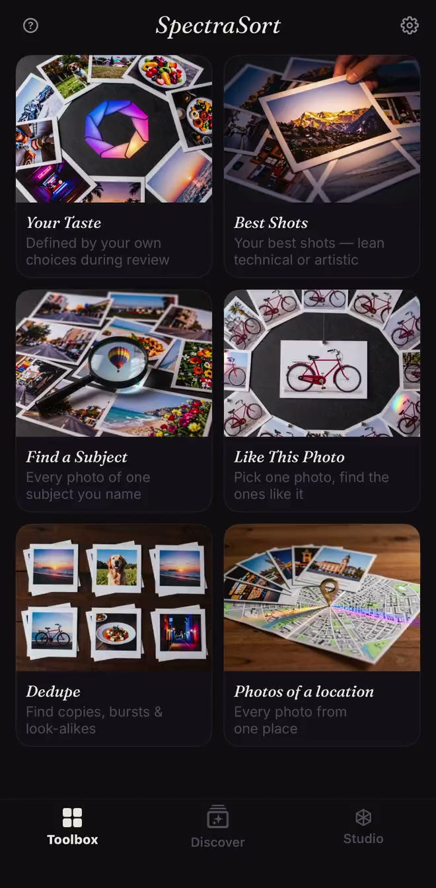
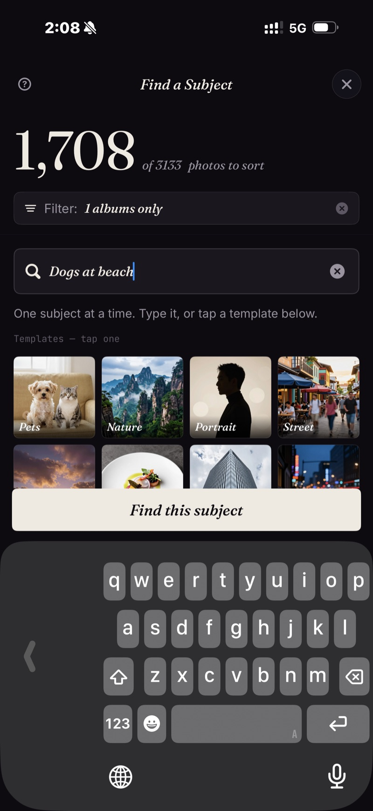

<section class="page-hero">
  

    
<a href="/pt/">SpectraSort</a>&#8250;Imprensa

    <h1>Kit de imprensa.</h1>
    
Tudo o que um jornalista precisa para checar o SpectraSort: os fatos, as capturas de tela e um contato. Atualizado em 31 de outubro de 2026, com a versão 3.2.

    

      <a class="cta" href="/press/spectrasort-press-kit.zip">Baixar o kit de imprensa</a>
      ZIP &middot; ícone, capturas de tela, ficha técnica
    

  

</section>

<section class="slab">
  

    

      Os fatos
      <h2>O que o SpectraSort é, em uma tabela.</h2>
      
O SpectraSort é um seletor de fotos com IA no próprio iPhone que classifica sua galeria por qualidade e pelo seu próprio gosto. Ele também faz seleção, remove duplicatas e limpa a galeria. Um único pagamento, sem assinatura.

    

    

      <table class="cmp">
        <tbody>
          <tr><th>Nome</th><td>SpectraSort</td></tr>
          <tr><th>O que é</th><td>Um seletor de fotos com IA no próprio iPhone. Ele classifica uma galeria por qualidade e por um perfil de gosto aprendido com o que o usuário mantém e descarta. Ele também faz seleção, remove duplicatas e limpa a galeria.</td></tr>
          <tr><th>Plataforma</th><td>iPhone, iOS 18.5 ou posterior. Sem versão para iPad, Mac, Android ou web.</td></tr>
          <tr><th>Idiomas</th><td>Inglês, francês, alemão, italiano, espanhol e português (Brasil). A edição da China continental é 光谱挑片.</td></tr>
          <tr><th>Preço</th><td>Download grátis. Cinco ações por semana são grátis para sempre; um único pagamento libera ações ilimitadas e o Studio. Sem assinatura, sem conta, sem cartão de crédito para começar.</td></tr>
          <tr><th>Privacidade</th><td>100% no aparelho. A busca, a classificação e o perfil de gosto rodam no Neural Engine do iPhone. Nenhum envio de fotos, nenhuma conta, nenhum servidor do SpectraSort.</td></tr>
          <tr><th>Velocidade</th><td>Até 100 fotos por segundo em iPhones recentes. O índice é criado na primeira classificação e depois mantido atualizado automaticamente.</td></tr>
          <tr><th>Ferramentas</th><td>Seis ferramentas de um toque: Seu gosto, Melhores fotos, Encontrar um assunto, Como esta foto, Duplicatas, Fotos de um lugar. O Studio adiciona sete eixos de qualidade, até três assuntos e perfis salvos. A busca digitada de Encontrar um assunto funciona em inglês por enquanto; os modelos funcionam em qualquer idioma.</td></tr>
          <tr><th>Primeiro lançamento</th><td>Janeiro de 2026. A versão 3.2 chegou em novembro de 2026.</td></tr>
          <tr><th>Criador</th><td>Mike Lu, desenvolvedor independente.</td></tr>
          <tr><th>Contato</th><td><a href="mailto:spectrasortapp@gmail.com">spectrasortapp@gmail.com</a></td></tr>
        </tbody>
      </table>
    

  

</section>

<section class="slab rise">
  

    

      Novo na 3.2
      <h2>Cinco idiomas. Menos papel.</h2>
      
A versão 3.2 adiciona francês, alemão, italiano, espanhol e português (Brasil) à interface inteira e à página da App Store. Ela também adiciona um interruptor <b>Documentos e recibos</b> em Filtros → Excluir: capturas de tela, formulários e fotos de papel ficam de lado antes de uma classificação, para que a revisão mostre as fotos que o usuário quis manter.

      
O compartilhamento foi corrigido na mesma versão: Instagram, WeChat e Xiaohongshu agora aceitam a foto, na orientação certa, em compartilhamentos de uma ou de várias fotos. <a href="/pt/changelog/">As notas completas da 3.2 →</a>

    

  

</section>

<section class="slab">
  

    

      O criador
      <h2>Feito por Mike Lu.</h2>
      
Mike Lu é o desenvolvedor independente por trás do SpectraSort. Ele criou o app em torno de uma pergunta que a maioria das ferramentas de fotos ignora: não “esta é uma boa foto?”, mas “você manteria esta foto?”. O app aprende com as decisões de manter e descartar que uma pessoa já toma, e então classifica a biblioteca do mesmo jeito.

      
O SpectraSort foi lançado em janeiro de 2026. É feito sem servidor, sem conta e sem assinatura — o app e o modelo de negócio são ambos deliberadamente pequenos.

    

  

</section>

<section class="slab rise">
  

    

      Capturas de tela
      <h2>Três capturas reais.</h2>
      
Os arquivos em tamanho real estão no kit de imprensa. O app roda no aparelho; as capturas vêm de uma biblioteca real.

      

        <figure><figcaption>A caixa de ferramentas: seis ferramentas de um toque, com Seu gosto no topo.</figcaption></figure>
        <figure><figcaption>Encontrar um assunto: digite uma frase e receba as correspondências classificadas, as melhores primeiro.</figcaption></figure>
        <figure><figcaption>Ações em lote: as escolhidas vão para um álbum, as favoritas ganham estrela, o resto é limpo.</figcaption></figure>
      

      

        <a class="cta" href="/press/spectrasort-press-kit.zip">Baixar o kit de imprensa</a>
        ZIP &middot; ícone, 3 capturas de tela, ficha técnica
      

    

  

</section>

<section class="slab">
  

    Ângulos que valem checar
    <h2>Três histórias dentro do app.</h2>
    <ul>
      <li><b>O utilitário antiassinatura.</b> Um único pagamento, sem assinatura, sem conta, sem servidor. Um app de fotos que não precisa de nuvem.</li>
      <li><b>IA no aparelho sem exigir Apple Intelligence.</b> A classificação, a busca e o perfil de gosto rodam no Neural Engine, offline, no iOS 18.5 ou posterior.</li>
      <li><b>Cinco idiomas de uma vez.</b> A versão 3.2 traduz a interface inteira e a página da App Store para francês, alemão, italiano, espanhol e português (Brasil).</li>
    </ul>
    

      
O que não vamos afirmar

      <ul>
        <li>Nenhuma afirmação de “melhor que o Fotos da Apple”. Eles são feitos para trabalhos diferentes: o Fotos da Apple navega e armazena; o SpectraSort escolhe e classifica.</li>
        <li>Nenhum percentual de precisão para o classificador de documentos. É um filtro, não uma promessa.</li>
        <li>Sem nuvem, sem conta, sem treinamento com as fotos do usuário — esses são fatos de arquitetura, não frases de marketing.</li>
      </ul>
    

  

</section>
