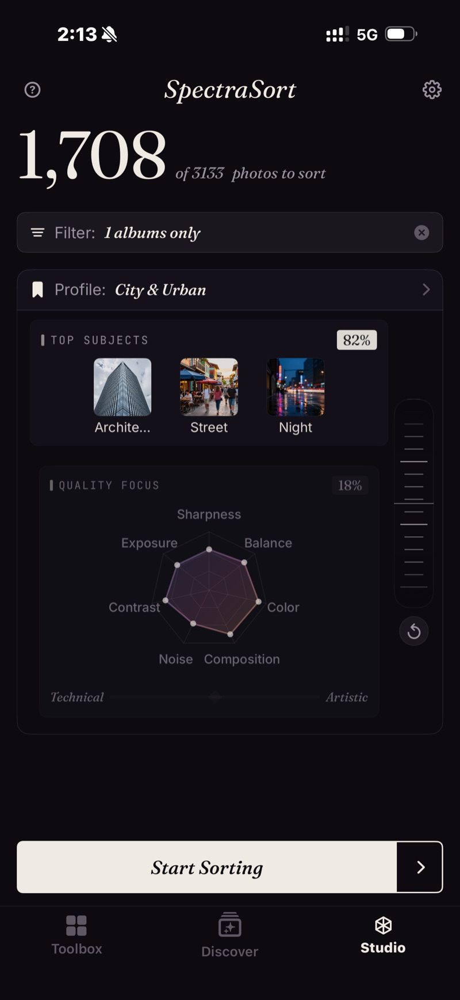

<section class="page-hero">
  

    
<a href="/pt/">SpectraSort</a>&#8250;Studio

    <h1>Studio. Quando você quer os controles.</h1>
    
As ferramentas de um toque decidem o que “melhor” significa. O Studio entrega essa decisão para você: quais dos sete eixos de qualidade contam, quais assuntos importam e quanto uma correspondência de assunto deve pesar diante de um quadro nítido. Salve como um perfil e cada classificação depois disso é sua.

    

      <a class="cta" href="https://apps.apple.com/us/app/spectrasort-ai-photo-picker/id6757512134?ppid=5fd01708-3a73-4412-9bea-b411522af1f3"><svg viewBox="0 0 24 24" aria-hidden="true"><path d="M17.05 12.04c-.02-2.16 1.77-3.2 1.85-3.25-1.01-1.48-2.59-1.68-3.14-1.7-1.33-.13-2.61.78-3.29.78-.69 0-1.73-.76-2.85-.74-1.46.02-2.83.85-3.59 2.17-1.54 2.66-.39 6.59 1.1 8.75.73 1.06 1.6 2.24 2.73 2.2 1.1-.04 1.51-.71 2.84-.71 1.32 0 1.7.71 2.85.69 1.18-.02 1.92-1.07 2.64-2.13.84-1.22 1.18-2.42 1.2-2.48-.03-.01-2.3-.88-2.34-3.58zM14.95 5.6c.61-.74 1.02-1.77.9-2.8-.88.04-1.94.58-2.57 1.31-.56.65-1.06 1.7-.93 2.71.98.07 1.99-.5 2.6-1.22z"/></svg>
        Baixar na App Store
      </a>
      Grátis &middot; iPhone &middot; iOS 18.5+
    

    

      <b>Sete</b> eixos de qualidade
      <b>Até três</b> assuntos por classificação
      <b>Incluído</b> no Premium — um único pagamento
    

  

</section>

<section id="quality-focus" class="slab">
  

    

      

        Foco em qualidade — sete eixos
        <h2>Nitidez para vida selvagem. Composição para fotografia de rua.</h2>
        
Nitidez, exposição, contraste e ruído do lado técnico. Composição, harmonia de cores e equilíbrio visual do lado artístico. Arraste qualquer ponto do radar para dar peso a ele, ou mova o controle Técnico/Artístico para deslocar os sete juntos.

      

      

        

          

          
Um perfil salvo, Cidade e urbano: três assuntos a 82%, qualidade a 18%, contraste e cor em destaque.

        

      

    

  

</section>

<section id="balance-wheel" class="slab rise">
  

    

      

        Assuntos e a roda de equilíbrio
        <h2>Correspondência de assunto contra qualidade.</h2>
        
Até três assuntos em uma classificação — predefinidos ou qualquer coisa que você digitar. A roda decide quanto uma correspondência deve contar. Gire-a para Assuntos e uma boa foto da coisa certa vence. Gire-a para Qualidade e o quadro mais nítido e mais bem composto vence, mostre ele o que mostrar.

      

      

        

          

            <video class="screen-loop" src="/video/web-studio-wheel.mp4"
                   poster="/images/shots/studio-wheel-poster.jpg"
                   loop muted playsinline preload="none"
                   width="920" height="852"
                   aria-label="A roda de equilíbrio do Studio girando para os dois lados: o peso de Assuntos principais cai de 75% para 25% enquanto o radar de Foco em qualidade cresce de 25% para 75%, e depois volta"></video>
          

        

      

    

  

</section>

<section id="profiles" class="slab">
  

    Perfis
    <h2>Configure uma vez. Reuse sempre.</h2>
    
Salve qualquer configuração com um nome próprio e alterne entre elas na tela inicial. Comece pelo Seu gosto e ajuste — o app cria uma cópia Personalizada, então o perfil aprendido permanece intacto e continua aprendendo.

    
O perfil que você escolhe comanda cada classificação, inclusive Duplicatas e Fotos de um lugar, então a escolhida de uma pilha ou a melhor foto de uma cidade é julgada pelos seus critérios. A grade de Revisão nomeia o perfil que fez a classificação.

  

</section>

<section id="pricing" class="slab rise">
  

    

      Preços
      <h2>Incluído no Premium — um único pagamento.</h2>
      
As seis ferramentas de um toque são grátis, com cinco ações grátis por semana. O Studio faz parte do Premium: classificações personalizadas e perfis salvos, além de ações ilimitadas — um único pagamento, sem assinatura.

      <a class="cta" href="https://apps.apple.com/us/app/spectrasort-ai-photo-picker/id6757512134?ppid=5fd01708-3a73-4412-9bea-b411522af1f3"><svg viewBox="0 0 24 24" aria-hidden="true"><path d="M17.05 12.04c-.02-2.16 1.77-3.2 1.85-3.25-1.01-1.48-2.59-1.68-3.14-1.7-1.33-.13-2.61.78-3.29.78-.69 0-1.73-.76-2.85-.74-1.46.02-2.83.85-3.59 2.17-1.54 2.66-.39 6.59 1.1 8.75.73 1.06 1.6 2.24 2.73 2.2 1.1-.04 1.51-.71 2.84-.71 1.32 0 1.7.71 2.85.69 1.18-.02 1.92-1.07 2.64-2.13.84-1.22 1.18-2.42 1.2-2.48-.03-.01-2.3-.88-2.34-3.58zM14.95 5.6c.61-.74 1.02-1.77.9-2.8-.88.04-1.94.58-2.57 1.31-.56.65-1.06 1.7-.93 2.71.98.07 1.99-.5 2.6-1.22z"/></svg>
        Baixar na App Store
      </a>
    

  

</section>

<section id="faq" class="slab">
  

    

      Perguntas frequentes
      <h2>Perguntas sobre o Studio.</h2>
    

    

      

Para quem é o Studio?

Para quem fotografa muito e faz a seleção no telefone — trabalhos de evento e viagem com nitidez e exposição em primeiro lugar, ruído ignorado no conjunto noturno. Para quem tem um estilo próprio que os padrões não capturam: cor e composição à frente, um ou dois assuntos fixados. E para qualquer pessoa que simplesmente discorda das Melhores fotos e quer o controle ajustado do seu jeito, uma vez.

      

Qual é a diferença entre o Studio e as Melhores fotos?

As Melhores fotos são um controle só: técnico de um lado, artístico do outro. O Studio divide isso em sete eixos que você pondera individualmente, adiciona até três assuntos e a roda de equilíbrio, e deixa você salvar o resultado como um perfil.

      

Personalizar altera meu perfil Seu gosto?

Não. Personalizar cria uma cópia Personalizada; o perfil aprendido permanece intacto e continua aprendendo. Você pode redefini-lo ou recriá-lo nos Ajustes quando quiser.

      

Dá para classificar por assunto e qualidade na mesma classificação?

Sim — é para isso que serve a roda de equilíbrio. Gire-a para Assuntos e uma boa foto da coisa certa vence; gire-a para Qualidade e o quadro mais nítido e mais bem composto vence, mostre ele o que mostrar.

      

Um perfil do Studio vale para Duplicatas e classificações por lugar?

Sim. O perfil que você seleciona comanda cada classificação, então a escolhida de uma pilha ou a melhor foto de uma cidade é julgada pelos seus critérios. A grade de Revisão nomeia o perfil que fez a classificação.

      

O Studio é grátis?

O Studio faz parte do Premium — um único pagamento, sem assinatura. Você pode abri-lo no plano grátis e olhar; classificações personalizadas e perfis salvos exigem Premium. As seis ferramentas de um toque continuam grátis, com cinco ações grátis por semana.

    

  

</section>

<section class="slab">
  

    

      Continue lendo
      

        <a href="/pt/photo-culling-iphone/">Seleção de fotos no iPhoneClassifique primeiro, deslize depois</a>
        <a href="/pt/features/">Todos os recursosFerramentas, controles e limites em uma página</a>
        <a href="/pt/find-best-photos-iphone/">Encontre suas melhores fotosPor frase, por exemplo, por gosto</a>
      

    

  

</section>
