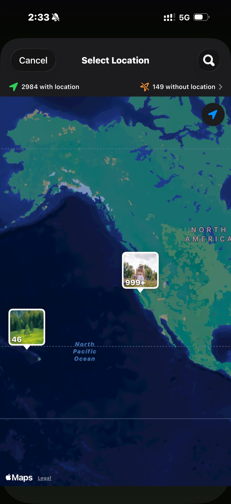

<section class="page-hero">
  

    
<a href="/pt/">SpectraSort</a>&#8250;Fotos de viagem

    <h1>1.200 fotos de viagem → o álbum que vale mostrar.</h1>
    
Uma viagem de duas semanas volta para casa como mil fotos e uma promessa de “depois eu vejo”. O SpectraSort faz o “ver”: a viagem já está reunida em uma Cena, cada foto volta classificada, os onze pores do sol ficam em uma pilha só, e suas escolhas caem em um álbum — no voo de volta.

    

      <a class="cta" href="https://apps.apple.com/us/app/spectrasort-ai-photo-picker/id6757512134?ppid=5fd01708-3a73-4412-9bea-b411522af1f3"><svg viewBox="0 0 24 24" aria-hidden="true"><path d="M17.05 12.04c-.02-2.16 1.77-3.2 1.85-3.25-1.01-1.48-2.59-1.68-3.14-1.7-1.33-.13-2.61.78-3.29.78-.69 0-1.73-.76-2.85-.74-1.46.02-2.83.85-3.59 2.17-1.54 2.66-.39 6.59 1.1 8.75.73 1.06 1.6 2.24 2.73 2.2 1.1-.04 1.51-.71 2.84-.71 1.32 0 1.7.71 2.85.69 1.18-.02 1.92-1.07 2.64-2.13.84-1.22 1.18-2.42 1.2-2.48-.03-.01-2.3-.88-2.34-3.58zM14.95 5.6c.61-.74 1.02-1.77.9-2.8-.88.04-1.94.58-2.57 1.31-.56.65-1.06 1.7-.93 2.71.98.07 1.99-.5 2.6-1.22z"/></svg>
        Baixar na App Store
      </a>
      Grátis &middot; iPhone &middot; iOS 18.5+ &middot; Atualizado em 31 de outubro de 2026
    

    

      <b>100% no aparelho</b> — nada é enviado
      <b>Grátis</b> 5 ações por semana
      <b>Um único pagamento</b> — ações ilimitadas
    

  

</section>

<section id="find-the-trip" class="slab">
  

    

      

        Encontre a viagem
        <h2>Ela já é uma Cena.</h2>
        
Abra o Explorar e a viagem está lá, reunida por tempo e lugar — sem precisar de álbum. Ou toque em Fotos de um lugar e marque a cidade: cada foto tirada ali, nada mais.

        
Fotos de anos atrás também contam. O pino encontra a viagem anterior que você esqueceu que fotografou.

      

      

        

          

        

      

    

  

</section>

<section id="rank" class="slab rise">
  

    

      

        Classificar
        <h2>As que ficam sobem antes de você deslizar.</h2>
        
Melhores fotos põem no topo os quadros mais nítidos e mais bem compostos. Seu gosto, quando já conhece você, põe no topo as que você teria escolhido. De um jeito ou de outro, a revisão começa com as vencedoras, não com a foto 1 de 1.200.

        
Incline o controle para o artístico nos pores do sol e para o técnico nas fotos de grupo.

      

      

        

          

        

      

    

  

</section>

<section id="retakes" class="slab">
  

    

      

        Repetidas
        <h2>11 fotos do mesmo pôr do sol → um deslize.</h2>
        
Pores do sol, fotos de grupo, a vista do hotel: cada momento que você fotografou seis vezes chega como uma pilha só, com a mais nítida marcada. Gire a roda, mantenha uma, siga em frente.

      

      

        

          

        

      

    

  

</section>

<section id="finish" class="slab rise">
  

    

      

        Concluir
        <h2>Álbum feito. O resto limpo.</h2>
        
As Ações em lote colocam as escolhidas em um álbum que aparece no Apple Photos — e na folha de compartilhamento, para o grupo. Mantenha o resto, ou limpe pelo diálogo do sistema para Excluídos recentemente.

      

      

        

          

        

      

    

  

</section>

<section id="the-trip-in-three-steps" class="slab">
  

    
A viagem, em três passos

    

      

Encontrar

A Cena, o pino no mapa, ou os meses na Linha do tempo.

      

Deslizar

Resultados classificados, repetidas empilhadas, três gestos. Autoseleção se você preferir passar os olhos a deslizar.

      

Arquivar

Um álbum, a folha de compartilhamento, e o resto limpo — uma tela.

    

  

</section>

<section class="slab rise">
  

    <h2>A letra miúda</h2>
    
As Cenas, as pontuações e o perfil de gosto rodam todos no Neural Engine do iPhone. Nada é enviado e não há conta. <a href="/pt/private-ai-photo-app/">Mais sobre como isso funciona →</a>

    

      
Onde ele não ajuda

      <ul>
        <li>Só iPhone, iOS 18.5 ou posterior. Sem versão para iPad, Android ou computador.</li>
        <li>A primeira indexação de uma biblioteca grande leva algum tempo. Depois disso é automático — fotos novas são indexadas conforme aparecem, então você não espera de novo.</li>
        <li>A busca de lugares por nome usa o Apple Maps e precisa de conexão. As Cenas, a Linha do tempo e a classificação em si funcionam offline.</li>
        <li>Fotos apagadas passam pela lixeira do próprio iOS: vão para Excluídos recentemente, e o espaço volta no momento em que você esvazia esse álbum lá — ou automaticamente após 30 dias.</li>
      </ul>
    

  

</section>

<section id="pricing" class="slab">
  

    

      Preços
      <h2>Cinco ações grátis por semana. Pague uma vez para ter ilimitado.</h2>
      
Cinco ações grátis por semana, sem conta e sem cartão de crédito. Um único pagamento libera ações ilimitadas. Sem assinatura, nunca. Feito por um desenvolvedor independente que usa o app todos os dias.

      <a class="cta" href="https://apps.apple.com/us/app/spectrasort-ai-photo-picker/id6757512134?ppid=5fd01708-3a73-4412-9bea-b411522af1f3"><svg viewBox="0 0 24 24" aria-hidden="true"><path d="M17.05 12.04c-.02-2.16 1.77-3.2 1.85-3.25-1.01-1.48-2.59-1.68-3.14-1.7-1.33-.13-2.61.78-3.29.78-.69 0-1.73-.76-2.85-.74-1.46.02-2.83.85-3.59 2.17-1.54 2.66-.39 6.59 1.1 8.75.73 1.06 1.6 2.24 2.73 2.2 1.1-.04 1.51-.71 2.84-.71 1.32 0 1.7.71 2.85.69 1.18-.02 1.92-1.07 2.64-2.13.84-1.22 1.18-2.42 1.2-2.48-.03-.01-2.3-.88-2.34-3.58zM14.95 5.6c.61-.74 1.02-1.77.9-2.8-.88.04-1.94.58-2.57 1.31-.56.65-1.06 1.7-.93 2.71.98.07 1.99-.5 2.6-1.22z"/></svg>
        Baixar na App Store
      </a>
    

  

</section>

<section id="faq" class="slab rise">
  

    

      Perguntas frequentes
      <h2>Perguntas sobre viagens.</h2>
    

    

      

Quanto tempo leva para passar pelas fotos de uma viagem?

A classificação em si leva um instante depois que a biblioteca está indexada — a primeira indexação roda a até 100 fotos por segundo em iPhones recentes e acontece uma vez. Seus deslizes são o tempo real, e classificação mais empilhamento os reduzem: as vencedoras ficam no topo e cada repetida custa um gesto.

      

O que acontece com as fotos que eu não escolho?

Nada, a menos que você diga. Guardar é uma caixa, não um apagar. O que você limpar passa pelo diálogo do sistema para Excluídos recentemente, onde fica por 30 dias.

      

Consigo fazer isso no avião, offline?

Classificar, pontuar e revisar rodam inteiramente no telefone, então sim. Buscar um lugar por nome usa o Apple Maps e precisa de conexão; abrir a viagem pelas Cenas ou pela Linha do tempo, não.

      

Consigo classificar várias viagens de uma vez?

Na Linha do tempo, marque quantos meses quiser e classifique todos juntos. Ou filtre por um intervalo de datas personalizado que cubra o verão inteiro.

      

Ele envia minhas fotos da viagem?

Não. As Cenas, as pontuações e o perfil de gosto são calculados e guardados no seu iPhone. Sem envios, sem conta.

    

  

</section>

<section class="slab">
  

    

      Continue lendo
      

        <a href="/pt/photo-culling-iphone/">Seleção de fotos no iPhoneO fluxo completo de manter ou limpar</a>
        <a href="/pt/photo-organizer-iphone/">Organizador de fotos com IAAgrupadas, classificadas, arquivadas</a>
        <a href="/pt/duplicate-photo-finder-iphone/">Localizador de fotos duplicadasRajadas e parecidas, empilhadas</a>
      

    

  

</section>
